# Audiment — Platform Training Guide

> This is the complete, role-by-role training reference for Audiment. It covers every page, every UI element, and every workflow available in the platform, derived directly from the codebase.


---


## Table of Contents

1. [Roles & Access](#roles--access)
2. [Admin Dashboard](#admin-dashboard)
3. [Manager Dashboard](#manager-dashboard)
4. [Auditor Dashboard](#auditor-dashboard)
5. [Notifications](#notifications)
6. [Screenshots Directory & Folder Structure](#screenshots-directory--folder-structure)
7. [AI Video Generator — Step-to-Screenshot Mapping Index](#ai-video-generator--step-to-screenshot-mapping-index)
8. [Step-by-Step Workflow Tutorials](#step-by-step-workflow-tutorials)


---


## Roles & Access

Audiment has three user roles. Each role has a different dashboard and a scoped view of data.

| Role | Dashboard URL | Access Level |
|---|---|---|
| **Admin** | `/dashboard/admin` | Full org-wide access. Manages all locations, users, templates, audits, reports, and flashmob. |
| **Manager** | `/dashboard/manager` | Manages their assigned locations. Assigns auditors, resolves CAPAs, views reports. |
| **Auditor** | `/dashboard/auditor` | Receives and executes assigned audits. Submits evidence and flashmob recordings. |


---


## Admin Dashboard

### 1. Overview / Home

**URL:** `/dashboard/admin`

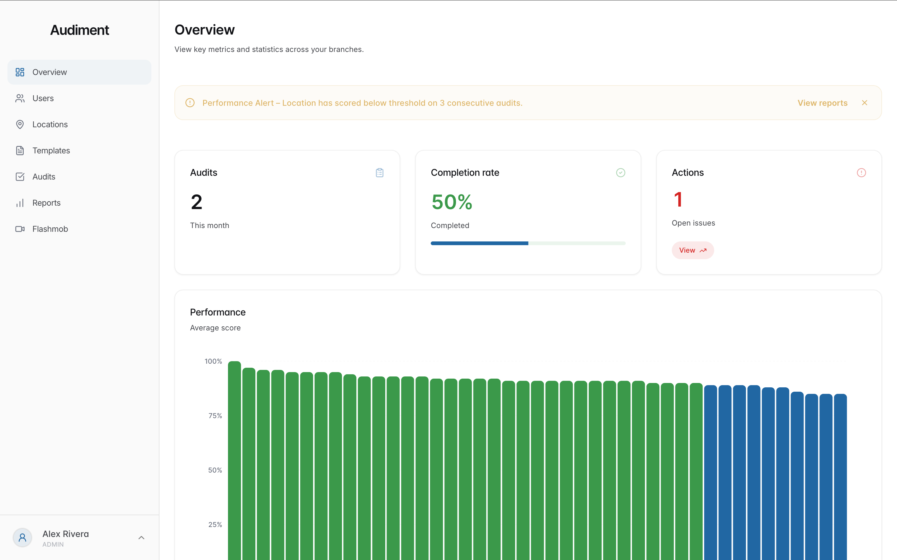


**What you see:**
- **Page heading:** "Overview" with the subtext "View key metrics and statistics across your branches."
- **Trend Alert Banners** (if any exist): Yellow warning banners at the top showing locations that have scored below threshold on 3 consecutive audits. Each banner has a "View Reports" link and a dismiss (x) button.
- **KPI Cards (3 across):**
  - **Audits** — Total audit count for the current calendar month
  - **Completion Rate** — Percentage of audits completed this month, with a thin progress bar
  - **Actions** — Count of currently open corrective actions; this card is clickable and links to the CAPA page
- **Location Performance Bar Chart** — A bar chart showing each location's average audit score across all completed audits. Bars are color-coded: green (>= 90%), blue (>= 70%), red (< 70%).

**How it updates:** All four data sets (locations, audits, corrective actions, trend alerts) update in real time using Firebase listeners.


---


### 2. Audits

**URL:** `/dashboard/admin/audits`

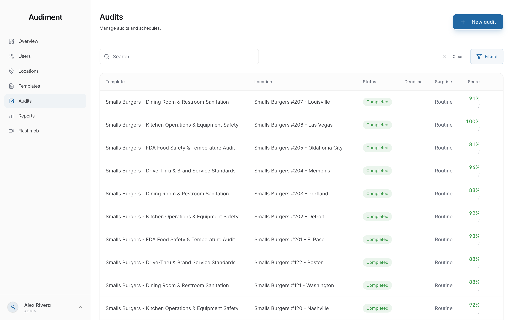
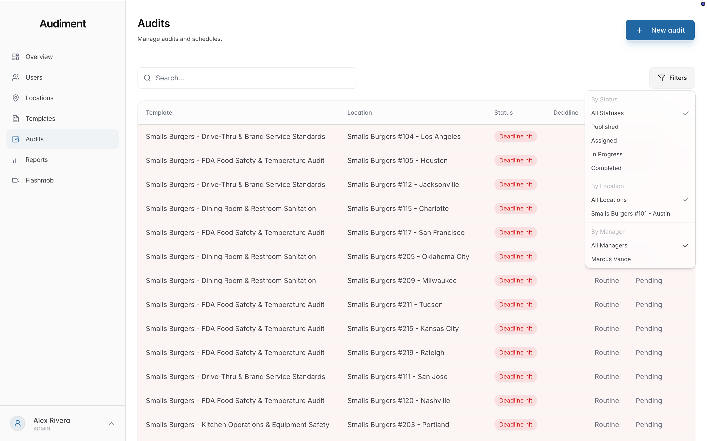
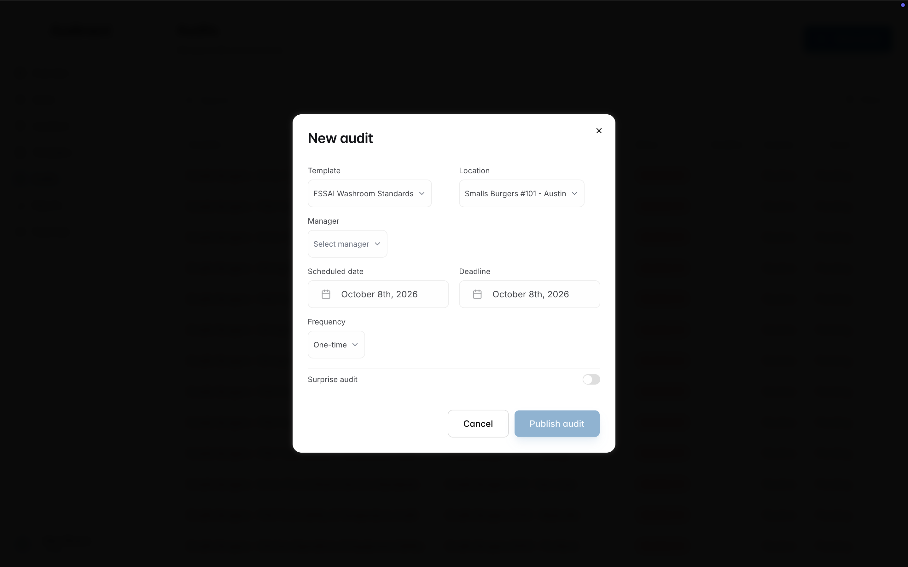
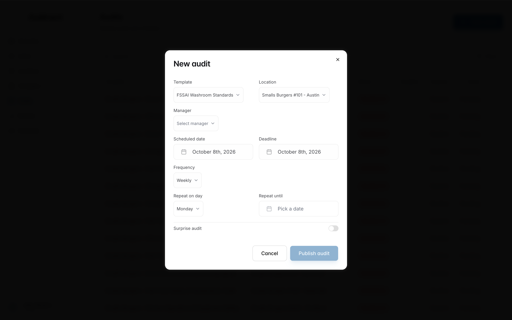

**What you see:**
- **Page heading:** "Audits" with the subtext "Manage audits and schedules."
- **"New Audit" button** (top right): Opens the audit creation dialog.
- **Search bar**: Searches across template title, location name, status, and assigned manager name.
- **Filter dropdowns** (4 filters): Status, Location, Manager — any combination can be active simultaneously.
- **Audits table** with columns: Template Title, Location, Manager, Scheduled Date, Deadline, Status, Actions (Edit icon).
- **Status badges:** Scheduled (gray), Pending (orange), In Progress (blue), Deadline Hit (red), Completed (green), Missed (red).
- **Sort order:** Incomplete audits first by scheduledDate ascending. Completed audits last by completedAt descending.

**New Audit Dialog — Fields:**

| Field | Options | Notes |
|---|---|---|
| Template | Dropdown of all active org templates | Required |
| Location | Dropdown of all active org locations | Required; selecting a location auto-fills default times |
| Manager | Dropdown of all active Managers | Required |
| Scheduled Date | Date picker | Pre-fills with location's default start time if available |
| Deadline | Date picker | Pre-fills with location's default end time; cannot be before scheduled date |
| Frequency | One-time / Daily / Weekly / Monthly | Controls recurring behaviour |
| Repeat Until | Date picker | Visible only when frequency is not One-time; sets end date (max 30 instances) |
| Surprise Audit | Toggle (on/off) | Changes notification type from audit_assigned to surprise_audit |

**Edit Audit:** Click the pencil icon on any row to re-open the dialog pre-filled with existing data.


---


### 3. Templates

**URL:** `/dashboard/admin/templates`

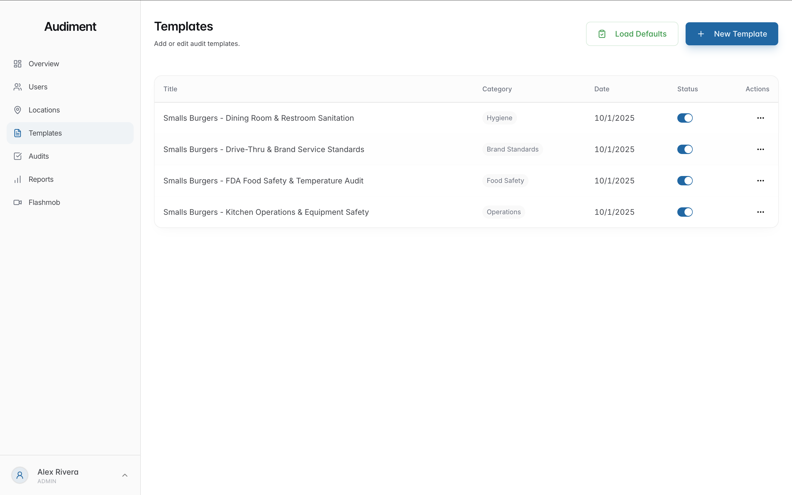
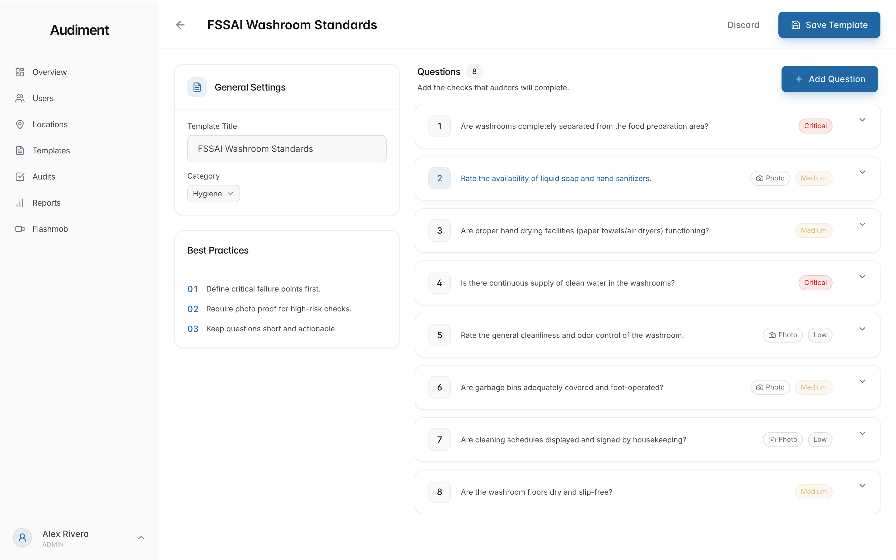
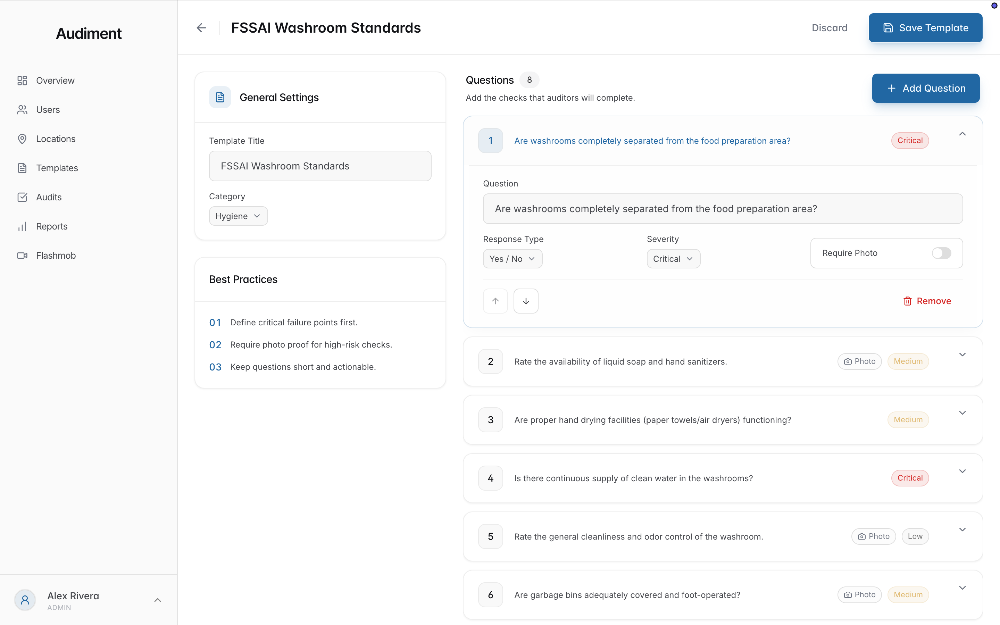

**What you see:**
- **Page heading:** "Templates"
- **"New Template" button**: Opens the Template Builder.
- **Table of all active templates** with columns: Title, Number of Questions, Created Date, Actions.

**Template Builder — Per-Question Fields:**

| Field | Options | Notes |
|---|---|---|
| Question Text | Free text | The question shown to the auditor |
| Response Type | Yes/No, Rating (1-10) | Controls how the auditor answers |
| Severity | Low, Medium, Critical | Critical questions with a failing answer auto-create a CAPA |
| Required Photo | Toggle | When on, the auditor cannot proceed without uploading a photo |
| Order | Up / Down arrows | Reorder questions |

**Save behaviour:** Clicking Save creates the template document and all questions in a single Firestore writeBatch.


---


### 4. Locations

**URL:** `/dashboard/admin/locations`

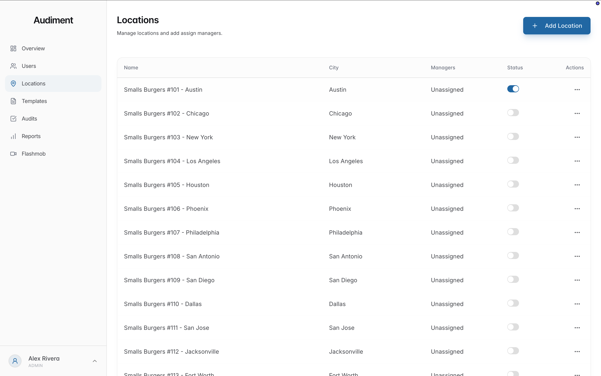

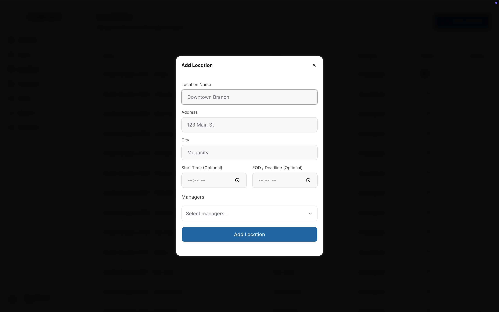
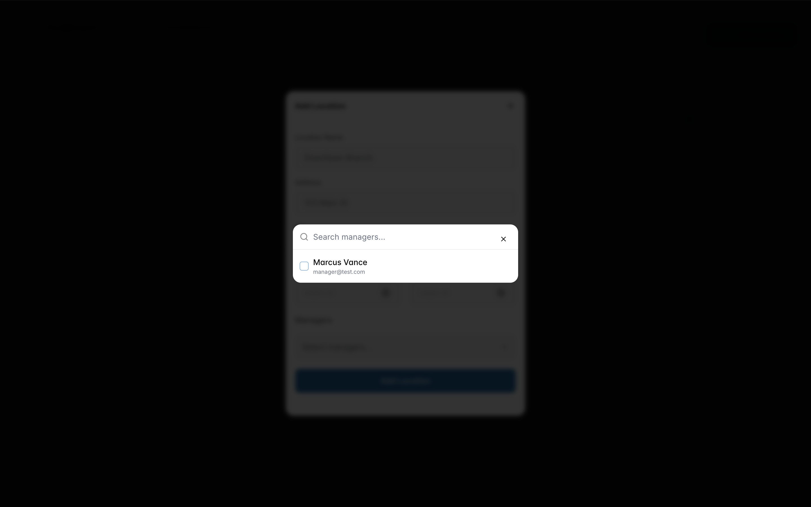

**What you see:**
- **Page heading:** "Locations" with the subtext "Manage locations and assign managers."
- **"Add Location" button**: Opens the location creation dialog.
- **Locations table** with columns: Name, City, Managers, Status (Active/Inactive toggle), Actions (Edit).

**Add Location Dialog — Fields:**

| Field | Notes |
|---|---|
| Location Name | Free text (e.g. "Downtown Branch") |
| Address | Street address |
| City | City name |
| Start Time | Optional; overrides org default when scheduling audits for this location |
| EOD / Deadline Time | Optional; overrides org default when scheduling audits |
| Managers | Searchable multi-select picker; select multiple managers |

**Edit Location:** If the location name is changed, the system automatically updates locationName across all linked Audits, Corrective Actions, and Flashmob Audits in one batch operation.

**Active/Inactive toggle:** Soft-disables the location (does not appear in audit creation dropdowns when inactive).


---


### 5. Users

**URL:** `/dashboard/admin/users`

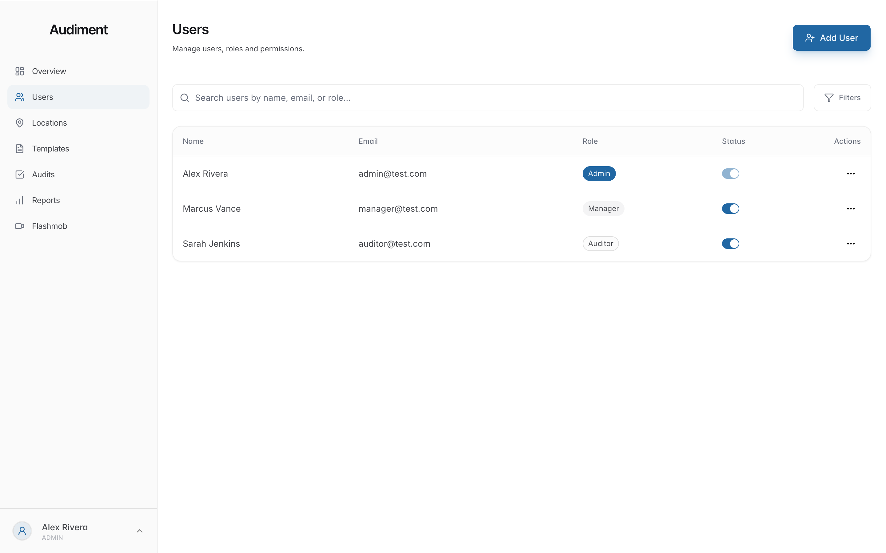
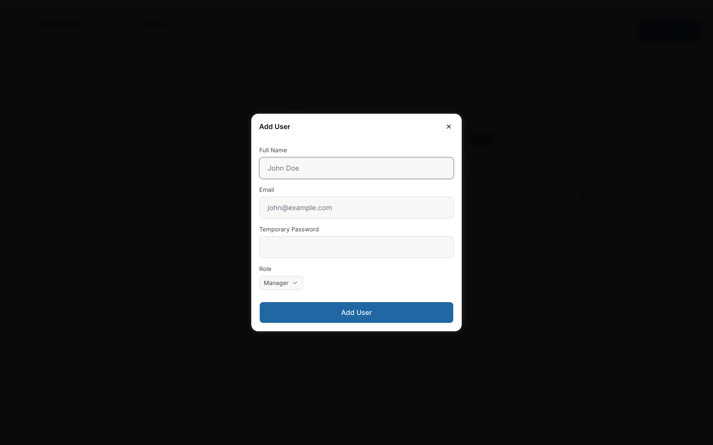
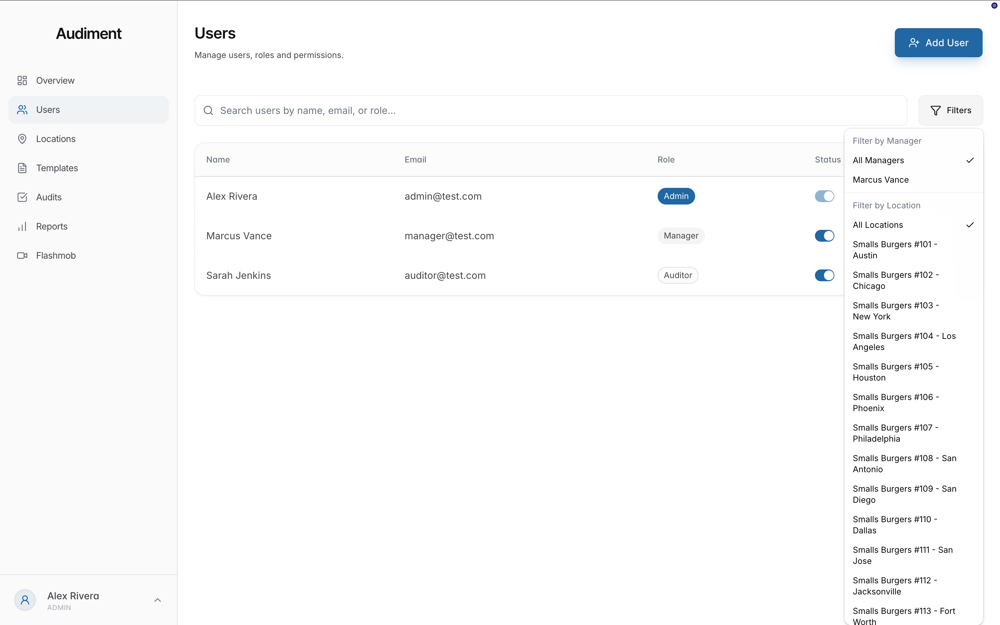
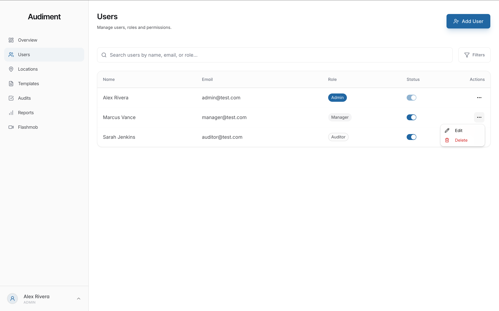

**What you see:**
- **Page heading:** "Users"
- **"Add User" button**: Opens the user creation dialog.
- **Search bar**: Searches by name or email.
- **Filter dropdown**: Filter by Role (Manager / Auditor), Location, Status (Active / Inactive).
- **Users table** with columns: Name, Email, Role, Status (Active toggle), Actions (Edit, Delete, Send Password Reset).

**Add User Dialog — Fields:**

| Field | Options / Notes |
|---|---|
| Full Name | Free text |
| Email | Used as login credential |
| Temporary Password | Min 6 characters |
| Role | Manager or Auditor |
| Assigned Manager | Dropdown (Auditor role only); links the auditor to a manager |

**Edit User Dialog — Fields:**

| Field | Notes |
|---|---|
| Full Name | Rename the user |
| Assigned Manager | Change which manager oversees this auditor (Auditor only) |
| Flashmob Access | Toggle (Auditor only); controls access to the Flashmob feature |
| Send Password Reset Email | Button that emails a Firebase password reset link |

**Active/Inactive toggle:** Disabling a user blocks their login by suspending their Firebase Auth account.

**Delete:** Permanently removes the user from the auth system and database. Admins cannot delete other Admins.


---


### 6. Corrective Actions (Admin)

**URL:** `/dashboard/admin/corrective-actions`

**What you see:**
- **Page heading:** "Actions" with the subtext "Track and resolve issues."
- **Pending count badge** (top right): Live count of all non-resolved CAPAs, animates with a pulse.
- **Summary KPI cards (3 across):**
  - **Overdue** — Count of CAPAs where deadline < now
  - **Critical** — Count of CAPAs with severity = critical
  - **Upcoming** — "48h" label (CAPAs auto-created with 48-hour deadlines)
- **Search bar**: Searches by location name, issue description, or manager name.
- **Status filter dropdown**: All / Open / In Progress / Resolved / Overdue.
- **CAPAs table** with columns: Location, Issue (the failed question text), Severity, Deadline (turns red if overdue), Status, Actions (Edit, Review).

**Sort order:** Closest deadline first, Critical severity first, Open status first.

**Edit CAPA (Reassign):** Opens a dialog to change the Assigned Manager and Deadline for any CAPA.

**Review CAPA (Resolve/Reject):** When a manager marks a CAPA as completed, the "Review" button appears. The admin can:
- **Resolve** — sets status to resolved
- **Reject** — sends the CAPA back to in_progress
- The dialog also shows the manager's resolution note and any evidence photos. Clicking a photo opens a full-screen lightbox.


---


### 7. Reports (Admin)

**URL:** `/dashboard/admin/reports`

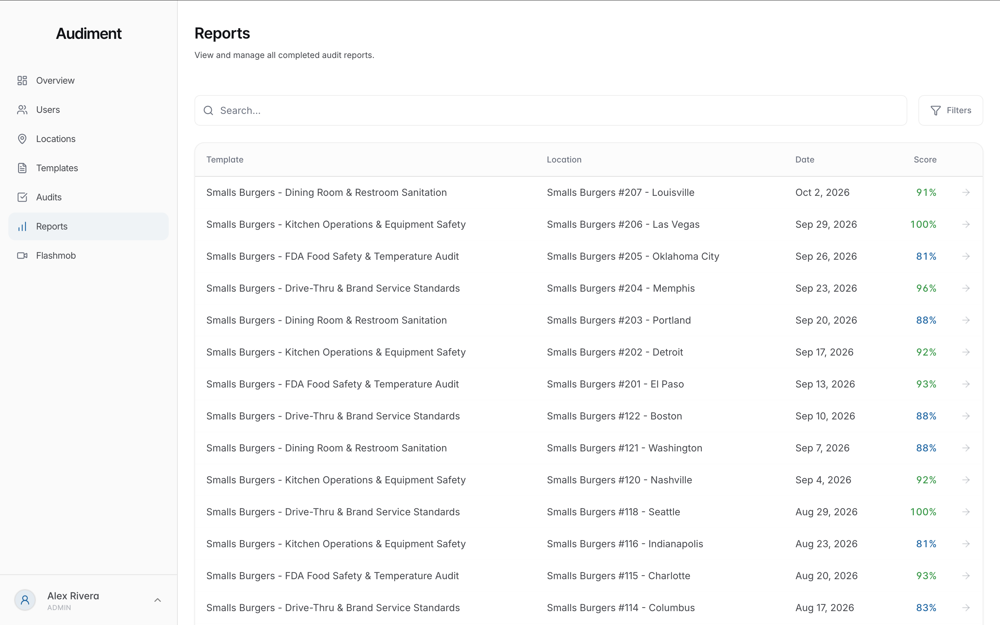
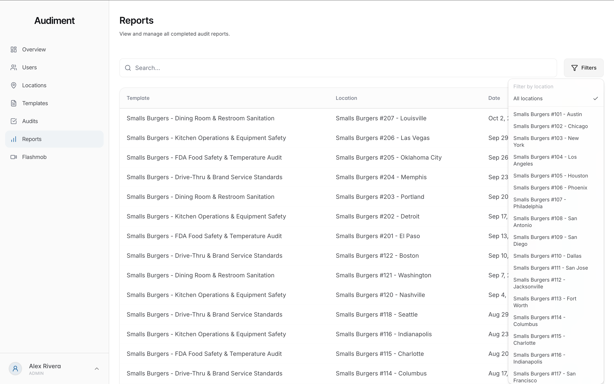
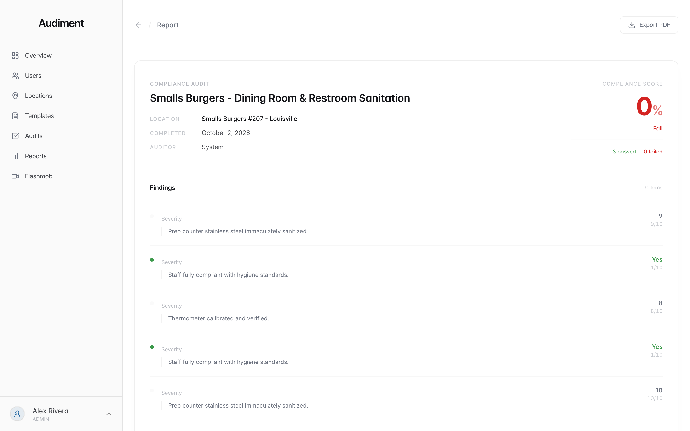

**What you see:**
- List of all completed audits across the organization.
- Filters: Location, Date Range (start and end date pickers), Search.
- Each row links to the detailed report page.

**Detailed Report Page (`/dashboard/admin/reports/[auditId]`):**
- Full audit metadata: Template name, Location, Manager, Auditor, GPS coordinates, Completed date.
- Critical failure alert banner (if hasCriticalFailure = true).
- Final score with color-coded display: green (>= 90%), blue (>= 70%), red otherwise.
- Pass/Fail summary counts.
- Per-question breakdown: Question text, Severity badge, Answer, Notes, all attached evidence photos.
- Clicking any photo opens a full-screen image modal.
- **Export PDF button**: Generates and downloads a PDF of the full report.


---


### 8. Flashmob (Admin)

**URL:** `/dashboard/admin/flashmob`

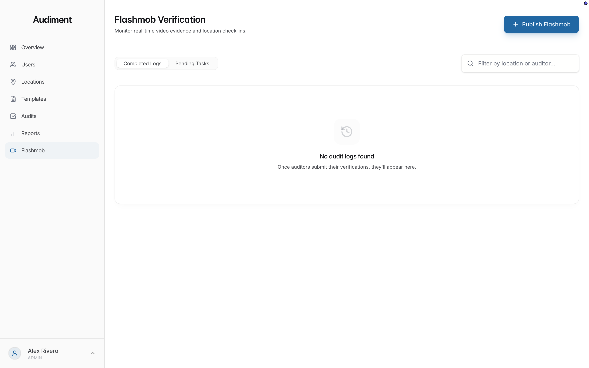
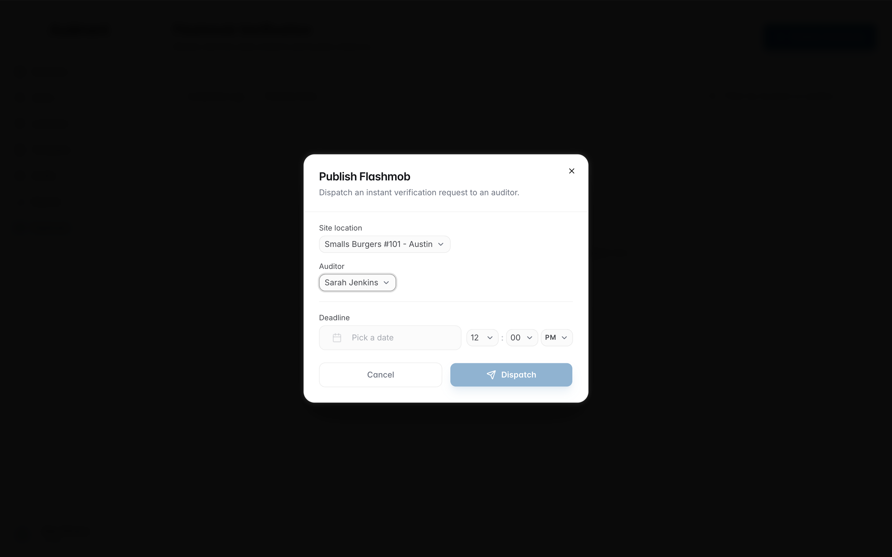

**What you see:**
- **Page heading:** "Flashmob Verification" with the subtext "Monitor real-time video evidence and location check-ins."
- **"Dispatch Flashmob" button**: Opens the dispatch dialog.
- **Success banner**: Appears after a successful dispatch with the auditor's name.
- **Two tabs:**
  - **Active Requests** — All published flashmob requests sorted by publishedAt descending. Each row shows: Auditor name, Location, Deadline. Has a "Cancel" button.
  - **History** — All completed flashmob audits sorted by submittedAt descending. Each row shows: Auditor, Location, Submitted date. Has a link to the full report and a delete button.
- **Search bar** on History tab: Filters by location name or auditor name.

**Dispatch Dialog — Fields:**

| Field | Options | Notes |
|---|---|---|
| Auditor | Dropdown of all active auditors | Required |
| Location | Dropdown of all active locations | Required |
| Deadline Date | Date picker | Required |
| Deadline Hour | 1-12 dropdown | 12-hour clock |
| Deadline Minute | 00, 15, 30, 45 dropdown | |
| AM / PM | AM / PM dropdown | |

**On dispatch:** A flashmobAuditRequest document is created and a surprise_audit notification is pushed immediately to the selected auditor.


---


### 9. Settings (Admin)

**URL:** `/dashboard/admin/settings`

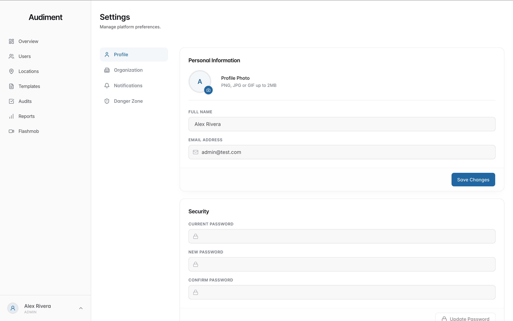
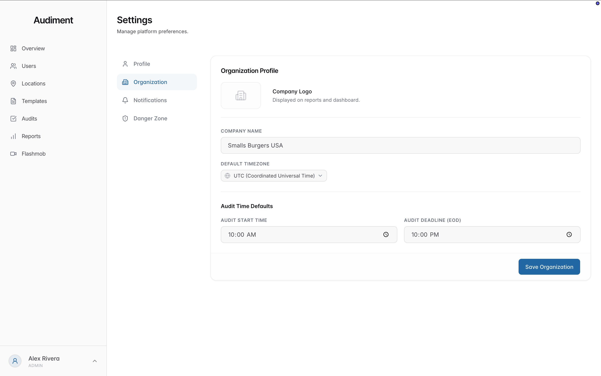
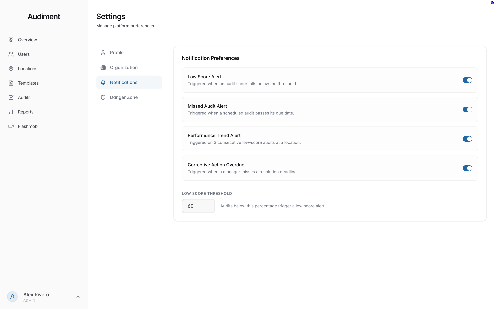

**Tabs** (URL updates to `?tab=profile`, etc.):

#### Profile Tab
- **Name**: Edit display name, click "Save Changes"
- **Email**: Edit email address, click "Save Changes"
- **Password**: Enter current password, new password, confirm new password, click "Update Password" (requires re-authentication)
- **Profile Photo**: Click the camera icon on the avatar, choose a file, crop modal opens, adjust crop area and zoom, click "Save"

#### Organization Tab
- **Organization Name**: Edit, "Save Changes"
- **Timezone**: Dropdown of 11 timezone options (UTC, ET, CT, MT, PT, London, Paris, Dubai, India, Singapore, Sydney)
- **Default Start Time**: Used as default scheduledDate time when creating audits
- **Default End Time**: Used as default deadline time when creating audits
- **Organization Logo**: Same crop-and-upload flow as profile photo

#### Notifications Tab

| Toggle | What it controls |
|---|---|
| Low Score Alert | Notify manager + admin when an audit scores below the threshold |
| Missed Audit Alert | Notify manager + admin when an audit deadline passes without completion |
| Trend Alert | Notify admin when a location has 3+ consecutive low-score audits |
| Corrective Overdue Alert | Notify manager 6 hours before a CAPA deadline |
| Low Score Threshold | Configurable % value (default 60) |

#### Danger Zone Tab
- **Export All Data**: Downloads a CSV file of all org audits with columns: Audit Title, Location, Manager, Auditor, Score, Date, Status.


---


## Manager Dashboard

### 1. Overview / Home

**URL:** `/dashboard/manager`  

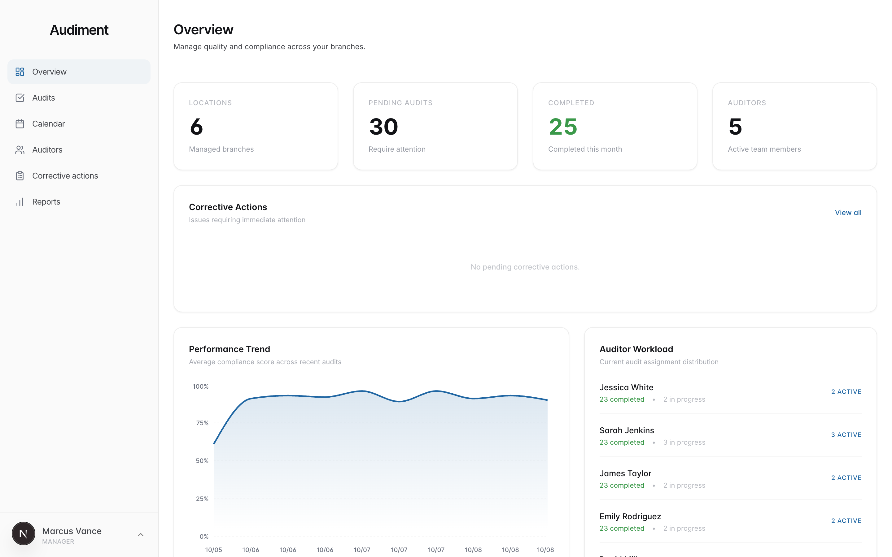  
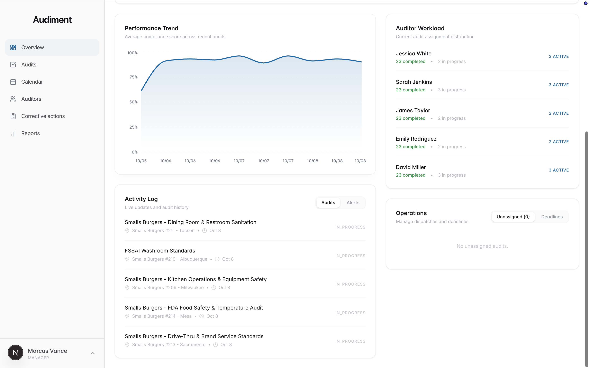  
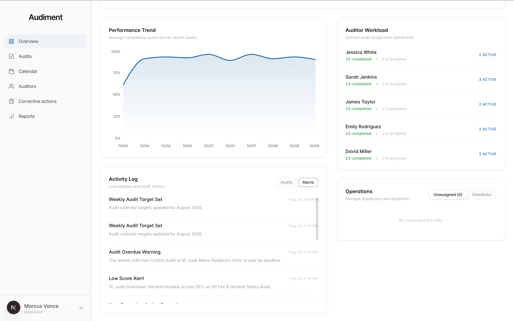

**What you see:**
- **Page heading:** "Overview"
- **KPI Cards (top row):**
  - **Assigned Locations**: Count of locations this manager oversees
  - **Active Auditors**: Count of auditors assigned to this manager
  - **Completion Rate**: % of audits completed this month
  - **Open Issues**: Count of open CAPAs assigned to this manager
- **Score Trend Area Chart**: Shows the recent history of audit scores over time for managed locations.
- **Auditor Activity Table**: Lists each auditor on the team with their completed and pending audit counts.
- **Activity section (tabbed):**
  - **Audits tab**: The most recent audit activity (template, location, status, date).
  - **Notifications tab**: Recent notifications received.
- **Task Priority section (tabbed):**
  - **Unassigned tab**: Audits published but not yet assigned to an auditor.
  - **Near Deadlines tab**: Audits with deadlines approaching soon.
- **Open Corrective Actions**: Listed directly on the homepage. Each CAPA card shows the issue, location, severity, deadline, and a "Resolve" button. Clicking "Resolve" opens an inline resolution dialog without leaving the page.

**Inline CAPA Resolution (from homepage):**
- **Resolution Note**: Free-text area for what was done to fix the issue.
- **Attach Evidence Photo**: File picker for uploading a resolution evidence photo.
- **Camera button**: Opens a live camera feed to capture a resolution photo directly in the browser.
- **Resolve button**: Sets CAPA status to completed, saves the resolution note and photo URLs.


---


### 2. Audits (Manager)

**URL:** `/dashboard/manager/audits`  

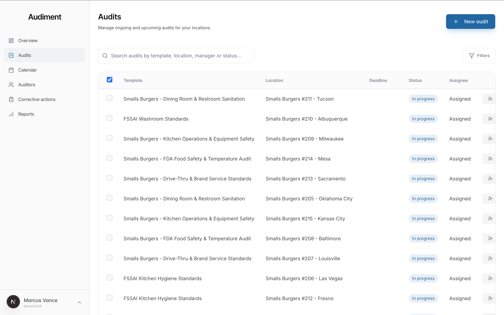  
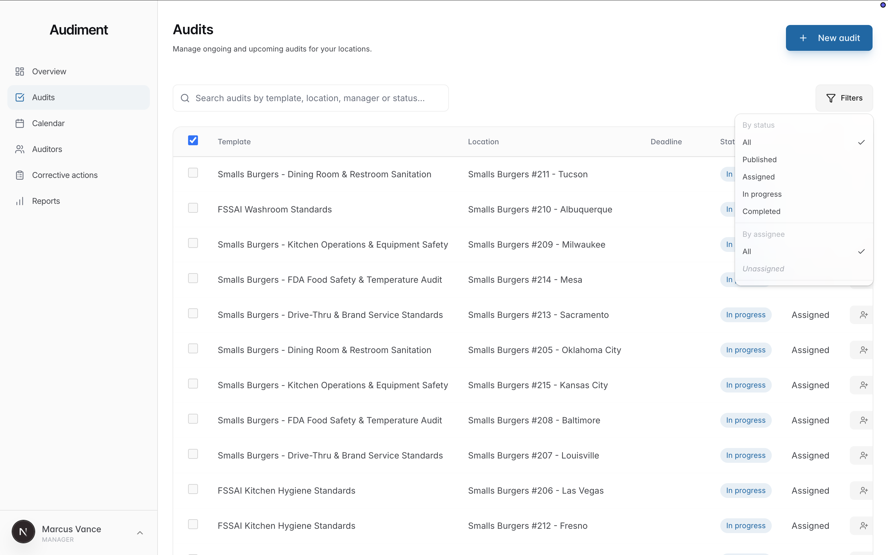  
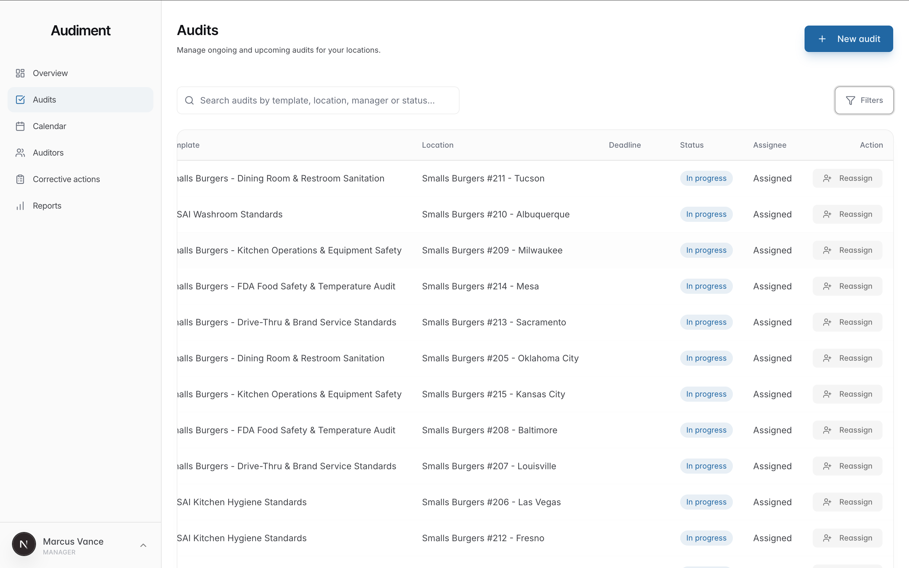  
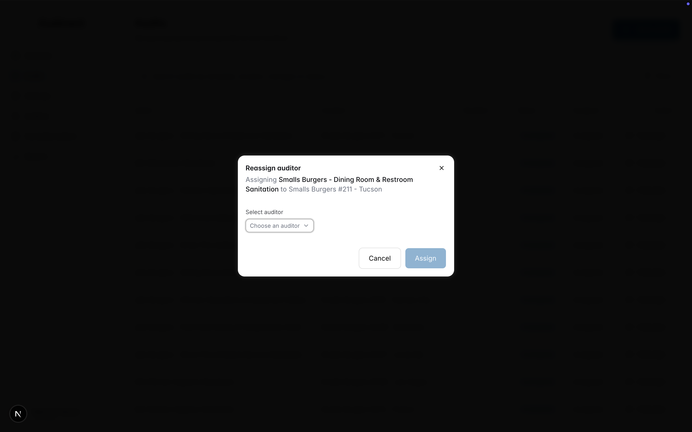  
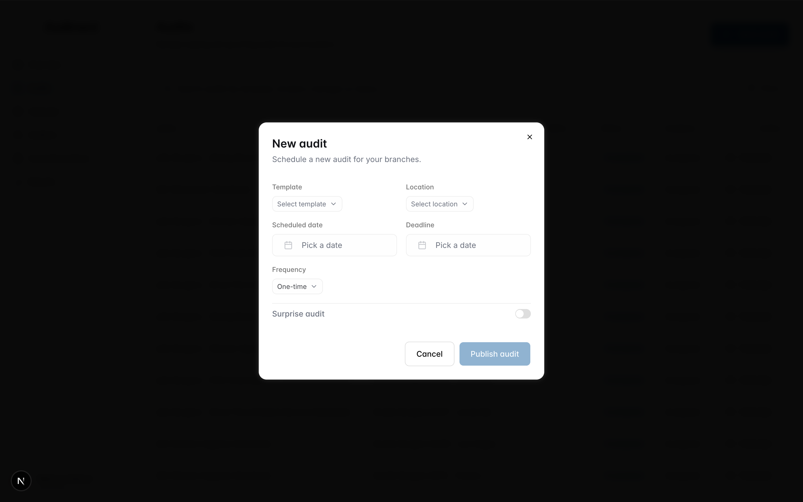

**What you see:**
- **Page heading:** "Audits" with the subtext "Manage ongoing and upcoming audits for your locations."
- **"New Audit" button**: Opens the audit creation dialog (same fields as admin, but auto-assigns current manager).
- **Search bar**: Searches by template title, location name, or status.
- **Filter dropdown**: Filter by Status and Assignee (All / Unassigned / specific auditor).
- **Checkboxes on each row** (for bulk selection).
- **"Bulk Assign" button** (appears when 1+ rows are checked): Opens the bulk assign dialog.
- **Audits table** with columns: Checkbox, Template, Location, Auditor (or "Unassigned"), Scheduled Date, Deadline, Status, Assign button.
- **Status badges:** Published (blue), Assigned (orange), In Progress (blue), Completed (green), Missed (red).

**Single Assign Dialog:**
- Shows the audit template name and location.
- Dropdown of active auditors who report to this manager.
- "Assign" button — sets assignedAuditorId, changes status to assigned, sends an audit_assigned notification to the auditor.

**Bulk Assign Dialog:**
- Shows how many audits are selected.
- Single auditor dropdown.
- "Bulk Assign" button — assigns all selected audits simultaneously, sends one notification per audit.


---


### 3. Calendar

**URL:** `/dashboard/manager/calendar`  

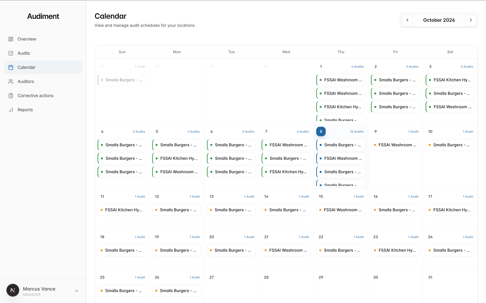

**What you see:**
- **Page heading:** "Calendar" with the subtext "View and manage audit schedules for your locations."
- **Month navigation** (< and > arrows): Navigate to previous or next month. Current month/year shown in center.
- **Full-month grid calendar**: 7-column grid (Sun-Sat), each cell is a day.
- **Today's date**: Highlighted with a primary color circle.
- **Audit labels on each day**: Days with audits show the audit title(s) and location. Clicking an audit expands a detail card showing the auditor name and status badge.
- **Only non-surprise, non-completed audits** are shown (status is published, assigned, or in_progress).


---


### 4. Auditors

**URL:** `/dashboard/manager/auditors`  

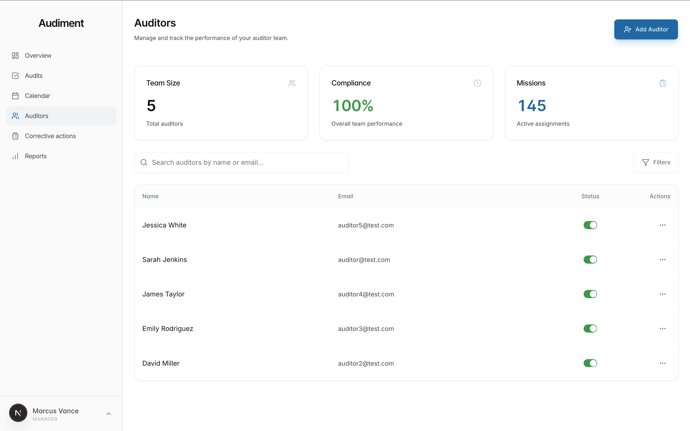  
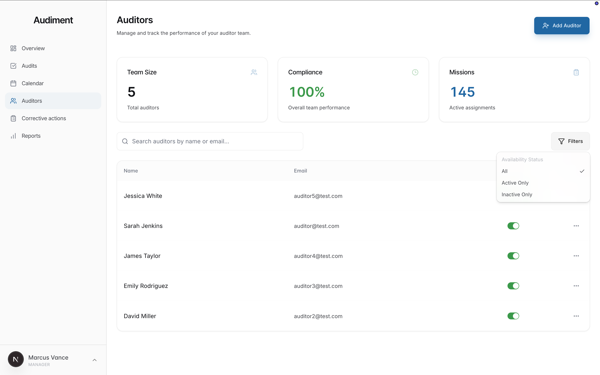  
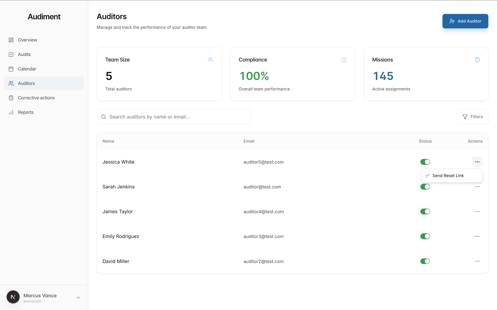  
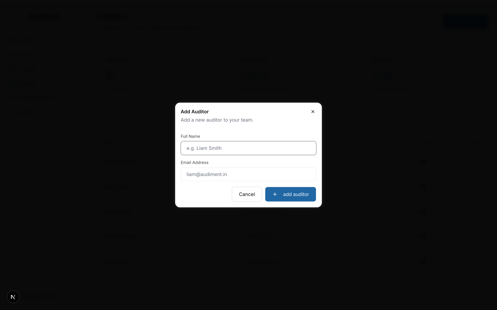

**What you see:**
- **Page heading:** "Auditors" with the subtext "Manage and track the performance of your auditor team."
- **"Add Auditor" button**: Opens a lightweight add dialog (Name + Email only; creates a Firestore record).
- **KPI Cards (3 across):**
  - **Team Size** — Total auditor count
  - **Compliance** — Overall team performance
  - **Missions** — Total audit count across all team auditors
- **Search bar**: Searches by name or email.
- **Filter dropdown**: All / Active Only / Inactive Only.
- **Auditors table** with columns: Name, Email, Status (Active toggle), Actions (three-dot menu).
- **Row is clickable**: Takes you to the individual auditor profile page.
- **Actions menu**: "Send Reset Link" — sends a Firebase password reset email to the auditor.
- **Active toggle**: Enables/disables the auditor directly from the table.

**Individual Auditor Profile Page (`/dashboard/manager/auditors/[id]`):**
- Shows the auditor's name, email, joined date.
- KPIs: Total Audits Completed, Average Score.
- Toggle for Flashmob Access.
- "Send Reset Link" button.
- Recent audit history table.


---


### 5. Corrective Actions (Manager)

**URL:** `/dashboard/manager/corrective-actions`  

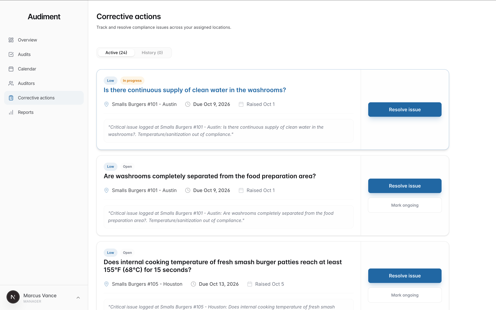  
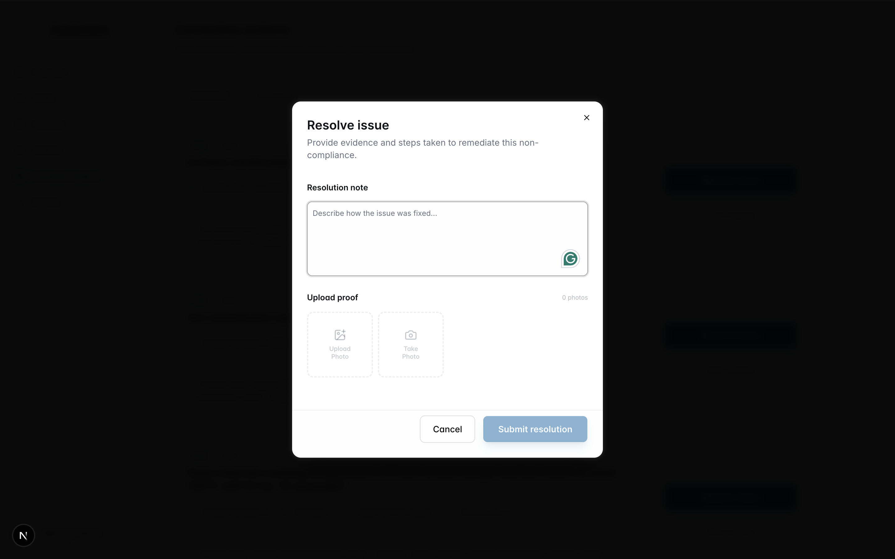

**What you see:**
- **Page heading:** "Actions"
- **Two tabs:**
  - **Open Issues** — CAPAs with status open or in_progress
  - **Resolved** — CAPAs with status completed or resolved
- **CAPA cards** (each card shows): Location name, Failed question text, Severity badge, Deadline, Status, "Resolve" button.
- Real-time listener: New CAPAs appear instantly without page refresh.

**Resolve CAPA Dialog:**
- **Issue Details**: Shows the original question, location, and severity.
- **Resolution Note**: Free-text area to describe what was done.
- **Evidence Photo section**:
  - "Start Camera" button — opens an in-browser live camera feed using the device's rear camera.
  - Camera view shows the live feed; "Capture" takes a photo and shows a preview.
  - "Retake" allows recapturing.
  - File picker alternative for photos from device gallery.
  - Multiple photos can be attached.
- **Resolve button**: Sets status = completed, saves resolutionNote and resolutionPhotoUrls, records completedAt timestamp.

**After resolution:** The CAPA moves to the Resolved tab. An admin must then "Review" it to fully close it to resolved.


---


### 6. Reports (Manager)

**URL:** `/dashboard/manager/reports`  

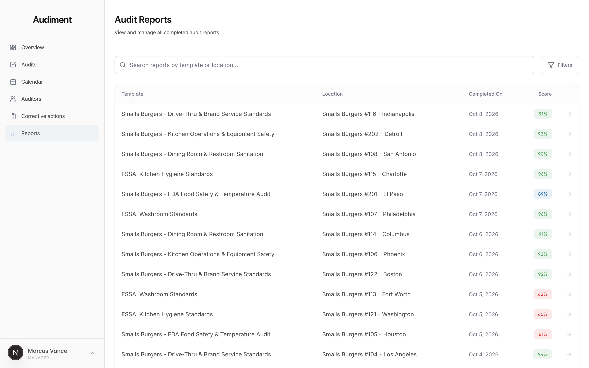  
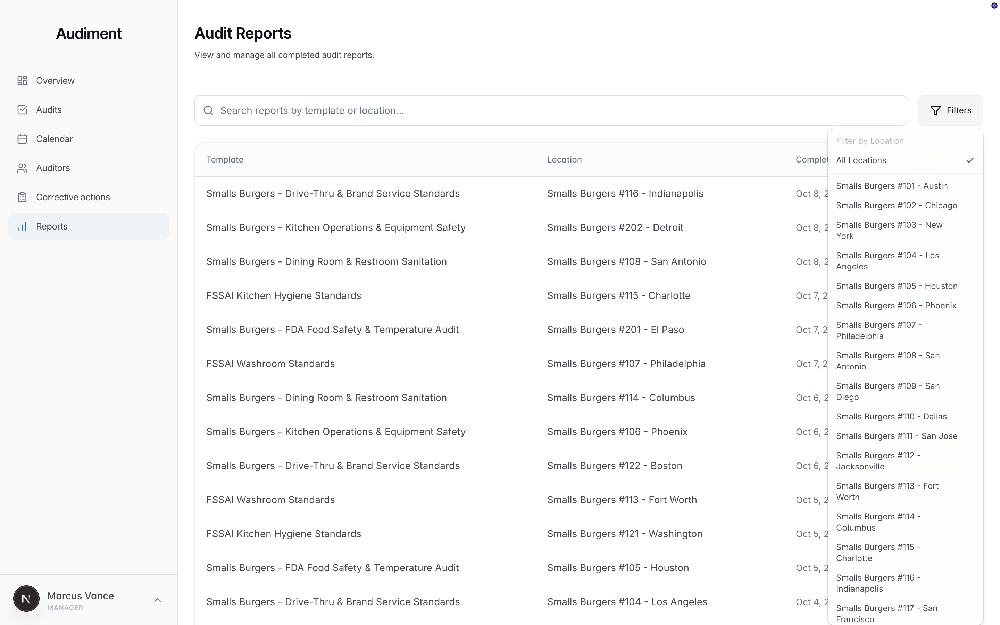

**What you see:**
- **Page heading:** "Reports"
- **Date filter**: Start date and end date pickers to narrow the list.
- **Reports table**: All completed audits for managed locations, sorted by most recent first. Columns: Template, Location, Auditor, Score %, Completed Date, link to full report.

**Detailed Report Page (`/dashboard/manager/reports/[auditId]`):**
- **Back arrow** (top left) — returns to reports list.
- **"Export PDF" button** (top right) — generates and downloads the report as a PDF named `{Location}-{Template}-{date}.pdf`.
- **Critical Failure banner**: Red alert box showing count of critical failures if any exist.
- **Report hero section**: Template title, Location name, Auditor name, Completed date, GPS coordinates.
- **Score ring**: Circular score display with color coding (green/blue/red).
- **Summary stats**: Passed questions count, Failed questions count.
- **Per-question list** (sorted by question order):
  - Question text, Severity badge, Answer (Yes / No / Rating number), Auditor notes
  - Evidence photos (thumbnail grid; click to fullscreen)


---


### 7. Settings (Manager)

**URL:** `/dashboard/manager/settings`  

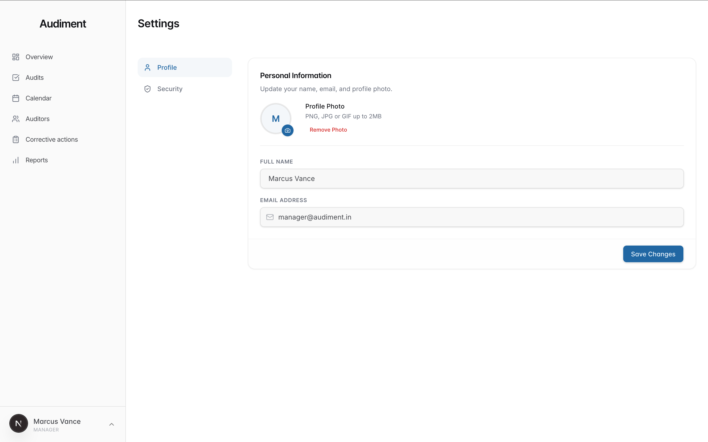

#### Profile Tab
- Edit name and email.
- Change password (requires re-authentication with current password).
- Upload and crop profile photo.


---


## Auditor Dashboard

### 1. Overview / Home

**URL:** `/dashboard/auditor`  

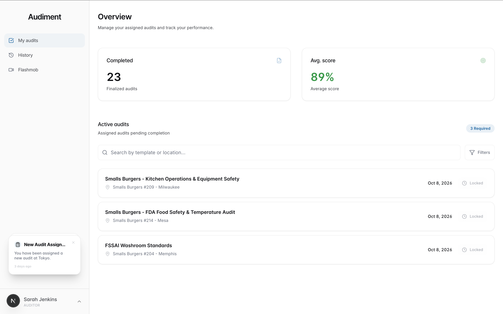

**What you see:**
- **Page heading:** "Overview" with the subtext "Manage your assigned audits and track your performance."
- **KPI Cards (2 across):**
  - **Completed** — Total finalized audits count
  - **Avg. Score** — Average score % across all completed audits
- **"Active Audits" section heading** with badge showing count of required audits.
- **Search bar**: Filter active audits by template name or location name.
- **Filter button** (desktop only).
- **Audit cards** (one per assigned audit): Each card shows:
  - Template title, Location name
  - Scheduled date and deadline
  - Status badge, Surprise audit badge (if applicable)
  - "Start Audit" / "Continue Audit" button
- **Sort order:** Closest deadline first, missed/pending first within same deadline, in_progress before assigned.
- **Empty state**: Shows a "No active audits" illustration when all audits are done.
- **Missed audits**: Shown with a red "Missed" badge; cannot be started.


---


### 2. Audit Execution

**URL:** `/dashboard/auditor/audits/[auditId]`  

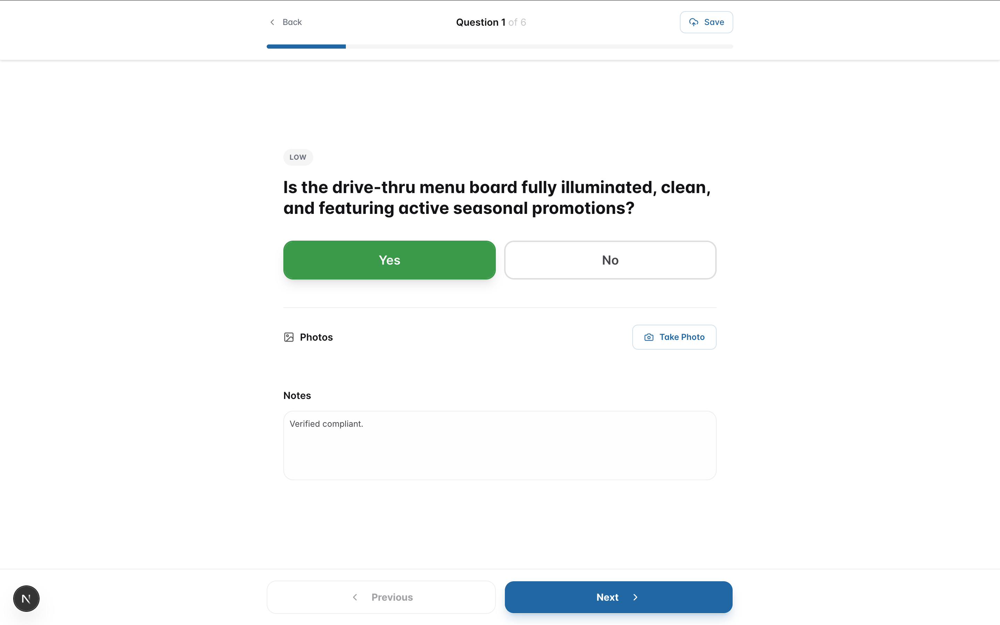  
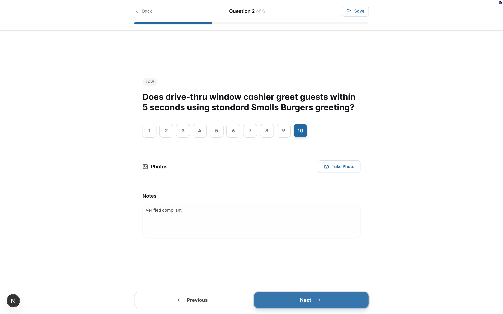  
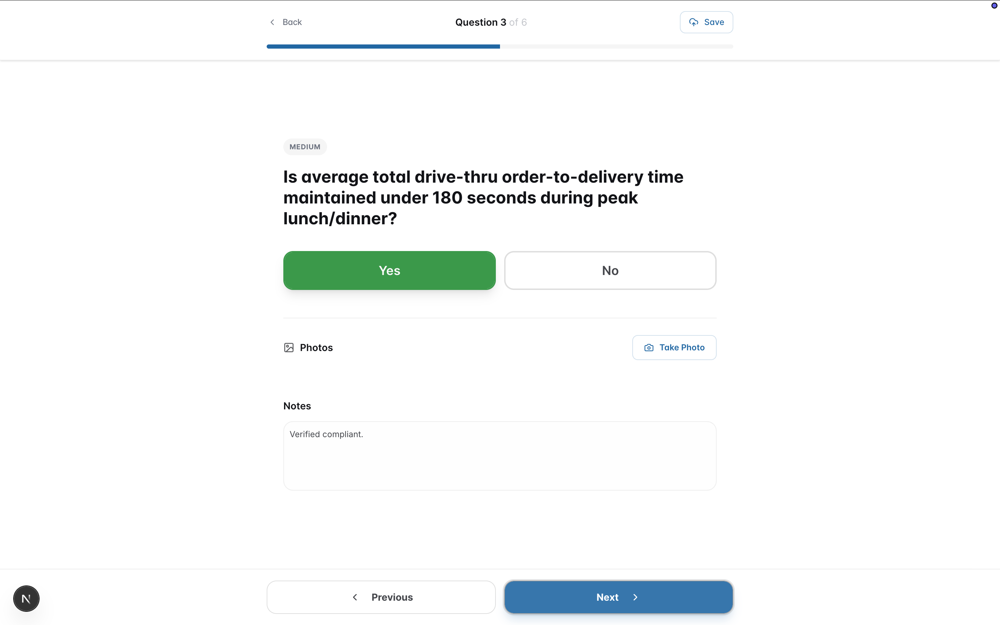  
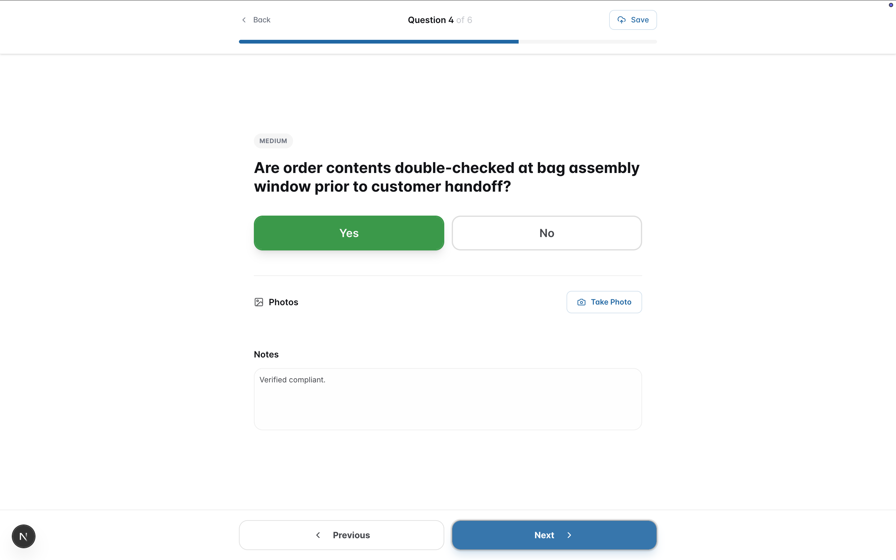  
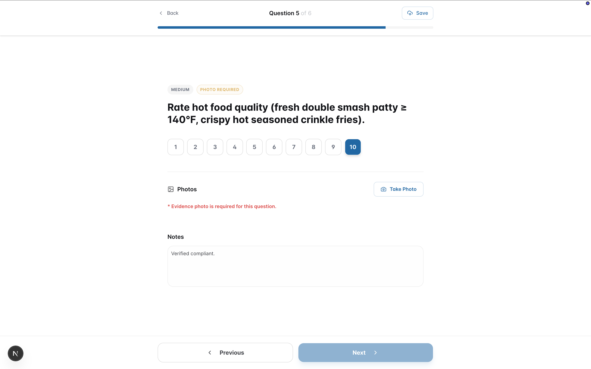  


**What you see (Header):**
- **"Back" button**: If there are unsaved changes, clicking this opens the Unsaved Progress dialog.
- **"Question X of N"** — Current question position.
- **"Save" button**: Saves current progress mid-audit without submitting.
- **Progress bar**: Animated bar filling from left to right as questions are answered.

**Location Permission Prompt (first time only):**
A dialog immediately appears when the audit page loads:
- Title: "Location Required"
- Message: "To begin and verify this audit accurately, you must allow location access."
- Button: "Enable Location" — triggers the browser's native geolocation permission prompt.

**Question Area (main content):**
- **Severity badge**: CRITICAL (red), MEDIUM (gray), or LOW (gray).
- **"PHOTO REQUIRED" badge**: Shown if the question has requiresPhoto = true.
- **Question text**: Large heading font.
- **Answer input:**
  - **Yes/No** (yes_no type): Two large buttons (Yes = green when selected, No = red when selected).
  - **Rating** (rating type): A grid of 10 numbered buttons (1-10). Selected number highlights in primary color.
- **Photos section** (below the answer):
  - "Take Photo" button — opens the in-app camera.
  - Uploaded photo thumbnails with a x delete button on hover.
  - If PHOTO REQUIRED and no photo is uploaded, a red pulsing warning shows.
- **Notes section**: A text area for observations about this specific question.

**In-App Camera Modal (full-screen):**
- Black full-screen overlay.
- Live camera viewfinder with corner alignment guides.
- **Flip camera button** (top right): Toggles between front and rear camera.
- **Shutter button** (bottom center): Large circular capture button.
- Captured photo uploads immediately to Cloudinary.
- **Front-camera mirror correction**: Selfie shots are automatically un-mirrored.

**Footer Navigation:**
- **"Previous" button**: Navigate to the previous question (disabled on question 1).
- **"Next" button**: Navigate to the next question. Disabled until the current question is answered (and photo uploaded if required).
- On the last question, the Next button becomes **"Submit Audit"**.

**Submission Flow:**
1. Auditor clicks "Submit Audit"
2. System calls `navigator.geolocation.getCurrentPosition()` with high accuracy, 8-second timeout
3. **If location cannot be captured**: Submission is BLOCKED. A "Location Verification Failed" dialog appears with a "Try Again" option.
4. **If location is captured**: The writeBatch commits all responses, final score, grade, GPS coordinates, and status = completed to Firestore simultaneously.
5. For every response where isCriticalFailure = true, a Corrective Action is automatically created (assigned to the manager, 48-hour deadline).
6. If the final score is < 60%, a background notification job is triggered for low-score and trend alerts.
7. Auditor is redirected to /dashboard/auditor.

**Unsaved Progress Dialog (Exit Guard):**
Appears when clicking "Back" with unsaved answers. Three options:
- **Continue Auditing** — Closes dialog, stays on the page
- **Exit Without Saving** — Navigates away without saving
- **Save and Leave** — Saves progress then navigates away


---


### 3. Flashmob (Auditor)

**URL:** `/dashboard/auditor/flashmob`

**Access:** Only visible if the auditor has `isFlashmobEnabled = true`. If not enabled, a "Verification Restricted" screen is shown.

**What you see:**
- **Two tabs:**
  - **Assigned**: Flashmob requests dispatched to this auditor by an admin. Each card shows the location, deadline, and a "Start" button.
  - **History**: Past flashmob audits this auditor has submitted.

**Flashmob Wizard (6 steps with a visual progress breadcrumb):**

**Step 1 — Site (Select Branch):**
- Dropdown of all org locations. If launched from an "Assigned" request, the location is pre-filled.

**Step 2 — Capture (Record Video):**
- Full live camera viewfinder (rear camera, 1280x720 ideal).
- "Record" button — starts recording (uses MediaRecorder with best available codec).
- **60-second countdown timer**: Recording automatically stops at 60 seconds. Auditor can stop manually.
- On stop, the video blob is saved and the wizard advances to the Review step.

**Step 3 — Review (Check Footage):**
- Plays back the recorded video for review.
- "Retake" button: Discards the video and returns to Step 2.
- "Looks Good" button: Advances to Step 4.

**Step 4 — ID Proof (Take Selfie):**
- Camera switches to front-facing (selfie mode).
- "Capture Selfie" button — takes a still photo of the auditor.
- Selfie confirms auditor identity at the time of submission.

**Step 5 — Verify (Submitting):**
- Shows a preview of the selfie.
- "Submit" button — triggers the submission sequence:
  1. Attempts to capture GPS coordinates (5-second timeout; non-blocking if it fails).
  2. Uploads the video to Cloudinary via /api/upload.
  3. Uploads the selfie to Cloudinary via /api/upload.
  4. Creates a flashmobAudits document with videoUrl, selfieUrl, latitude, longitude, locationId, auditorId, submittedAt.
  5. If linked to a dispatched request, marks the flashmobAuditRequests document as completed.

**Step 6 — Done (Success):**
- Success confirmation screen with "Go to Dashboard" button.


---


### 4. History

**URL:** `/dashboard/auditor/history`

**What you see:**
- **Page heading:** "Audit History" with the subtext "View and review your completed audits."
- **KPI Cards (3 across):**
  - **Total Audits** — Total completed (standard + flashmob combined)
  - **Avg. Performance** — Overall average score %
  - **Best Score** — Highest single audit score %
- **Search bar**: Filters by template title or location name.
- **History table** with columns: Type badge (Standard or Flashmob), Template / Audit Name, Location, Completed Date, Score %, Link to report.
- **Sort order:** Most recently completed first.
- Standard audits link to the detailed report page. Flashmob audits are labeled "Flashmob Verification."


---


### 5. Settings (Auditor)

**URL:** `/dashboard/auditor/settings`  

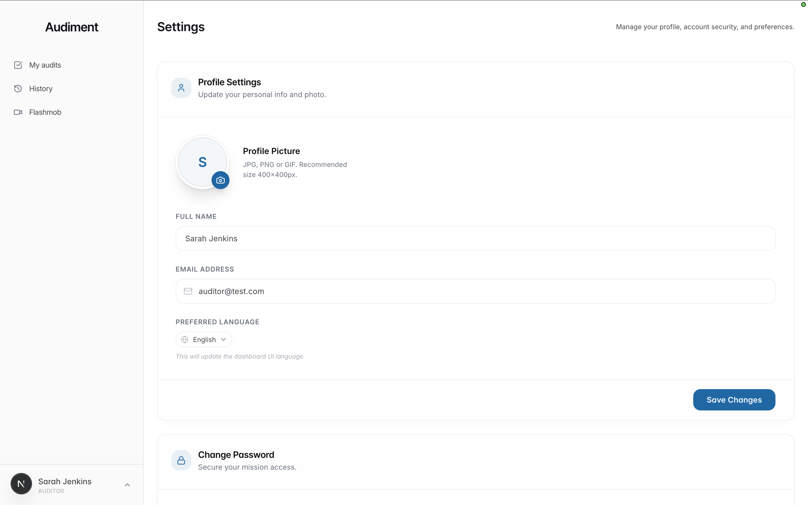  
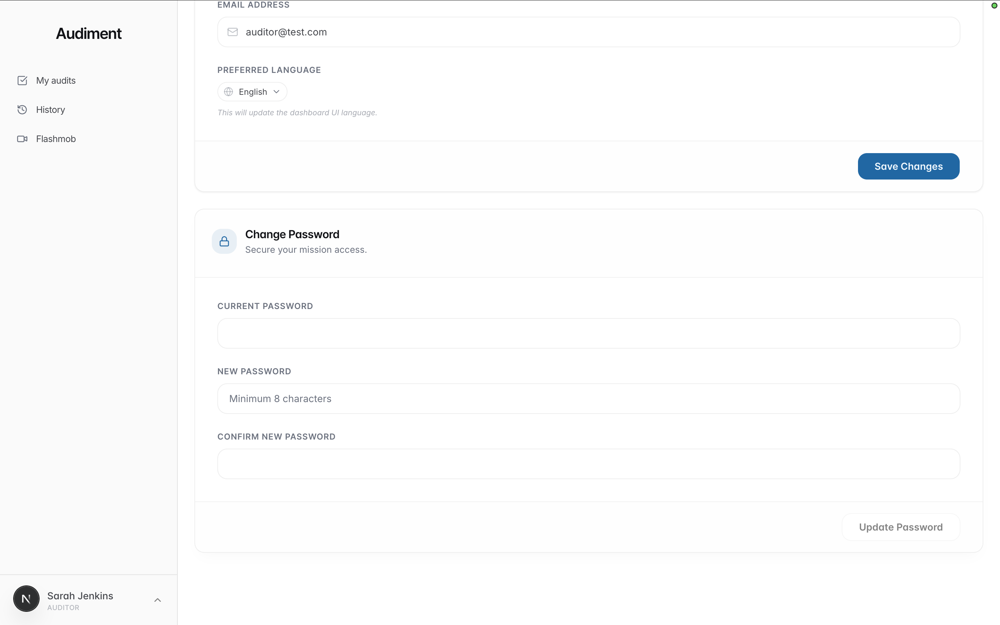

#### Profile Tab
- Edit name and email.
- Change password (requires current password for re-authentication).
- Upload and crop profile photo.


---


## Notifications

Notifications are accessible from every dashboard via the **bell icon** in the sidebar or header.

**What you see:**
- **Bell icon** with an unread count badge.
- **Notification list**: Each notification shows an icon, title, message, and relative time.
- **Mark All Read button**: Marks all visible notifications as read simultaneously.
- **Individual dismiss (x)**: Dismiss and mark a single notification as read. Disappears immediately (optimistic UI).

**Notification Types:**

| Type | Who receives it | What triggers it |
|---|---|---|
| audit_assigned | Auditor | Manager assigns them to an audit |
| surprise_audit | Auditor | Assigned to a surprise audit OR a flashmob request is dispatched |
| audit_missed | Manager + All Admins | Cron job detects a deadline has passed |
| low_score | Manager | Audit scores below the org threshold (default 60%) |
| trend_alert | Admin | A location scores below threshold on 3+ consecutive audits |
| corrective_action | Manager | A CAPA is within 6 hours of its deadline |

**Clicking a notification:**
- Routes to the correct page for the user's role.
- For auditors: if the notification links to an audit that hasn't reached its scheduledDate yet, access is blocked with an alert.

**Sidebar Card Stack Mode:**
When in the sidebar, the top 3 unread notifications are shown as a stacked deck of cards. The second and third cards scale down and blur behind the top card. When the top card is dismissed, the stack animates and the next card slides into focus.


---


---


## Screenshots Directory & Folder Structure

> **Base Directory Path:** `screenshots/`  
> **Absolute System Path:** `/Users/sanskar/Documents/Asellus/Audiment/screenshots/`

Below is the complete, organized directory tree containing all 62 high-resolution UI screenshots mapped to their respective user roles, navigation paths, and modal dialog states.

```
screenshots/
├── admin/                     (26 UI Screenshots)
│   ├── overview/
│   │   ├── overview.png
│   │   └── performance_alert.png
│   ├── users/
│   │   ├── users_list.png
│   │   ├── add_user_modal.png
│   │   ├── users_filters.png
│   │   └── user_actions_menu.png
│   ├── locations/
│   │   ├── locations_list.png
│   │   ├── location_actions_menu.png
│   │   ├── add_location_modal.png
│   │   └── select_manager_dropdown.png
│   ├── templates/
│   │   ├── templates_list.png
│   │   ├── template_editor.png
│   │   └── template_question_expanded.png
│   ├── audits/
│   │   ├── audits_list.png
│   │   ├── audits_filtered.png
│   │   ├── audits_status_filter.png
│   │   ├── new_audit_modal.png
│   │   └── new_audit_select_manager.png
│   ├── reports/
│   │   ├── reports_list.png
│   │   ├── report_detail.png
│   │   └── reports_location_filter.png
│   ├── flashmob/
│   │   ├── flashmob_dashboard.png
│   │   └── publish_flashmob_modal.png
│   └── settings/
│       ├── profile_settings.png
│       ├── organization_settings.png
│       └── notification_settings.png
├── manager/                   (18 UI Screenshots)
│   ├── overview/
│   │   ├── overview.png
│   │   ├── performance_trend.png
│   │   └── auditor_workload.png
│   ├── audits/
│   │   ├── audits_list.png
│   │   ├── audits_filters.png
│   │   ├── audit_actions_menu.png
│   │   ├── reassign_auditor_modal.png
│   │   └── new_audit_modal.png
│   ├── calendar/
│   │   └── calendar_view.png
│   ├── auditors/
│   │   ├── auditors_list.png
│   │   ├── auditors_metrics.png
│   │   ├── auditor_actions_menu.png
│   │   └── add_auditor_modal.png
│   ├── corrective-actions/
│   │   ├── corrective_actions_list.png
│   │   └── resolve_issue_modal.png
│   ├── reports/
│   │   ├── reports_list.png
│   │   └── reports_filters.png
│   └── settings/
│       └── profile_settings.png
└── auditor/                   (18 UI Screenshots)
    ├── overview/
    │   └── dashboard.png
    ├── history/
    │   └── audit_history.png
    ├── execution/
    │   ├── question_1.png
    │   ├── question_2.png
    │   ├── question_3.png
    │   ├── question_4.png
    │   ├── question_5_photo_required.png
    │   └── question_5_photo_attached.png
    ├── flashmob/
    │   ├── verification_tasks.png
    │   ├── step1_location.png
    │   ├── step1_arrival_confirmed.png
    │   ├── step2_capture_feed.png
    │   ├── step2_recording_active.png
    │   ├── step3_video_review.png
    │   ├── step4_id_proof.png
    │   └── step5_final_verification.png
    └── settings/
        ├── profile_settings.png
        └── security_settings.png
```

## AI Video Generator — Step-to-Screenshot Mapping Index

> **Notice for AI Video & Media Agents:** Since AI video generators do not possess OCR to read text inside screenshots, use this explicit step-by-screenshot lookup table. Each tutorial step below specifies the exact file path to load for visual video generation.

| Tutorial ID & Title | Workflow Step | Relevant UI Screenshot File Path | Visual Description |
|---|---|---|---|
| **Tutorial 1: New Audit Template** | Steps 1–2 | `screenshots/admin/templates/templates_list.png` | Admin Templates List View |
| | Steps 3–10 | `screenshots/admin/templates/template_editor.png` | Template Builder Questions List |
| | Step 11 | `screenshots/admin/templates/template_question_expanded.png` | Question Severity & Field Options |
| | Step 12 | `screenshots/admin/templates/templates_list.png` | Saved Template in Table |
| **Tutorial 2: Add Location** | Steps 1–2 | `screenshots/admin/locations/locations_list.png` | Locations Table View |
| | Steps 3–7 | `screenshots/admin/locations/add_location_modal.png` | Add Location Modal Overlay |
| | Step 8 | `screenshots/admin/locations/select_manager_dropdown.png` | Search & Select Manager Picker |
| | Step 9 | `screenshots/admin/locations/locations_list.png` | Updated Locations Table |
| **Tutorial 3: Create User** | Steps 1–2 | `screenshots/admin/users/users_list.png` | Users Management Table |
| | Steps 3–7 | `screenshots/admin/users/add_user_modal.png` | Add User Form Modal |
| | Steps 8–9 | `screenshots/admin/users/users_filters.png` | Role & Location Filter Dropdown |
| | Edit / Flashmob | `screenshots/admin/users/user_actions_menu.png` | User Row Action Menu |
| **Tutorial 4: Publish Audit (One-Time)** | Steps 1–2 | `screenshots/admin/audits/audits_list.png` | Audits List View |
| | Steps 3–6 | `screenshots/admin/audits/new_audit_modal.png` | Create New Audit Modal |
| | Step 7 | `screenshots/admin/audits/new_audit_select_manager.png` | Select Manager Dropdown |
| | Steps 8–11 | `screenshots/admin/audits/audits_status_filter.png` | Published Audit Status View |
| **Tutorial 5: Publish Recurring Audit** | Steps 1–3 | `screenshots/admin/audits/audits_list.png` | Audits Table View |
| | Steps 4–9 | `screenshots/admin/audits/new_audit_modal.png` | Frequency & Repeat Until Inputs |
| | Step 10 | `screenshots/admin/audits/audits_filtered.png` | Filtered Recurring Audits Table |
| **Tutorial 6: Assign Audit (Single)** | Steps 1–3 | `screenshots/manager/audits/audits_list.png` | Manager Audits Table |
| | Step 4 | `screenshots/manager/audits/audit_actions_menu.png` | Row Actions Menu |
| | Steps 5–6 | `screenshots/manager/audits/reassign_auditor_modal.png` | Assign Auditor Modal |
| **Tutorial 7: Bulk Assign Audits** | Steps 1–3 | `screenshots/manager/audits/audits_list.png` | Multi-select Checked Rows |
| | Step 4 | `screenshots/manager/audits/audits_filters.png` | Filter Dropdown Active |
| | Steps 5–7 | `screenshots/manager/audits/reassign_auditor_modal.png` | Bulk Assign Confirmation |
| **Tutorial 8: Execute Audit** | Steps 1–3 | `screenshots/auditor/overview/dashboard.png` | Auditor Active Audits Cards |
| | Step 4 | `screenshots/auditor/execution/question_1.png` | Question 1 Execution Screen |
| | Step 5a | `screenshots/auditor/execution/question_2.png` | Question 2 (Cashier Greeting) |
| | Step 5b | `screenshots/auditor/execution/question_3.png` | Question 3 (Delivery Time) |
| | Step 5c | `screenshots/auditor/execution/question_4.png` | Question 4 (Bag Assembly) |
| | Step 5d | `screenshots/auditor/execution/question_5_photo_required.png` | Question 5 (Photo Required Badge) |
| | Step 5e | `screenshots/auditor/execution/question_5_photo_attached.png` | Question 5 (Photo Uploaded Preview) |
| | Steps 6–11 | `screenshots/auditor/history/audit_history.png` | Finalized Audit History |
| **Tutorial 9: In-App Camera Usage** | Step 1 | `screenshots/auditor/execution/question_5_photo_required.png` | Required Photo Prompt |
| | Steps 2–9 | `screenshots/auditor/execution/question_5_photo_attached.png` | Captured Photo Evidence |
| **Tutorial 10: Resolve CAPA** | Steps 1–4 | `screenshots/manager/corrective-actions/corrective_actions_list.png` | Manager CAPA Open Issues |
| | Steps 5–8 | `screenshots/manager/corrective-actions/resolve_issue_modal.png` | Resolve CAPA Modal & Evidence |
| **Tutorial 11: Review & Close CAPA** | Steps 1–3 | `screenshots/admin/reports/reports_list.png` | Admin Reports & Actions |
| | Steps 4–5 | `screenshots/admin/reports/report_detail.png` | Audit Report Findings Review |
| **Tutorial 12: Export PDF Report** | Steps 1–2 | `screenshots/admin/reports/reports_list.png` | Reports Overview Table |
| | Steps 3–5 | `screenshots/admin/reports/report_detail.png` | Detailed Report & PDF Export |
| **Tutorial 13: Dispatch Flashmob** | Steps 1–2 | `screenshots/admin/flashmob/flashmob_dashboard.png` | Flashmob Dashboard |
| | Steps 3–8 | `screenshots/admin/flashmob/publish_flashmob_modal.png` | Dispatch Flashmob Modal |
| **Tutorial 14: Complete Flashmob** | Steps 1–4 | `screenshots/auditor/flashmob/verification_tasks.png` | Flashmob Verification Tasks |
| | Step 1 | `screenshots/auditor/flashmob/step1_location.png` | Wizard Step 1: Site Location |
| | Step 1 (Arrived) | `screenshots/auditor/flashmob/step1_arrival_confirmed.png` | Site Arrival Confirmed |
| | Step 2 (Capture) | `screenshots/auditor/flashmob/step2_capture_feed.png` | Wizard Step 2: Camera Feed |
| | Step 2 (Recording) | `screenshots/auditor/flashmob/step2_recording_active.png` | Active 60s Video Recording |
| | Step 3 (Review) | `screenshots/auditor/flashmob/step3_video_review.png` | Wizard Step 3: Video Playback |
| | Step 4 (ID Proof) | `screenshots/auditor/flashmob/step4_id_proof.png` | Wizard Step 4: Auditor Selfie |
| | Step 5 (Final Submit) | `screenshots/auditor/flashmob/step5_final_verification.png` | Wizard Step 5: Final Submission |
| **Tutorial 15: Notification Settings**| Steps 1–6 | `screenshots/admin/settings/notification_settings.png` | Notification Preferences Tab |
| **Tutorial 16: Export CSV Data** | Steps 1–5 | `screenshots/admin/settings/organization_settings.png` | Organization & Export Data |
| **Tutorial 17: Org Settings** | Steps 1–9 | `screenshots/admin/settings/organization_settings.png` | Timezone & Brand Logo |
| **Tutorial 18: Password Change** | Steps 1–8 | `screenshots/admin/settings/profile_settings.png` | Profile & Security Settings |


## Step-by-Step Workflow Tutorials


---


### Tutorial 1: Set Up a New Audit Template

> **Role:** Admin

1. Log in to the **Admin dashboard** `[Screenshot: screenshots/admin/templates/templates_list.png]`
2. In the left sidebar, click **"Templates"**
3. Click the **"New Template"** button (top right) `[Screenshot: screenshots/admin/templates/template_editor.png]`
4. Enter the **Template Title** (e.g. "Kitchen Safety Audit")
5. Click **"Add Question"** to add the first question
6. Enter the **Question Text** (e.g. "Are all surfaces sanitized?")
7. Select the **Response Type**: Yes/No or Rating (1-10) `[Screenshot: screenshots/admin/templates/template_question_expanded.png]`
8. Select the **Severity**: Low, Medium, or Critical
9. Toggle **Required Photo** ON if evidence is mandatory for this question
10. Repeat steps 5-9 for every question
11. Use the **Up/Down arrows** to reorder questions if needed
12. Click **"Save Template"** `[Screenshot: screenshots/admin/templates/templates_list.png]`


---


### Tutorial 2: Add a New Location

> **Role:** Admin

1. Log in to the **Admin dashboard** `[Screenshot: screenshots/admin/locations/locations_list.png]`
2. In the sidebar, click **"Locations"**
3. Click **"Add Location"** `[Screenshot: screenshots/admin/locations/add_location_modal.png]`
4. Enter the **Location Name** (e.g. "Koramangala Branch")
5. Enter the **Address** and **City**
6. (Optional) Set **Start Time** — the default scheduled time for audits at this branch
7. (Optional) Set **EOD / Deadline Time** — the default audit deadline time for this branch
8. In the **Managers** field, search and select one or more managers to assign `[Screenshot: screenshots/admin/locations/select_manager_dropdown.png]`
9. Click **"Add Location"** `[Screenshot: screenshots/admin/locations/locations_list.png]`


---


### Tutorial 3: Create a New User (Manager or Auditor)

> **Role:** Admin

1. Log in to the **Admin dashboard** `[Screenshot: screenshots/admin/users/users_list.png]`
2. In the sidebar, click **"Users"**
3. Click **"Add User"** `[Screenshot: screenshots/admin/users/add_user_modal.png]`
4. Enter **Full Name** and **Email**
5. Set a **Temporary Password** (min 6 characters)
6. Select **Role**: Manager or Auditor
7. If **Auditor**: select the **Assigned Manager** from the dropdown
8. Click **"Create User"**
9. The user can now log in with the email and temporary password

To enable Flashmob for an auditor after creation:
1. Find the auditor in the Users table, click the **edit (pencil) icon**
2. Toggle **Flashmob Access** ON
3. Click **"Save Changes"**


---


### Tutorial 4: Publish a New Audit (One-Time)

> **Role:** Admin

1. Log in to the **Admin dashboard** `[Screenshot: screenshots/admin/audits/audits_list.png]`
2. In the sidebar, click **"Audits"**
3. Click **"New Audit"** `[Screenshot: screenshots/admin/audits/new_audit_modal.png]`
4. Select **Template** from the dropdown
5. Select **Location** from the dropdown
6. Select the **Manager** responsible for this location `[Screenshot: screenshots/admin/audits/new_audit_select_manager.png]`
7. Pick the **Scheduled Date** (date the audit becomes accessible)
8. Pick the **Deadline** (date the audit must be completed by)
9. Leave **Frequency** as One-time
10. (Optional) Toggle **Surprise Audit** ON if the auditor should not know in advance
11. Click **"Publish Audit"**

The assigned manager immediately receives an audit_assigned (or surprise_audit) notification.


---


### Tutorial 5: Publish a Recurring Audit

> **Role:** Admin

1. Log in to the **Admin dashboard**
2. In the sidebar, click **"Audits"**
3. Click **"New Audit"** `[Screenshot: screenshots/admin/audits/new_audit_modal.png]`
4. Select **Template**, **Location**, **Manager**
5. Set **Scheduled Date** (the date of the **first** occurrence)
6. Set **Deadline** (the deadline of the **first** occurrence; the same duration window is applied to all future occurrences)
7. Select **Frequency**:
   - **Daily** — one audit per day
   - **Weekly** — one audit per week; set "Repeat Until" to control when the series ends
   - **Monthly** — one audit per month; set "Repeat Until" to control when the series ends
8. Set **Repeat Until** — the last date of the recurring series (max 30 instances will be created)
9. (Optional) Toggle **Surprise Audit** ON
10. Click **"Publish Audit"**

The system creates all instances at once. Only the first occurrence sends a notification to the manager.


---


### Tutorial 6: Assign an Audit to an Auditor (Single)

> **Role:** Manager

1. Log in to the **Manager dashboard** `[Screenshot: screenshots/manager/audits/audits_list.png]`
2. In the sidebar, click **"Audits"**
3. Find the audit with status **Published** that needs an auditor
4. Click the **"Assign"** button in that row `[Screenshot: screenshots/manager/audits/reassign_auditor_modal.png]`
5. Select the **Auditor** from the dropdown (only auditors reporting to you are shown)
6. Click **"Assign"**

The auditor immediately receives an audit_assigned notification. The audit status changes to Assigned.


---


### Tutorial 7: Bulk Assign Multiple Audits

> **Role:** Manager

1. Log in to the **Manager dashboard**
2. In the sidebar, click **"Audits"**
3. Use the **checkboxes** on the left of each row to select multiple audits
4. Once at least one audit is selected, the **"Bulk Assign"** button appears at the top
5. Click **"Bulk Assign"**
6. Select the **Auditor** to assign all selected audits to
7. Click **"Bulk Assign"**

Each selected audit is assigned simultaneously. One notification per audit is sent to the auditor.


---


### Tutorial 8: Execute an Audit (Auditor)

> **Role:** Auditor

1. Log in to the **Auditor dashboard** `[Screenshot: screenshots/auditor/overview/dashboard.png]`
2. On the Overview page, find an active audit card
3. Click **"Start Audit"** (or "Continue Audit" if already started)
4. A dialog asks for **Location Permission** — click **"Enable Location"** and allow browser access
5. For each question: `[Screenshots: screenshots/auditor/execution/question_1.png -> question_2.png -> question_3.png -> question_4.png]`
   - Read the question text and severity badge
   - Select **Yes / No** (for Yes/No questions) or tap a **number 1-10** (for rating questions)
   - If a **"PHOTO REQUIRED"** badge is shown: click **"Take Photo"** `[Screenshot: screenshots/auditor/execution/question_5_photo_required.png]` and capture evidence `[Screenshot: screenshots/auditor/execution/question_5_photo_attached.png]`
   - Add any **Notes** in the text area if needed
   - Click **"Next"** to proceed (button is locked until answered and photo uploaded if required)
6. Use **"Previous"** at any time to revisit a question and change an answer
7. Click **"Save"** at any time to save progress mid-audit without submitting
8. On the **last question**, the "Next" button becomes **"Submit Audit"**
9. Click **"Submit Audit"**
10. The system verifies GPS location. If location cannot be confirmed, a "Location Verification Failed" dialog appears — enable location and click **"Try Again"**
11. On success, you are redirected to the Auditor Overview page


---


### Tutorial 9: Using the In-App Camera During an Audit

> **Role:** Auditor

While on any question in the audit execution page:

1. Click the **"Take Photo"** button
2. The full-screen camera modal opens (rear camera is used by default)
3. Use the **Flip camera button** (top right) to switch to the front camera if needed
4. Align the subject within the corner guides in the viewfinder
5. Tap the **circular shutter button** to capture
6. The photo automatically uploads to the cloud. The "Uploading..." state is shown with a spinner.
7. Once uploaded, the photo thumbnail appears in the question's photo section
8. To remove a photo, hover over the thumbnail and click the x button
9. To add another photo, click **"Take Photo"** again


---


### Tutorial 10: Resolve a Corrective Action (Manager)

> **Role:** Manager

`[Screenshot: screenshots/manager/corrective-actions/corrective_actions_list.png]`

CAPAs are auto-created when an auditor submits a critical failure in an audit.

1. Log in to the **Manager dashboard**
2. In the sidebar, click **"Actions"**
3. The **Open Issues** tab is shown by default
4. Find the CAPA you want to resolve
5. Click **"Resolve"** `[Screenshot: screenshots/manager/corrective-actions/resolve_issue_modal.png]`
6. In the resolution dialog:
   - Enter a **Resolution Note** describing what was done
   - Attach a **Photo** as evidence:
     - Click **"Start Camera"** to use the live in-browser camera, then **"Capture"**
     - Or use the **file picker** to upload a photo from your device gallery
7. Click **"Resolve"**
8. The CAPA moves to the **Resolved** tab with status completed

> **Note:** An Admin must review and accept your resolution to fully close it to resolved. If the admin rejects it, it returns to in_progress.


---


### Tutorial 11: Review and Close a CAPA (Admin)

> **Role:** Admin

1. Log in to the **Admin dashboard**
2. In the sidebar, click **"Actions"**
3. Find a CAPA with status **completed** (manager has submitted a resolution)
4. Click the **"Review"** button on that row
5. In the review dialog:
   - Read the manager's **resolution note**
   - View the **evidence photos** (click to fullscreen)
   - If satisfied: click **"Resolve"** — status becomes resolved
   - If not satisfied: click **"Reject"** — status returns to in_progress


---


### Tutorial 12: Export an Audit Report as PDF

> **Role:** Manager or Admin

1. Navigate to the **Reports** page
2. Find the completed audit and click to open the detail page
3. Click **"Export PDF"** (top right)
4. Wait for the "Exporting..." spinner to finish
5. The PDF downloads automatically with the filename format: `{Location}-{Template}-{date}.pdf`

The PDF contains the full report including score, critical failure notices, all questions, answers, notes, and evidence photos.


---


### Tutorial 13: Dispatch a Flashmob Audit (Admin)

> **Role:** Admin

1. Log in to the **Admin dashboard** `[Screenshot: screenshots/admin/flashmob/flashmob_dashboard.png]`
2. In the sidebar, click **"Flashmob"**
3. Click **"Dispatch Flashmob"** `[Screenshot: screenshots/admin/flashmob/publish_flashmob_modal.png]`
4. Select the **Auditor** from the dropdown
5. Select the **Location** they should verify
6. Set the **Deadline Date** using the calendar picker
7. Set the **Deadline Hour** (1-12), **Minute** (00/15/30/45), and **AM/PM**
8. Click **"Dispatch"**

The auditor immediately receives a surprise_audit push notification. The request appears in the Active Requests tab.


---


### Tutorial 14: Complete a Flashmob Audit (Auditor)

> **Role:** Auditor (must have Flashmob Access enabled)

1. Log in to the **Auditor dashboard** `[Screenshot: screenshots/auditor/flashmob/verification_tasks.png]`
2. In the sidebar, click **"Flashmob"**
3. On the **Assigned** tab, find the dispatched request with the deadline
4. Click **"Start"** on that request card

**Step 1 — Site:** The location is pre-filled from the dispatch `[Screenshots: screenshots/auditor/flashmob/step1_location.png & step1_arrival_confirmed.png]`. Click "Continue".

**Step 2 — Capture:** `[Screenshots: screenshots/auditor/flashmob/step2_capture_feed.png & step2_recording_active.png]`
- Click **"Record"** to start video recording (max 60 seconds)
- Walk through the location to capture live footage
- Click **"Stop"** (or wait for auto-stop at 60s)

**Step 3 — Review:** `[Screenshot: screenshots/auditor/flashmob/step3_video_review.png]`
- Watch the recorded video
- Click **"Retake"** if you need to redo it
- Click **"Looks Good"** to proceed

**Step 4 — ID Proof:** `[Screenshot: screenshots/auditor/flashmob/step4_id_proof.png]`
- Camera switches to front-facing
- Click **"Capture Selfie"** to take your identity photo

**Step 5 — Verify:** `[Screenshot: screenshots/auditor/flashmob/step5_final_verification.png]`
- Review the selfie preview
- Click **"Submit"**

**Step 6 — Done:** Success confirmation screen.


---


### Tutorial 15: Manage Notification Preferences (Admin)

> **Role:** Admin

1. Log in to the **Admin dashboard**
2. In the sidebar, click **"Settings"**
3. Click the **"Notifications"** tab
4. Toggle any alert type ON or OFF:
   - **Low Score Alert**: Alerts when an audit scores below your threshold
   - **Missed Audit Alert**: Alerts when an audit is missed
   - **Trend Alert**: Alerts when a location consistently scores low
   - **Corrective Overdue Alert**: Alerts 6 hours before CAPA deadlines
5. Adjust the **Low Score Threshold** number input (e.g. change from 60% to 70%)
6. Changes save automatically


---


### Tutorial 16: Export All Org Data to CSV

> **Role:** Admin

1. Log in to the **Admin dashboard**
2. In the sidebar, click **"Settings"**
3. Click the **"Danger Zone"** tab
4. Click **"Export All Data"**
5. A CSV file downloads with columns: Audit Title, Location, Manager, Auditor, Score, Date, Status


---


### Tutorial 17: Update Organization Settings

> **Role:** Admin

1. Log in to the **Admin dashboard**
2. In the sidebar, click **"Settings"**
3. Click the **"Organization"** tab
4. Edit **Organization Name** if needed
5. Change **Timezone** to the correct timezone for your org
6. Set **Default Start Time** — the default time audits begin
7. Set **Default End Time** — the default deadline time for audits
8. Click **"Save Changes"**
9. (Optional) Click the **camera icon** on the organization logo area to upload a brand logo


---


### Tutorial 18: Change Your Password

> **Role:** Any (Admin, Manager, Auditor)

1. Log in to your dashboard
2. In the sidebar, click **"Settings"**
3. The **Profile** tab is shown by default
4. Scroll to the **Password** section
5. Enter your **Current Password**
6. Enter your **New Password**
7. Enter your **Confirm Password** (must match new password)
8. Click **"Update Password"**

If you enter the wrong current password, an error message appears and your password is not changed.


---


### Tutorial 19: Reassign an Auditor to a Different Manager

> **Role:** Admin

1. Log in to the **Admin dashboard**
2. Go to **"Users"**
3. Find the auditor and click the **edit (pencil) icon**
4. In the **Assigned Manager** dropdown, select the new manager
5. Click **"Save Changes"**

The auditor now appears in the new manager's Auditors page and their audits are visible from the new manager's dashboard.


---


### Tutorial 20: Send a Password Reset Link to a User

> **Role:** Admin or Manager

**From Admin (Users page):**
1. Go to **"Users"**
2. Click the **edit (pencil) icon** on the user
3. In the dialog, click **"Send Password Reset Email"**

**From Manager (Auditors page):**
1. Go to **"Auditors"**
2. Click the **three-dot (actions)** button on the auditor row
3. Click **"Send Reset Link"**

The user receives an email with a link to reset their password.
