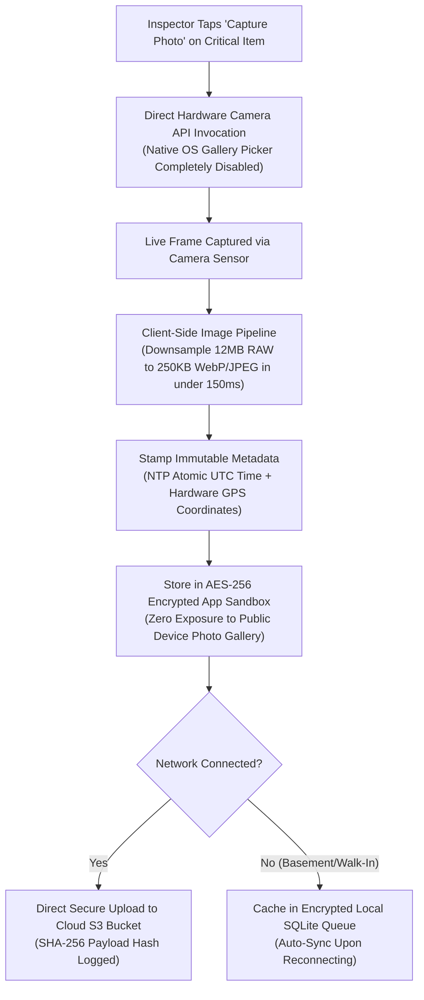

In multi-unit retail chains, quick-service restaurant (QSR) networks, healthcare clinic systems, and manufacturing facilities, the most common failure mode in operational compliance is **"pencil-whipping"**:

A store manager or roving field auditor sits in a back office or nearby coffee shop, opens a 50-point mobile inspection checklist, and taps "Pass" down the entire screen in 90 seconds without physically inspecting a single asset.

When audit systems allow staff to submit evaluations without physical proof—or permit users to upload pre-saved photos from smartphone camera rolls—compliance data becomes a dangerous corporate illusion. Executive dashboards report a flawless 98% compliance score, while broken walk-in chillers, blocked fire exits, and uncalibrated sterilizers sit uninspected until a health department shutdown, product recall, or regulatory penalty occurs.

The solution is not requiring photos for every single checkbox—which creates paralyzing [audit fatigue](/blog/how-to-reduce-audit-fatigue-among-store-managers)—but configuring an audit app with **mandatory photo evidence on the "Vital Few" critical control points**.

This guide provides the complete architectural and operational blueprint for implementing tamper-proof, photo-required audits across distributed locations.

---

## The Operational Failure of Blanket vs. Zero Photo Mandates

Most organizations oscillate between two failed extremes when deploying mobile inspection apps:

```
┌────────────────────────────────────────────────────────────────────────┐
│                   THE TWO EXTREMES OF AUDIT EVIDENCE                   │
├────────────────────────────────────────────────────────────────────────┤
│ Extreme A: The "Honor System" (Zero Mandatory Photos)                 │
│ • Checklists consist entirely of Yes/No taps.                          │
│ • Fast for frontline staff (under 3 minutes).                          │
│ • Fatal Flaw: Invites widespread pencil-whipping; zero proof of on-site│
│   execution; impossible to verify before-and-after maintenance fixes.  │
│                                                                        │
│ Extreme B: The "Blanket Mandate" (Photos on Every Checkpoint)          │
│ • Managers must photograph all 85 items, including light switches and  │
│   broom closets.                                                       │
│ • Fatal Flaw: Triggers massive audit fatigue; shifts consume 60+ mins; │
│   staff resort to cheating tactics like photographing paper photos or  │
│   computer screens. See our forensic guide on catching photo fraud.    │
└──────────────────────────────────┬─────────────────────────────────────┘
                                   │
                                   ▼
┌────────────────────────────────────────────────────────────────────────┐
│ The Balanced Optimum: Smart Conditional Evidence Logic                 │
│ • 80% of routine checkpoints: Quick binary Yes/No taps.                │
│ • 20% Critical Control Points (CCPs): Mandatory live camera capture.   │
│ • 100% of Failed Items: Mandatory "Before" photograph to trigger CAPA. │
└────────────────────────────────────────────────────────────────────────┘
```

By concentrating mandatory photo evidence exclusively on **Critical Control Points (CCPs)** and **Failed Checkpoints**, businesses maintain rapid audit velocity while ensuring unassailable legal and operational proof where risk is concentrated.

To learn how to detect fraudulent photo workarounds, read our in-depth investigation on [how to catch reused or old photos in audit submissions](/blog/how-to-catch-reused-or-old-photos-in-audit-submissions).

---

## The Critical Control Point (CCP) Decision Matrix

How do operations leaders determine which questions require mandatory photo proof? Use the **Hazard & Severity Decision Matrix**:

| Checkpoint Category | Operational Checkpoint Example | Photo Mandatory? | Trigger Condition | Operational Justification |
| :--- | :--- | :---: | :---: | :--- |
| **Cold Chain / Food Safety** | Walk-in freezer temperature at or below -18°C | **YES** | Always Mandatory | High statutory risk. Photo of digital display verifies compressor health. |
| **Life Safety & EHS** | Emergency fire exits unblocked and unlocked | **YES** | Always Mandatory | Life safety liability. Proves rear egress is physically unobstructed. |
| **Life Safety & EHS** | Fire extinguisher pressure gauge in green zone | **YES** | Always Mandatory | OSHA / Local fire code compliance. Proves operational readiness. |
| **Cash & Vault Security** | Safe door locked & cash drawer reconciled | **YES** | Always Mandatory | Loss prevention. Eliminates uninspected overnight cash float discrepancies. |
| **Visual Merchandising** | Promotional entrance display built to planogram | **YES** | Always Mandatory | Revenue assurance. Confirms seasonal marketing execution on launch day. |
| **Sanitation / Cleanliness** | Handwash sink stocked with soap and paper towels | **CONDITIONAL** | Only if "FAIL" | Quick tap if compliant; photo required on failure to dispatch replenishment. |
| **Facility Maintenance** | Customer seating area furniture free of damage | **CONDITIONAL** | Only if "FAIL" | Mandatory "Before" photo required to generate automated repair work order. |
| **Routine Housekeeping** | Restroom floor swept and dry | **NO** | Never | Routine operational hygiene. Monitored via manager visual walk-through. |

---

## Mobile Architecture: How Tamper-Proof Photo Capture Works

A reliable photo-based audit app cannot simply use standard web file inputs (`<input type="file">`), which allow smartphone users to pick old screenshots or forwarded images from their gallery.

Modern audit platforms like [Audiment](/) implement a hardware-level client-side camera pipeline:



### Key Technical Safeguards:

1. **Native OS Camera Sensor Lockdown:** The mobile SDK interacts directly with the device camera driver (CameraX on Android, AVFoundation on iOS). The operating system's image picker is never invoked, making it technically impossible for users to upload pre-existing photos.
2. **Client-Side Image Compression Pipeline:** High-end smartphones capture 12MB to 48MB raw images. Uploading ten 48MB photos in a remote store with weak 3G coverage crashes the application. Audiment processes the raw frame on the device within 150ms—resizing the image to a sharp 1600x1200 resolution and compressing it to ~250KB WebP format with zero visual loss on meter dials or asset barcodes.
3. **Encrypted Sandbox Storage:** To prevent sensitive retail cash counters, bank vaults, or healthcare facilities from leaking onto personal devices, images are saved strictly within the app's encrypted sandbox container. They never appear in Apple Photos or Google Photos.
4. **Offline Resilience with Local Queueing:** Audits frequently occur in RF-shielded environments (underground parking, metal walk-in freezers, concrete basements). The mobile app caches the compressed photo, timestamp, and GPS fix in an encrypted local database, automatically synchronizing with central servers once network connectivity returns.

---

## Streamlining Contractor and Maintenance Workflows

Requiring photo evidence does more than verify compliance—it dramatically accelerates facility maintenance and eliminates disputed vendor invoices through **Side-by-Side Visual CAPA**:

```
Visual Corrective Action Protocol:

[Auditor Flags Cracked Ceramic Floor Tile in Prep Area]
                          │
                          ▼
[Mandatory "Before" Photo Captured]
App automatically generates High-Priority CAPA Ticket #1042.
Photo instantly routed via email/SMS to Masonry Contractor.
                          │
                          ▼
[Contractor Dispatched with Visual Context]
Contractor sees exact tile color, dimensions, and mortar condition before arriving.
Brings correct replacement materials on the first trip (First-Time Fix Rate climbs 40%).
                          │
                          ▼
[Mandatory "After" Photo Submission]
Contractor completes repair, opens ticket in Audiment mobile web portal,
and captures live photo of newly set, grouted tile.
                          │
                          ▼
[Facility Manager Approves Invoice]
Facility Manager reviews side-by-side Before/After photos on dashboard.
Invoice approved in 60 seconds with zero disputed hours or false claims.
```

Without visual proof, facilities management relies on vague descriptions like *"floor damaged in back"*, resulting in wasted vendor diagnostic visits and billing arguments. Photo-backed CAPA creates complete transparency.

---

## Industry Blueprint: Where Mandatory Photos Drive Highest ROI

### 1. Quick-Service Restaurants (QSR) & Grocery Chains
- **Critical Points:** Walk-in freezer and line prep cooler temperature readouts, sanitizing solution titration strips, deep fryer oil quality color discs, emergency rear egress.
- **ROI Impact:** Prevents large-scale inventory spoilage, eliminates foodborne illness outbreaks, and guarantees passing scores on unannounced municipal health inspections.

### 2. Retail Banking & NBFC Branches
- **Critical Points:** Vault time-delay locks, alarm control panel statuses, CCTV DVR 90-day storage capacity screens, gold loan tamper-evident packet seals. Explore our specialized guide on [Branch Audit Software for Banks and NBFCs](/blog/branch-audit-software-for-banks-and-nbfcs-with-geo-tagged-proof).
- **ROI Impact:** Protects against internal cash substitution, satisfies Reserve Bank statutory mandates, and verifies physical security integrity.

### 3. Commercial Facilities & Healthcare Networks
- **Critical Points:** Autoclave cycle completion readouts, biomedical waste disposal bin color-coding, emergency eye-wash station flow tests, backup generator fuel tank gauges.
- **ROI Impact:** Guarantees OSHA / biohazard compliance and prevents catastrophic facility downtime.

---

## Four Operational Metrics to Measure Evidence Integrity

Operations executives should monitor four evidence quality indicators on [operational dashboards](/platform/operational-dashboards):

```
┌───────────────────────────────────────┬───────────────────────────────────────┐
│ 1. Mandatory Photo Compliance (%)     │ 2. First-Time Fix Ratio (FTFR)        │
│ Percentage of CCP checkpoints         │ Percentage of maintenance defects     │
│ submitted with valid live camera      │ resolved on the initial technician    │
│ verification (Target: 100%).          │ visit due to clear visual triage.     │
├───────────────────────────────────────┼───────────────────────────────────────┤
│ 3. Supervisory Image Rejection Rate   │ 4. Mean Sync Latency (Minutes)        │
│ Percentage of photos flagged by Area  │ Average time elapsed between offline  │
│ Managers for poor framing, occlusion, │ photo capture in walk-ins and final   │
│ or unreadable gauge dials.            │ cloud database synchronization.       │
└───────────────────────────────────────┴───────────────────────────────────────┘
```

1. **Mandatory Photo Compliance (%):** Measures systematic adherence across all operating units. Any unit dropping below 98% indicates supervisory neglect.
2. **First-Time Fix Ratio (FTFR):** Demonstrates the operational efficiency gained by supplying visual defect photos to field contractors.
3. **Supervisory Image Rejection Rate (%):** Keeps frontline inspectors honest. If store staff know supervisors actively reject blurry photos, photo quality remains high.
4. **Mean Sync Latency (Minutes):** Verifies that the mobile offline caching engine is operating smoothly without clogging local device memory.

---

## How Audiment Enforces Tamper-Proof Photo Audits

[Audiment](/) is the leading proof-based audit management platform for multi-location businesses that demand genuine operational accountability:

- **Hardware Camera Lockdown:** Blocks the operating system photo gallery, requiring live sensor capture on every mandatory photo checkpoint.
- **GPS Polygon Geofencing:** Verifies that photos are captured within the physical perimeter of the store or branch facility.
- **Granular CCP Blueprint Configuration:** Easily mark individual checkpoints as "Mandatory Photo Always", "Photo on Failure Only", or "Checkbox Only".
- **Closed-Loop Visual CAPA:** Automatically converts failed photo checkpoints into actionable maintenance work orders requiring verified "After" photos for resolution.

### Transparent Pricing: Free Tier & Unlimited Paid Tier

* **Free Tier (Free Forever):** Ideal for single-location operators. Includes 1 physical location, up to 3 auditor logins, 25 monthly audits, and full proof-verification tools (native camera lockdown and GPS check-in).
* **Paid Tier (Custom Flat Pricing):** Designed for growing multi-location brands. Everything is unlimited—unlimited locations, unlimited users, supervisors, and auditor accounts (zero per-seat licensing), and unlimited monthly audits and custom templates.

---

## Frequently Asked Questions

<details>
<summary><strong>Can staff take photos inside metal walk-in freezers or basements with zero cellular reception?</strong></summary>
<p>Yes. Audiment operates 100% offline. The camera captures the photo, compresses it locally, stamps the hardware timestamp and cached GPS fix, and encrypts the file within local device storage. The moment the device reconnects to Wi-Fi or cellular coverage, all photos synchronize automatically in the background.</p>
</details>

<details>
<summary><strong>Does uploading high-resolution photos consume excessive mobile data?</strong></summary>
<p>No. Audiment's client-side compression engine reduces raw 12MB camera photos down to lightweight, crystal-clear 250KB WebP images in milliseconds before transmission. An entire 20-photo audit consumes less than 5MB of mobile data, uploading smoothly even over slow 3G networks.</p>
</details>

<details>
<summary><strong>Can administrators configure photos to be required only when an item fails?</strong></summary>
<p>Yes. Audiment features powerful conditional logic. You can configure any checkpoint to be a rapid Yes/No tap when compliant, while automatically triggering a mandatory camera photo and corrective action ticket if the inspector selects "Fail".</p>
</details>

<details>
<summary><strong>Are captured audit photos stored on the employee's personal device?</strong></summary>
<p>No. Images captured within the Audiment application are written directly to an encrypted application sandbox container and never saved to the smartphone's public photo gallery or cloud backups, protecting corporate operational privacy.</p>
</details>

---

## Transform Checklists into Verifiable Proof

Stop accepting blind checkmarks and unverified self-assessments. Equip your operations with proof-based audits that reflect ground-level reality.

Explore how [Audiment](/solutions/retail-audit-software) enforces mandatory photo proof across retail, restaurant, and healthcare networks, or read our guide on [Proof-Based Audits vs. Standard Checklist Audits](/blog/proof-based-audits-vs-standard-checklist-audits).
