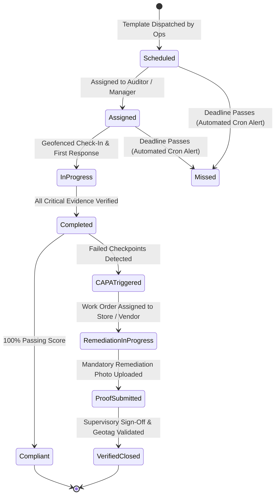

Most operational teams know how to create an audit checklist. The breakdown happens the moment those audits are published. 

Was the inspection assigned to the right regional manager? Did the store manager complete the daily walk-through before the lunch rush, or did they rush through it at 11:00 PM from home? When three fire extinguishers and a walk-in cooler failed inspection, who was notified, when was the vendor dispatched, and what proof confirms the defects were fixed?

Without dedicated tracking, an organization does not have an audit system—it has an archive of static PDFs.

**Audit tracking software** provides the real-time governance layer between field execution and executive oversight. It monitors every stage of the audit lifecycle, alerts leadership to missed inspections, and forces failed items into automated, proof-backed corrective action loops.

---

## What Is Audit Tracking Software?

```
Traditional Reporting vs. Real-Time Audit Tracking:

┌───────────────────────────────────────┬───────────────────────────────────────┐
│ Traditional Audit Reporting           │ Real-Time Audit Tracking              │
├───────────────────────────────────────┼───────────────────────────────────────┤
│ • Static historical summary           │ • Live operational state machine      │
│ • "Audit completed on Oct 14"         │ • Real-time alerts for missed audits  │
│ • Manual Excel consolidation          │ • Automated SLA escalation chains     │
│ • Corrective actions lost in email    │ • Photo-backed CAPA verification      │
│ • No visibility into in-flight audits │ • Cross-store trend & recidivism data │
└───────────────────────────────────────┴───────────────────────────────────────┘
```

Audit tracking software monitors the operational state of inspections across physical locations in real time. Rather than treating an audit as a completed event, it manages audits as active workflows: dispatching templates, monitoring scheduled deadlines, detecting unauthorized skips, routing non-conformances, and verifying remediation evidence.

As multi-unit businesses scale from 5 to 50 or 500 locations, personal follow-up collapses. An operations director cannot call 40 store managers every morning to ask if food safety logs were checked. Tracking software automates that supervisory layer.

---

## The Audit Lifecycle State Machine

A true audit tracking system models every state an inspection passes through. If a platform only records data when a form is submitted, it is a form builder, not a tracking engine.



### The Six Status Signals That Matter:

1. **Scheduled / Published:** The inspection template is dispatched to specific store profiles (e.g., QSR formats receive food safety templates; express kiosks receive merchandising checklists).
2. **Assigned:** A specific field auditor, area manager, or store leader is bound to the assignment with an explicit completion window.
3. **In-Progress:** The auditor has verified their physical presence on-site via GPS check-in and begun capturing live checkpoint responses.
4. **Missed (Automated Detection):** The deadline window expired without submission. The system automatically marks the audit as missed, increments the location's risk index, and alerts area leadership.
5. **Completed:** The audit was submitted on-site within the window, with all mandatory evidence, timestamps, and digital signatures validated.
6. **Active CAPA (Corrective Action):** One or more checkpoints failed. The system automatically isolates non-conformances into standalone remediation tickets with strict resolution deadlines.

---

## How Tracking Software Handles Remediation (The CAPA Loop)

The true test of audit tracking software is what happens **after** an audit score drops. In traditional systems, low scores produce email chains and finger-pointing. In closed-loop audit tracking software, non-conformances trigger automated remediation workflows:

```
Defect Identified: Walk-in Cooler Temperature at 8.5°C (Threshold: Under 4.0°C)
                               │
                               ▼
     [Audiment Auto-Generates Urgent Priority Corrective Action]
     • Assignee: Store Manager & Regional HVAC Vendor
     • Resolution SLA: 4 Hours
     • Evidence Rule: Mandatory live photo of recalibrated thermostat dial
                               │
                               ▼
     [Escalation Engine Monitors Timer]
     • Hour 2: Automated SMS reminder to Store General Manager
     • Hour 4 (Overdue): Alert auto-escalated to VP of Operations
                               │
                               ▼
     [Remediation Proof Submitted]
     • HVAC technician repairs compressor
     • Store Manager photographs digital temp display at 3.2°C
     • App validates hardware camera timestamp and store GPS perimeter
                               │
                               ▼
     [Ticket Verified & Closed]
     • Operations dashboard logs 3.4-hour resolution MTTR
     • Historical database flags location for cooling equipment review
```

Without an automated remediation engine, multi-location businesses accumulate hundreds of unresolved safety, operational, and brand defects. [Corrective action tracking](/platform/corrective-actions) converts audit findings into closed-loop accountability.

---

## Comparison: Audit Tracking Software vs. Alternative Systems

When evaluating audit tracking solutions, operations executives typically compare four distinct architectural approaches:

| Feature / Capability | Manual Tools (Excel, WhatsApp, Email) | Form Builders (Google Forms, Typeform) | Legacy Field Inspection Apps (SafetyCulture / iAuditor) | Audiment Proof-Based Audit Tracking |
| :--- | :---: | :---: | :---: | :---: |
| **Real-Time Dispatch & Schedule Tracking** | None (Manual files) | None (Static links) | Yes | **Yes (Automated cron scheduling)** |
| **Automated Missed-Audit Detection** | None | None | Limited (Requires paid add-ons) | **Instant automated alerts to admins** |
| **Anti-Fraud Verification** | None | None | Weak (Allows camera roll uploads) | **Hardware camera lock & GPS geofencing** |
| **Automated CAPA Ticketing** | None (Manual follow-up) | None | Basic (Manual task creation) | **Instant auto-ticketing by severity** |
| **SLA Escalation Chains** | None | None | Limited | **Tiered multi-level executive alerts** |
| **Trend & Recidivism Detection** | Manual pivot tables | None | Standard reporting | **Automated 3x consecutive failure alerts** |
| **Pricing Predictability** | Free (High labor cost) | Low | High per-seat pricing ($24–$39/user/mo) | **Flat per-operation pricing (Unlimited seats)** |

---

## Key Metrics Executive Leadership Must Track

Effective audit tracking software aggregates ground-level checkpoints into actionable executive dashboards. Chief Operating Officers and Heads of Quality should monitor four core indicators:

```
┌───────────────────────────────────────┬───────────────────────────────────────┐
│ 1. Audit Execution Rate (%)           │ 2. Mean Time to Remediation (MTTR)    │
│ Percentage of scheduled inspections   │ The average hours elapsed between     │
│ completed on time vs. missed across   │ identifying a non-conformance and     │
│ all operating locations.              │ verified proof-backed closure.        │
├───────────────────────────────────────┼───────────────────────────────────────┤
│ 3. Checkpoint Recidivism Rate (%)     │ 4. First-Pass Quality Score           │
│ Frequency of the same violation       │ Percentage of audits completed with   │
│ recurring at the same location within │ zero critical corrective actions      │
│ trailing 90-day cycles.               │ required.                             │
└───────────────────────────────────────┴───────────────────────────────────────┘
```

1. **Audit Execution Rate (%):** If a 100-store chain schedules 400 monthly audits and 42 are marked missed by the system, the 89.5% execution rate immediately highlights regional supervisory lapses.
2. **Mean Time to Remediation (MTTR):** Tracking how fast stores resolve safety and operational hazards. High-performing chains maintain an MTTR under 12 hours for high-severity violations.
3. **Checkpoint Recidivism Rate (%):** Identifies chronic failures. If "Restroom Sanitization" or "Cash Drawer Reconciliation" fails three times in 60 days at the same location, the issue is systemic operational failure, not an isolated oversight.
4. **First-Pass Quality Score:** Measures baseline operational discipline before corrective interventions are required.

---

## How Audiment Delivers Modern Audit Tracking

[Audiment](/) was designed specifically for multi-unit retail, restaurant, healthcare, and banking chains that require tamper-proof execution and automated remediation tracking.

- **Automated Deadline Governance:** Our background scheduler continuously evaluates audit schedules. When an audit window lapses, the audit is instantly flagged as **Missed**, notifying the store general manager and regional director.
- **Proof-Backed Fieldwork:** Audiment enforces native camera capture (blocking photo gallery uploads) and GPS check-ins, ensuring that every tracked audit represents verified on-site presence.
- **Automated Escalation Chains:** Unresolved corrective actions automatically climb the organizational hierarchy based on custom SLAs—from store supervisor to area director to VP of Operations.
- **Operational Health Dashboards:** Executive leadership monitors real-time league tables, recurring failure trends, and regional compliance health across [operational dashboards](/platform/operational-dashboards).

### Transparent Pricing: Free Tier & Unlimited Paid Tier

Audiment eliminates the penalizing per-user seat fees that discourage companies from rolling out audit tracking software to all frontline staff:

* **Free Tier (Free Forever):** Ideal for single-location operators. Includes 1 physical facility, up to 3 auditor logins, 25 monthly audits, and full proof-verification tools (native camera lockdown and GPS check-in).
* **Paid Tier (Custom Flat Pricing):** Built for growing multi-location brands. Everything is unlimited—unlimited locations, unlimited users, supervisors, and auditor accounts (zero per-seat licensing), and unlimited monthly audits and custom templates. Pricing is structured as a predictable flat subscription.

---

## Frequently Asked Questions

<details>
<summary><strong>What is the difference between audit tracking software and audit reporting tools?</strong></summary>
<p>Audit reporting tools generate static retrospective documents (PDFs or spreadsheets) summarizing an audit after it finishes. Audit tracking software manages the live, end-to-end lifecycle: monitoring schedule adherence, detecting missed audits, dispatching automated SLA reminders, and tracking failed checkpoints until verified photo-backed resolution.</p>
</details>

<details>
<summary><strong>How does audit tracking software detect missed audits automatically?</strong></summary>
<p>The system monitors predefined audit windows (e.g., daily opening checklists must be submitted by 9:30 AM; weekly hygiene audits by Friday 5:00 PM). If an audit remains unsubmitted when the window expires, an automated background job flags the record as "Missed" and routes immediate alerts to regional supervisors.</p>
</details>

<details>
<summary><strong>Can store managers close corrective action tickets without proof?</strong></summary>
<p>In Audiment, administrators can configure mandatory proof rules for corrective action closure. A store manager cannot simply tap "Issue Resolved"; they must capture a live, timestamped, geofenced photograph demonstrating that the physical defect has been repaired before the ticket can close.</p>
</details>

<details>
<summary><strong>How does audit tracking handle operations in low-connectivity environments?</strong></summary>
<p>Audiment operates completely offline. Field auditors and managers can complete scheduled inspections, take photos, and log CAPA resolutions in cellular dead zones. The software encrypts data locally and syncs seamlessly with central tracking dashboards once internet connectivity is restored.</p>
</details>

---

## Gain Full Operational Visibility

Stop guessing whether operational audits are occurring on the ground. Replace disconnected spreadsheets with automated tracking, real-time alerts, and proof-backed remediation.

Explore [Audiment's Corrective Action Tracking](/platform/corrective-actions) or read our comprehensive guide on [What Is Audit Management](/blog/what-is-audit-management) to standardize your multi-location operations.
