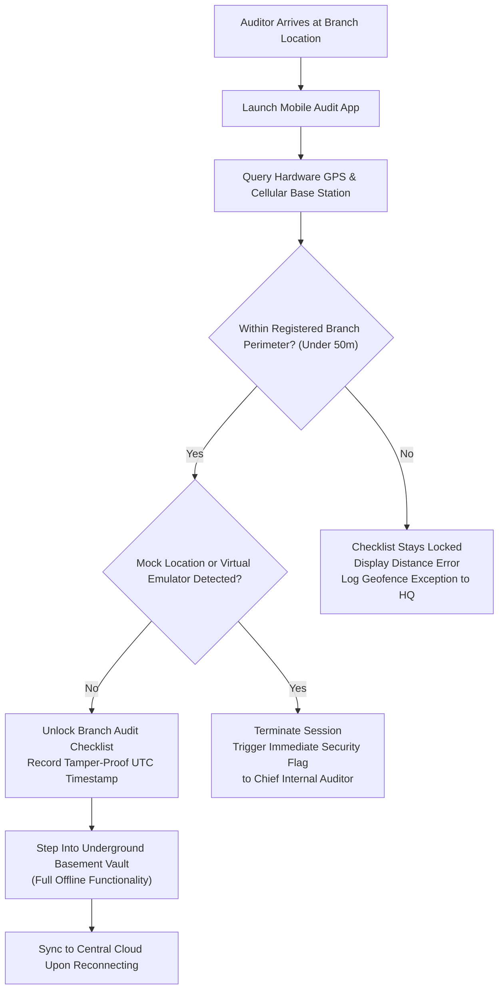

Operating a distributed retail banking network, microfinance institution (MFI), or Non-Banking Financial Company (NBFC) across hundreds of Tier-2, Tier-3, and rural branches involves intense regulatory scrutiny. In India, institutions must comply with Reserve Bank of India (RBI) mandates—specifically the **Risk-Based Internal Audit (RBIA)** framework, Master Directions on Cash Management, physical security mandates, and gold loan custody protocols.

Yet, Internal Audit Directors and Chief Risk Officers (CROs) frequently discover a systemic breakdown in the field: roving branch auditors conduct audits from local hotel rooms, accept scanned registers over WhatsApp, backdate sign-offs, and leave critical physical security vulnerabilities uninspected.

When vault alarms fail, CCTV storage loops overwrite before 90 days, or cash counts are signed off without physical verification, institutions face severe operational risks, internal fraud, and regulatory penalties.

[Audiment](/) provides purpose-built audit management software for multi-location financial institutions, combining hardware-gated GPS geofencing, native camera tamper protection, and automated corrective action tracking (CAPA) to verify physical compliance at every branch.

---

## Why Banks and NBFCs Struggle with Traditional Branch Audits

Traditional internal branch audits in distributed banking networks suffer from structural vulnerabilities that paper binders, email threads, and static Excel workbooks cannot solve.

```
Vulnerabilities in Traditional Bank & NBFC Branch Audits:

1. The "Hotel Room Audit" (Ghost Auditing):
   Roving auditors assigned to rural or semi-urban clusters call branch managers to email 
   scanned register pages, signing off on branch inspections without ever setting foot inside.

2. Unverified Cash & Gold Vault Verification:
   Physical cash counts and gold loan packet audits are documented on paper without 
   cryptographic, timestamped photographic proof, allowing temporary cash substitution.

3. Latent Non-Conformance Visibility:
   Field findings take 2 to 4 weeks to compile into formal committee decks, leaving severe physical 
   security defects (e.g., failed vault time-delay locks, expired fire cylinders) unaddressed.

4. Failure to Satisfy RBI Statutory Inspection:
   Statutory inspectors demand unalterable audit trails. Disconnected spreadsheets fail scrutiny 
   due to the absence of verifiable device metadata, tamper-proof timestamps, and change histories.
```

When an institution manages 50 to 1,500 branches across diverse geographies, executive leadership loses visibility into ground reality. Regional audit heads face pressure to soften findings to maintain local relationships, while branch managers treat audits as administrative checklist exercises rather than security risk controls.

---

## What Makes Branch Audit Software Tamper-Proof?

To eliminate ghost audits and falsified inspection records, modern branch audit systems enforce hardware-level constraints directly through the mobile application.

| Security Dimension | Banking Operational Need | Software Implementation |
| :--- | :--- | :--- |
| **Physical Branch Presence** | Verify the auditor is physically inside the branch premises | Hardware GPS coordinates must match registered branch geofence (within 50 meters) |
| **Tamper-Proof Photo Evidence** | Eliminate recycled photos of cash vaults, strongrooms, and CCTV racks | Direct camera sensor integration; gallery and file picker uploads strictly blocked |
| **Dual-Custody Sign-Off** | Verify joint vault cash verification with branch manager | On-screen dual biometric/digital signatures locked with UTC timestamps |
| **Gold Loan Packet Verification** | Inspect tamper-evident seals on pledged collateral packets | Macro photo capture with barcode/packet number scanning and tag verification |
| **Vault Lock Verification** | Verify time-delay locks and alarm sensor operation | Live macro-photo required of dial positions and control panels |
| **Regulator-Ready Dossiers** | Immediate export of RBI/statutory inspection records | 1-click automated PDF generation with GPS coordinates, timestamps, and evidence hashes |

By replacing open-ended checkboxes with verifiable evidence rules, financial institutions transform subjective opinion into objective, auditable operational records.

---

## 20-Point Retail Bank & NBFC Branch Audit Checklist

A regulatory-grade physical branch audit protocol spans physical strongroom integrity, electronic surveillance, loan collateral preservation, statutory customer disclosures, and emergency business continuity.

The table below outlines the core control checkpoints enforced through automated branch inspection workflows:

| # | Inspection Checkpoint | Control Category | Mandatory Evidence Required | Risk Weight |
|---|---|---|---|:---:|
| 1 | **Vault Dual-Custody Key Register** | Cash & Vault | Live photo of updated physical key register & dual sign-off | High |
| 2 | **Surprise Vault Physical Cash Count** | Cash & Vault | Live photo of physical cash verification sheet & safe interior | Critical |
| 3 | **Vault Time-Delay Lock Functionality** | Physical Security | Photo of time-lock dial & verification of delay timer setting | High |
| 4 | **Emergency Foot-Switch / Duress Alarm** | Physical Security | Silent alarm trigger confirmation test with central monitoring | Critical |
| 5 | **CCTV Coverage & 90-Day DVR Retention** | Electronic Security | Live photo of DVR system settings showing storage capacity & days | Critical |
| 6 | **Camera Alignment on Cash Counters & Vault Door** | Electronic Security | Visual confirmation of active video streams with zero blind spots | High |
| 7 | **Gold Loan Packet Tamper-Evident Seals** | Collateral Custody | Macro photo of randomized sample packets (minimum 10% sample) | Critical |
| 8 | **Gold Safe Dual-Lock Verification** | Collateral Custody | Verification of key custodian separation (Manager + Joint Custodian) | High |
| 9 | **Title Deed Fireproof Safe Verification** | Collateral Custody | Photo of locked fireproof cabinet housing original property documents | High |
| 10 | **Fire Extinguisher Pressure & Servicing** | Life Safety | Photo of maintenance tag showing servicing within trailing 12 months | High |
| 11 | **Smoke & Thermal Detector Operational Test** | Life Safety | Physical walk-through test of branch smoke detection sensors | Medium |
| 12 | **RBI Ombudsman Scheme Noticeboard** | Statutory Disclosure | Photo of customer lobby noticeboard with updated contact details | Medium |
| 13 | **Current Interest Rate & Service Charge Display** | Statutory Disclosure | Photo of public display board matching latest head-office circular | Medium |
| 14 | **BCSBI & Fair Practices Code Availability** | Statutory Disclosure | Physical copy verified at customer inquiry helpdesk | Low |
| 15 | **UPS Battery Bank Load Test & Run Time** | Infrastructure | Photo of battery room & recorded voltage readings under full load | High |
| 16 | **Diesel Generator Fuel Level & Run Log** | Infrastructure | Verification of logbook hours and fuel tank float gauge | Medium |
| 17 | **Physical KYC Document Storage & Access Control** | Data Privacy | Photo of locked record room; visitor register verification | High |
| 18 | **Unclaimed Demand Draft / Cheque Book Register** | Accounting Control | Physical count of blank cheque books vs. inventory register | High |
| 19 | **ATM Vestibule Security & Skimming Inspection** | Physical Security | Photo of card reader mouth, keypad shield, and ATM CCTV camera | High |
| 20 | **Pest Control & Cleanliness in Collateral Vault** | Asset Preservation | Inspection of moisture absorbers and pest control traps in vault | Low |

---

## How Hardware-Gated Geo-Tagging Prevents Fake Audits

Relying on standard smartphone location services is insufficient for financial compliance because standard operating systems permit mock location apps, VPNs, and manual coordinate overrides.

To ensure true physical presence, modern branch audit systems query device-level satellite hardware and cross-reference multiple positioning inputs:



### The Geofence Verification Mechanics

1. **Polygon Geofencing:** Rather than a simple radius circle that might overlap with adjacent buildings or streets, branches are configured with polygonal GPS boundaries encompassing the physical property lines.
2. **Anti-Mock Detection:** The application queries the Android/iOS kernel to detect active developer options, mock location providers, or device rooting/jailbreaking frameworks. If mocking is active, the app refuses execution.
3. **Cellular Base Station Corroboration:** In dense urban corridors or deep basement strongrooms where GPS satellite signals degrade, the system corroborates cellular cell tower IDs and Wi-Fi BSSID signals to authenticate proximity before transitioning to offline mode.

---

## Automated CAPA: Closing the Remediation Loop

Flagging a failed vault alarm or an unserviced fire extinguisher is useless if the finding sits in an audit report for 30 days. In high-risk financial environments, non-conformances must immediately trigger automated **Corrective and Preventive Action (CAPA)** workflows.

```
Critical Finding Workflow:

[Auditor Flags Failed CCTV Camera in Cash Counter Area]
                      │
                      ▼
[Audiment Auto-Generates Urgent CAPA Ticket]
- Severity: CRITICAL
- Remediation SLA: 24 Hours
- Automated Alert sent via SMS/Email to Branch Manager & Regional Facility Vendor
                      │
                      ▼
[Branch Manager Arranges Technician Repair]
                      │
                      ▼
[Branch Manager Opens Audiment App]
- Takes live, mandatory photo proof of repaired CCTV camera feed
- Adds technician service work-order number & signature
                      │
                      ▼
[Verification Layer]
- System verifies GPS coordinates of photo submission
- Regional Security Officer reviews and approves closure
- Ticket marked CLOSED; audit trail logged permanently for RBI examiners
```

Without automated CAPA tracking, banking networks accumulate thousands of orphaned audit findings. With automated ticketing, every failure has a named owner, an enforceable SLA, and proof-backed closure.

---

## What Metrics Chief Risk Officers and Audit Committees Must Track

Chief Risk Officers (CROs), Heads of Internal Audit, and Audit Committees need aggregated, real-time risk intelligence, not hundreds of individual branch PDF attachments.

Leadership should evaluate branch operational health using four key metrics:

```
┌───────────────────────────────────────┬───────────────────────────────────────┐
│ 1. Physical Security Compliance Index │ 2. Critical CAPA Resolution Latency   │
│ Aggregate percentage score measuring  │ Average hours elapsed between         │
│ vault, CCTV, alarm, and physical fire │ detecting a high-risk security flaw   │
│ safety readiness across all branches. │ and verified photo-backed closure.    │
├───────────────────────────────────────┼───────────────────────────────────────┤
│ 3. Geofence Discrepancy Rate          │ 4. Repeat Finding Ratio               │
│ Frequency of attempted audit starts   │ Percentage of audit deficiencies that │
│ outside approved branch coordinates   │ represent repeat violations from the  │
│ (identifies auditor integrity risks). │ previous audit cycle.                 │
└───────────────────────────────────────┴───────────────────────────────────────┘
```

1. **Physical Security Compliance Index (%):** A normalized score across all operating units. Branches scoring below 85% automatically trigger mandatory supervisory audits within 14 days.
2. **Critical CAPA Resolution Latency (Hours):** The velocity of remediation. Top-tier banks resolve vault and electronic security defects within 24 hours; underperforming networks average 18+ days.
3. **Geofence Discrepancy Rate (%):** Identifies potential integrity issues. A high discrepancy rate in a specific zone indicates roving auditors attempting off-site sign-offs.
4. **Repeat Finding Ratio (%):** Highlights systemic branch neglect. If the same branch fails dual-custody register sign-offs three quarters in a row, the problem is supervisory culture, not knowledge gaps.

---

## Frequently Asked Questions

<details>
<summary><strong>Can branch audit software work offline in basement vault areas with zero cellular signal?</strong></summary>
<p>Yes. The Audiment mobile application operates 100% offline. Auditors can complete cash counts, inspect strongrooms, and photograph security panels in shielded underground vaults. The device encrypts and caches all audit answers, photos, and signatures locally, synchronizing automatically once the auditor returns to cell coverage or branch Wi-Fi.</p>
</details>

<details>
<summary><strong>How does the software handle gold loan packet sampling during surprise audits?</strong></summary>
<p>Auditors use the built-in randomization tool to select a statistically valid sample (e.g., 10% of total pledged packets). The app requires mandatory macro-photographs of the tamper-evident security seals, bar codes, and weight tags, comparing them against the core banking loan register.</p>
</details>

<details>
<summary><strong>How are sensitive banking photos protected on personal or company-issued smartphones?</strong></summary>
<p>All captured photos are encrypted using AES-256 encryption within the app sandbox. Images captured during an audit are never saved to the device's public photo gallery or iCloud/Google Photos backup, preventing confidential vault designs, cash holdings, or customer documents from leaking.</p>
</details>

<details>
<summary><strong>How does Audiment pricing work for large branch networks?</strong></summary>
<p>Audiment offers transparent, predictable pricing without per-seat penalties. The Free tier covers 1 physical location with up to 3 auditor logins and 25 audits per month. For multi-branch banking and NBFC networks, the Paid tier provides custom flat pricing with unlimited branch locations, unlimited auditor and manager accounts, and unlimited monthly audits.</p>
</details>

---

## Strengthen Your Branch Governance

Eliminate ghost audits, secure cash and gold loan operations, and satisfy statutory regulatory requirements with proof-backed branch audit automation. 

Explore how [Audiment](/solutions/retail-audit-software) enforces on-site presence and closed-loop remediation across retail financial networks, or read our comprehensive guide on [What Is Audit Management](/blog/what-is-audit-management) for enterprise operational standards.
