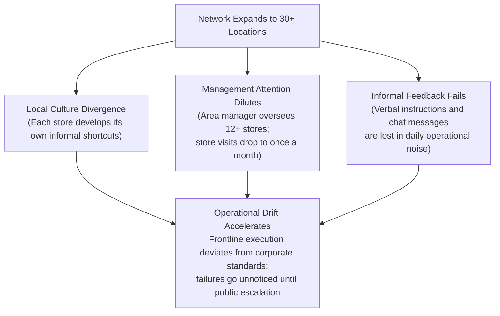

Consistency at scale is not about generating more reports.  
It is about capturing reliable frontline signals, detecting drift early, and enforcing closed-loop follow-through.

Multi-unit retail chains, restaurant groups, healthcare networks, and franchise systems that successfully maintain standards across 50, 100, or 500 locations share a common operational trait: **they have built systems that catch failures before they become habits, and resolve them before they become norms.**

Conversely, businesses that struggle as they expand make a classic organizational error: they attempt to scale informal, founder-led management habits—more phone calls, chaotic WhatsApp groups, impromptu visits, and color-coded spreadsheets—instead of building the infrastructure required for distributed accountability.

This guide outlines the structural breakdown points that occur as location count grows, the management cadences that restore operational control, and how high-performing enterprises maintain consistency across hundreds of remote units.

---

## The Four Stages of Multi-Unit Growth and Where Control Breaks Down

Operational control does not collapse all at once. It degrades predictably at specific scale milestones when an organization outgrows its informal communication habits:

```
┌────────────────────────────────────────────────────────────────────────┐
│                   THE 4 MULTI-UNIT SCALE MILESTONES                    │
├────────────────────────────────────────────────────────────────────────┤
│ STAGE 1: The Founder Phase (1 to 7 Locations)                         │
│ • Control Mechanism: Direct founder presence and personal observation. │
│ • Core Vulnerability: "The founder is the system." Standards hold only │
│   because leadership physically touches each outlet weekly.            │
│                                                                        │
│ STAGE 2: The Middle-Management Fracture (8 to 20 Locations)            │
│ • Control Mechanism: Area coaches and store managers.                  │
│ • Core Vulnerability: WhatsApp communication bloat. Area coaches spend │
│   all day driving between stores; informal instructions are forgotten. │
│                                                                        │
│ STAGE 3: The "Invisibility Zone" (21 to 75 Locations)                  │
│ • Control Mechanism: Regional directors and departmental spreadsheets. │
│ • Core Vulnerability: The "Good News Filter." Middle management filters│
│   bad news upwards. Executive dashboards show 98% pass rates while     │
│   customer complaints climb and store standards drift.                 │
│                                                                        │
│ STAGE 4: Enterprise Systems Governance (75 to 500+ Locations)          │
│ • Control Mechanism: Digital proof systems and exception management.   │
│ • Core Vulnerability: Audit fatigue and data bloat. If audits are not  │
│   focused on critical proof, staff pencil-whip compliance forms.       │
└────────────────────────────────────────────────────────────────────────┘
```

The majority of scaling failures occur during the transition from **Stage 2 to Stage 3**, when leadership attempts to manage a 30-location network using the personal oversight tools that worked for 5 units.

To learn more about standardizing multi-unit procedures, explore our guide on [how to scale from 3 to 20 outlets without losing quality](/blog/how-to-scale-from-3-to-20-outlets-without-losing-quality).

---

## Why Growth Creates Hidden Operational Risk

When location count doubles, operational complexity does not grow linearly—it compounds exponentially:

> **Organizational Complexity Formula:**  
> `Communication Channels = [N * (N - 1)] / 2` (where N is the number of stores and managers)



1. **Local Culture Divergence:** Without automated verification, each location develops its own micro-culture. In Store #4, "clean prep counters" means wiping with hot soapy water and sanitizer; in Store #19, it means a dry paper towel wipe. Without comparative visual evidence, corporate cannot see the divergence.
2. **Dilution of Supervisory Attention:** An Area Manager responsible for 4 stores can coach staff daily. The same Area Manager covering 14 stores becomes a traveling firefighter, spending 70% of their week driving between locations and only addressing visible emergencies.
3. **The "Good News Filter":** Frontline and area managers are incentivized to present passing reports to corporate leadership. Unpleasant truths—such as broken cold-holding equipment or inventory shrinkage—are concealed until they become catastrophic failures.

This divergence is known as [operational drift](/blog/what-is-operational-drift-and-how-it-happens). It is most dangerous when a business is growing rapidly because top-line revenue momentum masks underlying quality erosion.

---

## The Four Pillars of the Scalable Operational Control Model

To maintain standards across dozens of cities or franchise territories, businesses must replace subjective oversight with **four continuous operational pillars**:

```
┌───────────────────────────────────────┬───────────────────────────────────────┐
│ 1. Proof-Based Input Verification     │ 2. Automated Defect Routing (CAPA)    │
│ Critical standards require objective  │ Every failed checkpoint automatically │
│ photographic proof and GPS check-in   │ generates a tracked work order with   │
│ before submission is allowed.         │ an owner and an enforceable SLA.      │
├───────────────────────────────────────┼───────────────────────────────────────┤
│ 3. Closed-Loop Remediation            │ 4. Exception-Based Dashboards         │
│ Resolving an issue requires verified  │ Leadership focuses exclusively on     │
│ "After" photo evidence, preventing    │ outliers, overdue tasks, and repeat   │
│ premature sign-offs on open defects.  │ failure clusters across regions.      │
└───────────────────────────────────────┴───────────────────────────────────────┘
```

### 1. Proof-Based Input Verification
A checklist that accepts simple checkmarks produces data on **what managers intended to do**, not what actually occurred. In contrast, [proof-based audits](/platform/proof-based-audits) mandate tamper-proof photos on high-risk checkpoints (e.g., refrigeration temperatures, fire exits, cash reconciliation).

### 2. Automated Defect Routing (CAPA)
When an audit checkpoint fails, the software instantly extracts the non-conformance into a standalone [Corrective and Preventive Action (CAPA)](/platform/corrective-actions) ticket. The failure does not languish in a 40-page PDF report; it is dispatched to the store manager or maintenance vendor with a countdown timer.

### 3. Closed-Loop Remediation
To prevent "false closure"—where a manager taps "Fixed" without doing the work—closing a critical ticket requires capturing a live, timestamped photograph demonstrating the corrected physical condition.

### 4. Exception-Based Dashboards
Executive leadership at a 100-location company cannot read 3,000 monthly audit reports. They require **exception dashboards** that highlight only stores with declining scores, recurring violations, or overdue corrective actions.

---

## Building a Management Review Cadence That Scales

Operational signals are worthless without a structured management cadence to act upon them. Establish this multi-tiered operational review rhythm:

| Cadence | Operational Focus | Primary Attendees | Agenda & Metrics Reviewed |
| :--- | :--- | :--- | :--- |
| **Daily Shift Pulse (10 Mins)** | Immediate store readiness | Store GM & Shift Leads | Review morning opening checklist, critical food/life safety CCPs, staff muster. |
| **Weekly Ops Standup (30 Mins)** | Tactical non-conformance resolution | Area Coaches & Facility Leads | Review open high-severity CAPA tickets, overdue repairs, and bottom 10% store scores. |
| **Monthly Strategic Review (60 Mins)** | Regional trend & drift analysis | Operations VPs & Regional Directors | Analyze 90-day failure trends, regional score variance, vendor fix times, repeat failure ratios. |
| **Quarterly Governance (90 Mins)** | Capital allocation & system redesign | C-Suite, Board, Chief Risk Officer | Correlation between audit health and store P&L/shrink, franchise compliance, SOP updates. |

```
The Golden Rule of Monthly Operational Reviews:

If repeat-failure concentration is rising across a specific region or category, 
INTERVENE IN THE SYSTEM, NOT JUST INDIVIDUAL BEHAVIOR.

Treating systemic process failures as individual employee faults leads to endless 
"coaching conversations" while the identical violation recurs under the next manager.
```

---

## Operational League Tables: Driving Healthy Accountability

One of the most powerful psychological tools in multi-location management is **transparent rank-order visibility**.

When operational performance is hidden in private emails, store managers lack external benchmarks. When operational scores are published on a centralized network league table, peer accountability activates:

```
Sample Network Operational League Table:

┌──────┬──────────────────────┬─────────────┬─────────────┬────────────────────┐
│ Rank │ Outlet Code & City   │ Audit Score │ Open CAPAs  │ 30-Day Trend       │
├──────┼──────────────────────┼─────────────┼─────────────┼────────────────────┤
│ 01   │ Store #104 (Mumbai)  │ 98.4%       │ 0 Overdue   │ ▲ +2.1% (Top Tier) │
│ 02   │ Store #012 (Delhi)   │ 97.2%       │ 1 In-Prog   │ ── Stable          │
│ 03   │ Store #088 (Bangalore│ 96.5%       │ 0 Overdue   │ ▲ +1.4%            │
│ ...  │ ...                  │ ...         │ ...         │ ...                │
│ 48   │ Store #042 (Pune)    │ 74.1%       │ 6 Overdue   │ ▼ -8.5% (At Risk)  │
│ 49   │ Store #019 (Chennai) │ 69.8%       │ 9 Overdue   │ ▼ -12.4% (Critical)│
└──────┴──────────────────────┴─────────────┴─────────────┴────────────────────┘
```

- **Top Quartile (Reward & Learn):** Identify the specific practices and store managers driving top performance. Promote their routines to the wider network.
- **Bottom Quartile (Targeted Intervention):** Area Managers focus their physical travel time exclusively on the bottom 15% of stores, diagnosing equipment bottlenecks or staffing deficits.

---

## How Audiment Powers Scalable Multi-Unit Control

[Audiment](/) is the operational execution engine built for multi-location brands that demand consistent standards across every storefront:

- **Proof-Based Auditing:** Hardware camera lockdown and GPS geofencing verify that frontline checks happen on the floor, not in a spreadsheet.
- **Automated CAPA Engine:** Transforms audit failures into trackable work orders with resolution SLAs and photo-verified closure.
- **Exception-Based Management:** Executive dashboards highlight only what requires attention—overdue tasks, chronic repeat failures, and outlier stores.
- **Predictable Flat Pricing:** Unlimited users, unlimited auditor seats, and unlimited locations without per-seat taxes.

### Transparent Pricing: Free Tier & Unlimited Paid Tier

* **Free Tier (Free Forever):** Ideal for single-location operators. Includes 1 physical facility, up to 3 auditor logins, 25 monthly audits, and complete proof verification.
* **Paid Tier (Custom Flat Pricing):** Designed for scaling multi-location brands. Everything is unlimited—unlimited locations, unlimited users, supervisors, and auditor accounts (zero per-seat licensing), and unlimited monthly audits and custom templates.

---

## Frequently Asked Questions

<details>
<summary><strong>At what location count does informal management via WhatsApp and spreadsheets collapse?</strong></summary>
<p>Informal management typically begins to fracture between 7 and 10 locations, and collapses completely past 15 locations. At that scale, physical distance prevents direct leadership observation, and informal messages get lost in daily store operations.</p>
</details>

<details>
<summary><strong>How do executive directors monitor 50+ stores without micromanaging?</strong></summary>
<p>By using exception-based reporting. Rather than reviewing hundreds of passing checklist forms, leadership monitors automated dashboards that highlight only failing locations, chronic repeat defects, and overdue corrective action tickets.</p>
</details>

<details>
<summary><strong>How does a proof-based system prevent area managers from being overwhelmed with photos?</strong></summary>
<p>Audiment enforces smart conditional logic. Photos are mandated only on the "Vital Few" critical control points (e.g., refrigeration temps, safe locks, fire doors) and on failed items. Routine checks remain fast binary confirmations, keeping audits under 7 minutes.</p>
</details>

<details>
<summary><strong>Can the software accommodate regional differences across states or countries?</strong></summary>
<p>Yes. Audiment supports centralized master templates with localized conditional sections. Global brand standards remain locked and mandatory across all stores, while regional statutory sections (e.g., state-specific labor notices or climate-specific HVAC protocols) activate only for relevant store profiles.</p>
</details>

---

## Take Control of Your Multi-Location Growth

Scaling your location footprint should not mean diluting your standards. Build the operational infrastructure that ensures consistency across every outlet.

Explore [Audiment's Multi-Location Audit Platform](/) or discover our complete guide on [What Is Audit Management](/blog/what-is-audit-management).
