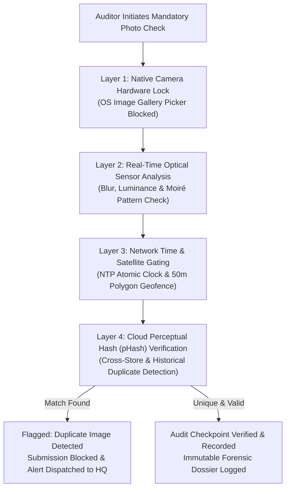

In multi-location retail chains, franchise restaurant networks, hospitality groups, and healthcare facilities, requiring photographic evidence has become standard operating procedure. Corporate headquarters assumes that because a store manager attached a photograph showing a sparkling prep counter, an unblocked fire exit, or a properly calibrated thermometer, the checkpoint was genuinely inspected.

In reality, frontline staff under pressure to maintain 95%+ audit scores develop sophisticated evasion tactics: taking screenshots of photos sent weeks ago in store WhatsApp groups, downloading promotional marketing images from the company website, photographing a computer screen displaying an old picture, or recycling photos captured during a previous audit cycle.

When inspection software permits users to upload images from smartphone camera rolls without forensic verification, photo evidence degrades into an instrument of compliance fraud. 

This guide outlines the technical and operational mechanics used to detect, flag, and eliminate recycled audit photos across distributed field operations.

---

## The Five Ways Field Staff and Managers Fake Audit Photos

Store managers and roving inspectors rarely forge documents out of malice; they do it because of time constraints, understaffing, or poorly designed 100-question daily checklists. Over time, informal workarounds solidify into institutionalized cheating:

```
┌────────────────────────────────────────────────────────────────────────┐
│                   THE 5 AUDIT PHOTO EVASION METHODS                    │
├────────────────────────────────────────────────────────────────────────┤
│ 1. The "Camera Roll Recycle"                                           │
│    A manager selects a photograph of an immaculate food prep counter   │
│    captured three months ago and uploads it from their photo gallery.  │
│                                                                        │
│ 2. The "WhatsApp Group Share"                                          │
│    Staff download photos shared across peer chat channels, using       │
│    another store's clean station to pass their own daily inspection.   │
│                                                                        │
│ 3. The "Screen-of-a-Screen" Capture                                    │
│    When an app locks the camera, the user displays an old photo on a   │
│    laptop or secondary tablet and photographs the monitor screen.      │
│                                                                        │
│ 4. The "Intentional Blur / Occlusion" Trick                            │
│    Auditors smear petroleum jelly, tape, or a thumb over the camera    │
│    lens to submit an unreadable frame, exploiting pass-fail ambiguity. │
│                                                                        │
│ 5. Device Operating System Clock Manipulation                          │
│    Staff roll back their smartphone clock by three days to submit      │
│    missed weekend food safety checks with retroactive timestamps.      │
└────────────────────────────────────────────────────────────────────────┘
```

To understand systemic prevention mechanisms across all audit types, explore our guide on [how to prevent fake audits](/blog/how-to-prevent-fake-audits).

---

## Technical Comparison: Genuine vs. Falsified Photo Signatures

Every digital photograph contains hidden metadata and structural artifacts. When a photo is recycled, forwarded, or captured off a screen, its forensic signature changes radically:

| Forensic Parameter | Genuine Native Capture | WhatsApp Forwarded Image | Screen-of-a-Screen Capture | Smartphone Screenshot |
| :--- | :--- | :--- | :--- | :--- |
| **Storage Source** | Native camera sensor buffer | Device `/Downloads` or `/WhatsApp` directory | Live camera buffer | Device `/Screenshots` folder |
| **EXIF Camera Model** | Exact device hardware (e.g., iPhone 15 Pro, Pixel 8) | Completely stripped or missing | Device hardware matches, but subject displays pixel grid | Hardware ID matches, but resolution matches device screen |
| **Original Capture Timestamp** | Matches current network atomic time (within seconds) | Missing or reflects original chat download time | Matches current time, but visual scene shows historical cues | Timestamp matches screenshot moment, not scene capture |
| **Image Compression Footprint** | Native OS JPEG engine | Proprietary messaging transcoder header (`libjpeg-turbo`) | Native compression, but optical high-frequency moiré patterns | PNG format or non-camera sensor aspect ratio (e.g., 19.5:9) |
| **Embedded GPS Coordinates** | Accurate satellite fix (±5 to 15 meters) | Stripped completely | Matches current phone, but subject location conflicts | Stripped or matches office/home where screenshot was taken |

---

## How Modern Audit Systems Detect Photo Fraud

To ensure photographic integrity, modern audit management platforms implement automated technical controls across four layers of the submission lifecycle:



### 1. Hardware-Level Camera Sensor Binding
The single most effective anti-cheating control is disabling file pickers entirely. 

When a user taps "Capture Photo" in an app like [Audiment](/), the application does not invoke the operating system's gallery picker (`ACTION_GET_CONTENT` or `PHPickerViewController`). Instead, it invokes the direct camera sensor hardware API. The user has zero opportunity to select an existing file, screenshot, or downloaded image from storage.

### 2. Network-Synchronized Atomic UTC Timestamps (NTP)
Relying on the smartphone's internal clock is fatal for compliance because any user can manually adjust their device date in Settings. 

Modern audit software ignores the local system clock. Instead, it queries **Network Time Protocol (NTP)** atomic clock servers via the cellular carrier or GPS satellite time signals. Even if an auditor rolls their device calendar back to last Friday, the submission payload embeds the true, tamper-proof UTC timestamp.

### 3. Detecting "Screen-of-a-Screen" Fraud with Optical Physics
When staff attempt to photograph an old image displayed on an iPad or computer monitor, the camera sensor captures physical optical interference known as the **Moiré Effect**:

```
The Physics of Screen-of-a-Screen Fraud Detection:

[Camera Sensor Pixel Grid]            [LCD / OLED Monitor Sub-Pixel Grid]
          │                                            │
          └─────────────────────┬──────────────────────┘
                                │
                                ▼
        [Spatial Frequency Optical Interference (Moiré Fringing)]
        • Unnatural geometric cross-hatch banding across the image
        • High-frequency backlight refresh flicker
        • Concentrated blue-spectrum chromatic radiation (> 6500 Kelvin)
                                │
                                ▼
    [Automated Image Processing Engine Flags Anomalous Artifacts]
    • Flags image as "High-Probability Screen Capture"
    • Routes finding to Area Director dashboard for immediate spot-check
```

### 4. Perceptual Image Hashing (pHash) Deduplication
What stops a franchise operator from taking one clean photo and submitting it for five different checklist items, or copying images between Store A and Store B?

Modern platforms compute a **Perceptual Hash (pHash)** for every captured image. Unlike cryptographic hashes (SHA-256) where changing one pixel alters the entire hash string, perceptual hashing generates a mathematical fingerprint based on visual frequency distribution:

> **Perceptual Hash Threshold:**  
> `Hamming Distance(H1, H2) <= 5  -->  Images are identical, cropped, or filtered duplicates`

If a manager submits a photo whose visual fingerprint matches an image submitted 45 days ago—even if they cropped the edges or adjusted the brightness—the system instantly flags the image as a duplicate and blocks submission.

---

## Building a Defensible Forensic Dossier for HR & Franchise Disputes

When corporate leadership or franchise legal counsel terminates a contract or executes disciplinary action for falsified compliance records, emotional accusations invite disputes. A technical forensic dossier provides unassailable evidence:

```
Sample Operational Forensic Investigation Dossier:

Incident ID: AUD-FRAUD-2026-882
Target Checkpoint: Store #42 Daily Chilled Prep Table Temperature Verification
Submission Claim: "Passed at 2.8°C on Monday, Nov 16 at 07:45 AM"

FORENSIC EVIDENCE ANALYSIS:
────────────────────────────────────────────────────────────────────────
1. Media File Examination:
   • File Format: JPEG (Quality: 70%, Transcoder: WhatsApp Image Engine)
   • Source Flag: Imported File (Local Path: /storage/emulated/0/WhatsApp/Media)
   • Native Camera Sensor Bypass: CONFIRMED

2. EXIF Metadata Extraction:
   • Embedded Original Capture Date: 2026-08-12T14:10:02Z (96 Days Prior)
   • Hardware Model Mismatch: Captured on Xiaomi Redmi Note 10;
     User's Registered Corporate Device: Samsung Galaxy A34

3. Spatial Coordinate Discrepancy:
   • Registered Store Coordinates: 19.0760° N, 72.8777° E (Mumbai Outlet)
   • Image GPS Coordinates: 18.5204° N, 73.8567° E (Pune, 150 km away)

CONCLUSION:
Conclusive, incontrovertible evidence of willful compliance falsification. 
Audit invalidated; default notice dispatched to franchise partner.
```

Presenting this level of objective forensic proof completely eliminates "he said, she said" arguments during disciplinary reviews or legal proceedings.

---

## Four Operational Metrics to Track Evidence Integrity

Internal audit departments and operations executives should track four standardized metrics on [operational dashboards](/platform/operational-dashboards) to measure network evidence integrity:

```
┌───────────────────────────────────────┬───────────────────────────────────────┐
│ 1. Native Sensor Compliance (%)       │ 2. EXIF Temporal Delta Index          │
│ Percentage of audit photographs taken │ Average discrepancy (in minutes)      │
│ directly through the in-app camera    │ between physical photo capture time   │
│ vs. imported media (Target: 100%).    │ and server submission receipt.        │
├───────────────────────────────────────┼───────────────────────────────────────┤
│ 3. Automated Fraud Alert Frequency    │ 4. Supervisory Photo Rejection Rate   │
│ Number of submissions flagged for     │ Percentage of photos rejected by      │
│ duplicate pHash, moiré artifacts, or  │ Area Managers during review due to    │
│ geofence boundary mismatches.         │ intentional blur or improper framing. │
└───────────────────────────────────────┴───────────────────────────────────────┘
```

1. **Native Sensor Compliance (%):** Any platform allowing less than 100% native camera capture introduces catastrophic compliance blind spots.
2. **EXIF Temporal Delta Index:** A healthy store submits photos within 5 to 15 minutes of real-time inspection. Deltas exceeding 60 minutes indicate batch-uploading or deferred documentation.
3. **Automated Fraud Alert Frequency:** Tracking anomalies by region immediately identifies rogue field auditors or rogue store clusters.
4. **Supervisory Photo Rejection Rate (%):** Measures the rigor of second-line supervisory review.

---

## How Audiment Enforces Proof-Based Integrity

[Audiment](/) was engineered specifically to solve the trust deficit in multi-location operational audits.

- **Direct Hardware Sensor Lockdown:** Audiment bypasses the device photo gallery completely. Every photo must be captured live through the camera lens.
- **Background GPS & Time Corroboration:** Audits cannot begin unless the device is physically within the store's 50-meter perimeter, backed by network-synchronized UTC timestamps.
- **Automated Anti-Tamper Flagging:** Identifies duplicate photos across locations and prevents staff from passing inspections with recycled screenshots.
- **Automated CAPA Remediation:** When a genuine defect is photographed, Audiment automatically generates a corrective action ticket, requiring a verified "After" photograph to close the loop.

Explore our philosophy on [Proof-Based Audits vs. Standard Checklist Audits](/blog/proof-based-audits-vs-standard-checklist-audits) or discover how to configure an [Audit App with Mandatory Photo Evidence](/blog/audit-app-with-mandatory-photo-evidence-on-critical-questions).

---

## Frequently Asked Questions

<details>
<summary><strong>Can staff bypass camera locks by taking a photo of a printed paper picture?</strong></summary>
<p>Photographing a printed piece of paper leaves distinct physical telltales: paper grain texture, specular glare reflections from gloss printer ink, and flat, unnatural focal depth. Area Managers reviewing audit dossiers on high-resolution split-screen monitors quickly spot paper reproductions.</p>
</details>

<details>
<summary><strong>What happens if the smartphone camera lens is scratched, broken, or blurry?</strong></summary>
<p>Audiment includes automated edge-detection and contrast algorithms. If an image is completely obscured or too blurry to read thermometer dials or asset tags, the application requires the user to retake the photo before the checkpoint can be submitted.</p>
</details>

<details>
<summary><strong>Does Audiment detect photos forwarded across WhatsApp or Telegram?</strong></summary>
<p>Yes. Consumer messaging applications transcode images, strip original camera EXIF tables, and write proprietary compression markers into the file header. Audiment detects these foreign software signatures and rejects the file immediately.</p>
</details>

<details>
<summary><strong>How does Audiment pricing work for brands with hundreds of store cameras and auditors?</strong></summary>
<p>Audiment operates on a flat, transparent pricing structure. The Free Tier covers 1 location with 3 auditor accounts, 25 audits/month, and full camera proof enforcement. The Paid Tier provides custom flat pricing with unlimited locations, unlimited users and auditor logins (zero per-seat fees), and unlimited monthly photo audits.</p>
</details>

---

## Eliminate Fake Audits from Your Operations

Stop relying on honor systems and unverified checkboxes. Equip your team with tamper-proof camera enforcement that reflects true ground-level execution.

[Discover how Audiment verifies operational proof](/) or read our comprehensive guide on [What Is Audit Management](/blog/what-is-audit-management).
