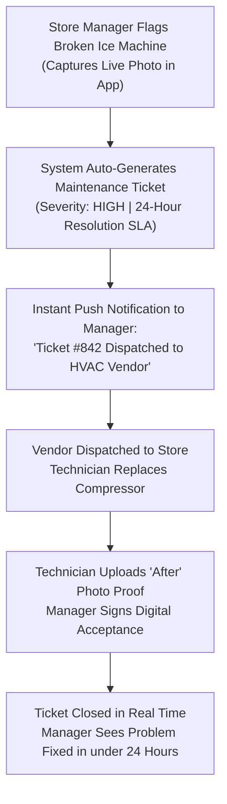

Store general managers run demanding daily operations: receiving early morning delivery trucks, managing long customer queues, fixing crashed POS terminals, resolving inventory discrepancies, and handling sudden staff call-outs. 

When corporate headquarters layers on relentless, uncoordinated administrative demands—a 90-question morning opening checklist, a 45-point mid-day food safety log, and a 70-question closing inspection—store managers reach an operational breaking point known as **audit fatigue**.

When audit fatigue sets in, compliance degrades into a cynical, mechanical ritual:

Store managers rush through screens, tapping "Pass" without lifting their eyes from their smartphones. Critical safety checks (such as walk-in refrigerator temperatures or fire exit clearances) are marked as verified while walking briskly to the cash register. Genuine operational, physical, or brand standards drift into chronic neglect.

Audit fatigue cannot be cured by motivational emails, disciplinary threats, or adding more supervisory visits. It is a structural engineering failure in your audit program.

This guide outlines how multi-unit retail, restaurant, and franchise operations eliminate checklist bloat, deploy micro-auditing frameworks, and restore genuine frontline compliance energy.

---

## What Causes Audit Fatigue in Multi-Unit Retail and Restaurant Chains?

In distributed multi-location operations, audit fatigue builds across four compounding friction points:

```
┌────────────────────────────────────────────────────────────────────────┐
│                   THE 4 DRIVERS OF AUDIT BURNOUT                       │
├────────────────────────────────────────────────────────────────────────┤
│ 1. Unchecked Checklist Bloat                                           │
│    Every time an incident occurs (a customer slip-and-fall, an audit   │
│    finding, a new marketing promo), HQ adds 5 permanent questions.     │
│    Over two years, a 20-point checklist balloons into a 120-item maze. │
│                                                                        │
│ 2. Static Administrative Questioning                                   │
│    Forcing store managers to verify static parameters daily—such as    │
│    trade license renewal dates, fire extinguisher tags, or exterior    │
│    signage dimensions—burns frontline goodwill on zero-risk tasks.     │
│                                                                        │
│ 3. Departmental Silos & Duplicate Forms                                │
│    Marketing, Food Safety, HR, Asset Maintenance, and Loss Prevention  │
│    deploy independent, uncoordinated forms, forcing managers to verify │
│    identical items three times across different applications.          │
│                                                                        │
│ 4. The "Black Hole" Effect (Frontline Cynicism)                        │
│    A manager flags a broken ice machine or leaking sink for four       │
│    consecutive weeks. HQ maintenance never dispatches a vendor. The    │
│    manager concludes audits are corporate theater and stops caring.    │
└────────────────────────────────────────────────────────────────────────┘
```

To structure an inspection cadence that sustains team energy, review our operational framework on [audit planning, scheduling, and audit data use](/blog/audit-planning-scheduling-audit-data-use).

---

## Measuring the Cost: The Checklist Burden Index

Before redesigning your checklists, calculate your organization's **Checklist Burden Index (CBI)**:

> **Checklist Burden Calculation:**  
> `Daily Audit Minutes = ((Total Daily Questions * 20s) / 60s) + (Mandatory Photos * 45s / 60s)`

```
Case Study: The 110-Question Daily Checklist Trap:
• 110 Checklist Questions per day @ 20 seconds average = 36.6 minutes
• 25 Mandatory Photo Checkpoints @ 45 seconds average = 18.7 minutes
• Total Daily Time Spent on Audit App = 55.3 minutes per day
• 55.3 minutes = 11.5% of an 8-hour Store Manager shift spent on administration!
```

When a store manager spends more than 10% of their working day staring at an audit screen, customer service degrades, team coaching vanishes, and managers inevitably resort to speed-clicking to reclaim their time.

> **Operational Rule of Thumb:** A frontline manager's daily operational checklists should never consume more than **15 total minutes** across their entire shift (under 3% of total working hours).

---

## The "Checklist Diet": Pruning Bloat with the 3-Tier Cadence

Eliminating audit fatigue does not mean lowering operational standards. It means separating **high-frequency operational pulse checks** from **periodic asset verifications**.

Categorize every checkpoint in your current binders into one of three operational tiers:

| Inspection Tier | Operational Focus | Recommended Frequency | Target Question Volume | Maximum Time on App |
| :--- | :--- | :---: | :---: | :---: |
| **Tier 1: Daily Operational Pulse** | Perishable safety, cash floats, customer-facing presentation | Daily (Opening & Shift Handovers) | **12 to 18 Questions** | 5 to 7 Minutes |
| **Tier 2: Weekly Quality & Deep Clean** | Back-of-house storage, FIFO stock rotation, equipment sanitization | Once Weekly (Low-traffic weekday) | **25 to 35 Questions** | 15 Minutes |
| **Tier 3: Monthly / Quarterly Asset Audit** | Structural assets, fire extinguisher tags, license renewals, HVAC | Monthly or Quarterly (Area Manager) | **40 to 60 Questions** | 30 to 45 Minutes |

```
The Checklist Pruning Decision Rule:

Ask of every daily checkpoint:
"If this item failed at 8:00 AM, would it cause food illness, guest injury, 
immediate revenue loss, or brand catastrophe before 2:00 PM?"

• If YES ──> KEEP in Tier 1 Daily Pulse (e.g., Chiller temp at 3.5°C, POS operational).
• If NO  ──> MOVE to Tier 2 Weekly or Tier 3 Monthly (e.g., Grease trap grease level, fire extinguisher service tag).
```

By removing static administrative questions from the morning opening checklist, brands typically reduce daily question volume by **60% to 70%** overnight, immediately increasing compliance accuracy.

---

## Deploying the Thematic Micro-Auditing Framework

Rather than dumping a massive 50-question audit on a store manager on Friday morning, modern high-performing retail and restaurant chains deploy **Thematic Micro-Auditing**.

Micro-auditing distributes inspections into focused, 3-to-4-minute daily deep-dives centered on specific operational zones:

```
┌────────────────────────────────────────────────────────────────────────┐
│                   THE WEEKLY MICRO-AUDITING MATRIX                     │
├────────────────────────────────────────────────────────────────────────┤
│ MONDAY: Sanitation & Customer Touchpoints (4 mins / 10 checks)         │
│ • Restroom cleanliness, soap/sanitizer dispensers, entrance glass      │
│                                                                        │
│ TUESDAY: Food Safety & Temperature Governance (4 mins / 8 checks)      │
│ • Walk-in freezer, prep table line temperatures, probe calibration     │
│                                                                        │
│ WEDNESDAY: Visual Merchandising & POS Readiness (3 mins / 7 checks)   │
│ • Promotional POP displays, shelf tag pricing accuracy, receipt rolls │
│                                                                        │
│ THURSDAY: Back-of-House Storage & Safety Clearance (4 mins / 9 checks) │
│ • Emergency fire exits, electrical breaker panels, chemical storage    │
│                                                                        │
│ FRIDAY: Weekend Rush Preparation & Inventory Staging (5 mins / 10 checks│
│ • High-velocity stock staging, cash change bank, staffing muster       │
└────────────────────────────────────────────────────────────────────────┘
```

Because each micro-audit takes under 5 minutes, managers can execute them with genuine attention between customer interactions rather than feeling overwhelmed by an exhaustive inspection binder.

---

## The Psychological Cure: The Reciprocal Maintenance Loop

The number-one driver of frontline cynicism is the **"Black Hole Effect"**. When a store manager spends time photographing a leaking prep sink or a broken air conditioner week after week, and corporate headquarters takes zero action, the manager learns that audits are a punitive corporate weapon rather than a helpful operational tool.

To restore frontline trust, your audit software must close the **Reciprocal Maintenance Loop**:



When store managers experience direct, tangible repairs as a result of logging issues in their audit software, their perception transforms:

> **The Cultural Mindset Shift:**  
> *From:* "Corporate is tracking my mistakes."  
> *To:* "This application gets broken store equipment fixed for my team."

That psychological shift is what sustains long-term operational excellence across hundreds of remote units.

---

## Three Warning Metrics that Expose Audit Fatigue

Operations leaders do not need to wait for store managers to complain to know audit fatigue is destroying their compliance data. Monitor these three operational metrics on your [operational dashboards](/platform/operational-dashboards):

```
┌───────────────────────────────────────┬───────────────────────────────────────┐
│ 1. Abnormal Completion Velocity       │ 2. The "Straight-Line" Score Trap     │
│ Audits completed in under 90 seconds  │ A store submitting identical 100%     │
│ when walking the physical floor       │ passing scores for 8 consecutive      │
│ requires a minimum of 6 minutes.      │ weeks while store revenue drops.      │
├───────────────────────────────────────┼───────────────────────────────────────┤
│ 3. Zero-Defect Submission Ratio       │ 4. Shift-End Batch Upload Spike       │
│ Physical stores suffer natural wear.  │ 75% of daily opening checklists       │
│ Zero logged defects over 30 days      │ submitted between 9:00 PM and         │
│ indicates rubber-stamping.            │ 10:30 PM just before store closing.   │
└───────────────────────────────────────┴───────────────────────────────────────┘
```

1. **Abnormal Completion Velocity:** If a 30-question checklist requires 8 minutes to walk the facility, but a manager submits it in 75 seconds, the software's speed-detection flags the audit for supervisory review.
2. **The "Straight-Line" Score Trap:** A store reporting 100% compliance across all categories for two months straight is almost never executing flawlessly; they have simply stopped inspecting reality.
3. **Zero-Defect Submission Ratio:** High-integrity stores average 2 to 4 minor defects per week (a burned-out display bulb, an unstocked soap dispenser). Zero defects over 30 days is a statistical red flag.
4. **Shift-End Batch Upload Spike:** When morning and mid-day checklists are all submitted in a single burst at 10:00 PM, managers are completing paperwork retroactively to avoid getting reprimanded.

---

## How Audiment Eliminates Frontline Audit Burnout

[Audiment](/) was designed with frontline store managers in mind, ensuring that compliance verification never comes at the expense of daily customer service:

- **Smart Conditional Evidence Rules:** Audiment never requires blanket photos on every question. Photo proof is enforced only on critical food safety or physical security checkpoints, or automatically when a failure is flagged. Discover our guide on [configuring mandatory photo evidence](/blog/audit-app-with-mandatory-photo-evidence-on-critical-questions).
- **Lightweight Micro-Auditing:** Schedule rotating, 3-minute pulse checks matched to specific shift routines.
- **Automated CAPA Ticketing:** Every non-conformance immediately creates a closed-loop work order routed to vendors or maintenance leads, with automated SLA tracking that keeps store managers informed of repair progress.
- **Speed & Fatigue Detection:** Automated alerts notify area directors when audits are completed with abnormal velocity or straight-line passing scores.

### Predictable Flat Pricing: Free Tier & Unlimited Paid Tier

* **Free Tier (Free Forever):** Ideal for single-location operators. Includes 1 physical facility, up to 3 auditor logins, 25 monthly audits, and complete proof verification.
* **Paid Tier (Custom Flat Pricing):** Designed for growing multi-location brands. Everything is unlimited—unlimited locations, unlimited users and auditor logins (zero per-seat licensing), and unlimited monthly audits and custom templates.

---

## Frequently Asked Questions

<details>
<summary><strong>How many questions should be included in a daily retail store opening checklist?</strong></summary>
<p>A daily store opening checklist should contain between 12 and 18 focused, binary questions that can be completed thoroughly in 5 to 7 minutes before customer doors open.</p>
</details>

<details>
<summary><strong>Should managers be required to take photos for passing checklist items?</strong></summary>
<p>No. Requiring photos for every passing item causes severe audit fatigue and data bloat. Enforce mandatory live photos only on high-risk critical control points (e.g., refrigerator temperature gauges or cash safe locks) and require evidence whenever an item fails inspection.</p>
</details>

<details>
<summary><strong>Can store managers delegate daily audits to assistant managers or shift leads?</strong></summary>
<p>Yes. In Audiment, administrators can configure role-based assignments. Shift supervisors can complete daily hygiene and opening pulse checks, while store general managers focus on weekly quality and cash reconciliations.</p>
</details>

<details>
<summary><strong>How quickly should maintenance issues flagged during audits be resolved?</strong></summary>
<p>Critical life safety and food safety hazards should have a maximum 4-to-12 hour resolution SLA. Standard cosmetic or non-critical equipment repairs should be scheduled and acknowledged within 48 hours to prevent frontline cynicism.</p>
</details>

---

## Re-Energize Your Frontline Compliance

Stop burning out your best store managers with bloated 100-question binders. Replace administrative fatigue with focused, proof-backed operational micro-audits.

Explore how [Audiment](/solutions/retail-audit-software) streamlines store operations or learn [how to scale without losing quality](/blog/how-to-scale-from-3-to-20-outlets-without-losing-quality).
