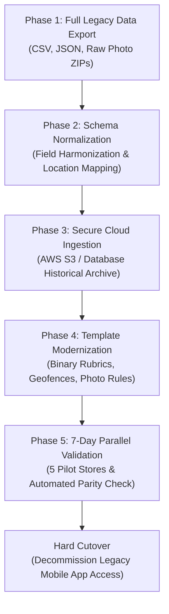

When enterprise retail chains, franchise restaurant brands, and healthcare networks reach the breaking point with legacy inspection software—stymied by punitive per-user seat fees, inflexible checklist templates, or the total absence of anti-tamper controls—the single greatest friction point preventing an immediate switch is data migration anxiety.

Chief Information Officers (CIOs), Operations Vice Presidents, and Compliance Directors rightfully fear losing three to five years of audit scoring trends, regulatory compliance records, and photo-backed maintenance histories.

Without a rigorous data preservation protocol, enterprises remain hostage to subpar platforms, absorbing 20% annual price increases and substandard support simply to avoid operational amnesia.

Switching audit management platforms does not require abandoning your compliance history. By following a structured schema-mapping and data preservation workflow, organizations can safely extract, normalize, and ingest years of legacy inspection data into a modern, proof-based audit platform in under ten business days.

---

## What Risks Threaten Historical Audit Data During Software Migration?

When transitioning between operational audit software platforms, data integrity faces four distinct points of failure:

```
Critical Data Vulnerabilities During Software Migration:

1. EXIF Metadata Stripping:
   Exporting photographic evidence through bulk ZIP archives frequently strips raw Exchangeable
   Image File Format (EXIF) metadata, destroying device-level UTC timestamps, camera serial numbers,
   and satellite GPS coordinates required for legal and regulatory defence.

2. Disconnected Relational Links (Orphaned Tasks):
   Failed checklist responses become decoupled from their associated maintenance and CAPA tickets,
   leaving orphaned work orders with zero traceability back to the original inspection failure.

3. Proprietary Database Schema Lock-In:
   Legacy SaaS vendors deliberately export data in convoluted, nested proprietary JSON or unstructured
   PDF blobs that resist standard relational SQL queries or ingestion by competing tools.

4. Unsynchronized Dual-System Cutover Windows:
   Running two audit systems concurrently without a defined cutover protocol creates operational
   confusion, duplicate submissions, and corrupted year-to-date compliance reporting.
```

To understand foundational platform architecture, review our guide on [audit software migration, scalability, and configuration](/blog/audit-software-migration-scalability-configuration).

---

## The Pre-Migration Vendor Exit Checklist

Before notifying your incumbent vendor of contract cancellation or non-renewal, execute this tactical data extraction checklist. Many SaaS vendors throttle API limits, disable bulk export features, or charge exorbitant "data extraction fees" once a termination notice is submitted.

```
┌────────────────────────────────────────────────────────────────────────┐
│                   PRE-MIGRATION VENDOR EXIT AUDIT                      │
├────────────────────────────────────────────────────────────────────────┤
│ [ ] Contractual IP Clause Verification: Confirm your contract grants  │
│     full ownership of all raw data, submitted forms, and media.        │
│                                                                        │
│ [ ] S3 / Blob Media Asset Access: Ensure photo attachments are         │
│     delivered as raw uncompressed image files, NOT expiring CDN links. │
│                                                                        │
│ [ ] Bulk API Extraction Rate Limits: Document API rate limits (calls/  │
│     minute) to schedule automated background scraping if needed.       │
│                                                                        │
│ [ ] User & Location Hierarchy Export: Download active and inactive     │
│     store rosters, area manager mappings, and regional hierarchies.    │
│                                                                        │
│ [ ] Template Blueprint Mapping: Export master checklist versions with  │
│     historical scoring weights, conditional logic, and category tags.  │
└────────────────────────────────────────────────────────────────────────┘
```

> **Warning:** Never cancel your existing SaaS contract until all historical data exports are validated and secured in an enterprise-owned cloud storage bucket (e.g., AWS S3 or Azure Blob Storage). Once account access is terminated, extracting lost media attachments is virtually impossible.

---

## What Four Data Layers Must Be Extracted?

A successful audit data migration preserves four independent operational data layers:

| Data Layer | Target Export Format | Critical Mandatory Fields Required |
| :--- | :--- | :--- |
| **1. Template Blueprints** | JSON / CSV / XLSX | Checklist title, section hierarchy, question unique IDs, response types (Yes/No, Numeric, Multiple Choice), scoring weights, and mandatory photo flags. |
| **2. Inspection Submissions** | Relational CSV / JSON | Audit ID, Store/Branch ID, Auditor User ID, Scheduled Date, Submission UTC Timestamp, GPS Latitude/Longitude, Total Score, Category Scores. |
| **3. Photographic Evidence** | Raw JPEG / PNG Archives | High-resolution image files preserving original EXIF metadata (camera hardware ID, GPS tag, capture timestamp), keyed to Audit ID and Question ID. |
| **4. Corrective Action (CAPA) Logs** | Tabular CSV / SQL Dump | Ticket ID, linked Audit ID, Checkpoint ID, Failure Description, Severity, Assigned Owner, Resolution Deadline, Closed Timestamp, Before/After Photo URLs. |

---

## Schema Normalization: Mapping Legacy Data to a Modern Platform

Audit platforms format responses differently. For example, legacy systems like SafetyCulture (iAuditor) or ProntoForms store responses in deeply nested key-value arrays, whereas modern proof-based engines require relational normalization.

Below is an example of mapping an unstructured legacy JSON payload into Audiment's normalized ingestion schema:

```json
/* UNSTRUCTURED LEGACY EXPORT PAYLOAD (Vendor A) */
{
  "inspection_uuid": "f81d4fae-7dec-11d0-a765-00a0c91e6bf6",
  "site_label": "Downtown Flagship #104",
  "conducted_on": "2024-11-14T09:42:15Z",
  "score_result": "88.5%",
  "items": [
    {
      "label": "Is the emergency fire exit completely unobstructed?",
      "selected": "FAIL",
      "attached_media": ["https://vendor-cdn.com/expiring-token/img902.jpg"],
      "action_item": "Boxes blocking rear stairwell. Manager notified."
    }
  ]
}

/* NORMALIZED AUDIMENT INGESTION SCHEMA */
{
  "historical_audit_id": "LEGACY-F81D4FAE",
  "location_id": "STORE-104",
  "template_id": "FIRE-LIFE-SAFETY-V2",
  "auditor_email": "r.chen@brandops.com",
  "submitted_at_utc": "2024-11-14T09:42:15Z",
  "geofence_verified": true,
  "normalized_percentage_score": 88.5,
  "responses": [
    {
      "checkpoint_id": "FLS-EXIT-01",
      "status": "NON_CONFORMANCE",
      "severity": "CRITICAL",
      "evidence_media_key": "s3://brand-audit-archive/2024/11/img902.jpg",
      "exif_metadata_verified": true
    }
  ],
  "capa_ticket": {
    "ticket_id": "CAPA-2024-104-01",
    "status": "CLOSED",
    "resolution_hours": 3.2,
    "closure_evidence_key": "s3://brand-audit-archive/2024/11/img902_resolved.jpg"
  }
}
```

By mapping historical records into a normalized schema, legacy inspection histories become fully searchable alongside modern audits without corrupting current system logic.

---

## Reconciling Divergent Historical Scoring Models

A common roadblock in audit software migration is that different platforms score audits using incompatible algorithms. 

For instance, your legacy software might have used a **1-to-5 Likert Scale** or an **Unweighted Point Deduction Model**, while your new platform utilizes a **Weighted Binary Risk Percentage Model**.

To maintain uninterrupted 36-month trend lines without skewing historical performance, apply the **Normalized Percentage Standard**:

> **Scoring Formula:**  
> `Normalized Score (%) = (Total Points Earned / Total Maximum Points Available) * 100`

```
Scoring Architecture: Dual-View Longitudinal Reporting:

┌────────────────────────────────────────────────────────────────────────┐
│ Historical Partition (Read-Only Archive: 2022 - 2025)                  │
│ • Preserves native historical scores and original PDF audit dossiers.  │
│ • Calculated Normalized Percentage Score displayed on executive graphs. │
│ • Prevents retroactively penalizing stores under newly adopted rules.  │
└──────────────────────────────────┬─────────────────────────────────────┘
                                   │
                                   ▼
┌────────────────────────────────────────────────────────────────────────┐
│ Active Operating Partition (Audiment Engine: 2026 Onward)              │
│ • Enforces modern weighted scoring with mandatory photo requirements.  │
│ • Multi-year trend line merges historical % with active % seamlessly.  │
└────────────────────────────────────────────────────────────────────────┘
```

| Historic System Model | Raw Legacy Score | Conversion Formula | Normalized Historical Score |
| :--- | :---: | :--- | :---: |
| **5-Star Rating Model** | 4.2 / 5.0 Stars | (4.2 / 5.0) * 100 | **84.0%** |
| **Point Deduction Model** | -18 Deductions (from 150) | ((150 - 18) / 150) * 100 | **88.0%** |
| **Binary Pass/Fail (80 checks)** | 72 Passed Checks | (72 / 80) * 100 | **90.0%** |

This normalization enables executive leadership to query 3-year performance trajectories across stores, regions, and franchises without mathematical discrepancies.

---

## 5-Step End-to-End Migration Sequence

A structured migration executes in five sequential phases, typically completed within 7 to 10 days:



1. **Phase 1: Full Legacy Data Extraction (Days 1–2):** Extract full database dumps and raw photo archives. Store all assets in an encrypted, enterprise-controlled cloud bucket.
2. **Phase 2: Schema Normalization & Entity Mapping (Days 3–4):** Standardize store IDs, eliminate closed locations, clean user roles, and format historical responses into standard relational tables.
3. **Phase 3: Historical Cloud Ingestion (Days 5–6):** Upload legacy records to the new platform's historical partition. Every legacy audit is indexed by store code, auditor name, and date, rendering it fully searchable in seconds.
4. **Phase 4: Template Modernization & Geofencing (Days 6–7):** Convert bloated legacy checklists into modern, streamlined templates. Configure 50-meter GPS polygon perimeters around all physical branches.
5. **Phase 5: 7-Day Pilot & Hard Cutover (Days 8–14):** Run the new platform across 5 to 10 test locations to validate offline caching, photo capture, and alert routing. Once validated, revoke legacy app access and go live network-wide.

---

## Technical Validation Checks Before Legacy Decommissioning

Before turning off your legacy vendor's contract, execute three automated technical validation checks:

```python
# Sample Automated Migration Validation Check
def validate_migration(legacy_row_count, ingested_row_count, media_urls):
    # 1. Row Parity Check
    assert legacy_row_count == ingested_row_count, (
        f"Mismatch: Legacy records ({legacy_row_count}) != Ingested ({ingested_row_count})"
    )
    
    # 2. Media Link HTTP Integrity Check
    broken_links = [url for url in media_urls if check_http_status(url) != 200]
    assert len(broken_links) == 0, f"Found {len(broken_links)} broken photo links!"
    
    print("Migration Verification Successful: 100% Data & Media Parity.")
```

1. **Database Row-Count Parity (100% Match):** If your legacy system contains 14,280 completed audits between 2022 and 2025, exactly 14,280 records must exist in the searchable historical archive.
2. **Zero-Broken-Link Media Audit:** Execute a script verifying that every historical photo link resolves to a valid image file in your secure storage bucket without 404 errors.
3. **The 30-Second Regulatory Retrieval Drill:** Select a random location and date from two years ago (e.g., Outlet #24 on August 12, 2024). The system must generate the complete, timestamped historical inspection report with embedded photos in under 30 seconds to satisfy statutory compliance examiners.

---

## How Audiment Simplifies Your Software Migration

[Audiment](/) provides white-glove data migration support for multi-location enterprises transitioning away from overpriced or outdated checklist tools.

- **Automated Data Ingestion:** Our technical migration team handles script mapping, CSV/JSON schema transformation, and historical photo imports at zero additional cost.
- **Unified Longitudinal Analytics:** Compare historical inspection scores seamlessly alongside modern proof-backed audits on centralized [operational dashboards](/platform/operational-dashboards).
- **Zero Per-Seat Penalties:** Say goodbye to restrictive per-user licenses. Audiment provides unlimited user accounts so your entire operational chain—from frontline crew to area directors—can participate without inflating software costs.

### Transparent Pricing: Free Tier & Unlimited Paid Tier

* **Free Tier (Free Forever):** Ideal for single-location testing and pilot validations. Includes 1 physical facility, up to 3 auditor logins, 25 monthly audits, and complete proof verification (live camera and GPS check-in).
* **Paid Tier (Custom Flat Pricing):** Designed for scaling multi-unit operations. Includes unlimited locations, unlimited users and auditor seats (no seat taxes), unlimited monthly audits, and full historical data migration support.

---

## Frequently Asked Questions

<details>
<summary><strong>Will store managers lose their historical performance records during migration?</strong></summary>
<p>No. Store manager inspection histories, historical scores, and resolved corrective action records are mapped to unique employee IDs, preserving their long-term performance records across platforms.</p>
</details>

<details>
<summary><strong>What happens if our legacy vendor only provides data as flat PDF reports?</strong></summary>
<p>If your incumbent vendor refuses or cannot provide structured CSV/JSON exports, Audiment's ingestion pipeline uses automated PDF document parsing to extract historical scores, dates, store codes, and embedded photographs into a structured, queryable database.</p>
</details>

<details>
<summary><strong>How long does an end-to-end data migration take for a 100-location brand?</strong></summary>
<p>For a 100-location enterprise with 3 to 5 years of audit records, full data extraction, schema normalization, media ingestion, and verification testing is typically completed in 7 to 10 business days without any downtime for retail store teams.</p>
</details>

<details>
<summary><strong>Should we cancel our legacy contract before beginning data extraction?</strong></summary>
<p>Never cancel your incumbent contract before data extraction is verified. Maintain active platform access until complete raw data exports and photo ZIP archives are secured in your own cloud environment and validated for row-count parity.</p>
</details>

---

## Ready to Switch Without Risk?

Migrate your inspection workflows to modern, proof-based operational audits without losing a single day of compliance history. 

Explore [Audiment's Multi-Location Audit Platform](/) or contact our engineering team to review your legacy export format and schedule a seamless data migration.
