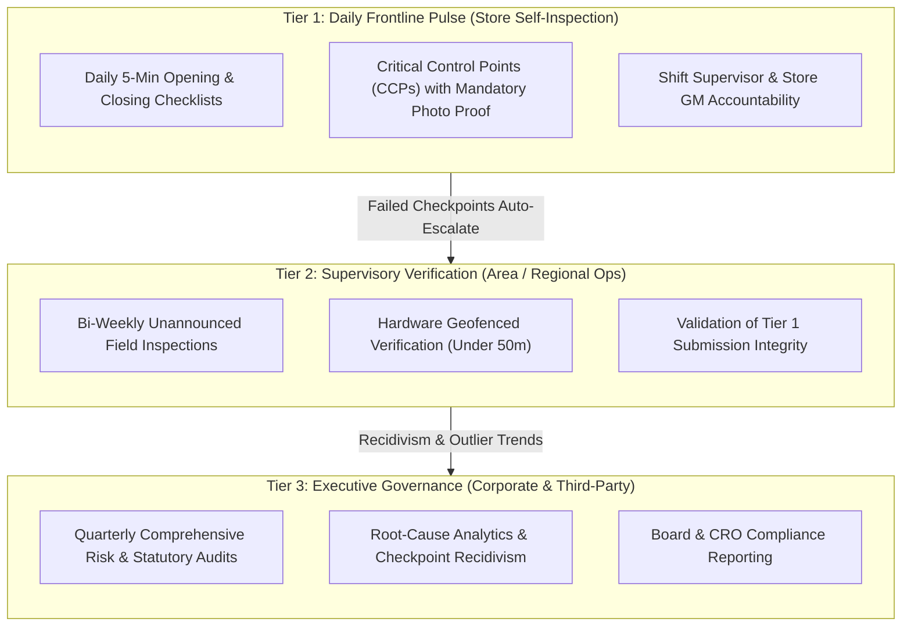

Leading a multi-location enterprise means that operational standards are defined centrally at headquarters, but executed locally across dozens or hundreds of distributed storefronts.

At three locations, brand consistency and regulatory compliance can rely on individual discipline. The founder or operations director drops by regularly, catches deviations, and corrects them in person.

At 30, 100, or 500 locations, that direct line of sight vanishes. 

Instead of walking the floor, leadership manages by proxy—reading forwarded messages, self-reported spreadsheets, and delayed periodic reports. The result is **operational drift**: communication dilutes as it cascades down through regional layers, local teams adopt convenient shortcuts, and severe compliance violations stay hidden until triggered by a customer injury, health department citation, or brand-damaging viral review.

This guide provides an end-to-end operational framework for multi-unit operators to govern quality consistency, regulatory readiness, and distributed accountability at scale.

---

## Why Compliance Breaks as Location Count Grows

Compliance management in distributed networks breaks down not from lack of intent, but from three structural failure points:

```
┌────────────────────────────────────────────────────────────────────────┐
│             THE THREE BREAKDOWN POINTS IN MULTI-UNIT SCALE             │
├────────────────────────────────────────────────────────────────────────┤
│ 1. Communication Cascade Drift                                         │
│    Corporate creates an updated hygiene SOP or promotional planogram.  │
│    Cascaded through regional coaches, area managers, and store leads,  │
│    frontline crew receive a diluted, misunderstood version of the SOP. │
│                                                                        │
│ 2. The Self-Reporting Paradox (Pencil-Whipping)                        │
│    When store managers self-report compliance on clipboards or basic   │
│    checkbox apps, audits become an exercise in self-preservation.      │
│    Staff check off boxes at shift close without walking the facility.  │
│                                                                        │
│ 3. The Unresolved Non-Conformance Bottleneck                           │
│    When a roving auditor flags a critical defect (e.g., a broken safe  │
│    dial or a failing refrigerator), the finding gets lost in email     │
│    inboxes. Without automated SLAs, issues sit open for weeks.         │
└────────────────────────────────────────────────────────────────────────┘
```

To understand the organizational dynamics of distributed operations, explore our strategic overview on [what is multi-location management](/blog/what-is-multi-location-management) and how to diagnose [operational drift](/blog/what-is-operational-drift-and-how-it-happens).

---

## The 3-Tier Multi-Location Compliance Architecture

High-performing enterprise operators enforce compliance through a tiered defense model that separates daily store routines from supervisory verification and independent audit oversight:



### Tier 1: Daily Frontline Pulse (Store Self-Inspection)
- **Cadence:** Daily (Opening, Pre-Peak Rush, Closing).
- **Execution Time:** Under 7 minutes.
- **Focus:** Perishable temperatures, cash floats, life safety egress, entrance hygiene.
- **Verification:** Mandatory live photo capture on critical control points to prevent pencil-whipping.

### Tier 2: Supervisory Verification (Area Operations)
- **Cadence:** Bi-weekly or monthly per location.
- **Execution Time:** 20 to 30 minutes.
- **Focus:** Cross-checking Tier 1 self-inspection accuracy, food safety records, inventory integrity, and staff coaching.
- **Verification:** Hardware GPS geofencing confirms physical presence on site.

### Tier 3: Executive Governance (Corporate Audit & Quality Assurance)
- **Cadence:** Quarterly or semi-annually.
- **Focus:** Statutory compliance, license validity, infrastructure wear, structural safety, brand standard adherence.
- **Verification:** Produces formal compliance dossiers for executive leadership and external regulatory bodies.

---

## Regulatory Framework Mapping for Multi-Location Chains

Multi-unit operators must harmonize corporate standards with regional and national statutory regulations:

| Regulatory Domain | Governing Framework (US / India / Global) | Critical Inspection Mandates | Mandatory Evidence Required |
| :--- | :--- | :--- | :--- |
| **Food Safety & Hygiene** | FDA Food Code / FSSAI Schedule 4 / HACCP | Cold-chain temperature retention (under 4°C), raw/cooked segregation, pest control logs, oil polar compounds. | Live photo of digital temperature probes and titration test strips. |
| **Life & Workplace Safety** | OSHA 1910 / National Building Code / Factories Act | 36-inch clearance around electrical panels, unblocked fire exits, fire extinguisher inspection tags. | Live photo of egress path and current maintenance tags. |
| **Cash & Physical Security** | RBI Branch Security / Loss Prevention Standards | Dual-custody safe logs, time-delay locks, 90-day CCTV storage retention, duress foot alarms. | Live macro-photo of DVR storage menus and safe lock dial positions. |
| **Statutory Consumer Notice** | Legal Metrology / Weights & Measures / Consumer Affairs | Display of trade licenses, labor law abstracts, consumer grievance officer contact info, price cards. | Live photo of public customer noticeboards in entrance lobby. |

---

## The Closed-Loop CAPA Escalation Matrix

When an audit uncovers a non-conformance, a static score deduction is insufficient. In high-reliability operations, every failure triggers a tiered **Corrective and Preventive Action (CAPA)** workflow:

```
┌────────────────────────────────────────────────────────────────────────────────────────┐
│                        COMPLIANCE REMEDIATION ESCALATION MATRIX                         │
├──────────┬──────────────────────┬─────────────┬──────────────────┬─────────────────────┤
│ Severity │ Example Violation    │ Resolution  │ Primary Owner    │ Escalation Trigger  │
│ Level    │                      │ SLA         │                  │ (If Overdue)        │
├──────────┼──────────────────────┼─────────────┼──────────────────┼─────────────────────┤
│ CRITICAL │ Blocked fire exit,   │ 4 Hours     │ Store GM & Area  │ Immediate SMS/Email │
│          │ walk-in cooler > 8°C │             │ Operations Coach │ to VP of Operations │
├──────────┼──────────────────────┼─────────────┼──────────────────┼─────────────────────┤
│ HIGH     │ CCTV camera offline, │ 24 Hours    │ Store GM & Local │ Alert to Regional   │
│          │ hot water heater out │             │ Vendor Tech      │ Facilities Director │
├──────────┼──────────────────────┼─────────────┼──────────────────┼─────────────────────┤
│ MEDIUM   │ Cracked prep tile,   │ 7 Days      │ Facilities       │ Weekly Review Queue │
│          │ faded promotional POP│             │ Maintenance Lead │ Flag                │
├──────────┼──────────────────────┼─────────────┼──────────────────┼─────────────────────┤
│ LOW      │ Minor baseboard scuff│ 14 Days     │ Store Supervisor │ Rolled into Monthly │
│          │ paint, uniform scuff │             │                  │ Maintenance Pass    │
└──────────┴──────────────────────┴─────────────┴──────────────────┴─────────────────────┘
```

By enforcing automated countdown timers and escalation paths, multi-unit brands eliminate the "black hole" where audit failures are recorded but never remediated. To learn how to execute this systematically, review our guide on [how to perform a compliance audit](/blog/how-to-perform-a-compliance-audit).

---

## Digital Proof Systems vs. Manual Spreadsheets

Operating a multi-location compliance program using paper binders or Google Sheets introduces catastrophic operational latency:

| Operational Parameter | Manual Tracking (Paper / Excel / Chat) | Digital Proof Platform (Audiment) |
| :--- | :--- | :--- |
| **Data Availability** | 7 to 14 days delayed (Manual consolidation) | Real-time live dashboards across all locations |
| **Evidence Reliability** | Trust-based checkboxes; unverified assertions | Tamper-proof, live camera photo capture + GPS |
| **Tamper Resistance** | Easily backdated; completed off-site | Network-synchronized atomic UTC timestamps |
| **Issue Follow-Up** | Disconnected emails and group chat reminders | Automated CAPA ticketing with enforceable SLAs |
| **Recidivism Detection** | Requires manual pivot tables; rarely analyzed | Automated alerts for 3x consecutive checkpoint failures |
| **Regulatory Audit Defense**| Scrambling through physical filing cabinets | Instant 1-click export of complete compliance dossiers |

---

## Four Operational Metrics to Measure Execution Consistency

Chief Operating Officers and Heads of Quality should move beyond simple aggregate pass rates and evaluate four core health metrics on their [operational dashboards](/platform/operational-dashboards):

```
┌───────────────────────────────────────┬───────────────────────────────────────┐
│ 1. Network Score Variance (Std Dev)   │ 2. Mean Time to Remediation (MTTR)    │
│ Measures consistency across stores.   │ Average hours elapsed between         │
│ Low variance indicates predictable,   │ identifying a non-conformance and     │
│ standardized customer experiences.    │ verified proof-backed resolution.     │
├───────────────────────────────────────┼───────────────────────────────────────┤
│ 3. Bottom-Quartile Recovery Rate      │ 4. Checkpoint Recidivism Ratio        │
│ Percentage of struggling locations    │ Percentage of audit failures that     │
│ that improve out of the bottom 25%    │ represent repeat violations from the  │
│ within 60 days of targeted coaching.  │ previous inspection cycle.            │
└───────────────────────────────────────┴───────────────────────────────────────┘
```

1. **Network Score Variance:** If Region A averages 94% and Region B averages 71%, your operations suffer from localized management failure. A tight distribution is the hallmark of true multi-unit operational control.
2. **Mean Time to Remediation (MTTR):** Tracking how rapidly stores close safety and quality defects. High-integrity networks achieve an MTTR under 12 hours for critical violations.
3. **Bottom-Quartile Recovery Rate:** Rather than constantly celebrating your best stores, focus executive attention on raising the floor. Measure how effectively underperforming units are rehabilitated.
4. **Checkpoint Recidivism Ratio:** Measures systemic operational drift. If Store #14 fails handwashing soap replenishment three cycles in a row, the problem is cultural, not operational.

---

## How Audiment Enforces Multi-Location Compliance

[Audiment](/) is the leading proof-based audit and compliance management system designed specifically for multi-unit retail, restaurant, healthcare, and banking networks.

- **Tamper-Proof Field Verification:** Disables camera roll uploads and mandates hardware GPS check-ins, ensuring every audit reflects genuine physical execution.
- **Granular Role-Based Access:** Configures customized views for Store Managers, Area Coaches, Maintenance Contractors, and Corporate Executives.
- **Automated CAPA Engine:** Automatically converts failed audit checkpoints into actionable remediation work orders with SLA countdowns and photo-verified closure.
- **Real-Time Cross-Location Analytics:** Spot systemic drift, track league tables, and isolate regional outliers on [operational dashboards](/platform/operational-dashboards).

### Transparent Pricing: Free Tier & Unlimited Paid Tier

Audiment eliminates the penalizing per-seat licensing fees that discourage brands from deploying compliance software across their entire workforce:

* **Free Tier (Free Forever):** Ideal for single-location operators. Includes 1 physical facility, up to 3 auditor logins, 25 monthly audits, and full proof-verification tools.
* **Paid Tier (Custom Flat Pricing):** Designed for scaling multi-location brands. Everything is unlimited—unlimited locations, unlimited users, supervisors, and auditor accounts (zero per-seat fees), and unlimited monthly audits and custom templates.

---

## Frequently Asked Questions

<details>
<summary><strong>How can we ensure compliance consistency across franchisee-operated locations?</strong></summary>
<p>Franchise compliance requires clear contractual brand operating standards backed by standardized digital audits. Audiment provides an objective, tamper-proof audit record that eliminates subjective disputes between franchisors and franchisees while protecting brand integrity across all territories.</p>
</details>

<details>
<summary><strong>What is the ideal ratio of Area Managers to store locations?</strong></summary>
<p>In high-velocity retail and QSR operations, the industry benchmark is 1 Area Manager to 8–12 locations. This span of control allows the manager to conduct thorough on-site physical audits, review daily self-inspections, and coach store managers without burning out.</p>
</details>

<details>
<summary><strong>How do we manage audits in remote locations with zero cellular reception?</strong></summary>
<p>Audiment operates 100% offline. Store managers and field auditors can complete inspections, snap photos, and record signatures in cellular dead zones. The application encrypts data locally and syncs automatically the moment the device reconnects to Wi-Fi or cellular coverage.</p>
</details>

<details>
<summary><strong>Should daily self-inspections replace supervisory audits?</strong></summary>
<p>No. Daily self-inspections build frontline discipline and catch immediate tactical risks (such as morning cooler temperatures). Supervisory and corporate audits verify the honesty and accuracy of those self-inspections, identifying deeper systemic and facility maintenance issues.</p>
</details>

---

## Standardize Compliance Across Every Location

Eliminate operational drift, verify physical standards, and protect your brand across every operating unit.

Explore [Audiment's Multi-Location Compliance Solution](/use-cases/multi-location-compliance) or read our foundational guide on [What Is Audit Management](/blog/what-is-audit-management).
