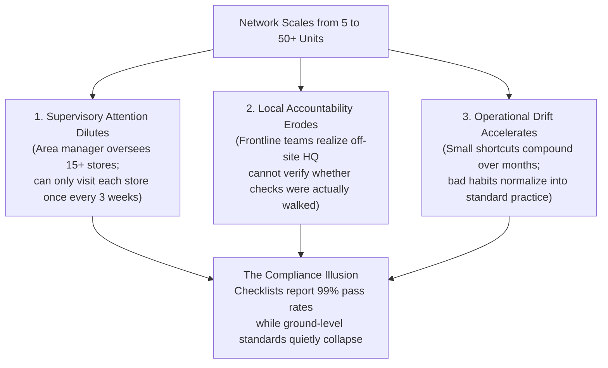

A standard checklist audit records answers.  
A proof-based audit verifies execution.

That difference determines whether your executive dashboard reflects operational reality or reported intent.

In a traditional checklist audit, an auditor or store manager opens a form on a tablet or clipboard, clicks down a column of checkboxes, hits "Submit", and moves on. The system records a 100% compliance score.

The fatal problem: **nothing in that process confirms the physical work was performed.** 

A team member can check "walk-in freezer temperature verified at 3.5°C" without ever opening the heavy steel door. A shift supervisor can tick "emergency fire exit unobstructed" without walking to the back of the building. 

At a single owner-operated facility, leadership can spot these discrepancies across the room. But across 30, 100, or 500 distributed locations, trust-based checklists degrade into pure corporate fiction.

This dynamic creates the **"Watermelon Audit" phenomenon**: reports look vibrant green on the outside, but underneath, operations are blood red.

Here is an architectural comparison of how proof-based audits differ from standard checklists, why trust-based inspection models collapse as organizations scale, and how modern multi-unit enterprises make the transition.

---

## The "Watermelon Audit" Phenomenon

The greatest danger in multi-unit management is not low audit scores. Low audit scores trigger management intervention, capital allocation, and training.

The greatest danger is **false assurance**: high audit scores masking severe operational decay.

```
The Anatomy of a Watermelon Audit:

[Executive Boardroom View: 98.4% Network Compliance Score]
"All regions are green. Food safety logs are 100% compliant. Fire exits clear."
                               │
                               ▼
[Ground-Level Physical Store Reality]
• Store #18: Dairy prep cooler compressor failed 4 hours ago; milk at 11°C.
• Store #34: Rear emergency exit blocked by 40 stacked cardboard inventory cartons.
• Store #09: Morning sanitizing buckets filled with plain tap water (zero chemical PPM).
• Store #52: Cash safe left unlocked on day-lock with dial tape attached.
                               │
                               ▼
[The Inevitable Disconnect]
Customer food poisoning outbreak ──> Health inspector arrives ──> Outlet shut down.
Management is stunned: "How did this happen? Store #18 had a 99% audit score yesterday!"
```

The audit did not fail because the standards were unclear. The audit failed because the system accepted **unverified assertions** instead of **verifiable proof**.

When an inspection system does not require objective evidence, frontline staff naturally prioritize speed over rigor, especially during peak retail rushes or understaffed shifts.

---

## 8-Point Architectural Comparison: Checklist vs. Proof-Based Audits

The fundamental difference between checklist audits and proof-based audits lies in their underlying data architecture:

| Operational Dimension | Standard Checklist Audit (Paper / Basic App) | Modern Proof-Based Audit (Audiment) |
| :--- | :--- | :--- |
| **1. Verification Mechanism** | Subjective assertion (User selects "Pass" or "Fail") | Objective verification (GPS coordinate gating + live camera frame) |
| **2. Physical Presence Proof** | None. Audits can be completed from a car, hotel room, or home | Hardware GPS geofencing unlocks the template only within 50m of facility |
| **3. Photographic Integrity** | Permits smartphone gallery uploads; easily bypassed with screenshots | Native camera hardware lock; gallery pickers disabled; EXIF time verified |
| **4. Fraud & Pencil-Whipping** | High vulnerability. 40 checks completed in under 90 seconds | Automated anomaly detection flags abnormal completion velocity |
| **5. Non-Conformance Handling** | Defect noted as text in a PDF; manual follow-up via email or calls | Automated CAPA ticketing with severity SLAs and assigned owners |
| **6. Issue Closure Proof** | Status manually toggled to "Resolved" in a spreadsheet | Ticket closure requires mandatory live "After" photograph |
| **7. Regulatory Defensibility** | Easily challenged by statutory examiners (FDA, FSSAI, OSHA, RBI) | Tamper-proof digital dossier with GPS, atomic UTC timestamps, and hash |
| **8. Frontline Engagement** | Viewed by staff as punitive corporate paperwork | High trust. Transparent SLAs ensure logged maintenance defects get fixed |

---

## Why Trust-Based Checklists Break at Scale

In a 3-unit business, operational governance operates on personal relationships and founder presence. The founder drops by weekly, inspects the prep lines, and speaks directly with the team.

As a brand scales past 15 locations, three structural breakdowns occur:



This is how [operational drift](/blog/what-is-operational-drift-and-how-it-happens) occurs. It does not start with catastrophic negligence. It begins with a shift manager who is 15 minutes behind schedule, glances at an uncalibrated thermometer, and checks "Pass" because "it's probably fine." 

When no one notices the shortcut, that shortcut becomes tomorrow's standard operating procedure. Over six months, the operational gap widens until a catastrophic failure occurs.

---

## The Four Pillars of Proof-Based Auditing

Proof-based auditing does not mean turning store managers into full-time photographers. It means creating an unbroken operational chain where high-risk assertions are backed by verifiable evidence.

```
The Closed-Loop Proof Chain:

Verified Audit Evidence ──> Reliable Defect Capture ──> Accountable CAPA SLA ──> Consistent Brand Standards
```

### 1. Verified Input Reliability
When an inspector must photograph a live temperature gauge or snap an unblocked fire exit, the data entered into your system transitions from **subjective intention** to **objective reality**. The operational baseline becomes trustworthy enough for executive decision-making.

### 2. High-Fidelity Defect Detection
Standard checklists incentivize managers to hide defects to maintain high performance scores. Proof-based systems invert this dynamic: by linking photographic defect reporting directly to automated maintenance tickets, store teams realize that flagging an issue is the fastest way to get equipment fixed.

### 3. Frictionless Contractor Accountability
When an audit non-conformance is identified, [Audiment](/) auto-routes the failure with the original "Before" photograph to the appropriate maintenance technician or vendor. The vendor arrives on-site with the exact parts required. When the repair is finished, the technician must upload an "After" photo through the mobile app, providing undisputed proof before vendor invoices are approved.

### 4. Defensible Statutory Compliance
Whether responding to an OSHA workplace safety inquiry, an FDA/FSSAI food safety audit, or an RBI financial branch review, an organization with proof-based audit trails can produce tamper-proof, timestamped photographic dossiers in seconds.

---

## The Economic Cost: False Assurance vs. Proof Systems

Many operators hesitate to upgrade from paper checklists or basic forms due to perceived implementation friction. However, the economic cost of operating on false assurance vastly exceeds the cost of modern software:

> **The Economic Calculation:**  
> `Cost of False Assurance = Uncaught Spoilage + Regulatory Fines + Franchise Litigation + Customer Churn`

```
Financial Impact Comparison (50-Unit QSR / Retail Network):

┌───────────────────────────────────────┬───────────────────────────────────────┐
│ Traditional Checklist Blindness       │ Proof-Based Operating System          │
├───────────────────────────────────────┼───────────────────────────────────────┤
│ • $45,000 annual cold-chain inventory │ • 82% reduction in perishable food    │
│   loss due to unflagged cooler drift  │   spoilage via daily photo temp logs  │
│                                       │                                       │
│ • $60,000 in disputed facility vendor │ • Zero disputed vendor invoices;      │
│   invoices for unverified repairs     │   Before/After photo matching         │
│                                       │                                       │
│ • Catastrophic brand damage from one  │ • 100% regulatory pass rate across    │
│   viral hygiene video on TikTok/X     │   unannounced municipal inspections   │
│                                       │                                       │
│ • $35,000 spent on manual Excel       │ • Real-time operational dashboards    │
│   consolidation by regional directors │   eliminating manual reporting waste  │
└───────────────────────────────────────┴───────────────────────────────────────┘
```

---

## 30-Day Transition Roadmap: From Checklists to Proof-Based Audits

Transitioning an existing retail, restaurant, or facility network to proof-based auditing does not require halting operations. Follow this practical four-week roadmap:

```
┌────────────────────────────────────────────────────────────────────────┐
│                   30-DAY PROOF TRANSITION ROADMAP                      │
├────────────────────────────────────────────────────────────────────────┤
│ WEEK 1: Critical Control Point (CCP) Audit                             │
│ • Review existing 80-question checklists.                              │
│ • Isolate the "Vital Few" (6 to 10 checkpoints) where false passes    │
│   create severe legal, safety, or financial risk.                      │
│                                                                        │
│ WEEK 2: Software Blueprinting & Geofence Setup                         │
│ • Rebuild templates in Audiment; configure mandatory camera rules.     │
│ • Map 50-meter GPS perimeters around all physical locations.           │
│                                                                        │
│ WEEK 3: Regional Pilot Rollout (5 to 10 Stores)                        │
│ • Run proof-based inspections in parallel with existing routines.      │
│ • Train store managers on acceptable evidence (framing, readability).  │
│ • Measure completion velocity and tune conditional photo triggers.     │
│                                                                        │
│ WEEK 4: Network-Wide Cutover & Maintenance Integration                 │
│ • Roll out Audiment mobile app across all operating units.             │
│ • Connect automated CAPA tickets to facility vendors and area leads.   │
│ • Review the first weekly executive league table on live dashboards.   │
└────────────────────────────────────────────────────────────────────────┘
```

By concentrating photo requirements exclusively on high-risk checkpoints (typically 10% to 15% of questions), store teams complete audits in under 8 minutes without experiencing operational fatigue.

---

## How Audiment Powers Proof-Based Auditing

[Audiment](/) is purpose-built to replace trust-based checklists with verifiable ground truth.

- **Native Camera Lockdown:** Completely bypasses smartphone photo galleries, preventing users from uploading downloaded screenshots or recycled images.
- **Hardware GPS Geofencing:** Ensures inspectors are physically within the facility before an audit can begin.
- **Automated CAPA Ticketing:** Every failed checkpoint instantly generates a corrective action work order with resolution SLAs and mandatory "After" photo closure.
- **Operational Health Dashboards:** Track network compliance, repeat failure concentrations, and store league tables in real time on [operational dashboards](/platform/operational-dashboards).

### Transparent Pricing: Free Tier & Unlimited Paid Tier

Audiment eliminates the restrictive per-seat licensing fees that prevent companies from deploying software to all store personnel:

* **Free Tier (Free Forever):** Ideal for single-location operators. Includes 1 physical facility, up to 3 auditor logins, 25 monthly audits, and complete proof-verification capabilities.
* **Paid Tier (Custom Flat Pricing):** Designed for scaling multi-location brands. Everything is unlimited—unlimited locations, unlimited users, supervisors, and auditor accounts (zero per-seat licensing), and unlimited monthly audits and custom templates.

---

## Frequently Asked Questions

<details>
<summary><strong>Do proof-based audits slow down frontline store teams?</strong></summary>
<p>No. In a well-designed proof-based system, photo requirements are applied only to the 5 to 8 Critical Control Points (e.g., refrigeration temps, fire exits, cash safe). Frontline managers complete the entire audit in 6 to 8 minutes—taking only 90 seconds longer than an unverified checkbox form while delivering 100% data reliability.</p>
</details>

<details>
<summary><strong>How do proof-based audits stop staff from uploading older photos?</strong></summary>
<p>Audiment enforces hardware camera sensor binding. The mobile app completely disables the operating system's image picker and gallery upload features. Every photo must be captured live through the camera lens, stamped with network-synchronized atomic UTC time and GPS satellite coordinates.</p>
</details>

<details>
<summary><strong>What happens when an audit check fails in a proof-based system?</strong></summary>
<p>When an item fails, the system automatically marks the defect, requires a mandatory "Before" photograph detailing the failure, and instantly generates a high-priority Corrective and Preventive Action (CAPA) ticket assigned to the store manager or facility vendor with a strict remediation deadline.</p>
</details>

<details>
<summary><strong>Can proof-based audits operate offline in basements or walk-in coolers?</strong></summary>
<p>Yes. Audiment operates 100% offline. Field staff can capture photographs, record responses, and collect digital signatures in cellular dead zones. The encrypted data is stored locally on the device and synchronizes automatically the moment an internet connection is re-established.</p>
</details>

---

## Replace Checklist Illusions with Operational Proof

Stop making critical business decisions using self-reported checklist data. Protect your brand, verify frontline execution, and hold teams accountable with proof-based auditing.

[Explore Audiment's Proof-Based Audit Platform](/) or discover our complete guide on [What Is Audit Management](/blog/what-is-audit-management).
