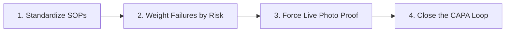

A restaurant audit on paper takes forty minutes. 

The shift supervisor grabs a laminated clipboard at 10:30 AM before the lunch rush hits. They check twenty-five boxes: line temperatures, prep labels, sanitizer concentration, employee hairnets. Every box gets a blue tick. The clipboard goes back on its nail beside the prep sink.

Then at 2:15 PM, a regional director walks in unannounced. 

The line reach-in cooler sits at 9.4°C instead of 4°C. Two pans of sliced chicken have yesterday's morning date dot scribbled over with black marker. The handwash basin near the grill has no hand soap, just water pooled in an empty dispenser. 

On paper, the outlet scored 100% four hours earlier. On the floor, the kitchen failed basic food hygiene regulations.

That disconnect is why Google and search engines demote generic "complete guide to restaurant audits" posts that read like generic AI regurgitations, and why restaurant chains struggle with audit consistency across 10, 50, or 200 locations.

An audit that relies on unchecked self-reporting is not an inspection; it is administrative theater. Here is how multi-unit restaurant operators structure audit programs that actually change daily kitchen behavior.

---

## The Four Types of Restaurant Audits (And Who Runs Them)

Trying to run every inspection through a single master checklist guarantees corners get cut. Food safety checks require digital probe thermometers and chemical test strips. Loss-prevention reviews require point-of-sale reconciliations. Brand standards require dining room sound-level and lighting checks.

Successful groups separate audits into four distinct tiers based on frequency and ownership:

### 1. Shift-Level Food Safety & Line Checks
* **Owner:** Shift manager or kitchen lead (BOH).
* **Cadence:** Twice daily (pre-lunch open and pre-dinner handover).
* **Focus:** Cold-chain integrity, cross-contamination, hot-holding lines.
* **Evidence:** Live photo of probe thermometer reading, not an unchecked "Pass".
* **Key Checks:**
  * Walk-in cooler at ≤ 4°C (40°F); freezer at ≤ -18°C (0°F).
  * Raw proteins stored on the lowest wire shelves, below prep foods and produce.
  * Sanitizer buckets at 200 to 400 PPM quaternary ammonium or 50 to 100 PPM free chlorine.
  * Prep date dots clearly printed with item name, discard timestamp, and prep cook initials.

### 2. Weekly Back-of-House (BOH) Deep Hygiene Audits
* **Owner:** General Manager (GM) or Head Chef.
* **Cadence:** Weekly, scheduled during low-volume prep windows (e.g., Monday mornings).
* **Focus:** Equipment cleanliness, pest harborages, hood ventilation, waste handling.
* **Key Checks:**
  * Exhaust hood grease filters soaked and degreased; fire suppression nozzles unobstructed.
  * Floor drains pulled, cleared of organic solids, and treated with enzyme cleaner.
  * Gaskets on line low-boys inspected for tears, mold, and door-seal suction.
  * Pest log checked for bait-station status and physical evidence along baseboards.

### 3. Monthly Operational & Brand Standard Audits
* **Owner:** Area Coach, District Manager, or Regional QA Specialist.
* **Cadence:** Monthly (unannounced or semi-announced).
* **Focus:** Guest-facing presentation, service speed, uniform compliance, POSM consistency.
* **Key Checks:**
  * Front-of-house (FOH) dining tables wiped, level, and free of food debris under table bases.
  * Restroom inspection every 60 minutes: functioning hot water, stocked soap, odor control.
  * Ticket-to-table speed clocked across 10 random peak orders.
  * Current promotional menu inserts and window graphics match active national campaigns.

### 4. Quarterly Loss Prevention (LP) & Margin Audits
* **Owner:** Internal auditor, finance controller, or regional operations lead.
* **Cadence:** Quarterly.
* **Focus:** Waste logs, recipe yields, high-cost protein shrinkage, cash handling.
* **Key Checks:**
  * Physical inventory variance on top 10 cost drivers (cheese, beef, poultry, cooking oil).
  * Manager voids, comps, and drawer reconciliations audited against POS logs.
  * Delivery receiving logs checked against invoice weights and vendor delivery temps.

---

## 20-Point Multi-Unit Restaurant Audit Checklist

Use this structured inspection framework across back-of-house, front-of-house, and compliance documentation:

  <table className="w-full min-w-[720px] border-collapse text-left text-sm">
    <thead className="bg-muted/50">
      <tr>
        <th className="p-4 font-semibold text-foreground border-b border-border">Station / Area</th>
        <th className="p-4 font-semibold text-foreground border-b border-border">Audit Check Item</th>
        <th className="p-4 font-semibold text-foreground border-b border-border">Verification Method</th>
        <th className="p-4 font-semibold text-foreground border-b border-border">Severity</th>
      </tr>
    </thead>
    <tbody>
      <tr className="hover:bg-muted/30 transition-colors">
        <td className="p-4 border-b border-border font-medium text-foreground">Cold Storage</td>
        <td className="p-4 border-b border-border text-muted-foreground">Walk-in and line coolers holding at 4°C (40°F) or below.</td>
        <td className="p-4 border-b border-border text-muted-foreground">Calibrated digital probe photo</td>
        <td className="p-4 border-b border-border text-red-600 font-semibold">Critical</td>
      </tr>
      <tr className="hover:bg-muted/30 transition-colors">
        <td className="p-4 border-b border-border font-medium text-foreground">Cold Storage</td>
        <td className="p-4 border-b border-border text-muted-foreground">Freezer units holding solid ice at -18°C (0°F) or below.</td>
        <td className="p-4 border-b border-border text-muted-foreground">Gauge photo reading</td>
        <td className="p-4 border-b border-border text-red-600 font-semibold">Critical</td>
      </tr>
      <tr className="hover:bg-muted/30 transition-colors">
        <td className="p-4 border-b border-border font-medium text-foreground">Food Handling</td>
        <td className="p-4 border-b border-border text-muted-foreground">Raw proteins stored strictly below cooked and ready-to-eat items.</td>
        <td className="p-4 border-b border-border text-muted-foreground">Shelf rack photo evidence</td>
        <td className="p-4 border-b border-border text-red-600 font-semibold">Critical</td>
      </tr>
      <tr className="hover:bg-muted/30 transition-colors">
        <td className="p-4 border-b border-border font-medium text-foreground">Food Handling</td>
        <td className="p-4 border-b border-border text-muted-foreground">FIFO labeling: Every opened or prepped container has legible prep/expiry dot.</td>
        <td className="p-4 border-b border-border text-muted-foreground">5-point random pan inspection</td>
        <td className="p-4 border-b border-border text-foreground">Major</td>
      </tr>
      <tr className="hover:bg-muted/30 transition-colors">
        <td className="p-4 border-b border-border font-medium text-foreground">Sanitation</td>
        <td className="p-4 border-b border-border text-muted-foreground">Handwash stations stocked: warm water (38°C+), antibacterial soap, single-use paper towels.</td>
        <td className="p-4 border-b border-border text-muted-foreground">Physical water flow & supply photo</td>
        <td className="p-4 border-b border-border text-red-600 font-semibold">Critical</td>
      </tr>
      <tr className="hover:bg-muted/30 transition-colors">
        <td className="p-4 border-b border-border font-medium text-foreground">Sanitation</td>
        <td className="p-4 border-b border-border text-muted-foreground">Active surface sanitizer bucket tests within 200–400 PPM quat concentration.</td>
        <td className="p-4 border-b border-border text-muted-foreground">Photo of colored test strip against scale</td>
        <td className="p-4 border-b border-border text-foreground">Major</td>
      </tr>
      <tr className="hover:bg-muted/30 transition-colors">
        <td className="p-4 border-b border-border font-medium text-foreground">Cooking / Line</td>
        <td className="p-4 border-b border-border text-muted-foreground">Internal cook temperatures logged (poultry 74°C, ground beef 68°C, seafood 63°C).</td>
        <td className="p-4 border-b border-border text-muted-foreground">Random core probe test during service</td>
        <td className="p-4 border-b border-border text-red-600 font-semibold">Critical</td>
      </tr>
      <tr className="hover:bg-muted/30 transition-colors">
        <td className="p-4 border-b border-border font-medium text-foreground">Dishwashing</td>
        <td className="p-4 border-b border-border text-muted-foreground">Commercial dish machine rinse cycle reaches ≥ 82°C (180°F) or chemical sanitizing PPM.</td>
        <td className="p-4 border-b border-border text-muted-foreground">Thermo-label or machine temperature display</td>
        <td className="p-4 border-b border-border text-red-600 font-semibold">Critical</td>
      </tr>
      <tr className="hover:bg-muted/30 transition-colors">
        <td className="p-4 border-b border-border font-medium text-foreground">Pest Control</td>
        <td className="p-4 border-b border-border text-muted-foreground">Zero rodent droppings, live roaches, or fruit fly infestations in dry storage or bar drains.</td>
        <td className="p-4 border-b border-border text-muted-foreground">Drain, motor base, and trap inspection</td>
        <td className="p-4 border-b border-border text-red-600 font-semibold">Critical</td>
      </tr>
      <tr className="hover:bg-muted/30 transition-colors">
        <td className="p-4 border-b border-border font-medium text-foreground">Staff Hygiene</td>
        <td className="p-4 border-b border-border text-muted-foreground">Line cooks and runners wear clean aprons, hair restraints, beard nets; no visible cuts without glove covers.</td>
        <td className="p-4 border-b border-border text-muted-foreground">Line visual audit</td>
        <td className="p-4 border-b border-border text-foreground">Major</td>
      </tr>
      <tr className="hover:bg-muted/30 transition-colors">
        <td className="p-4 border-b border-border font-medium text-foreground">Equipment</td>
        <td className="p-4 border-b border-border text-muted-foreground">Exhaust hood filters free of heavy grease dripping; fryer oil tested for total polar materials (TPM ≤ 24%).</td>
        <td className="p-4 border-b border-border text-muted-foreground">Oil test kit reading or visual color card</td>
        <td className="p-4 border-b border-border text-foreground">Major</td>
      </tr>
      <tr className="hover:bg-muted/30 transition-colors">
        <td className="p-4 border-b border-border font-medium text-foreground">Chemical Safety</td>
        <td className="p-4 border-b border-border text-muted-foreground">Degreasers and bleach stored in designated chemical closet, away from food prep and disposable packaging.</td>
        <td className="p-4 border-b border-border text-muted-foreground">Chemical locker photo</td>
        <td className="p-4 border-b border-border text-foreground">Major</td>
      </tr>
      <tr className="hover:bg-muted/30 transition-colors">
        <td className="p-4 border-b border-border font-medium text-foreground">Dining Area</td>
        <td className="p-4 border-b border-border text-muted-foreground">Dining tables, booth crevices, and high chairs disinfected with food-contact safe cleaner between turns.</td>
        <td className="p-4 border-b border-border text-muted-foreground">FOH visual spot check</td>
        <td className="p-4 border-b border-border text-muted-foreground">Minor</td>
      </tr>
      <tr className="hover:bg-muted/30 transition-colors">
        <td className="p-4 border-b border-border font-medium text-foreground">Dining Area</td>
        <td className="p-4 border-b border-border text-muted-foreground">Restrooms checked every 60 mins: clean fixtures, odor-free, stocked with soap and touchless paper towels.</td>
        <td className="p-4 border-b border-border text-muted-foreground">Restroom door log sign-off</td>
        <td className="p-4 border-b border-border text-foreground">Major</td>
      </tr>
      <tr className="hover:bg-muted/30 transition-colors">
        <td className="p-4 border-b border-border font-medium text-foreground">Waste Control</td>
        <td className="p-4 border-b border-border text-muted-foreground">Internal waste bins covered, bag-lined, emptied before 80% capacity; back corral dumpster lids closed.</td>
        <td className="p-4 border-b border-border text-muted-foreground">Corral area photo</td>
        <td className="p-4 border-b border-border text-foreground">Major</td>
      </tr>
      <tr className="hover:bg-muted/30 transition-colors">
        <td className="p-4 border-b border-border text-muted-foreground font-medium">Brand Standard</td>
        <td className="p-4 border-b border-border text-muted-foreground">Active promotional window vinyls, menu displays, and POS counter signs match national marketing directives.</td>
        <td className="p-4 border-b border-border text-muted-foreground">POS counter photo upload</td>
        <td className="p-4 border-b border-border text-muted-foreground">Minor</td>
      </tr>
      <tr className="hover:bg-muted/30 transition-colors">
        <td className="p-4 border-b border-border font-medium text-foreground">Speed of Service</td>
        <td className="p-4 border-b border-border text-muted-foreground">Order-to-delivery ticket times hit brand SLA (e.g., under 7 minutes for QSR counter, 18 minutes for casual dining).</td>
        <td className="p-4 border-b border-border text-muted-foreground">KDS (Kitchen Display System) snapshot</td>
        <td className="p-4 border-b border-border text-foreground">Major</td>
      </tr>
      <tr className="hover:bg-muted/30 transition-colors">
        <td className="p-4 border-b border-border font-medium text-foreground">Regulatory</td>
        <td className="p-4 border-b border-border text-muted-foreground">Current food service license (e.g., local health permit, FSSAI registration) posted publicly in guest view.</td>
        <td className="p-4 border-b border-border text-muted-foreground">License plaque photo</td>
        <td className="p-4 border-b border-border text-foreground">Major</td>
      </tr>
      <tr className="hover:bg-muted/30 transition-colors">
        <td className="p-4 border-b border-border font-medium text-foreground">Staff Records</td>
        <td className="p-4 border-b border-border text-muted-foreground">Food handler certifications and mandatory medical check cards on file for 100% of active roster.</td>
        <td className="p-4 border-b border-border text-muted-foreground">HR compliance roster audit</td>
        <td className="p-4 border-b border-border text-foreground">Major</td>
      </tr>
      <tr className="hover:bg-muted/30 transition-colors">
        <td className="p-4 border-b border-border font-medium text-foreground">Fire Safety</td>
        <td className="p-4 border-b border-border text-muted-foreground">Class K kitchen fire extinguisher and ABC extinguishers inspected, tagged within 12 months, and unblocked.</td>
        <td className="p-4 border-b border-border text-muted-foreground">Tag date stamp photo</td>
        <td className="p-4 border-b border-border text-red-600 font-semibold">Critical</td>
      </tr>
    </tbody>
  </table>

---

## Why Restaurant Audits Fail: The Three Flaws in Most Programs

When food hygiene lapses or guest complaints spike across a 20-store chain, executive leadership usually blames the store managers. But in 90% of operations, the failure is built into how the audit program was designed.

### 1. Subjective, Binary Scoring Without Evidence
If your checklist asks:
> *"Is the fry station clean? (Yes / No)"*

One manager marks "Yes" because there is no wet batter on the floor. An area director marks "No" because there is four days of carbon build-up behind the heating elements. 

**The fix:** Replace subjective questions with photographic thresholds. 
*Bad:* "Is the freezer organized?"
*Good:* "Are all proteins shelved 15cm off the floor with FIFO labels facing forward? Snap a photo of shelf 1 and shelf 2."

### 2. The Pencil-Whipping Trap (Unverified Submissions)
When store managers have fifteen minutes between deliveries and staff calls, paper logs and un-gated forms get signed off while sitting in the back office. Temperatures get written down from memory rather than measured with a probe.

**The fix:** Modern audit systems disable camera roll uploads. Auditors must snap live in-app photos with GPS coordinates stamped to the outlet boundary. If an auditor tries to submit opening temperatures from a coffee shop two miles away, the submission locks.

### 3. Audits Without a Corrective Action Loop (CAPA)
Finding twenty faults during a walk-through does nothing if those faults are not closed out. In traditional setups, the district manager emails a 14-page PDF summary to the store manager. The store manager skims it, gets pulled onto the lunch line, and forgets it.

**The fix:** Non-compliant findings must instantly spawn remediation tickets.
* If a salad prep cooler reads 7.5°C during an 11 AM audit:
  1. The item immediately generates a High-Severity CAPA ticket assigned to the General Manager.
  2. A 2-hour SLA clock begins counting down.
  3. The GM must move perishable items to the walk-in, adjust the thermostat or log a refrigeration repair ticket, and submit a live photo showing the cooler holding at ≤ 4°C before the ticket can close.

---

## How to Set Up an Audit Program in 4 Steps

If you are transitioning your restaurant brand from paper sheets or messy WhatsApp photo threads to a structured inspection system, follow this rollout sequence:

1. **Convert SOPs into Actionable Checklist Items:** Write checklist prompts as observable conditions. Include reference "golden standard" photos directly inside the app so team members see exactly how a prep line or display counter should look.
2. **Assign Weighting to Critical Failures:** A missing napkin dispenser is a minor issue (-2 points). A walk-in cooler running at 10°C or rodent activity is a critical failure that triggers an instant audit auto-fail, regardless of overall percentage.
3. **Mandate Proof at the Point of Inspection:** Require live camera captures for critical controls (thermometer readouts, oil test strips, sanitizer color cards) with phone gallery uploads blocked.
4. **Automate Remediation (CAPA):** Build automated escalations. If a store manager fails to submit proof of fix within 24 hours, the overdue ticket automatically escalates to the regional operations director.

---

## Frequently Asked Questions

<strong>How often should a restaurant chain audit its outlets?</strong>

Top-performing restaurant groups run food safety and line temperature checks twice daily (shift handovers), deep kitchen hygiene audits weekly by the GM, unannounced operational and brand audits monthly by the District Manager, and comprehensive loss-prevention audits quarterly.

<strong>What is the difference between an internal audit and an external health inspection?</strong>

Internal audits are proactive reviews conducted by your own management team to detect operational drift, train staff, and safeguard margins. External health inspections (conducted by municipal health inspectors, the FDA, or FSSAI) are regulatory evaluations focused strictly on food law compliance and public health codes.

<strong>How do you stop restaurant managers from faking audit checklists?</strong>

Paper checklists and standard mobile forms are easily falsified from the back office. To eliminate falsification, multi-unit operators use proof-based audit platforms that enforce GPS geofencing (ensuring the auditor is physically inside the building) and disable camera roll uploads (mandating real-time, live camera photo capture).

<strong>What happens when an audit check fails during peak service?</strong>

If a critical check fails during service (such as cold-holding equipment running warm), the manager must immediately apply a short-term correction (e.g., icing down prep pans or moving stock to a walk-in), followed by logging a corrective action ticket to repair the underlying equipment issue with verified photographic sign-off.

<strong>How can software improve audit consistency across 50+ restaurant locations?</strong>

Audit management software standardizes scoring rules, provides side-by-side standard photos on the auditor's screen, aggregates cross-store performance rankings in real time, and automates corrective action notifications so regional leaders see compliance trends without manually sorting through spreadsheets.

---

## Related Operational Resources

* [Best Restaurant Audit & Inspection Software for Multi-Unit Chains](/blog/best-restaurant-audit-software-multi-unit)
* [How to Digitise HACCP Checklists for Restaurant Chains](/blog/how-to-digitise-haccp-checklists-for-restaurant-chains)
* [How Restaurant Chains Maintain Consistency Across 50 Locations](/blog/how-restaurant-chains-maintain-consistency-across-50-locations)
* [Corrective Action Plans After an Audit: The Practical Guide](/blog/corrective-action-plan-after-audit)
* [How to Hold Outlet Managers Accountable for Fixing Audit Failures](/blog/how-to-hold-restaurant-outlet-managers-accountable-for-fixing-audit)

Looking to eliminate pencil-whipping and gain real ground-level visibility across your kitchens? [Book a walkthrough with Audiment](/solutions/restaurant-audit-software) to see proof-based restaurant auditing in action.
