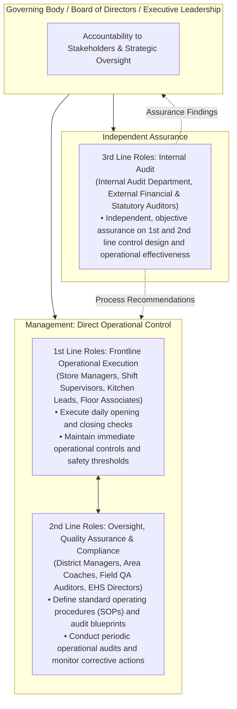
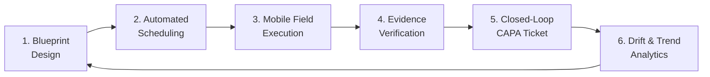

Audit management is the systematic process of designing inspection standards, executing on-site evaluations, gathering verified evidence, resolving non-conformances, and analyzing systemic operational performance across an organization.

In multi-unit operations—such as restaurant chains, retail store networks, convenience retail, and franchise groups—audit management governs how headquarters verifies that physical facilities execute daily operating procedures. It tracks whether food is held at safe temperatures, visual merchandising matches approved planograms, cash handling protocols are followed, and fire exits remain unobstructed.

When organizations manage five locations, audit oversight is handled informally through direct owner visits. When operations expand to twenty, fifty, or five hundred locations, physical distance breaks direct observation. Operational standards degrade across distributed units—a process known as operational drift. Audit management systems provide the structured framework and software tools required to measure and control this variance.

---

## 1. Formal Definition and Standards: ISO 19011:2018

In international quality management, audit criteria are codified under **ISO 19011:2018** (*Guidelines for auditing management systems*). 

Clause 3.1 defines an audit as a:
> "Systematic, independent and documented process for obtaining objective evidence and evaluating it objectively to determine the extent to which audit criteria are fulfilled."

The standard identifies six governing principles that ensure audit findings remain valid and actionable:

```
┌────────────────────────────────────────────────────────────────────────┐
│               THE 6 CORE PRINCIPLES OF ISO 19011:2018                   │
├────────────────────────────────────────────────────────────────────────┤
│ 1. Integrity: The foundation of professionalism and honesty.           │
│ 2. Fair Presentation: The obligation to report truthfully and accurately.│
│ 3. Due Professional Care: Applying reasoned judgment in auditing.      │
│ 4. Confidentiality: Security of proprietary operational information.   │
│ 5. Independence: Impartiality and freedom from operational bias.       │
│ 6. Evidence-Based Approach: Rational conclusions based on verifiable data.│
└────────────────────────────────────────────────────────────────────────┘
```

The governing principle for frontline field operations is the **evidence-based approach**. An audit finding without objective, time-verified evidence is merely an assertion. In multi-unit commercial management, valid evidence consists of time-stamped photographs captured on-site, verified temperature probe readings, calibrated test-strip assays, and GPS-authenticated physical coordinates.

---

## 2. Governance Architecture: The IIA Three Lines Model

The breakdown of operational standards in expanding multi-unit businesses corresponds directly to structural failures within **The Institute of Internal Auditors (IIA) Three Lines Model**. 

This model outlines how operational duties, risk oversight, and independent assurance interact:



### The Breakdown Across Multi-Unit Networks

In single-store operations, the owner operates as the first, second, and third lines simultaneously. When a brand expands across regions, these responsibilities separate:

1. **The First Line (Store Staff):** Frontline staff face peak order volumes, staffing absences, and delivery delays. When audits rely on unmonitored paper binders or simple digital forms, staff fill out forms from memory without inspecting the physical assets—a practice known as pencil-whipping.
2. **The Second Line (District Managers):** Responsible for 12 to 25 physical outlets across hundreds of miles, district managers spend substantial working hours traveling between branches and manually transcribing inspection notes into spreadsheets. They lack the tooling to verify whether store managers resolved previously cited non-conformances.
3. **The Third Line (Executive Leadership):** Leadership reviews monthly compliance spreadsheets that present 95%+ passing rates, while customer reviews report dirty restrooms and cold food, and local health authorities issue inspection citations.

A purpose-built operational audit management system links the First and Second lines, automating verification and converting passive checklists into verifiable operational records.

---

## 3. The 3 Types of Audits (ISO 19011 Classification)

Audit management differs fundamentally depending on the commercial relationship between the auditor and the facility being evaluated:

| Audit Type | Conducting Entity | Audited Facility | Primary Focus | Practical Examples |
| :--- | :--- | :--- | :--- | :--- |
| **First-Party (Internal)** | Shift supervisors, store managers, internal QA leads. | Own commercial stores, dark kitchens, warehouses. | Daily operational process control, hygiene, safety thresholds. | Morning restaurant line checks, retail opening audits, daily cold-holding logs. |
| **Second-Party (External / Partner)** | Corporate brand QA teams, franchisor field consultants, procurement auditors. | Franchisee-operated stores, contract co-packers, logistics vendors. | Contractual compliance, brand consistency, supplier food safety. | Franchise brand standard evaluations, central kitchen supplier audits. |
| **Third-Party (Regulatory / Certification)** | Accredited registrars (BSI, SGS, TÜV), statutory inspectors (FDA, OSHA, local health departments). | Company-owned and franchised facilities. | Legal conformity, management system certification. | FDA Food Code inspections, ISO 9001 audits, OSHA workplace safety reviews. |

Enterprise Governance, Risk, and Compliance (GRC) software packages (such as MetricStream or Diligent) focus almost exclusively on **third-party regulatory filings, corporate SOX financial controls, and IT security**. These systems are designed for corporate compliance officers working on desktop computers.

Operational audit management software focuses on **first-party daily checks and second-party franchise evaluations**. Frontline supervisors require lightweight mobile web interfaces, rapid camera capture, offline reliability, and fast issue ticketing.

---

## 4. The 6-Stage Closed-Loop Audit Lifecycle

An audit program is not a single form. It is a recurring six-stage operational cycle:



### Stage 1: Blueprint Design
Audit questions must define objective, binary verification criteria. Subjective questions produce inconsistent results across different inspectors:
* *Subjective prompt:* "Is the backroom clean and organized? (Yes / No)"
* *Objective prompt:* "Are chemical containers stored inside the locked yellow cabinet, off the floor, with SDS labels facing forward? Photograph the top and bottom shelves."

A complete blueprint specifies:
* **Binary condition criteria:** Clear definitions of acceptable and unacceptable states.
* **Evidence mandates:** Specification of required verification (live photo, numerical temperature reading, barcode scan, or digital sign-off).
* **Weighted scoring:** Mathematical point deductions scaled by operational risk (e.g., cosmetic flaw = 1 point; critical food safety hazard = 5 points with an immediate critical audit failure override).

### Stage 2: Automated Scheduling and Dispatch
Operational audit management systems automate inspection frequencies based on risk profiles:
* **Shift-level:** Twice-daily line checks, walk-in cooler temperature logs, quaternary sanitizer tests.
* **Weekly:** Store general manager deep sanitation audits, visual merchandising planogram reviews.
* **Monthly / Quarterly:** District manager evaluations, surprise brand integrity audits, fire protection reviews.

### Stage 3: Mobile Field Execution
Auditors inspect retail aisles, basements, and commercial kitchens where cellular data drops. The system must operate on an **offline-first local database architecture** (such as IndexedDB or SQLite). Checklists, logic branches, and captured images must save locally on the device, syncing automatically once internet connectivity is re-established.

### Stage 4: Evidence Verification (Anti-Fraud Controls)
Digital checklists that allow device gallery photo uploads invite falsification. When users can select images from phone storage, staff can submit photos taken weeks prior or download stock images from internal chats. 

Operational audit systems enforce hardware-level controls:
1. **Camera-Roll Lockout:** The application accesses the device camera API directly. Gallery selection is restricted, requiring the user to capture the photo live at the physical asset.
2. **GPS Geofenced Gating:** Device GPS coordinates are measured against the geofenced boundary of the physical store. If coordinates cannot be verified within the store perimeter, final audit submission is blocked.

### Stage 5: Closed-Loop Remediation (CAPA Engine)
Generating an inspection report without tracking corrective actions produces dead data. 

In a closed-loop system:
* Every failed checklist item automatically generates a **Corrective and Preventive Action (CAPA)** ticket.
* The ticket is assigned directly to the responsible location manager.
* A strict Service Level Agreement (SLA) clock starts (e.g., 2 hours for active food temperature hazards; 48 hours for mechanical repairs).
* The ticket cannot be marked closed with a simple checkbox. The location manager must submit live, verified photographic proof of the completed correction, which is reviewed and approved by the district manager.

### Stage 6: Drift and Trend Analytics
Aggregated audit records expose organizational failures that single inspections cannot show:
* *Do cold-chain temperature checks fail regularly on Sunday afternoons across District 3?* Indicates weekend shift handoff issues.
* *Did fryer oil degradation scores worsen after switching to a new oil supplier?* Indicates vendor material quality issues.
* *Which store locations consistently fail follow-up CAPA audits?* Identifies management execution gaps.

---

## 5. Statistical Sampling vs. 100% Census Audits

In manufacturing and operational compliance, audit management utilizes two distinct data collection strategies:

```
┌────────────────────────────────────────────────────────────────────────┐
│               AUDIT INSPECTION METHODOLOGIES                           │
├────────────────────────────────────────────────────────────────────────┤
│ 1. 100% Census Auditing (Critical Control Points):                     │
│    • Every unit, every day, without exception.                         │
│    • Applied to food core cook temps, reach-in cooler temps, fire doors.│
│                                                                        │
│ 2. Statistical Attribute Sampling (ISO 2859-1 / AQL):                  │
│    • Inspecting a statistically representative subset of items.        │
│    • Applied to visual merchandising planograms, shelf price tags,     │
│      and secondary stock packaging integrity.                          │
└────────────────────────────────────────────────────────────────────────┘
```

In multi-unit retail and restaurant operations, mixing these two approaches is essential. Mandating that store managers take photos of all 80 questions on an opening checklist causes inspection fatigue, slowing down operations. 

High-performing audit systems enforce **100% census auditing on high-risk critical checkpoints** (e.g., internal meat temperatures at 165°F, sanitizer at 200 PPM, locked chemical storage), while using **rotating attribute sampling for standard cosmetic and operational checks**.

---

## 6. The Economics of Quality: Cost of Quality (CoQ) Framework

Implementing dedicated audit management software changes how organizations spend capital across the classical **Cost of Quality (CoQ)** model:

```
Total Cost of Quality = (Prevention Costs + Appraisal Costs) + (Internal Failure Costs + External Failure Costs)
```

```
┌────────────────────────────────────────────────────────────────────────┐
│                THE COST OF QUALITY (CoQ) BALANCE                       │
├────────────────────────────────────────────────────────────────────────┤
│ CONFORMANCE COSTS:                                                     │
│ • Prevention Costs: Standard SOP creation, staff training.             │
│ • Appraisal Costs: Auditor travel, manual Excel data entry, inspection.│
│                                                                        │
│ NON-CONFORMANCE COSTS:                                                 │
│ • Internal Failure Costs: Food waste, spoiled stock, rework labor.     │
│ • External Failure Costs: Customer churn, health department fines,     │
│   foodborne illness litigation, brand reputation loss.                 │
└────────────────────────────────────────────────────────────────────────┘
```

Manual audit programs run high appraisal costs (district managers spending 15 hours per week on paperwork) and high external failure costs (missed violations leading to regulatory citations). 

A software-driven audit platform reduces appraisal costs by eliminating administrative reporting hours, and eliminates external failures by catching operational drift before it reaches customers.

---

## 7. Comparison: Audit Management vs. Other Business Systems

Organizations frequently confuse audit management systems with adjacent software categories:

| Dimension | Operational Audit Management (e.g., Audiment) | Enterprise GRC Software (e.g., MetricStream, Diligent) | Task & Checklist Apps (e.g., Notion, Google Forms) | CMMS / Work Order Apps (e.g., MaintainX) |
| :--- | :--- | :--- | :--- | :--- |
| **Primary User** | Shift leads, store managers, district coaches. | Corporate risk officers, compliance attorneys. | Office employees, generic project teams. | Facilities technicians, plant mechanics. |
| **Operating Hardware** | Personal smartphones (BYOD), mobile web browsers. | Desktop computers, corporate laptops. | Desktop browsers, generic mobile apps. | Native mobile apps on technician devices. |
| **Evidence Verification** | Mandatory live camera capture, GPS submission gating. | Spreadsheet uploads, policy documents. | Unverified gallery uploads or text inputs. | Photos allowed from camera roll. |
| **Scoring Engine** | Weighted scoring, passing grades, critical fail gates. | Enterprise risk heatmaps, regulatory indexes. | No native scoring engines. | Pass/fail task completion checks. |
| **Remediation Tracking** | Automated 48-hour CAPA SLAs with photo verification. | Multi-quarter corporate risk reviews. | Manual assignment in task boards. | Work order dispatch for equipment repair. |
| **Pricing Structure** | Flat store pricing with unlimited frontline users. | Enterprise contracts ($30k–$100k+/year). | Per-user seat licenses ($10–$25/user/month). | Per-technician seat licenses ($20–$50/user/month). |

---

## 8. Why Traditional Tooling Breaks at Scale

When expanding beyond ten locations, organizations typically rely on three manual methods that fail under operational pressure:

### 1. The Paper Checklist Binder
* **The failure mode:** Paper forms are filled out retroactively at the end of a shift rather than at the scheduled time. Binders get lost, soiled, or damaged.
* **The data cost:** Headquarters has no visibility into operational trends across branches. Gathering thirty days of cold-holding logs for an inspector requires physically sorting through binders at the store.

### 2. The Unindexed WhatsApp / Chat Channel
* **The failure mode:** Store managers upload dozens of unorganized photos every morning to prove line readiness. 
* **The data cost:** Photos lack tamper-proof timestamps and location metadata. Chat feeds become cluttered, making it impossible to search historical records, track overdue issues, or run cross-store performance comparisons.

### 3. The Generic Form (Google Forms / Airtable)
* **The failure mode:** Anyone with the form link can submit responses remotely from off-site. Users can upload old photos from their camera rolls.
* **The data cost:** Generic forms do not support offline execution in walk-in freezers, offer no weighted scoring matrices, and lack automated CAPA ticketing when critical checks fail.

---

## 9. How Audiment Implements Operational Audit Management

Audiment is engineered specifically for multi-unit retail, food service, and franchise brands that require verifiable ground-level accountability across distributed physical locations:

```
┌────────────────────────────────────────────────────────────────────────┐
│                   AUDIMENT ARCHITECTURAL PILLARS                       │
├────────────────────────────────────────────────────────────────────────┤
│ 1. Proof-Based Verification: In-app camera only, 8-sec GPS gate.       │
│ 2. Automated 48-Hour CAPA: Photo-verified closure, 6-hr escalation.    │
│ 3. Offline Mobile Execution: PWA web app, local SQLite sync.           │
│ 4. Systemic Drift Detection: 3x consecutive failure trend alert.       │
│ 5. Predictable Economics: Free 1-store plan, unlimited flat paid tiers.│
└────────────────────────────────────────────────────────────────────────┘
```

1. **Hardware-Level Evidence Verification:** The camera interface locks gallery uploads by default, requiring real-time photo capture. High-accuracy GPS geolocation validates physical presence within the store perimeter before submissions can be finalized.
2. **Automated CAPA SLAs:** Critical failures immediately spawn tracked corrective action tickets assigned to the store manager. If the ticket is not resolved within the SLA window, automated reminders notify regional leadership.
3. **PWA Mobile Web Architecture:** Audiment runs directly in standard smartphone browsers without requiring App Store downloads, device management profiles (MDM), or personal storage consumption.
4. **Multi-Branch Drift Alerts:** Dashboards monitor cross-store performance, automatically flagging branches that fail three consecutive audits or show abnormal completion speeds.
5. **Flat Store Pricing:** A completely Free tier covers single-location operators (up to 3 auditor logins and 25 audits/month). Multi-unit plans use flat pricing with unlimited locations, unlimited users, and zero per-seat fees, allowing companies to give audit access to every shift lead without cost penalties.

---

## Frequently Asked Questions

<details>
<summary><strong>What is audit management?</strong></summary>
<p>Audit management is the systematic process of designing inspection blueprints, scheduling audits, gathering objective evidence on-site, remediating non-conformances through corrective actions, and analyzing operational performance trends across organizational facilities.</p>
</details>

<details>
<summary><strong>What is the difference between an audit and an inspection?</strong></summary>
<p>An inspection is a focused point-in-time examination of a physical asset or condition against a specific standard (e.g., verifying that a refrigeration unit is below 40°F). An audit is a comprehensive evaluation of whether an entire facility, workflow, or operating system consistently complies with established corporate SOPs and regulatory standards.</p>
</details>

<details>
<summary><strong>What is an audit management system (AMS)?</strong></summary>
<p>An audit management system (AMS) is software that replaces paper forms, spreadsheets, and chat channels with a centralized platform. It provides mobile inspection execution, enforces tamper-proof photo and GPS verification, automates corrective action tracking, and generates cross-location performance dashboards.</p>
</details>

<details>
<summary><strong>What is CAPA in audit management?</strong></summary>
<p>CAPA stands for Corrective and Preventive Action. In audit software, a CAPA engine converts a failed inspection checkpoint into an accountable remediation ticket with an assigned owner, strict SLA deadline, and mandatory photographic proof required before the issue can be verified and closed.</p>
</details>

<details>
<summary><strong>Why do per-seat software pricing models fail for retail audit management?</strong></summary>
<p>Per-seat software models charge monthly subscription fees ($20 to $60/user/month) for each named login. In a 50-store network with 4 shift supervisors per store, licensing 200 users costs $48,000 to $144,000 annually. To reduce costs, operators restrict licenses to regional managers, leaving frontline store managers without access and forcing them back onto paper forms. Flat store pricing with unlimited user accounts eliminates this restriction.</p>
</details>

<details>
<summary><strong>How does audit management software handle zero-connectivity environments?</strong></summary>
<p>Audit management software uses an offline-first mobile architecture. Draft inspections, branch blueprints, and captured media store locally on the device in indexed storage (such as IndexedDB or SQLite). When internet connectivity returns, the application automatically syncs the records to the central cloud database without data loss.</p>
</details>

<script
  type="application/ld+json"
  dangerouslySetInnerHTML={{
    __html: JSON.stringify({
      "@context": "https://schema.org",
      "@type": "FAQPage",
      "mainEntity": [
        {
          "@type": "Question",
          "name": "What is audit management?",
          "acceptedAnswer": {
            "@type": "Answer",
            "text": "Audit management is the systematic process of designing inspection blueprints, scheduling audits, gathering objective evidence on-site, remediating non-conformances through corrective actions, and analyzing operational performance trends across organizational facilities."
          }
        },
        {
          "@type": "Question",
          "name": "What is the difference between an audit and an inspection?",
          "acceptedAnswer": {
            "@type": "Answer",
            "text": "An inspection is a focused point-in-time examination of a physical asset or condition against a specific standard. An audit is a comprehensive evaluation of whether an entire facility, workflow, or operating system consistently complies with established corporate SOPs and regulatory standards."
          }
        },
        {
          "@type": "Question",
          "name": "What is an audit management system (AMS)?",
          "acceptedAnswer": {
            "@type": "Answer",
            "text": "An audit management system (AMS) is software that replaces paper forms, spreadsheets, and chat channels with a centralized platform. It provides mobile inspection execution, enforces tamper-proof photo and GPS verification, automates corrective action tracking, and generates cross-location performance dashboards."
          }
        },
        {
          "@type": "Question",
          "name": "What is CAPA in audit management?",
          "acceptedAnswer": {
            "@type": "Answer",
            "text": "CAPA stands for Corrective and Preventive Action. In audit software, a CAPA engine converts a failed inspection checkpoint into an accountable remediation ticket with an assigned owner, strict SLA deadline, and mandatory photographic proof required before the issue can be verified and closed."
          }
        },
        {
          "@type": "Question",
          "name": "Why do per-seat software pricing models fail for retail audit management?",
          "acceptedAnswer": {
            "@type": "Answer",
            "text": "Per-seat software models charge monthly subscription fees for each named login. In a 50-store network with 4 shift supervisors per store, licensing 200 users costs $48,000 to $144,000 annually. To reduce costs, operators restrict licenses to regional managers, leaving frontline store managers without access and forcing them back onto paper forms. Flat store pricing with unlimited user accounts eliminates this restriction."
          }
        },
        {
          "@type": "Question",
          "name": "How does audit management software handle zero-connectivity environments?",
          "acceptedAnswer": {
            "@type": "Answer",
            "text": "Audit management software uses an offline-first mobile architecture. Draft inspections, branch blueprints, and captured media store locally on the device in indexed storage. When internet connectivity returns, the application automatically syncs the records to the central cloud database without data loss."
          }
        }
      ]
    })
  }}
/>
