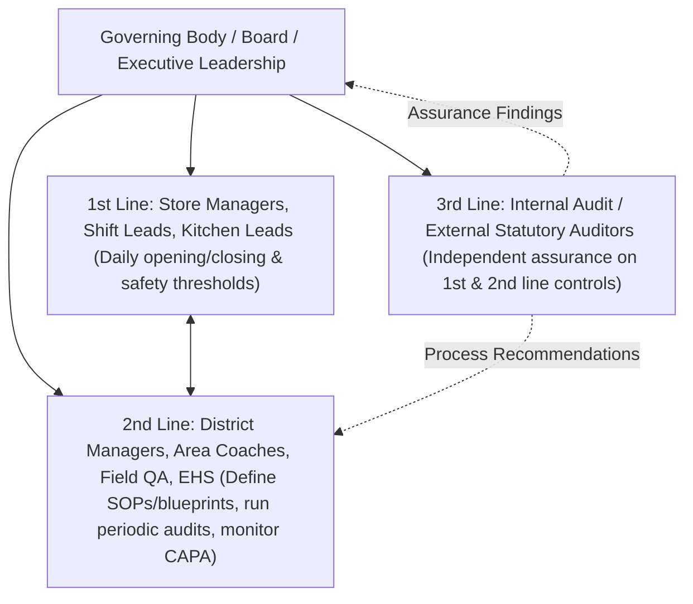
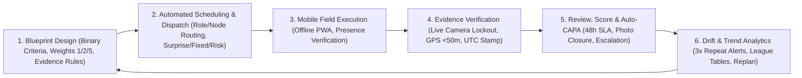

# 01 — Audit Fundamentals, Lifecycle, Scoring & Operational Drift

> **Priority Tier:** P3 / Core Foundation (Audit Fundamentals, Lifecycle, Scoring & Operational Drift)  
> **Narrative Anchor:** *"You can't be everywhere."* Multi-location operators lose ground-truth execution not from lack of written SOPs, but because physical distance breaks direct observation. Audiment replaces trust-based checkmarks with verified on-site execution, mandatory proof, and closed-loop corrective follow-through.

---

## 0. Module Scope & Source Inventory

### Target Personas
- **Founders, CEOs & COOs** scaling physical networks from 3 to 500+ outlets who need ground-truth branch performance without living on the road.
- **Operations Directors, Regional Heads & Area Managers** managing 6–25+ locations per territory who need standardized checklists, exception tracking, and travel prioritization.
- **Quality Assurance (QA), Compliance & Risk Leads** responsible for ISO 9001/19011 alignment, FSSAI/FDA/OSHA/RBI statutory readiness, and repeat-failure detection.
- **Franchise & Multi-Unit Retail/QSR Operators** enforcing brand consistency, planograms, food safety, and workplace safety across owned and franchised nodes.

### Source Blog Inventory (26 Source Posts)

| # | Blog Title & Canonical URL | Source File | Words | Standards Cited | Routed-Out Sections |
| :- | :--- | :--- | -: | :--- | :--- |
| 1 | [Audit management for multi-location operators](https://audiment.in/blog/audit-management-guide) | `audit-management-guide.mdx` | 1,299 | — | — |
| 2 | [How Audit Management Software Improves Regulatory Compliance](https://audiment.in/blog/audit-management-software-regulatory-compliance) | `audit-management-software-regulatory-compliance.mdx` | 2,233 | GDPR, ISO 27001, SOC 2 Type II, SOX | *What Security Features Should You Look for in Audit Management Systems?* → Mod 11 |
| 3 | [Audit Planning, Scheduling & Audit Data Use: A Practical Guide](https://audiment.in/blog/audit-planning-scheduling-audit-data-use) | `audit-planning-scheduling-audit-data-use.mdx` | 3,861 | ISO 9001 | — |
| 4 | [Audit Reporting, Scheduling & Mobile Fieldwork: How Multi-Location Teams Should Manage Audits](https://audiment.in/blog/audit-reporting-scheduling-mobile-fieldwork) | `audit-reporting-scheduling-mobile-fieldwork.mdx` | 2,876 | — | — |
| 5 | [Audit Workflow Automation & Risk-Based Auditing: How Multi-Location Teams Should Run Audits](https://audiment.in/blog/audit-workflow-automation-risk-based-auditing) | `audit-workflow-automation-risk-based-auditing.mdx` | 3,372 | — | — |
| 6 | [What Is a Compliance Audit Checklist? How to Build One That Works](https://audiment.in/blog/compliance-audit-checklist) | `compliance-audit-checklist.mdx` | 1,408 | FSSAI | — |
| 7 | [How Multi-Location Businesses Maintain Operational Control as They Scale](https://audiment.in/blog/how-multi-location-businesses-stay-in-control-as-they-scale) | `how-multi-location-businesses-stay-in-control-as-they-scale.mdx` | 1,815 | — | — |
| 8 | [How to Do Quality Control Across Multiple Outlets (Without Being Everywhere)](https://audiment.in/blog/how-to-do-quality-control-across-multiple-outlets) | `how-to-do-quality-control-across-multiple-outlets.mdx` | 1,702 | — | — |
| 9 | [What Is a Compliance Audit? A Practical Guide for Multi-Location Businesses](https://audiment.in/blog/how-to-perform-a-compliance-audit) | `how-to-perform-a-compliance-audit.mdx` | 2,387 | FSSAI | — |
| 10 | [How to Produce Regulator-Ready Compliance Reports in One Click](https://audiment.in/blog/how-to-produce-regulator-ready-compliance-reports-in-one-click) | `how-to-produce-regulator-ready-compliance-reports-in-one-click.mdx` | 1,611 | FDA, FSSAI, FSSAI Schedule 4, OSHA | — |
| 11 | [How to Scale from 3 to 20 Outlets Without Losing Quality](https://audiment.in/blog/how-to-scale-from-3-to-20-outlets-without-losing-quality) | `how-to-scale-from-3-to-20-outlets-without-losing-quality.mdx` | 1,739 | — | — |
| 12 | [What Is an Inspection Checklist? (And How to Build One That Actually Gets Used)](https://audiment.in/blog/inspection-checklist) | `inspection-checklist.mdx` | 3,475 | FSSAI | — |
| 13 | [What Is Multi-Location Management? A Practical Guide for Growing Businesses](https://audiment.in/blog/manage-multi-location-business) | `manage-multi-location-business.mdx` | 2,155 | — | — |
| 14 | [Multi-Location Audit Management: How to Manage Audits Across 10, 50, or 500 Locations](https://audiment.in/blog/multi-location-audit-management) | `multi-location-audit-management.mdx` | 1,699 | — | — |
| 15 | [Multi-Location Compliance Management: The Operational Operator's Playbook](https://audiment.in/blog/multi-location-compliance-guide) | `multi-location-compliance-guide.mdx` | 1,855 | FDA Food Code, FSSAI Schedule 4, HACCP, OSHA 1910 | *The Closed-Loop CAPA Escalation Matrix* → Mod 03 |
| 16 | [Quality Audit Best Practices, Methods & Common Challenges](https://audiment.in/blog/quality-audit-best-practices-methods-common-challenges) | `quality-audit-best-practices-methods-common-challenges.mdx` | 4,788 | ISO 19011:2026, ISO 9001 | — |
| 17 | [Quality Audit Templates, Checklists & Reports: A Practical Guide](https://audiment.in/blog/quality-audit-templates-checklists-reports) | `quality-audit-templates-checklists-reports.mdx` | 5,245 | FSSAI | — |
| 18 | [How to Run a Risk Management Audit Across Multiple Locations](https://audiment.in/blog/risk-management-audit-multi-location) | `risk-management-audit-multi-location.mdx` | 2,719 | — | — |
| 19 | [What Is a Field Audit? How It Works and Why It Matters for Distributed Operations](https://audiment.in/blog/what-is-a-field-audit) | `what-is-a-field-audit.mdx` | 2,671 | — | — |
| 20 | [What Is an Audit Score? How Scoring Works in Multi-Location Audits](https://audiment.in/blog/what-is-an-audit-score) | `what-is-an-audit-score.mdx` | 1,393 | — | — |
| 21 | [What Is Audit Management? The Definitive Guide for Multi-Location Operations](https://audiment.in/blog/what-is-audit-management) | `what-is-audit-management.mdx` | 3,251 | FDA, FDA Food Code, IIA Three Lines Model, ISO 19011, ISO 19011:2018, ISO 9001, OSHA, SOX | — |
| 22 | [What Is Inspection Management? A Plain-English Guide](https://audiment.in/blog/what-is-inspection-management) | `what-is-inspection-management.mdx` | 1,383 | — | — |
| 23 | [What Is Operational Auditing? A Plain-English Guide](https://audiment.in/blog/what-is-operational-auditing) | `what-is-operational-auditing.mdx` | 2,313 | SOX | — |
| 24 | [What is operational drift and how it happens](https://audiment.in/blog/what-is-operational-drift-and-how-it-happens) | `what-is-operational-drift-and-how-it-happens.mdx` | 1,575 | FSSAI | — |
| 25 | [Why Quality Control Is Important for Multi-Location Businesses](https://audiment.in/blog/why-quality-control-is-important) | `why-quality-control-is-important.mdx` | 2,955 | FSSAI | — |
| 26 | [Workplace & Operational Safety Inspection Checklists](https://audiment.in/blog/workplace-operational-safety-inspection-checklists) | `workplace-operational-safety-inspection-checklists.mdx` | 4,457 | OSHA (29 CFR 1910) | — |

---

## 1. Core Definitions, Taxonomy & Key Operational Distinctions

### 1.1 Foundational Definitions

- **Audit Management:** The systematic process of designing inspection standards/blueprints, scheduling audits, executing on-site evaluations, capturing objective evidence, scoring performance, resolving non-conformances through corrective actions, and analyzing recurring patterns across facilities [audit-management-guide](https://audiment.in/blog/audit-management-guide), [what-is-audit-management](https://audiment.in/blog/what-is-audit-management). If a checklist is the form, audit management is the system that verifies the form reflects physical reality and forces closure on failures [audit-management-guide](https://audiment.in/blog/audit-management-guide).
- **Multi-Location Audit Management:** The centralized process of planning, assigning, executing, tracking, and improving quality and compliance inspections across distributed branch networks (10, 50, or 500+ outlets) so templates, scoring algorithms, evidence rules, and corrective actions stay synchronized across every node [multi-location-audit-management](https://audiment.in/blog/multi-location-audit-management).
- **Multi-Location Management:** The set of processes, tools, and accountability structures enabling a business to operate multiple branches to a consistent standard across six operational areas: (1) standards and compliance, (2) people management, (3) inventory and supply chain, (4) customer experience, (5) financial oversight, and (6) **audit and verification**—the only layer that generates ground-truth data rather than self-reported estimates [manage-multi-location-business](https://audiment.in/blog/manage-multi-location-business).
- **Field Audit (and Field Auditor):** A structured, on-site inspection conducted physically at a business location by a visiting auditor (employee, third-party contractor, or brand/franchisor representative) who verifies operational, compliance, and brand standards using a defined checklist and evidence capture—never remotely or via self-reporting [what-is-a-field-audit](https://audiment.in/blog/what-is-a-field-audit).
- **Operational Auditing:** The systematic verification that day-to-day processes, SOPs, and standards are executed as intended across shifts and outlets, producing a scored, timestamped, evidence-backed record and corrective actions [what-is-operational-auditing](https://audiment.in/blog/what-is-operational-auditing).
- **Inspection Management (and IMS):** The structured workflow of scheduling, assigning, executing on mobile, scoring, and closing inspections. In day-to-day multi-location operations, inspection management and audit management share the same five-stage core workflow (`Schedule → Assign → Execute → Score → Close`), though "inspection" typically refers to routine physical/safety checks while "audit" carries formal compliance or governance weight [audit-management-guide](https://audiment.in/blog/audit-management-guide), [what-is-inspection-management](https://audiment.in/blog/what-is-inspection-management).
- **Compliance Audit:** A structured inspection verifying whether a facility meets defined external (regulatory, statutory, contractual) or internal (brand, SOP, franchise agreement) requirements, producing a scored, traceable due-diligence record [how-to-perform-a-compliance-audit](https://audiment.in/blog/how-to-perform-a-compliance-audit). Four types exist: **Regulatory**, **Brand & Franchise**, **Internal Policy**, and **Supplier/Third-Party** [how-to-perform-a-compliance-audit](https://audiment.in/blog/how-to-perform-a-compliance-audit).
- **Quality Audit:** A systematic assessment of whether quality requirements, processes, and controls are followed and supported by objective evidence (`Requirement → Process → Evidence → Result`), subdivided into **Process audits**, **Product audits**, **System audits**, **Internal audits**, and **External audits** [quality-audit-best-practices-methods-common-challenges](https://audiment.in/blog/quality-audit-best-practices-methods-common-challenges).
- **Risk Management Audit:** A structured review designed to identify operational vulnerabilities, test whether preventive controls function reliably across branches, and surface recurring failure patterns before incidents occur [risk-management-audit-multi-location](https://audiment.in/blog/risk-management-audit-multi-location).

### 1.2 Critical Operational Distinctions

| Comparison Pair | Entity / Concept A | Entity / Concept B | Practical Operational Rule | Source |
| :--- | :--- | :--- | :--- | :--- |
| **Audit vs. Inspection** | **Audit:** Comprehensive evaluation of whether an entire facility, workflow, or management system consistently complies with SOPs and regulations. | **Inspection:** Focused point-in-time examination of a physical asset or condition against a specific standard (e.g., cooler `<40°F` / `<4°C`). | Inside software, both run on the same blueprint → execute → score → CAPA loop; "inspection" is routine/tactical, "audit" is broader/formal. | [what-is-audit-management](https://audiment.in/blog/what-is-audit-management), [what-is-inspection-management](https://audiment.in/blog/what-is-inspection-management) |
| **Inspection Checklist vs. Audit** | **Inspection Checklist:** The structured tool/list of criteria used to record observations. | **Audit:** The full accountable process (qualified observer, scoring, evidence, findings, CAPA). | A checklist alone is just a list of questions; an audit produces a verified, accountable record with defined outcomes. | [inspection-checklist](https://audiment.in/blog/inspection-checklist) |
| **Field Audit vs. Office Audit** | **Field Audit:** On-site at the branch; direct observation + live photos; verifies *actual* operational condition; low false-data risk. | **Office Audit:** Remote/desk-based; reviews submitted documents/logs; verifies *reported* condition; high false-data risk. | An office audit of submitted hygiene logs cannot confirm cleaning happened; only a field audit gives ground truth. | [what-is-a-field-audit](https://audiment.in/blog/what-is-a-field-audit) |
| **Field Audit vs. Mystery Shopper** | **Field Audit:** Known auditor (unannounced to store for surprise checks); structured checklist + evidence; scored compliance + CAPA. | **Mystery Shopper:** Always anonymous; observed customer experience + subjective rating; narrative + service score. | Field audits come first—you cannot deliver consistent customer experience without consistent operational standards. | [what-is-a-field-audit](https://audiment.in/blog/what-is-a-field-audit) |
| **Operational vs. Financial Audit** | **Operational Audit:** Evaluates processes, execution, and SOPs ("Is the work done right?"); run daily/weekly/monthly by ops/field auditors. | **Financial Audit:** Evaluates accounts, balance sheets, and accounting compliance ("Are the numbers right?"); run annually/statutorily by finance/external auditors. | Operational auditing is the immediate management tool telling leadership what is happening in branches today. | [what-is-operational-auditing](https://audiment.in/blog/what-is-operational-auditing) |
| **Compliance vs. Operational Audit** | **Compliance Audit:** Binary pass/fail against fixed obligations ("Are we meeting obligations?"); failure risks fines or contract breach. | **Operational Audit:** Evaluates day-to-day process execution ("Are we executing our standards?"); failure degrades consistency and CX. | Regulatory compliance sets the *floor*; operational auditing maintains standards *above* that floor. Most multi-unit checklists combine both. | [how-to-perform-a-compliance-audit](https://audiment.in/blog/how-to-perform-a-compliance-audit), [what-is-operational-auditing](https://audiment.in/blog/what-is-operational-auditing) |
| **Operational vs. Risk Management Audit** | **Operational Audit:** Checks daily task completion (e.g., floor swept) and immediate branch outputs; drives localized fixes. | **Risk Management Audit:** Tests whether systemic controls prevent major hazards; aggregates patterns across sites to drive network-wide changes. | Operational audits keep shifts smooth; risk management audits protect the whole network from systemic breaches. | [risk-management-audit-multi-location](https://audiment.in/blog/risk-management-audit-multi-location) |
| **Compliance vs. Quality Audit** | **Compliance Audit:** Binary pass/fail against fixed statutory, contractual, or policy thresholds. | **Quality Audit:** Evaluates whether processes produce intended outcomes and can be improved (`Requirement → Process → Evidence → Result`). | Distinguish fixed statutory pass/fail thresholds from aspirational internal quality items inside the blueprint. | [how-to-perform-a-compliance-audit](https://audiment.in/blog/how-to-perform-a-compliance-audit), [quality-audit-best-practices-methods-common-challenges](https://audiment.in/blog/quality-audit-best-practices-methods-common-challenges) |
| **Quality Control (QC) vs. Quality Assurance (QA)** | **QC:** Inspects physical execution on the floor (e.g., oil temp, restroom cleanliness, product specs). | **QA:** Defines the operational SOPs, training materials, and audit blueprints that prevent defects. | Quality auditing evaluates whether both QA processes and QC checks are followed with objective evidence. | [how-to-do-quality-control-across-multiple-outlets](https://audiment.in/blog/how-to-do-quality-control-across-multiple-outlets), [quality-audit-best-practices-methods-common-challenges](https://audiment.in/blog/quality-audit-best-practices-methods-common-challenges) |
| **Correction vs. Corrective Action** | **Correction:** Fixes the immediate symptom on the spot (e.g., restocking soap or discarding warm food). | **Corrective Action:** Identifies and eliminates the root cause so the failure stops recurring across shifts. | Minor issues may need only a correction; recurring or critical issues demand root-cause corrective action + effectiveness verification. | [quality-audit-best-practices-methods-common-challenges](https://audiment.in/blog/quality-audit-best-practices-methods-common-challenges) |
| **Audit Report vs. Audit Analytics** | **Audit Report:** Summarizes one inspection event (e.g., Outlet 12 scored 82% Tuesday and failed refrigeration). | **Audit Analytics:** Aggregates multiple audits over time (e.g., 40% of Region B failed refrigeration in 90 days). | Reports fix single outlets; analytics expose regional, equipment, vendor, or training root causes. | [audit-reporting-scheduling-mobile-fieldwork](https://audiment.in/blog/audit-reporting-scheduling-mobile-fieldwork) |

---

## 2. International Standards & Governance Architecture

### 2.1 ISO 19011:2018 & ISO 19011:2026 Auditing Guidelines

Under **ISO 19011:2018** (*Guidelines for auditing management systems*, Clause 3.1), an audit is defined as a [what-is-audit-management](https://audiment.in/blog/what-is-audit-management):
> *"Systematic, independent and documented process for obtaining objective evidence and evaluating it objectively to determine the extent to which audit criteria are fulfilled."*

ISO 19011:2018 establishes **six core principles** [what-is-audit-management](https://audiment.in/blog/what-is-audit-management):
1. **Integrity:** Professionalism, honesty, and ethical conduct.
2. **Fair Presentation:** Obligation to report findings truthfully and accurately.
3. **Due Professional Care:** Applying diligence and reasoned judgment during inspection.
4. **Confidentiality:** Protecting proprietary operational and commercial data.
5. **Independence:** Impartiality and freedom from operational bias or conflict of interest.
6. **Evidence-Based Approach:** Reaching rational, reproducible conclusions solely from verifiable objective data (time-stamped photos, probe readings, calibrated assays, GPS coordinates—never assumptions).

**ISO 19011:2026 Updates** extend this guidance by explicitly distinguishing *audit-program management* from conducting individual audits, emphasizing both **evidence-based** and **risk-based** auditing approaches, auditor competence evaluation, and a formal program cycle: establishing audit-program objectives, evaluating audit-program risks and opportunities, establishing and implementing the program, monitoring performance, and reviewing for continuous improvement [quality-audit-best-practices-methods-common-challenges](https://audiment.in/blog/quality-audit-best-practices-methods-common-challenges).

For **ISO 9001 internal audits**, schedules must reflect process importance, operational changes, and previous audit results rather than assuming one rigid annual calendar [audit-planning-scheduling-audit-data-use](https://audiment.in/blog/audit-planning-scheduling-audit-data-use).

### 2.2 First-Party, Second-Party & Third-Party Audit Taxonomy (ISO 19011)

| Audit Type | Conducting Entity | Audited Facility | Primary Focus | Practical Examples | Software Fit | Source |
| :--- | :--- | :--- | :--- | :--- | :--- | :--- |
| **First-Party (Internal)** | Shift supervisors, store managers, internal QA leads | Own commercial stores, dark kitchens, warehouses | Daily operational process control, hygiene, safety thresholds | Morning line checks, retail opening audits, daily cold-holding logs | Operational audit management (mobile, fast capture, offline) | [quality-audit-best-practices-methods-common-challenges](https://audiment.in/blog/quality-audit-best-practices-methods-common-challenges), [what-is-audit-management](https://audiment.in/blog/what-is-audit-management) |
| **Second-Party (External / Partner)** | Corporate brand QA teams, franchisor consultants, procurement auditors | Franchisee-operated outlets, contract co-packers, logistics vendors, suppliers | Contractual compliance, brand consistency, supplier quality/food safety | Franchise brand evaluations, central kitchen supplier audits | Operational audit management (standardized blueprints, CAPA) | [quality-audit-best-practices-methods-common-challenges](https://audiment.in/blog/quality-audit-best-practices-methods-common-challenges), [what-is-audit-management](https://audiment.in/blog/what-is-audit-management) |
| **Third-Party (Regulatory / Certification)** | Accredited registrars (BSI, SGS, TÜV), statutory inspectors (FDA, FSSAI, OSHA, RBI) | Company-owned and franchised facilities | Legal conformity, statutory licensing, management-system certification | FDA Food Code inspections, ISO 9001 certification, OSHA reviews | Enterprise GRC (MetricStream, Diligent) for desktop SOX/IT; Audiment exports regulator-ready dossiers | [quality-audit-best-practices-methods-common-challenges](https://audiment.in/blog/quality-audit-best-practices-methods-common-challenges), [what-is-audit-management](https://audiment.in/blog/what-is-audit-management) |

### 2.3 The IIA Three Lines Model & Multi-Unit Breakdown

Operational breakdown in expanding multi-unit businesses maps directly to failures in **The Institute of Internal Auditors (IIA) Three Lines Model** [what-is-audit-management](https://audiment.in/blog/what-is-audit-management):

In a single-location business, the founder acts as Lines 1, 2, and 3 simultaneously. As locations expand across regions, those lines separate and fail predictably [what-is-audit-management](https://audiment.in/blog/what-is-audit-management):
1. **1st Line Breakdown (Store Staff):** Under order peaks, staff absences, and delivery delays, unmonitored paper binders or basic checkbox apps lead staff to fill forms from memory without checking physical assets (**pencil-whipping**).
2. **2nd Line Breakdown (District Managers):** Managing **12 to 25 outlets** across hundreds of miles, district managers burn hours driving and transcribing notes into spreadsheets, with no mechanism to verify whether store managers closed prior defects.
3. **3rd Line Breakdown (Executive Leadership):** Executives review monthly spreadsheets showing **95%+ pass rates** while public customer reviews report dirty restrooms and cold food, and health inspectors issue citations.

### 2.4 The 3-Tier Multi-Location Compliance Architecture

To connect the First, Second, and Third lines, high-performing operators run a three-tier defense model [multi-location-compliance-guide](https://audiment.in/blog/multi-location-compliance-guide):

| Governance Tier | Role / Executor | Cadence & Duration | Scope & Verification Mechanism | Span-of-Control Benchmark | Source |
| :--- | :--- | :--- | :--- | :--- | :--- |
| **Tier 1: Daily Frontline Pulse** | Store GM & Shift Supervisors | Daily (Opening, Pre-Peak, Closing); **under 7–8 minutes** | Perishable temps, cash floats, life safety egress, entrance hygiene; mandatory live photo proof on CCPs (e.g., 3 mandatory live photos at opening) | 100% store-level self-inspection | [how-to-scale-from-3-to-20-outlets-without-losing-quality](https://audiment.in/blog/how-to-scale-from-3-to-20-outlets-without-losing-quality), [multi-location-compliance-guide](https://audiment.in/blog/multi-location-compliance-guide) |
| **Tier 2: Supervisory Verification** | Area Coaches / Regional Ops | Bi-weekly or monthly (unannounced); **20–35 minutes** | Cross-checks Tier 1 accuracy, food safety logs, inventory integrity, coaching; **GPS geofence (<50m)** confirms physical presence | **1 Area Manager per 8–12 outlets** (hire 1st Area Manager at **5–6 units**; 6–8 units in early scale) | [how-to-scale-from-3-to-20-outlets-without-losing-quality](https://audiment.in/blog/how-to-scale-from-3-to-20-outlets-without-losing-quality), [multi-location-compliance-guide](https://audiment.in/blog/multi-location-compliance-guide) |
| **Tier 3: Executive Governance** | Corporate QA / Internal Audit / External | Quarterly or semi-annually | Statutory compliance, license validity, structural safety, brand adherence, checkpoint recidivism; produces board/regulator dossiers | Network-wide | [multi-location-compliance-guide](https://audiment.in/blog/multi-location-compliance-guide) |

*(Note: Daily self-inspections never replace supervisory audits; Tier 1 builds daily discipline while Tier 2 verifies the honesty of Tier 1 and uncovers systemic facility issues [multi-location-compliance-guide](https://audiment.in/blog/multi-location-compliance-guide).)*

### 2.5 Statutory Regulatory Mapping & Document Retention Mandates

Generic checklists fail formal statutory audits because agencies mandate specific registers, measurable thresholds, and retention windows [how-to-produce-regulator-ready-compliance-reports-in-one-click](https://audiment.in/blog/how-to-produce-regulator-ready-compliance-reports-in-one-click), [multi-location-compliance-guide](https://audiment.in/blog/multi-location-compliance-guide):

| Regulatory Body / Framework | Mandatory Register / Scope | Measurable Thresholds & Evidentiary Proof | Cadence | Minimum Retention | Source |
| :--- | :--- | :--- | :--- | :--- | :--- |
| **FSSAI (Food Safety & Standards Act 2006) — Schedule 4** | Schedule 4 Hygiene & Sanitation Daily Log | Live probe photo: cold storage **<4°C**, cooking temp **>75°C**; raw/cooked segregation; pest logs; oil polar compound titration strips | Daily per shift | **2 Years** | [how-to-produce-regulator-ready-compliance-reports-in-one-click](https://audiment.in/blog/how-to-produce-regulator-ready-compliance-reports-in-one-click), [multi-location-compliance-guide](https://audiment.in/blog/multi-location-compliance-guide) |
| **FDA Food Code / HACCP** | Food safety CCPs & Sanitation | Internal meat temp **165°F**, sanitizer **200 PPM**, cold storage **≤4°C (40°F)**, locked chemical storage with SDS labels | Shift / Daily | Per statute | [inspection-checklist](https://audiment.in/blog/inspection-checklist), [multi-location-compliance-guide](https://audiment.in/blog/multi-location-compliance-guide), [what-is-audit-management](https://audiment.in/blog/what-is-audit-management) |
| **State Fire Service Act & NBC 2016** | Fire Suppression & Hydrant Operational Logbook | Live photo of pressure gauge in green zone, diesel fire pump run test record, unblocked fire exits | Monthly | **5 Years** | [how-to-produce-regulator-ready-compliance-reports-in-one-click](https://audiment.in/blog/how-to-produce-regulator-ready-compliance-reports-in-one-click), [inspection-checklist](https://audiment.in/blog/inspection-checklist) |
| **OSHA General Industry (29 CFR 1910)** | Life & Workplace Safety | **36-inch clearance** around electrical panels, unobstructed egress routes, current extinguisher inspection tags (initialed within 30 days) | Routine / Monthly | Per statute | [inspection-checklist](https://audiment.in/blog/inspection-checklist), [multi-location-compliance-guide](https://audiment.in/blog/multi-location-compliance-guide), [workplace-operational-safety-inspection-checklists](https://audiment.in/blog/workplace-operational-safety-inspection-checklists) |
| **State Pollution Control Board (SPCB)** | Form 10 Hazardous Waste & STP Manifest | Effluent discharge TDS/BOD meter readout, authorized vendor receipt | Monthly / Quarterly | **3 Years** | [how-to-produce-regulator-ready-compliance-reports-in-one-click](https://audiment.in/blog/how-to-produce-regulator-ready-compliance-reports-in-one-click) |
| **Factories Act, 1948** | Form 25 Register of Accidents & Machinery Guarding | Machine interlock photo, electrical earth pit resistance test certificate | Monthly | **Permanent / 10 Years** | [how-to-produce-regulator-ready-compliance-reports-in-one-click](https://audiment.in/blog/how-to-produce-regulator-ready-compliance-reports-in-one-click) |
| **Central Electricity Authority (CEA 2010)** | Substation Earth Resistance & Breaker Log | Earth pit tester readout photo (**under 2.0 Ohms**), transformer oil level | Quarterly | **3 Years** | [how-to-produce-regulator-ready-compliance-reports-in-one-click](https://audiment.in/blog/how-to-produce-regulator-ready-compliance-reports-in-one-click) |
| **RBI / Banking Regulations Act (NBFCs / Banks)** | Branch Security, Vault & Dual-Control Audit | Time-lock activation photo, panic button test log, **90-day CCTV retention** confirmation, duress foot alarms | Fortnightly | **8 Years** | [how-to-produce-regulator-ready-compliance-reports-in-one-click](https://audiment.in/blog/how-to-produce-regulator-ready-compliance-reports-in-one-click), [multi-location-compliance-guide](https://audiment.in/blog/multi-location-compliance-guide) |
| **Legal Metrology / Weights & Measures** | Statutory Consumer Notice | Live photo of trade licenses, labor law abstracts, grievance officer contact, accurate price cards in entrance lobby | Routine | Per statute | [multi-location-compliance-guide](https://audiment.in/blog/multi-location-compliance-guide) |
| **GDPR / SOX / ISO 27001 / SOC 2 Type II** | Data Privacy, Financial & InfoSec Controls | DPIAs and consent logs (GDPR); physical/procedural branch cash & inventory controls (SOX); platform security posture (ISO 27001 / SOC 2 Type II) | Periodic | Per statute | [audit-management-software-regulatory-compliance](https://audiment.in/blog/audit-management-software-regulatory-compliance) |

---

## 3. Scaling Mechanics, Operational Drift & Multi-Unit Failure Modes

### 3.1 The 4 Multi-Unit Scale Milestones & The "Quality Cliff"

Operational control degrades predictably at specific outlet thresholds when founders try to scale informal habits (phone calls, WhatsApp groups, impromptu visits, spreadsheets) [how-multi-location-businesses-stay-in-control-as-they-scale](https://audiment.in/blog/how-multi-location-businesses-stay-in-control-as-they-scale), [how-to-scale-from-3-to-20-outlets-without-losing-quality](https://audiment.in/blog/how-to-scale-from-3-to-20-outlets-without-losing-quality):

1. **Stage 1 — The Founder Phase (1–7 Locations; Flagship 1–3, Cluster 4–7):** *"The founder is the system."* Direct presence catches micro-defects weekly. At **4–7 units**, founder travel saturates; food taste, plating, and merchandising diverge. Informal WhatsApp/spreadsheet management begins fracturing at **7–10 units**—the **Quality Cliff**—and collapses completely past **15 units** [how-multi-location-businesses-stay-in-control-as-they-scale](https://audiment.in/blog/how-multi-location-businesses-stay-in-control-as-they-scale), [how-to-scale-from-3-to-20-outlets-without-losing-quality](https://audiment.in/blog/how-to-scale-from-3-to-20-outlets-without-losing-quality).
   - *Actionable Rule:* Hire the first dedicated Area Manager at **5–6 units**, establish codified 25-point binary checklists before **store #5**, and deploy digital proof governance before **unit 12** [how-to-scale-from-3-to-20-outlets-without-losing-quality](https://audiment.in/blog/how-to-scale-from-3-to-20-outlets-without-losing-quality).
2. **Stage 2 — Middle-Management Fracture (8–20 Locations):** Area managers cover **6–12+ stores**, spending up to **70% of their week driving** and fighting fires while verbal corrections vanish into WhatsApp noise [how-multi-location-businesses-stay-in-control-as-they-scale](https://audiment.in/blog/how-multi-location-businesses-stay-in-control-as-they-scale), [how-to-scale-from-3-to-20-outlets-without-losing-quality](https://audiment.in/blog/how-to-scale-from-3-to-20-outlets-without-losing-quality).
3. **Stage 3 — The "Invisibility Zone" (21–75 Locations):** Most scaling failures happen moving from Stage 2 to Stage 3. Regional directors filter out bad news (**"The Good News Filter"**): executive dashboards show **98% pass rates** while customer complaints rise and same-store sales slip [how-multi-location-businesses-stay-in-control-as-they-scale](https://audiment.in/blog/how-multi-location-businesses-stay-in-control-as-they-scale).
4. **Stage 4 — Enterprise Systems Governance (75–500+ Locations):** Without smart conditional proof and exception management, long checklists trigger audit fatigue and pencil-whipping across hundreds of outlets [how-multi-location-businesses-stay-in-control-as-they-scale](https://audiment.in/blog/how-multi-location-businesses-stay-in-control-as-they-scale).

#### Organizational Complexity Formula
As outlets and managers grow, communication paths compound quadratically [how-multi-location-businesses-stay-in-control-as-they-scale](https://audiment.in/blog/how-multi-location-businesses-stay-in-control-as-they-scale):
$$\text{Communication Channels} = \frac{N \times (N - 1)}{2}$$
*(where $N$ is the number of stores and managers)*

Three structural breakdown points amplify this complexity [multi-location-compliance-guide](https://audiment.in/blog/multi-location-compliance-guide):
1. **Communication Cascade Drift:** Corporate SOPs dilute as they pass through regional coaches, area managers, and shift leads.
2. **The Self-Reporting Paradox (Pencil-Whipping):** Store managers checking boxes on clipboards or unverified forms optimize for self-preservation at shift close.
3. **The Unresolved Non-Conformance Bottleneck:** Critical defects logged by roving auditors sit buried in email threads for weeks without SLA timers.

### 3.2 Operational Drift Mechanics & Industry Manifestations

**Operational Drift** is the gradual, invisible gap between documented standards and daily frontline execution [what-is-operational-drift-and-how-it-happens](https://audiment.in/blog/what-is-operational-drift-and-how-it-happens). It compounds through a five-step cycle [what-is-operational-drift-and-how-it-happens](https://audiment.in/blog/what-is-operational-drift-and-how-it-happens):
1. **A standard is skipped under pressure** (understaffed shift, tight deadline).
2. **The checklist is still marked complete** (no evidence gate exists to block false completion).
3. **Follow-up is informal and inconsistent** (verbal assurances to an area manager).
4. **The deviation repeats and transfers during onboarding** (new hires learn the shortcut as the SOP).
5. **The shortcut becomes local norm** ("how we do things here" replaces the brand standard).

#### How Drift & Quality Breakdowns Manifest by Sector

| Sector | Concrete Operational Drift / Failure Modes | Exact Technical & Verification Controls | Source |
| :--- | :--- | :--- | :--- |
| **Restaurants & QSR** | Estimated rather than measured temp logs; skipped sanitizer checks during rush; broken FIFO rotation; compliance only during expected FSSAI inspections; warm cold-storage units. | Daily digital probe photos (**<4°C** cold, **>75°C** cook, **165°F** internal meat, **200 PPM** sanitizer, oil polar compound strips) + unannounced spot checks. | [how-to-do-quality-control-across-multiple-outlets](https://audiment.in/blog/how-to-do-quality-control-across-multiple-outlets), [multi-location-compliance-guide](https://audiment.in/blog/multi-location-compliance-guide), [what-is-operational-drift-and-how-it-happens](https://audiment.in/blog/what-is-operational-drift-and-how-it-happens) |
| **Specialty Café Chains** | Founder can no longer taste shots or inspect pastry displays past 3 stores; ambient humidity alters espresso extraction; milk foam degrades; steam wands build baked-on residue. | Morning dial-in photo of shot timer & scale (**18.5g** dry dose, **27–30s** extraction, **38g** liquid yield); milk cooler **≤4°C** thermometer photo + purged steam wand photo; weekly water **TDS** & boiler pressure photo; FIFO discard timestamps on sandwiches/pastries. | [how-to-do-quality-control-across-multiple-outlets](https://audiment.in/blog/how-to-do-quality-control-across-multiple-outlets) |
| **Retail Chains** | Managers skip "unimportant" planogram steps; expired shelf stock; loose pricing/promotional tags; weak loss-prevention checks; brand inconsistency across cities. | Side-by-side "Golden Sample" photo comparison (**±5% visual tolerance**); receiving dock weight/temp/challan photo checks; rotating attribute sampling on secondary displays. | [how-to-do-quality-control-across-multiple-outlets](https://audiment.in/blog/how-to-do-quality-control-across-multiple-outlets), [how-to-scale-from-3-to-20-outlets-without-losing-quality](https://audiment.in/blog/how-to-scale-from-3-to-20-outlets-without-losing-quality), [what-is-operational-drift-and-how-it-happens](https://audiment.in/blog/what-is-operational-drift-and-how-it-happens) |
| **Hotels & Hospitality** | Rooms pass weekday checks but fail high-occupancy weekends; maintenance tickets logged without closure; F&B variance across shifts; silent guest churn. | Tiered opening/shift housekeeping checks + photo-verified maintenance CAPA closure before ticket sign-off. | [what-is-operational-drift-and-how-it-happens](https://audiment.in/blog/what-is-operational-drift-and-how-it-happens) |
| **Construction & Facilities** | Weekly safety checks skipped under project deadlines; unresolved equipment guard defects; undocumented electrical/excavation risks. | Dynamic stage-adjusted checklists + 3-tier stop-work/escalation triggers + offline mobile capture. | [how-to-do-quality-control-across-multiple-outlets](https://audiment.in/blog/how-to-do-quality-control-across-multiple-outlets), [workplace-operational-safety-inspection-checklists](https://audiment.in/blog/workplace-operational-safety-inspection-checklists) |

#### Early Drift Signals & Cost of Inaction
- **4 Early Drift Signals (Monitor Weekly, Not Monthly):** (1) Repeat failures in the same checklist section, (2) rising overdue corrective actions, (3) high branch score volatility (passing one week, failing the next), and (4) declining evidence quality (blurry photos, off-angle shots, attempts to bypass live capture) [what-is-operational-drift-and-how-it-happens](https://audiment.in/blog/what-is-operational-drift-and-how-it-happens). Detecting drift in **Week 2** fixes it by **Week 4**; detecting it in **Month 3** requires months of intervention [what-is-operational-drift-and-how-it-happens](https://audiment.in/blog/what-is-operational-drift-and-how-it-happens).
- **4 Compounding Costs of Drift:** Quality consistency cost (silent customer churn—customers rate brands, not isolated branches), Compliance cost (e.g., **₹50,000** show-cause fines or **₹5 lakh+** regulatory/closure events vs. a **₹5,000** internal fix), Remediation cost (systemic overhauls), and Management attention cost (firefighting viral incidents) [how-to-produce-regulator-ready-compliance-reports-in-one-click](https://audiment.in/blog/how-to-produce-regulator-ready-compliance-reports-in-one-click), [what-is-operational-drift-and-how-it-happens](https://audiment.in/blog/what-is-operational-drift-and-how-it-happens), [why-quality-control-is-important](https://audiment.in/blog/why-quality-control-is-important). Unenforced standards also drive **staff turnover**: diligent staff leave when corner-cutters set the floor [why-quality-control-is-important](https://audiment.in/blog/why-quality-control-is-important).

### 3.3 The Four Failure Modes of Multi-Location Audits & Why Traditional Tooling Fails

Multi-location audit programs break along four predictable failure modes [multi-location-audit-management](https://audiment.in/blog/multi-location-audit-management), [what-is-a-field-audit](https://audiment.in/blog/what-is-a-field-audit), [what-is-operational-auditing](https://audiment.in/blog/what-is-operational-auditing):
1. **Template Drift:** Regional managers customize local checklists; a score of 80 at Branch A and 80 at Branch B becomes mathematically meaningless.
2. **No Real-Time Status:** Chat and spreadsheet trackers obscure which audits are published, in progress, completed, or overdue. Manual reporting introduces **7–14 days** of latency (a Monday safety failure reaches leadership on Friday—or two weeks later) [audit-reporting-scheduling-mobile-fieldwork](https://audiment.in/blog/audit-reporting-scheduling-mobile-fieldwork), [multi-location-compliance-guide](https://audiment.in/blog/multi-location-compliance-guide).
3. **Follow-Up Collapse:** Failed items stay trapped in PDFs or email threads instead of becoming assigned CAPA tasks with owners, deadlines, and closure proof.
4. **Unverifiable Submissions ("Fake Audits" & "Audit Theatre"):** Checklists completed from a car park, recycled WhatsApp photos from days earlier, or pre-announced inspections where branches stage temporary compliance.

#### Audit Management Maturity Levels
| Maturity Level | Operating Reality | Core Risk | Source |
| :--- | :--- | :--- | :--- |
| **Level 1: Manual** | Paper binders, spreadsheets, WhatsApp photo dumps | High error, backdating, lost logs, zero trend tracking | [audit-management-guide](https://audiment.in/blog/audit-management-guide), [what-is-audit-management](https://audiment.in/blog/what-is-audit-management) |
| **Level 2: Digital Forms** | Checklists in Google Forms / Airtable / basic apps | Paper in a browser; still easy to fake off-site or with gallery photos | [audit-management-guide](https://audiment.in/blog/audit-management-guide), [what-is-audit-management](https://audiment.in/blog/what-is-audit-management) |
| **Level 3: Evidence-Based Audits** | Live camera capture, UTC timestamps, GPS check-in | Strong field authenticity, but lacks systemic follow-through if CAPA is disconnected | [audit-management-guide](https://audiment.in/blog/audit-management-guide) |
| **Level 4: Closed-Loop Audit Management** | Evidence + weighted scoring + automated CAPA + cross-branch trend analytics | Highest accountability and early drift detection | [audit-management-guide](https://audiment.in/blog/audit-management-guide) |

#### Why Adjacent Software Categories Cannot Replace Operational Audit Management
| System Category | What It Covers | What It Misses for Physical Multi-Location Operations | Source |
| :--- | :--- | :--- | :--- |
| **POS / Scheduling / Inventory** | Transactions, shifts/attendance, stock replenishment | Store cleanliness, SOP execution, planogram/display compliance, evidence, weighted scoring | [manage-multi-location-business](https://audiment.in/blog/manage-multi-location-business) |
| **Task & Checklist Apps (Notion, Google Forms)** | Generic forms, basic task boards, per-seat pricing ($10–$25/user/mo) | No camera-roll lockout, no GPS gating, no offline freezer sync, no weighted scoring or auto-CAPA | [what-is-audit-management](https://audiment.in/blog/what-is-audit-management) |
| **Enterprise GRC (MetricStream, Diligent)** | Desktop SOX controls, IT security, board risk heatmaps ($30k–$100k+/yr) | Too heavy for BYOD frontline shift leads; lacks rapid mobile fieldwork and live floor photo proof | [what-is-audit-management](https://audiment.in/blog/what-is-audit-management) |
| **CMMS / Work Orders (MaintainX)** | Technician equipment repairs ($20–$50/technician/mo) | Allows gallery uploads; lacks weighted compliance scoring, SOP blueprints, and drift analytics | [what-is-audit-management](https://audiment.in/blog/what-is-audit-management) |

---

## 4. The Closed-Loop Audit Lifecycle & Blueprint Design

### 4.1 The 6-Stage Closed-Loop Audit Lifecycle

*Sources: [audit-management-guide](https://audiment.in/blog/audit-management-guide), [audit-planning-scheduling-audit-data-use](https://audiment.in/blog/audit-planning-scheduling-audit-data-use), [audit-workflow-automation-risk-based-auditing](https://audiment.in/blog/audit-workflow-automation-risk-based-auditing), [multi-location-audit-management](https://audiment.in/blog/multi-location-audit-management), [what-is-audit-management](https://audiment.in/blog/what-is-audit-management).*

*(Note: When focusing specifically on reporting pipelines, the same loop expands into 7 stages: `Schedule → Assign → Execute → Capture → Report → Act → Analyze` [audit-reporting-scheduling-mobile-fieldwork](https://audiment.in/blog/audit-reporting-scheduling-mobile-fieldwork).)*

### 4.2 Objective Blueprint Design: Subjective vs. Objective Checkpoints

Every blueprint question must describe an observable physical condition so two competent auditors reach the identical conclusion [compliance-audit-checklist](https://audiment.in/blog/compliance-audit-checklist), [inspection-checklist](https://audiment.in/blog/inspection-checklist), [quality-audit-templates-checklists-reports](https://audiment.in/blog/quality-audit-templates-checklists-reports).

| Domain | ❌ Subjective / Weak Prompt (Fails in Practice) | ✅ Objective / Observable Prompt (Audit-Ready) | Source |
| :--- | :--- | :--- | :--- |
| **Kitchen Hygiene** | "Is the kitchen clean?" | "Are all cutting boards stored vertically and dry? Are mop heads replaced at the start of each shift? Is the drain cover free from visible grease buildup? Is the prep surface sanitized, waste bin covered, and handwashing station stocked with soap?" | [audit-management-guide](https://audiment.in/blog/audit-management-guide), [inspection-checklist](https://audiment.in/blog/inspection-checklist) |
| **Chemical Storage** | "Is the backroom clean and organized?" / "Is the kitchen safe?" | "Are chemical containers stored inside the locked yellow cabinet, off the floor, with SDS labels facing forward? Photograph the top and bottom shelves." | [risk-management-audit-multi-location](https://audiment.in/blog/risk-management-audit-multi-location), [what-is-audit-management](https://audiment.in/blog/what-is-audit-management) |
| **Cold Storage** | "Is cold storage adequate?" | "Are all refrigerators below 5°C (or ≤4°C / 40°F) and displaying a readable thermometer reading, with temperature log signed within the past 4 hours?" | [inspection-checklist](https://audiment.in/blog/inspection-checklist) |
| **Retail Stock & Floors** | "Is stock organised?" / "Is the store clean?" | "Are shelves clear of expired products?" / "Are customer-facing floors free of visible debris and spills at the time of inspection?" | [compliance-audit-checklist](https://audiment.in/blog/compliance-audit-checklist), [quality-audit-templates-checklists-reports](https://audiment.in/blog/quality-audit-templates-checklists-reports) |
| **Equipment & Specs** | "Is equipment maintained properly?" / "Is quality acceptable?" | "Is the required maintenance record available for the equipment sampled during this audit?" / "Are all sampled units within the approved specification?" | [quality-audit-best-practices-methods-common-challenges](https://audiment.in/blog/quality-audit-best-practices-methods-common-challenges), [quality-audit-templates-checklists-reports](https://audiment.in/blog/quality-audit-templates-checklists-reports) |
| **Workplace Safety** | "Is the workplace safe?" / "Keep emergency exits clear." | "Are designated walkways clear of materials and trip hazards?" / "Are designated emergency exit routes free from stored materials, equipment, and other obstructions, with illuminated sign lit and push-bar unlocking without key?" | [inspection-checklist](https://audiment.in/blog/inspection-checklist), [workplace-operational-safety-inspection-checklists](https://audiment.in/blog/workplace-operational-safety-inspection-checklists) |

#### Blueprint Design Rules & Governance Controls
- **8-Step Build Process:** (1) Define outcome/standard, (2) break into logical zones/functions, (3) write observable questions, (4) assign response types (`Pass/Fail`, `Yes/No`, `Rating`, `Numeric`, `Text`, `N/A`), (5) assign severity (`Low`, `Medium`, `Critical`), (6) set selective photo mandates (critical CCPs + any failed item), (7) map failure-to-CAPA ownership & deadlines, and (8) **field-test at one location** before network-wide rollout [compliance-audit-checklist](https://audiment.in/blog/compliance-audit-checklist), [inspection-checklist](https://audiment.in/blog/inspection-checklist), [quality-audit-templates-checklists-reports](https://audiment.in/blog/quality-audit-templates-checklists-reports).
- **Session Scope Limit:** Checklists taking **>45–60 minutes** get rushed; break long audits into focused **20–25 item** zone checklists (daily opening checks kept **under 7–8 minutes**) [how-multi-location-businesses-stay-in-control-as-they-scale](https://audiment.in/blog/how-multi-location-businesses-stay-in-control-as-they-scale), [how-to-scale-from-3-to-20-outlets-without-losing-quality](https://audiment.in/blog/how-to-scale-from-3-to-20-outlets-without-losing-quality), [inspection-checklist](https://audiment.in/blog/inspection-checklist).
- **Controlled "N/A" Handling:** Permit `N/A` only when a site genuinely lacks an asset (e.g., loading dock, excavation), and require a justification note so inspectors cannot abuse `N/A` to skip inconvenient checks [workplace-operational-safety-inspection-checklists](https://audiment.in/blog/workplace-operational-safety-inspection-checklists).
- **Visual "Golden Standard" Side-by-Side Alignment:** Embed corporate-approved "Golden Sample" photos beside the live camera viewfinder so staff match planograms, bakery cases, and layouts within **±5% visual tolerance** [how-to-scale-from-3-to-20-outlets-without-losing-quality](https://audiment.in/blog/how-to-scale-from-3-to-20-outlets-without-losing-quality).
- **Controlled Template Hierarchy & Versioning:** Lock the **Master Template** centrally (global brand rules), layer **Region-Specific Additions** (state labor notices, climate HVAC), and allow controlled **Location-Specific Requirements** without letting stores fork templates [how-multi-location-businesses-stay-in-control-as-they-scale](https://audiment.in/blog/how-multi-location-businesses-stay-in-control-as-they-scale), [quality-audit-templates-checklists-reports](https://audiment.in/blog/quality-audit-templates-checklists-reports). Log what changed, why, effective date, assigned sites, and historical score impact [quality-audit-templates-checklists-reports](https://audiment.in/blog/quality-audit-templates-checklists-reports).

### 4.3 Evidence Verification, Anti-Fraud Controls & Field Architecture

- **Match Evidence to the Requirement:** Never mandate photos on all 80 items—that creates inspection fatigue and low-value data bloat [how-multi-location-businesses-stay-in-control-as-they-scale](https://audiment.in/blog/how-multi-location-businesses-stay-in-control-as-they-scale), [what-is-audit-management](https://audiment.in/blog/what-is-audit-management), [workplace-operational-safety-inspection-checklists](https://audiment.in/blog/workplace-operational-safety-inspection-checklists). Instead:
  - Combine **100% Census Auditing** on high-risk Critical Control Points (CCPs—e.g., `165°F` internal meat, `200 PPM` sanitizer, fire exits, chemical locks) with **Rotating Attribute Sampling (ISO 2859-1 / AQL)** for cosmetic/secondary merchandising checks [what-is-audit-management](https://audiment.in/blog/what-is-audit-management).
  - Match proof type to claim: **Photos** for visible hazards/displays; **Measurements** for temperatures/TDS; **Training/Maintenance records** for competency/calibration (a photo alone cannot prove training completion) [quality-audit-best-practices-methods-common-challenges](https://audiment.in/blog/quality-audit-best-practices-methods-common-challenges), [workplace-operational-safety-inspection-checklists](https://audiment.in/blog/workplace-operational-safety-inspection-checklists).
- **Hardware Anti-Fraud Stack:**
  1. **Camera-Roll / Gallery Lockout:** Restricts uploads to live device camera API capture only—prevents reusing old WhatsApp or gallery photos [how-to-scale-from-3-to-20-outlets-without-losing-quality](https://audiment.in/blog/how-to-scale-from-3-to-20-outlets-without-losing-quality), [what-is-audit-management](https://audiment.in/blog/what-is-audit-management).
  2. **GPS Geofenced Gating:** Validates device coordinates against the store perimeter (**under 50m accuracy**, e.g., **8-second GPS gate**) before allowing submission [multi-location-compliance-guide](https://audiment.in/blog/multi-location-compliance-guide), [what-is-audit-management](https://audiment.in/blog/what-is-audit-management).
  3. **Flash Verification (Pre-Audit Presence Lock):** Requires a **20-second geo-tagged surroundings video**, a **verified selfie**, and a **locked server-side UTC timestamp** before the checklist unlocks [what-is-a-field-audit](https://audiment.in/blog/what-is-a-field-audit), [what-is-operational-auditing](https://audiment.in/blog/what-is-operational-auditing).
  4. **Surprise Audits:** Published with same-day deadlines and hidden from store managers prior to launch to eliminate "audit theatre" [manage-multi-location-business](https://audiment.in/blog/manage-multi-location-business), [what-is-a-field-audit](https://audiment.in/blog/what-is-a-field-audit).
- **Offline-First Mobile Architecture:** Progressive Web App (PWA) storing blueprints, drafts, and encrypted media locally in **IndexedDB / SQLite** (including a **90-day encrypted local cache** of historical compliance dossiers for zero-reception spot inspections), auto-syncing on reconnection without MDM or app-store friction [how-to-produce-regulator-ready-compliance-reports-in-one-click](https://audiment.in/blog/how-to-produce-regulator-ready-compliance-reports-in-one-click), [multi-location-compliance-guide](https://audiment.in/blog/multi-location-compliance-guide), [what-is-audit-management](https://audiment.in/blog/what-is-audit-management).

### 4.4 Workflow Automation: Six Phases & Progressive Rollout

Automation handles six repetitive administrative handoffs—without replacing human inspection judgment [audit-workflow-automation-risk-based-auditing](https://audiment.in/blog/audit-workflow-automation-risk-based-auditing):
1. **Recurring Scheduling:** Auto-generates daily/weekly/monthly cycles by node type and region.
2. **Role-Based Assignment:** Routes checklists to store managers, shift leads, or field auditors automatically.
3. **Reminders & Late Alerts:** Sends pre-due nudges and alerts regional heads when windows are missed.
4. **Instant CAPA Creation:** Failed checks spawn tracked tasks with named owners and SLAs (`Failed Check → Task Created → Owner Assigned → Deadline Set`).
5. **Multi-Tier Escalation:** Unresolved overdue tasks escalate (`Store Manager → Regional Head → HQ`).
6. **Centralized Reporting:** Aggregates completion, scores, and repeat defects without spreadsheets.

**Four Progressive Rollout Stages:** (1) Core Administration (schedules, reminders, central reporting) → (2) Accountability & Follow-Through (auto-CAPA, SLAs, photo closure, escalation) → (3) Risk-Based Prioritization (dynamic frequency triggers) → (4) Cross-Location Intelligence (fixing systemic supplier/training gaps) [audit-workflow-automation-risk-based-auditing](https://audiment.in/blog/audit-workflow-automation-risk-based-auditing).  
*Prerequisite Rule:* Automation never fixes a broken audit design. Before automating, define purpose, objective failure criteria, named ownership, proof-of-closure standards, and escalation thresholds [audit-workflow-automation-risk-based-auditing](https://audiment.in/blog/audit-workflow-automation-risk-based-auditing).

---

## 5. Audit Planning, Scheduling, Sampling & Risk-Based Auditing

### 5.1 Building an Annual & Multi-Location Audit Schedule

A practical audit plan connects: **What matters → Where the risk is → What needs checking → When it should happen → What the results tell you next** [audit-planning-scheduling-audit-data-use](https://audiment.in/blog/audit-planning-scheduling-audit-data-use).

**6-Step Annual Audit Schedule Build** [audit-planning-scheduling-audit-data-use](https://audiment.in/blog/audit-planning-scheduling-audit-data-use):
1. **List the Audit Universe:** Map all outlets, departments, processes, and suppliers.
2. **Classify Audits:** Separate **Mandatory** (statutory/contractual), **Recurring** (baseline daily/weekly/monthly), **Risk-Based**, **Event-Triggered** (serious incident, new store launch, new process, major complaint, supplier change, repeated failures), and **Follow-Up** audits.
3. **Allocate Frequency by Rationale:** Never set frequency because "we have always done it monthly." Tie frequency to risk, process importance, historical findings, and transitions.

| Example Location Type | Audit Type | Cadence | Owner | Source |
| :--- | :--- | :--- | :--- | :--- |
| Restaurant | Food-safety audit | Weekly (plus daily opening/closing checks) | Field auditor (daily: store GM) | [audit-planning-scheduling-audit-data-use](https://audiment.in/blog/audit-planning-scheduling-audit-data-use), [audit-reporting-scheduling-mobile-fieldwork](https://audiment.in/blog/audit-reporting-scheduling-mobile-fieldwork) |
| Restaurant | Operational audit | Monthly | Regional manager | [audit-planning-scheduling-audit-data-use](https://audiment.in/blog/audit-planning-scheduling-audit-data-use) |
| Retail store | Store standards audit | Monthly | Field team | [audit-planning-scheduling-audit-data-use](https://audiment.in/blog/audit-planning-scheduling-audit-data-use) |
| Hotel | Property audit | Quarterly | Operations team | [audit-planning-scheduling-audit-data-use](https://audiment.in/blog/audit-planning-scheduling-audit-data-use) |

4. **Verify Auditor Capacity:** A plan demanding **300 field visits/month** when the team can execute **150** guarantees skipped work. Account for geographic clustering, travel time, operating hours, and peak trading seasons.
5. **Spread the Workload:** Avoid artificial end-of-month/end-of-week clusters.
6. **Review Quarterly:** Adjust Q2+ schedules using Q1 findings and add **planned exceptions** (e.g., targeted checks for Store 17's merchandising failures or Restaurant 32's manager transition).

### 5.2 Capacity-Constrained Prioritization & Dynamic Frequency Rules

When required audits exceed capacity (e.g., **160 theoretical audits/month vs. 100 auditor capacity**), apply and document a strict five-tier priority order [audit-planning-scheduling-audit-data-use](https://audiment.in/blog/audit-planning-scheduling-audit-data-use):
1. **Priority 1 — Mandatory:** Statutory, regulatory, contractual, or certification audits.
2. **Priority 2 — Significant Risk:** Processes with severe safety, financial, or brand consequences.
3. **Priority 3 — Repeat Problems:** Locations with recurring failures or overdue CAPAs.
4. **Priority 4 — Emerging Issues:** Recent score deterioration, incidents, or management turnover.
5. **Priority 5 — Routine Coverage:** Stable baseline locations.

#### Dynamic Risk-Based Frequency Matrix
*Sources: [audit-planning-scheduling-audit-data-use](https://audiment.in/blog/audit-planning-scheduling-audit-data-use), [audit-workflow-automation-risk-based-auditing](https://audiment.in/blog/audit-workflow-automation-risk-based-auditing).*

| Location Risk Tier | Operational Signals | Scheduling & Verification Strategy |
| :--- | :--- | :--- |
| **Low Risk** | Consistent high scores, zero critical findings, rapid CAPA closure | Standard baseline frequency; avoids audit fatigue |
| **Medium Risk** | Occasional minor findings, recent manager/supplier/menu change | Increased monitoring + unannounced spot checks |
| **High Risk** | Repeated critical failures (e.g., **3x same food-safety failure**), overdue CAPAs, regulatory warnings | Immediate targeted follow-up (e.g., **within 48 hours** of critical fail), heightened frequency, mandatory photo + manager sign-off; reassess once stabilized |

**Workflow Automation vs. Risk-Based Auditing:** Workflow automation answers *"What steps happen next?"* (scheduling, routing, reminders, CAPA creation, escalation); risk-based auditing answers *"Where should human attention go?"* (dynamic frequency, targeted scrutiny, reducing audit fatigue on compliant sites) [audit-workflow-automation-risk-based-auditing](https://audiment.in/blog/audit-workflow-automation-risk-based-auditing).

### 5.3 Sampling Plans, Statistical Process Control (SPC) & Commercial Data Integration

- **Quality Audit Sampling Plans:** When reviewing **500 locations**, **100,000 transactions**, or **50,000 records**, sample intentionally by risk, prior findings, process variation, volume, and recent changes—never by convenience. Document selection rules and limitations so sample findings are not overstated across the whole population [quality-audit-best-practices-methods-common-challenges](https://audiment.in/blog/quality-audit-best-practices-methods-common-challenges).
- **SPC Integration:** Statistical Process Control (SPC) charts monitor process stability statistically; audits verify whether controls are followed. A sustained control-chart shift or defect spike triggers a focused audit into process settings, operator practices, equipment condition, maintenance, calibration/measurement systems, material changes, and work instructions [audit-planning-scheduling-audit-data-use](https://audiment.in/blog/audit-planning-scheduling-audit-data-use).
- **Product Assortment & Inventory Signals:** If outlet audits across 100 stores reveal Product A missing in 40 stores, combine audit data (shelf presence, planograms, out-of-stocks) with sales/inventory data to distinguish assortment errors from supply-chain stockouts or store execution gaps [audit-planning-scheduling-audit-data-use](https://audiment.in/blog/audit-planning-scheduling-audit-data-use).

### 5.4 Risk Management Audit: 5 Steps & 7 Vulnerability Domains

- **5-Step Risk Audit Process:** (1) Identify risk categories → (2) Build objective audit criteria → (3) Assign and schedule continuous reviews → (4) Collect geo-tagged, timestamped evidence → (5) Escalate and resolve with verified closure [risk-management-audit-multi-location](https://audiment.in/blog/risk-management-audit-multi-location).
- **7 Core Coverage Domains:** (1) **Compliance** (licenses, right-to-know posters, waste rules), (2) **Safety** (charged extinguishers, clear exits, wet floor signs), (3) **Operational Consistency** (planograms, promos, opening/closing logs), (4) **Financial Controls** (register reconciliation, dual-signature safe drops, manager-approved voids), (5) **Staff Conduct** (uniforms, safety training, service scripts), (6) **Equipment** (refrigeration temps, HVAC leaks/noise, appliance calibration/grease), and (7) **Hygiene** (soap/towels stocked, sanitized prep surfaces, updated pest logs) [risk-management-audit-multi-location](https://audiment.in/blog/risk-management-audit-multi-location).

---

## 6. Audit Scoring Models, Analytics & Executive Reporting

### 6.1 Centralized Weighted Scoring & Critical-Fail Override Logic

Flat pass/fail averages distort operational risk: a branch failing 10 cosmetic checks and passing 3 critical ones can score worse—or hide a life-safety hazard behind high minor passes (e.g., Location A at **92%** with 1 critical safety fail vs. Location B at **86%** with 0 critical fails) [quality-audit-templates-checklists-reports](https://audiment.in/blog/quality-audit-templates-checklists-reports), [what-is-an-audit-score](https://audiment.in/blog/what-is-an-audit-score).

Audiment uses a **centralized weighted scoring model** identical across mobile submission, dashboards, and PDF exports [multi-location-audit-management](https://audiment.in/blog/multi-location-audit-management), [what-is-an-audit-score](https://audiment.in/blog/what-is-an-audit-score):
1. **Answer Normalization:**
   - `Yes / No` (or `Pass / Fail`): normalizes to **`1.0`** or **`0.0`**.
   - `Rating` (1–10 scale): normalizes as **`rating / 10`**.
2. **Severity Weights:**
   - **Low** = `1`
   - **Medium** = `2`
   - **Critical** = `5`
3. **Weighted Score Formula:**
   $$\text{Audit Score (\%)} = \frac{\sum (\text{Normalized Answer}_i \times \text{Severity Weight}_i)}{\sum \text{Severity Weight}_i} \times 100$$
4. **Critical-Fail Override (`criticalfail`):** Failing any `Critical` checkpoint triggers a `criticalfail` grade override regardless of the total percentage, and automatically spawns a CAPA ticket [multi-location-audit-management](https://audiment.in/blog/multi-location-audit-management), [what-is-an-audit-score](https://audiment.in/blog/what-is-an-audit-score).
5. **Cross-Branch Comparability:** Scores across branches are only comparable when generated from the exact same centralized blueprint, weights, and evidence rules [multi-location-audit-management](https://audiment.in/blog/multi-location-audit-management), [what-is-an-audit-score](https://audiment.in/blog/what-is-an-audit-score).

### 6.2 Score Interpretation, Trend Signals & Economics (CoQ / ROI)

- **Never Overreact to a Single Score:** A single **`72%`** is a signal to investigate, not proof of chronic failure. Compare `72% → 94% × 6` (isolated anomaly) against **`94 → 89 → 83 → 72`** (structural deterioration) [audit-planning-scheduling-audit-data-use](https://audiment.in/blog/audit-planning-scheduling-audit-data-use). Similarly, two stores both scoring **`82`** today tell opposite stories if one dropped **`90 → 88 → 87 → 82`** while the other climbed **`79 → 81 → 80 → 82`** [what-is-an-audit-score](https://audiment.in/blog/what-is-an-audit-score).
- **Automated Trend Threshold:** Three consecutive low scores or three consecutive failures on the same checkpoint trigger a priority management alert (`Recidivism`) [multi-location-audit-management](https://audiment.in/blog/multi-location-audit-management), [multi-location-compliance-guide](https://audiment.in/blog/multi-location-compliance-guide), [what-is-an-audit-score](https://audiment.in/blog/what-is-an-audit-score).
- **Cost of Quality (CoQ) Framework** [what-is-audit-management](https://audiment.in/blog/what-is-audit-management):
  $$\text{Total CoQ} = (\text{Prevention Costs} + \text{Appraisal Costs}) + (\text{Internal Failure Costs} + \text{External Failure Costs})$$
  - *Conformance:* Prevention (SOPs, training) + Appraisal (auditor travel, manual Excel entry—often **15 hrs/week per DM** in manual programs).
  - *Non-Conformance:* Internal Failures (spoiled stock, food waste, rework) + External Failures (churn, health fines, litigation, brand damage). Software cuts appraisal labor and prevents external failures [what-is-audit-management](https://audiment.in/blog/what-is-audit-management), [why-quality-control-is-important](https://audiment.in/blog/why-quality-control-is-important).

### 6.3 Executive Metrics, Review Cadences & Operational League Tables

#### Core Audit & Operational Health Metrics
| Metric | Definition & Benchmark Target | Source |
| :--- | :--- | :--- |
| **Store / Network Compliance Index (%)** | Aggregate compliance score across outlets; scaling readiness target: **>90% network average for 3 consecutive months** | [how-to-produce-regulator-ready-compliance-reports-in-one-click](https://audiment.in/blog/how-to-produce-regulator-ready-compliance-reports-in-one-click), [how-to-scale-from-3-to-20-outlets-without-losing-quality](https://audiment.in/blog/how-to-scale-from-3-to-20-outlets-without-losing-quality) |
| **Network Score Variance (Std Dev)** | Spread between top and bottom regions (e.g., Region A 94% vs. Region B 71% exposes localized leadership failure) | [multi-location-compliance-guide](https://audiment.in/blog/multi-location-compliance-guide) |
| **Mean Time to Remediation (MTTR) / Closure Speed** | Average hours from finding to photo-verified closure; high-integrity target: **<12 hours** for critical violations (**<24h** for scaling readiness; **48h** default CAPA SLA; **2h** for active cold-chain hazards) | [how-to-scale-from-3-to-20-outlets-without-losing-quality](https://audiment.in/blog/how-to-scale-from-3-to-20-outlets-without-losing-quality), [inspection-checklist](https://audiment.in/blog/inspection-checklist), [multi-location-compliance-guide](https://audiment.in/blog/multi-location-compliance-guide), [what-is-audit-management](https://audiment.in/blog/what-is-audit-management) |
| **Bottom-Quartile Recovery Rate** | % of bottom-25% stores improving out of the bottom quartile within **60 days** of targeted coaching | [multi-location-compliance-guide](https://audiment.in/blog/multi-location-compliance-guide) |
| **Checkpoint Recidivism / Repeat Failure Ratio** | % of failures repeating from the previous cycle; **3x consecutive fails** flag cultural/systemic drift | [multi-location-compliance-guide](https://audiment.in/blog/multi-location-compliance-guide) |
| **On-Time Completion & Overdue Audit Rate** | % of scheduled audits completed within window vs. past due | [audit-reporting-scheduling-mobile-fieldwork](https://audiment.in/blog/audit-reporting-scheduling-mobile-fieldwork), [audit-workflow-automation-risk-based-auditing](https://audiment.in/blog/audit-workflow-automation-risk-based-auditing) |
| **Evidence Verification Rate** | % of completed audits backed by mandatory live photo/geo proof | [audit-reporting-scheduling-mobile-fieldwork](https://audiment.in/blog/audit-reporting-scheduling-mobile-fieldwork), [audit-workflow-automation-risk-based-auditing](https://audiment.in/blog/audit-workflow-automation-risk-based-auditing) |
| **Dossier Assembly Latency & Expiry Lead Time** | Time to export 12-month statutory PDF (**<10–15 seconds**; **8 seconds** in 1-click pipelines) + **60-day** advance alerts for expiring trade licenses/NOCs + **Zero-Finding Audit Ratio** | [how-to-produce-regulator-ready-compliance-reports-in-one-click](https://audiment.in/blog/how-to-produce-regulator-ready-compliance-reports-in-one-click) |
| **Incentive Bonus Linkage** | Leading chains tie **20%–30%** of store manager monthly bonuses to maintaining **>90%** verified audit scores and on-time SLA closure | [how-to-scale-from-3-to-20-outlets-without-losing-quality](https://audiment.in/blog/how-to-scale-from-3-to-20-outlets-without-losing-quality) |

#### Multi-Tiered Management Review Cadence
*Source: [how-multi-location-businesses-stay-in-control-as-they-scale](https://audiment.in/blog/how-multi-location-businesses-stay-in-control-as-they-scale).*

| Cadence | Duration | Attendees | Focus & Decisions |
| :--- | :--- | :--- | :--- |
| **Daily Shift Pulse** | 10 mins | Store GM & Shift Leads | Morning opening checklist, critical food/life safety CCPs, staff muster |
| **Weekly Ops Standup** | 30 mins | Area Coaches & Facility Leads | Open high-severity CAPAs, overdue repairs, bottom 10% store scores |
| **Monthly Strategic Review** | 60 mins | Ops VPs & Regional Directors | 90-day drift trends, regional score variance, vendor fix times, repeat-failure ratios *(Golden Rule: if repeat failures rise across a region/category, fix the system, not just individuals)* |
| **Quarterly Governance** | 90 mins | C-Suite, Board, CRO | Audit health vs. store P&L/shrink correlation, franchise compliance, SOP updates |

#### Operational League Tables & Exception Dashboards
Publishing ranked branch scores activates peer accountability while letting Area Managers focus travel on the **bottom 15%** of outlets and harvest best practices from the top quartile [how-multi-location-businesses-stay-in-control-as-they-scale](https://audiment.in/blog/how-multi-location-businesses-stay-in-control-as-they-scale). Dashboards must trace cleanly: **`Summary → Location → Audit → Finding → Evidence → Corrective Action`** [quality-audit-templates-checklists-reports](https://audiment.in/blog/quality-audit-templates-checklists-reports), displaying six planning views: Schedule (due this week), Coverage (audited this quarter), Overdue, Risk, Findings, and Trends [audit-planning-scheduling-audit-data-use](https://audiment.in/blog/audit-planning-scheduling-audit-data-use).

### 6.4 Tiered Audit Reporting, Finding Standards & Regulator-Ready Dossiers

- **Three Reporting Tiers:** (1) **Executive Network View** (network averages, completion rates, bottom 10 outlets), (2) **Location View** (store scores, open CAPAs, repeat failures), and (3) **Itemized Finding View** (question, notes, geo-tagged photo, owner, resolution status) [audit-reporting-scheduling-mobile-fieldwork](https://audiment.in/blog/audit-reporting-scheduling-mobile-fieldwork).
- **4-Part Finding Documentation Standard:** Every finding must state **(1) Requirement** (e.g., temp checks per service period), **(2) Observation** (missing for two periods), **(3) Evidence** (temp log reviewed on-site), and **(4) Impact/Severity**—never vague conclusions like *"Temperature compliance is poor"* [quality-audit-best-practices-methods-common-challenges](https://audiment.in/blog/quality-audit-best-practices-methods-common-challenges).
- **1-Click Regulator-Ready Compliance Bundle Architecture:**
  - Compiles **12 months** of geo-verified logs, calibration/AMC PDFs, and side-by-side Before/After CAPA photos into an unalterable **PDF/A-1b** dossier in **8–15 seconds** [how-to-produce-regulator-ready-compliance-reports-in-one-click](https://audiment.in/blog/how-to-produce-regulator-ready-compliance-reports-in-one-click).
  - Embeds **SHA-256 cryptographic hashes** for every live photo, raw GPS lat/long pairs (<50m geofence), immutable UTC timestamps, role-based data masking, and a cover **QR verification code** linking inspectors to a read-only authenticity page [how-to-produce-regulator-ready-compliance-reports-in-one-click](https://audiment.in/blog/how-to-produce-regulator-ready-compliance-reports-in-one-click).

---

## 7. Actionable Checklists & Report Templates

### 7.1 Compliance & Inspection Checklist Architecture

**Retail / QSR Compliance Checklist Zones** [how-to-perform-a-compliance-audit](https://audiment.in/blog/how-to-perform-a-compliance-audit):
1. **Food Safety & Hygiene:** Temp logs, food handling, storage conditions, pest control, FSSAI/FDA criteria.
2. **Health & Safety:** Fire exit clearance, equipment condition, first aid, staff safety training records.
3. **Licensing & Signage:** Current licenses displayed, pricing accuracy, allergen disclosures.
4. **Brand Standards:** Visual merchandising, planograms, promotional materials, uniforms.
5. **Staff Conduct:** Service protocols, product knowledge, grooming/appearance.
6. **Operational Procedures:** Opening/closing checklists, cleaning logs, maintenance records.

**Practical Multi-Location Inspection Sample** [inspection-checklist](https://audiment.in/blog/inspection-checklist):

| Checklist Item | Observable Standard | Photo Rule | Action on Failure |
| :--- | :--- | :--- | :--- |
| **Emergency Exit Access** | Exit corridor unobstructed; illuminated sign lit; push-bar unlocks without key | Optional (routine) | Immediate hazard escalation if blocked |
| **Cold Storage Temperature** | Internal thermometer **≤4°C (40°F)**; log signed within past **4 hours** | Mandatory (live photo of gauge) | Immediate escalation: relocate stock to backup unit, dispatch HVAC tech (**Manager SLA: 2 hours**) |
| **POS & Customer Counter** | Card terminals sanitized; no exposed wiring; active promos accurately displayed | Optional | Standard operational CAPA |
| **Fire Extinguisher Maintenance** | Pressure gauge in green zone; inspection tag initialed within last **30 days** | Mandatory (photo of tag) | Facility manager assigned to verify pressure & sign off (**SLA: 24 hours**) |

**Retail Planogram Compliance Checks:** Product position, number of facings, arrangement sequence, promotional/category signage, displayed price accuracy, product availability, and display condition [quality-audit-templates-checklists-reports](https://audiment.in/blog/quality-audit-templates-checklists-reports).

### 7.2 Reusable Quality Audit Checklist & Report Templates

*Source: [inspection-checklist](https://audiment.in/blog/inspection-checklist), [quality-audit-templates-checklists-reports](https://audiment.in/blog/quality-audit-templates-checklists-reports).*

- **Template Header & Sections (Order Matters):** (1) **Inspection/Audit Details** (location, region, date, time, auditor, type: scheduled/surprise, scope) → (2) **Checklist Items** (category: Process, Equipment, Documentation, Training, Product/Output, Environment; question; response `Pass/Fail/N/A` or rating; severity `Low/Medium/Critical`; evidence rule; notes) → (3) **Findings / Issue Log** (requirement, observation, evidence, severity, owner, due date) → (4) **Corrective Action & Resolution** (action taken, resolution evidence, status `Open/In Progress/Closed`, review) → (5) **Score Summary** (total %, grade / `criticalfail`, critical failure count) → (6) **Conclusion & Sign-Off** (overall conclusion, required follow-up, review date, auditor & manager sign-off).

### 7.3 Workplace & Operational Safety Inspection Checklists

*Source: [workplace-operational-safety-inspection-checklists](https://audiment.in/blog/workplace-operational-safety-inspection-checklists) (aligned with OSHA 29 CFR 1910).*

- **3-Tier Hazard Response Matrix:**
  - **Routine Issue:** Record and assign tracked corrective action.
  - **Significant Hazard:** Escalate promptly and restrict affected activity/equipment where required.
  - **Immediate Danger:** Execute site emergency or stop-work procedure immediately.
- **General Workplace Safety:** Access & housekeeping (clear walkways, hazard-free floors, stored materials, waste control, unobstructed equipment access); Emergency arrangements (accessible/marked exits, accessible emergency equipment, current test records); Equipment (condition, guards present, defects logged); Electrical & physical (visible defects, cable routing, damaged fixtures); People & practices (PPE available/used, procedures followed, hazards communicated, training records).
- **Pre-Event Public Gathering Safety:** Access & entry (entrances, emergency routes, queuing clear of access, public pathways); Emergency arrangements (exits, clear access, equipment, staff duties); Temporary structures (condition, secure barriers, stages/platforms inspected, approvals); Electrical & equipment (temp electrical checks, cable protection); Public areas (walking surfaces, lighting, signage, trip hazards).
- **Public Playground Safety:** Play equipment (condition, visible damage, loose/missing parts, moving parts); Surfacing (surface condition, hazards, drainage); Surrounding area (clear access, no sharp objects, safe nearby structures, gates/barriers); Signage & info (rules/age signage, maintenance logs); Follow-up (hazard escalation, repair owners, follow-up schedule).
- **Vehicle Safety (Pre-Operation & Condition):** Before operation (tires, lights, mirrors/visibility, brakes, fluid leaks, safety equipment); Condition (visible damage, secured load/cargo, doors/closures, documentation); Defects (logged, serious defects escalated, vehicle removed from service when unsafe).
- **Construction Site Safety (Updated with Project Stage):** Site access (entry/exit, pedestrian/vehicle separation, restricted zones); Housekeeping (walkways, materials, waste); Work at height (access equipment, edge protection, controls); Excavation & ground (identified, protective measures, access control); Equipment (condition, inspections current); Electrical (temporary setups, damage, cable placement); Emergency arrangements.

### 7.4 Audit Automation & Fieldwork Readiness Checklist

*Source: [audit-reporting-scheduling-mobile-fieldwork](https://audiment.in/blog/audit-reporting-scheduling-mobile-fieldwork), [audit-workflow-automation-risk-based-auditing](https://audiment.in/blog/audit-workflow-automation-risk-based-auditing).*
- **Planning & Scheduling:** Locations/departments mapped; checklists assigned by node type; frequencies split into mandatory vs. risk-adjusted; schedules adapt to risk scores and auditor capacity.
- **Workflow & Accountability:** Role-based auto-assignment; pre-due nudges; late submission escalation; failed items auto-create CAPAs with named owners; overdue CAPAs escalate to regional heads.
- **Evidence & Mobile Fieldwork:** 1-tap daily schedule access; live camera lock with GPS geofencing; photo-verified closure required before CAPA sign-off; full offline save and sync.
- **Management Reporting:** Instant report generation on submission; filtering by region/location/severity; automated repeat-failure and trend alerts.

---

## 8. Master AEO / FAQ Knowledge Bank

1. **What is the difference between audit management and inspection management?**  
   In daily operations, both share the same workflow (`Schedule → Assign → Execute → Score → Close`). "Inspection" usually refers to routine, point-in-time checks of physical conditions, while "audit management" covers the broader multi-location system of blueprint governance, planning, scoring, CAPA closure, and trend analytics [audit-management-guide](https://audiment.in/blog/audit-management-guide), [what-is-inspection-management](https://audiment.in/blog/what-is-inspection-management).
2. **At what location count do WhatsApp and spreadsheets collapse?**  
   Informal founder-led oversight hits a "quality cliff" around **7 stores**, begins fracturing at **7–10 locations**, and collapses completely past **15 locations** as travel saturates and messages get buried in daily shift noise [how-multi-location-businesses-stay-in-control-as-they-scale](https://audiment.in/blog/how-multi-location-businesses-stay-in-control-as-they-scale), [how-to-scale-from-3-to-20-outlets-without-losing-quality](https://audiment.in/blog/how-to-scale-from-3-to-20-outlets-without-losing-quality).
3. **When should a growing brand hire its first Area Manager?**  
   At **5 to 6 outlets**, with an ongoing benchmark of **1 Area Manager per 8–12 outlets** in high-velocity retail and QSR [how-to-scale-from-3-to-20-outlets-without-losing-quality](https://audiment.in/blog/how-to-scale-from-3-to-20-outlets-without-losing-quality), [multi-location-compliance-guide](https://audiment.in/blog/multi-location-compliance-guide).
4. **How do you prevent fake field audits and "audit theatre"?**  
   Enforce pre-audit presence confirmation (Flash Verification: 20-sec surroundings video + selfie + GPS <50m + locked UTC stamp), disable camera-roll uploads per critical question, and schedule surprise audits with same-day deadlines [what-is-a-field-audit](https://audiment.in/blog/what-is-a-field-audit), [what-is-operational-auditing](https://audiment.in/blog/what-is-operational-auditing).
5. **How does weighted audit scoring work in Audiment?**  
   `Yes/No` normalizes to `1.0`/`0.0`, `Rating` divides by `10`, and severity weights are **Low = 1, Medium = 2, Critical = 5**. Any critical failure triggers a **`criticalfail`** override regardless of the overall percentage and auto-generates a CAPA task [multi-location-audit-management](https://audiment.in/blog/multi-location-audit-management), [what-is-an-audit-score](https://audiment.in/blog/what-is-an-audit-score).
6. **How do you prevent area managers from drowning in audit photos?**  
   Apply smart conditional logic: enforce **100% census photo proof** only on the "Vital Few" critical control points and on failed items, while keeping routine checks as fast binary confirmations—keeping daily checks under **7 minutes** [how-multi-location-businesses-stay-in-control-as-they-scale](https://audiment.in/blog/how-multi-location-businesses-stay-in-control-as-they-scale), [what-is-audit-management](https://audiment.in/blog/what-is-audit-management).
7. **What is operational drift and how do you catch it early?**  
   Operational drift is the gradual divergence of daily store habits from corporate SOPs under shift pressure. Catch it weekly via four signals: repeat failures in the same section, rising overdue CAPAs, branch score volatility, and declining evidence quality [what-is-operational-drift-and-how-it-happens](https://audiment.in/blog/what-is-operational-drift-and-how-it-happens).
8. **How do audit tools handle zero-connectivity environments like walk-in freezers or remote sites?**  
   Through an offline-first PWA architecture using IndexedDB/SQLite that stores blueprints, drafts, live photos, and a **90-day local encrypted cache** of compliance dossiers locally and syncs automatically when connectivity returns [how-to-produce-regulator-ready-compliance-reports-in-one-click](https://audiment.in/blog/how-to-produce-regulator-ready-compliance-reports-in-one-click), [multi-location-compliance-guide](https://audiment.in/blog/multi-location-compliance-guide), [what-is-audit-management](https://audiment.in/blog/what-is-audit-management).
9. **Can regulatory inspectors independently verify exported audit PDFs?**  
   Yes. Exported PDF/A-1b compliance dossiers embed **SHA-256 photo hashes**, GPS coordinates, UTC timestamps, and a cover **QR code** that opens a read-only verification page confirming zero post-export tampering [how-to-produce-regulator-ready-compliance-reports-in-one-click](https://audiment.in/blog/how-to-produce-regulator-ready-compliance-reports-in-one-click).
10. **Why do per-seat software pricing models break retail and QSR audit rollouts?**  
    Charging $20–$60/user/month for 200 shift supervisors across 50 stores costs **$48,000–$144,000/year**, forcing operators to restrict logins to regional managers and push store leads back onto paper [what-is-audit-management](https://audiment.in/blog/what-is-audit-management).
11. **Should daily store self-inspections replace supervisory audits?**  
    No. Daily Tier 1 self-checks build shift discipline and catch immediate hazards (e.g., morning cooler temps), while Tier 2 unannounced supervisory audits verify that Tier 1 submissions match physical reality [multi-location-compliance-guide](https://audiment.in/blog/multi-location-compliance-guide).
12. **Does audit automation or safety software replace auditors or safety professionals?**  
    No. Software manages scheduling, routing, proof capture, scoring, and escalation; human judgment and qualified professionals remain responsible for hazard identification, risk assessments, technical standards, and coaching [audit-workflow-automation-risk-based-auditing](https://audiment.in/blog/audit-workflow-automation-risk-based-auditing), [workplace-operational-safety-inspection-checklists](https://audiment.in/blog/workplace-operational-safety-inspection-checklists).

---

## Audiment Positioning, Capabilities & Mentions

### Core Product Capabilities Documented in Module
- **Centralized Blueprint Builder & FSSAI Loader:** Admins build and publish identical templates across nodes (`Low=1`, `Medium=2`, `Critical=5`, `criticalfail` override), with localized conditional sections and a **one-click FSSAI template loader** [compliance-audit-checklist](https://audiment.in/blog/compliance-audit-checklist), [how-multi-location-businesses-stay-in-control-as-they-scale](https://audiment.in/blog/how-multi-location-businesses-stay-in-control-as-they-scale), [multi-location-audit-management](https://audiment.in/blog/multi-location-audit-management).
- **Anti-Fraud Field Execution:** **Flash Verification** (20-sec geo-tagged surroundings video + selfie + locked timestamp), camera-roll gallery lockout, **<50m / 8-sec GPS geofencing**, surprise same-day audits, and "Golden Sample" side-by-side photo viewfinders [how-to-scale-from-3-to-20-outlets-without-losing-quality](https://audiment.in/blog/how-to-scale-from-3-to-20-outlets-without-losing-quality), [what-is-a-field-audit](https://audiment.in/blog/what-is-a-field-audit), [what-is-audit-management](https://audiment.in/blog/what-is-audit-management).
- **Offline-First PWA Mobile Web App:** Zero App Store downloads or MDM required; local IndexedDB/SQLite sync plus 90-day encrypted historical dossier cache [how-to-produce-regulator-ready-compliance-reports-in-one-click](https://audiment.in/blog/how-to-produce-regulator-ready-compliance-reports-in-one-click), [what-is-audit-management](https://audiment.in/blog/what-is-audit-management).
- **Automated Closed-Loop CAPA Engine:** Critical failures automatically spawn assigned tasks with a **48-hour default SLA** (**6-hour escalation reminders**), mandatory "After" photo proof for closure, and **3x consecutive failure/low-score** priority trend alerts [multi-location-audit-management](https://audiment.in/blog/multi-location-audit-management), [what-is-an-audit-score](https://audiment.in/blog/what-is-an-audit-score), [what-is-audit-management](https://audiment.in/blog/what-is-audit-management).
- **1-Click Regulator-Ready PDF/A-1b Dossiers:** Compiles 12 months of logs, AMCs, and Before/After CAPAs in **8–15 seconds** with SHA-256 photo hashes, role-based data masking, and QR verification [how-to-produce-regulator-ready-compliance-reports-in-one-click](https://audiment.in/blog/how-to-produce-regulator-ready-compliance-reports-in-one-click).

### Pricing Model
- **Free Tier (Free Forever):** 1 physical facility/location, up to **3 auditor logins**, **25 monthly audits**, full live camera + GPS proof verification [how-multi-location-businesses-stay-in-control-as-they-scale](https://audiment.in/blog/how-multi-location-businesses-stay-in-control-as-they-scale), [how-to-scale-from-3-to-20-outlets-without-losing-quality](https://audiment.in/blog/how-to-scale-from-3-to-20-outlets-without-losing-quality), [what-is-audit-management](https://audiment.in/blog/what-is-audit-management).
- **Paid Tier (Custom Flat Pricing):** Unlimited locations, unlimited users/supervisors/auditors (zero per-seat licensing fees), unlimited monthly audits and custom templates [how-multi-location-businesses-stay-in-control-as-they-scale](https://audiment.in/blog/how-multi-location-businesses-stay-in-control-as-they-scale), [how-to-scale-from-3-to-20-outlets-without-losing-quality](https://audiment.in/blog/how-to-scale-from-3-to-20-outlets-without-losing-quality).

### Internal Link & Anchor Map
- **Core Product & Solution Pages:** `/multi-location-audit-software` (*multi-location audit software*), `/solutions/retail-audit-software` (*retail audit software*), `/platform/proof-based-audits` (*proof-based audits*), `/platform/corrective-actions` (*corrective actions / CAPA*), `/platform/issue-tracking` (*issue tracking*), `/platform/operational-dashboards` (*operational dashboards*), `/improving-accountability` (*improving accountability*), `/operational-drift` (*operational drift*), `/#contact` (*book a demo / call with Audiment*).
- **Use-Case & Comparison Pages:** `/use-cases/audit-checklist-software` (*audit checklist software*), `/use-cases/corrective-action-tracking` (*corrective action tracking*), `/use-cases/inspection-management-software` (*inspection management software*), `/use-cases/multi-location-compliance` (*multi-location compliance*), `/compare/audiment-vs-checklist-apps`, `/compare/audiment-vs-auditboard`, `/compare/audiment-vs-teammate`, `/compare/audiment-vs-logicgate`, `/compare/audiment-vs-hyperproof`.
- **Cross-Cluster Supporting Blogs Referenced:** `/blog/best-audit-management-software`, `/blog/best-field-audit-software`, `/blog/best-quality-audit-software`, `/blog/best-inspection-checklist-apps`, `/blog/inspection-software`, `/blog/inspection-checklist-software-features`, `/blog/audit-tracking-software`, `/blog/audit-software-vs-inspection-software`, `/blog/audit-management-software-pricing`, `/blog/audit-software-migration-scalability-configuration`, `/blog/corrective-action-tracking`, `/blog/corrective-action-plan-after-audit`, `/blog/corrective-actions-findings-continuous-improvement`, `/blog/why-corrective-actions-fail-in-multi-location-operations`, `/blog/proof-based-audits-vs-standard-checklist-audits`, `/blog/how-to-compile-paper-audits-faster-from-one-week-to-one-day`, `/blog/audit-software-that-alerts-you-when-a-location-scores-low-three-times`, `/blog/how-to-get-trend-reports-showing-repeat-failures-by-location`, `/blog/digital-fssai-hygiene-checklist-with-photo-evidence-free-template`, `/blog/food-safety-compliance-software-restaurants`, `/blog/restaurant-audit-guide`, `/blog/restaurant-operations-checklist`, `/blog/retail-store-audit`, `/blog/hotel-operations-audit-checklist`, `/blog/outlet-audit-software`, `/blog/iso-9001-auditing-audit-readiness`, `/blog/quality-control-manufacturing-audit-methods`, `/blog/quality-control-vs-quality-assurance`, `/blog/audit-evidence-collection-verification`, `/blog/digital-inspection-checklists-evidence-security-implementation`.

---

## SEO Keywords & Search Intent Bank

- **Primary Keywords:** `audit management`, `multi-location audit management`, `what is audit management`, `what is operational auditing`, `what is a field audit`, `what is inspection management`, `compliance audit`, `quality audit`, `audit score`, `operational drift`, `audit planning and scheduling`, `audit workflow automation`, `risk-based auditing`, `workplace safety inspection checklist`, `quality control across multiple outlets`.
- **Long-Tail & High-Intent Keywords:** `how to manage audits across 10 50 or 500 locations`, `how to scale from 3 to 20 outlets without losing quality`, `how to prevent fake field audits`, `weighted audit scoring critical fail`, `how to audit risk management process across multiple locations`, `regulator-ready compliance reports one click PDF`, `compliance audit vs operational audit`, `field audit vs office audit`, `audit reporting vs audit analytics`, `how to build a compliance audit checklist`, `quality audit templates checklists and reports`, `audit management software regulatory compliance`.
- **Aggregated Frontmatter Tags:** `audit management`, `audit management system`, `audit software`, `multi-location operations`, `multi-location compliance`, `field audit`, `operational auditing`, `inspection management`, `inspection checklist`, `compliance audit checklist`, `quality audit`, `quality control`, `weighted audit score`, `critical fail`, `operational drift`, `risk-based auditing`, `audit workflow automation`, `audit planning`, `audit scheduling`, `audit reporting`, `mobile audit software`, `CAPA`, `corrective action tracking`, `proof-based audits`, `ISO 19011`, `ISO 9001`, `IIA three lines model`, `FSSAI checklist`, `OSHA`, `GDPR`, `SOX`, `workplace safety inspection checklist`, `franchise`.
- **Core Search Intents:**
  1. *Definitional / Top-of-Funnel:* Distinguishing audit vs. inspection, compliance vs. operational audit, QC vs. QA, 1st/2nd/3rd-party audits, ISO 19011 principles.
  2. *Diagnostic / Pain-Driven:* Why standards slip after 7–15 outlets, how pencil-whipping and audit theatre hide risk, why Excel/WhatsApp/per-seat apps fail.
  3. *Implementation / How-To:* Writing objective binary checklists, setting weighted 1/2/5 scoring and `criticalfail` overrides, building risk-based calendars, exporting SHA-256 statutory dossiers.

---

## Authoritative External Citations & Standards

| Standard / Agency / Statute | Context & Clause / Threshold Details | External URL (if cited) | Supporting Audiment Blogs |
| :--- | :--- | :--- | :--- |
| **ISO 19011:2018** | Clause 3.1 audit definition; 6 principles (Integrity, Fair Presentation, Due Professional Care, Confidentiality, Independence, Evidence-Based Approach) | — | [what-is-audit-management](https://audiment.in/blog/what-is-audit-management) |
| **ISO 19011:2026** | Audit-program management vs. individual audit conduct; risk-based & evidence-based auditing; program risk/opportunity review; auditor competence | — | [quality-audit-best-practices-methods-common-challenges](https://audiment.in/blog/quality-audit-best-practices-methods-common-challenges) |
| **ISO 9001** | Internal audit scheduling based on process importance, changes, and previous audit results; 3rd-party certification | — | [audit-planning-scheduling-audit-data-use](https://audiment.in/blog/audit-planning-scheduling-audit-data-use), [quality-audit-best-practices-methods-common-challenges](https://audiment.in/blog/quality-audit-best-practices-methods-common-challenges), [what-is-audit-management](https://audiment.in/blog/what-is-audit-management) |
| **ISO 2859-1 / AQL** | Statistical attribute sampling for secondary retail/merchandising checks | — | [what-is-audit-management](https://audiment.in/blog/what-is-audit-management) |
| **IIA Three Lines Model** | 1st Line (frontline), 2nd Line (oversight/QA), 3rd Line (independent assurance) and how multi-unit scaling fractures them | — | [what-is-audit-management](https://audiment.in/blog/what-is-audit-management) |
| **OSHA (29 CFR 1910)** | General Industry Standards: 36-inch electrical panel clearance, clear egress, extinguisher tags | `https://www.osha.gov/`, `https://www.osha.gov/laws-regs/regulations/standardnumber/1910` | [how-to-produce-regulator-ready-compliance-reports-in-one-click](https://audiment.in/blog/how-to-produce-regulator-ready-compliance-reports-in-one-click), [multi-location-compliance-guide](https://audiment.in/blog/multi-location-compliance-guide), [what-is-audit-management](https://audiment.in/blog/what-is-audit-management), [workplace-operational-safety-inspection-checklists](https://audiment.in/blog/workplace-operational-safety-inspection-checklists) |
| **FSSAI / Schedule 4 (Act 2006)** | Daily shift hygiene log; <4°C cold storage, >75°C cooking, oil polar compounds, 2-year retention | — | [compliance-audit-checklist](https://audiment.in/blog/compliance-audit-checklist), [how-to-perform-a-compliance-audit](https://audiment.in/blog/how-to-perform-a-compliance-audit), [how-to-produce-regulator-ready-compliance-reports-in-one-click](https://audiment.in/blog/how-to-produce-regulator-ready-compliance-reports-in-one-click), [inspection-checklist](https://audiment.in/blog/inspection-checklist), [multi-location-compliance-guide](https://audiment.in/blog/multi-location-compliance-guide), [quality-audit-templates-checklists-reports](https://audiment.in/blog/quality-audit-templates-checklists-reports), [what-is-operational-drift-and-how-it-happens](https://audiment.in/blog/what-is-operational-drift-and-how-it-happens), [why-quality-control-is-important](https://audiment.in/blog/why-quality-control-is-important) |
| **FDA Food Code & HACCP** | ≤4°C (40°F) cold storage, 165°F internal meat temp, 200 PPM sanitizer | — | [how-to-produce-regulator-ready-compliance-reports-in-one-click](https://audiment.in/blog/how-to-produce-regulator-ready-compliance-reports-in-one-click), [multi-location-compliance-guide](https://audiment.in/blog/multi-location-compliance-guide), [what-is-audit-management](https://audiment.in/blog/what-is-audit-management) |
| **State Fire Service Act & NBC 2016** | Monthly fire suppression/hydrant logs, pump tests, 5-year retention | — | [how-to-produce-regulator-ready-compliance-reports-in-one-click](https://audiment.in/blog/how-to-produce-regulator-ready-compliance-reports-in-one-click), [multi-location-compliance-guide](https://audiment.in/blog/multi-location-compliance-guide) |
| **SPCB (Form 10), Factories Act 1948 (Form 25), CEA 2010** | Effluent TDS/BOD (3-yr); machinery guards & accidents (10-yr/permanent); earth pit <2.0 Ohms (3-yr) | — | [how-to-produce-regulator-ready-compliance-reports-in-one-click](https://audiment.in/blog/how-to-produce-regulator-ready-compliance-reports-in-one-click), [multi-location-compliance-guide](https://audiment.in/blog/multi-location-compliance-guide) |
| **RBI / Banking Regulations Act** | Fortnightly branch vault/dual-control audit, time-locks, panic buttons, 90-day CCTV retention, 8-year record retention | — | [how-to-produce-regulator-ready-compliance-reports-in-one-click](https://audiment.in/blog/how-to-produce-regulator-ready-compliance-reports-in-one-click), [multi-location-compliance-guide](https://audiment.in/blog/multi-location-compliance-guide) |
| **GDPR, SOX, ISO 27001, SOC 2 Type II** | Privacy DPIAs (GDPR); physical branch cash/inventory controls (SOX); audit platform info-security posture (ISO 27001 / SOC 2 Type II) | — | [audit-management-software-regulatory-compliance](https://audiment.in/blog/audit-management-software-regulatory-compliance), [what-is-audit-management](https://audiment.in/blog/what-is-audit-management), [what-is-operational-auditing](https://audiment.in/blog/what-is-operational-auditing) |
| **Legal Metrology / Consumer Affairs** | Entrance noticeboard display of trade licenses, labor abstracts, price cards | — | [multi-location-compliance-guide](https://audiment.in/blog/multi-location-compliance-guide) |

---

## Cross-Platform SEO Remodeling Angles

1. **LinkedIn Carousel / Founder Playbook — "The Quality Cliff at Store #7 (And Why Your Area Managers Are Driving 70% of the Week)"**
   - *Exact Facts to Pull:* The 4 Scale Milestones (1–7, 8–20, 21–75 Invisibility Zone, 75–500+), `[N*(N-1)]/2` communication channels formula, hiring the first Area Manager at 5–6 units (1:8–12 ratio), and the 4-step transition from founder walkthroughs to 8-minute daily self-audits + unannounced 35-min territory checks.
   - *Backlinks:* `https://audiment.in/blog/how-to-scale-from-3-to-20-outlets-without-losing-quality` and `https://audiment.in/blog/how-multi-location-businesses-stay-in-control-as-they-scale`
2. **Medium / Ops Deep-Dive — "Why a 92% Audit Score Can Still Fail Your Business (The Math Behind Weighted Scoring & Critical Overrides)"**
   - *Exact Facts to Pull:* Location A (92% with 1 critical safety fail) vs. Location B (86% with 0 critical fails); Yes/No → 1.0/0.0 and Rating/10 normalization; severity weights `1 / 2 / 5` + `criticalfail` override; interpreting `94 → 89 → 83 → 72` vs. an isolated `72%`; 3x consecutive low-score trend alerts.
   - *Backlinks:* `https://audiment.in/blog/what-is-an-audit-score` and `https://audiment.in/blog/multi-location-audit-management`
3. **Quora / Reddit (`r/restaurateur`, `r/smallbusiness`, `r/Franchising`) — "How to Stop Managers From Faking Store Checklists in the Car Park Without Turning Into a Micromanager"**
   - *Exact Facts to Pull:* Why 80-photo checklists fail; combining 100% census photo verification on "Vital Few" CCPs (`<4°C`, `165°F`, `200 PPM`, locked yellow chemical cabinet) with rotating ISO 2859-1 attribute sampling; gallery lockout, `<50m` GPS geofencing, 20-sec Flash Verification, and keeping daily checks under 7 minutes.
   - *Backlinks:* `https://audiment.in/blog/what-is-a-field-audit` and `https://audiment.in/blog/what-is-audit-management`
4. **Operations Newsletter Issue — "The 5-Step Anatomy of Operational Drift (And the 4 Weekly Signals That Catch It in Week 2)"**
   - *Exact Facts to Pull:* The 5-step drift cascade (pressure skip → false checkmark → informal follow-up → onboarding transfer → local norm), specialty café/QSR/hotel/retail drift examples (`18.5g` dose / `27–30s` / `38g` yield, `≤4°C` milk, FIFO), Week 2 vs. Month 3 remediation speed, and the ₹5,000 internal fix vs. ₹5 lakh regulatory event delta.
   - *Backlinks:* `https://audiment.in/blog/what-is-operational-drift-and-how-it-happens` and `https://audiment.in/blog/why-quality-control-is-important`
5. **Compliance & Legal Guest Post — "Surviving Unannounced FSSAI, Fire & RBI Spot Inspections in Under 15 Seconds"**
   - *Exact Facts to Pull:* Manual compilation drag (Hour 0–24 ending in a ₹50,000 show-cause fine), statutory register/retention table (FSSAI Schedule 4: 2 yrs; Fire/NBC: 5 yrs; CEA `<2.0 Ohms`: 3 yrs; RBI 90-day CCTV: 8 yrs; Factories Act Form 25: 10 yrs/permanent), PDF/A-1b architecture with SHA-256 photo hashes, QR verification cover, and 90-day offline dossier cache.
   - *Backlinks:* `https://audiment.in/blog/how-to-produce-regulator-ready-compliance-reports-in-one-click` and `https://audiment.in/blog/multi-location-compliance-guide`
6. **QA / Procurement Comparison Post — "Why Per-Seat Pricing Kills Frontline Audit Adoption (And How the IIA Three Lines Model Breaks at 15 Stores)"**
   - *Exact Facts to Pull:* 50 stores × 4 shift leads = 200 users × $20–$60/user/month = `$48,000–$144,000/year` per-seat tax vs. flat store pricing; Cost of Quality (`Prevention + Appraisal + Internal + External Failure`) cutting 15 hrs/week DM paperwork; IIA Three Lines breakdown across 12–25 outlets/DM.
   - *Backlinks:* `https://audiment.in/blog/what-is-audit-management` and `https://audiment.in/blog/audit-workflow-automation-risk-based-auditing`
