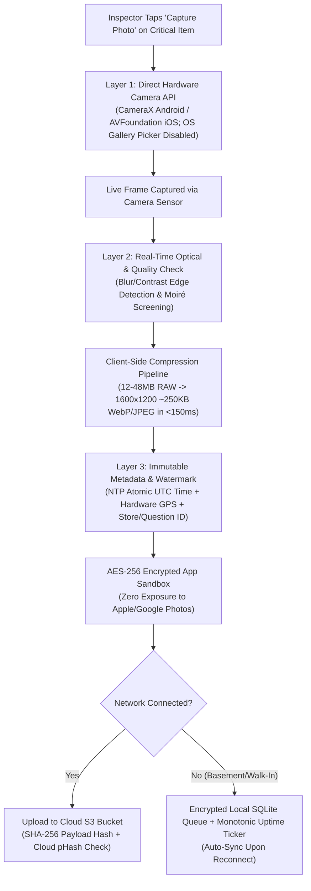

# 02 — Proof Verification, GPS Presence & Anti-Fraud

## 0. Module Scope & Source Inventory

- **Priority Tier:** P2 / P3 Core Differentiator (Proof Verification, GPS Presence & Anti-Fraud)
- **Narrative Anchor:** *"You can't be everywhere."* Multi-location founders, operations heads, and audit agencies cannot personally inspect every branch every day. Without proof controls tied to physical presence, time, and live hardware capture, digital checklists turn into green-washed compliance illusions.
- **Target Personas:**
  - Multi-unit Retail, QSR, Franchise, and Hospitality Operations Directors / COOs
  - Chief Internal Auditors, Quality Assurance (QA) & Food Safety Leads (FSSAI / OSHA / NABH / NABL)
  - District / Area Managers & Regional Coaches
  - Third-Party Audit Agencies, ISO Certification Bodies & Mystery Shopping Consultancies
  - Bank / NBFC Branch Operations & Facility Engineering Heads

### Source Inventory (10 Full Blogs + 16 Routed Sections from 11 Additional Blogs = 21 Source Blogs)

#### Primary Full Blogs
| # | Blog Title & Canonical URL | Words | Category | Primary Focus Absorbed |
| :---: | :--- | :---: | :--- | :--- |
| 1 | [audit-app-with-mandatory-photo-evidence-on-critical-questions](https://audiment.in/blog/audit-app-with-mandatory-photo-evidence-on-critical-questions) | 2,020 | Feature-Led Operations | Blanket vs. zero vs. CCP photo logic, hardware camera pipeline, visual CAPA, industry ROI, 4 evidence metrics |
| 2 | [audit-evidence-collection-verification](https://audiment.in/blog/audit-evidence-collection-verification) | 5,146 | Proof-Based Audits | Audit result vs. evidence, 6 evidence types, quality & traceability standards, sampling, retention, edit history, analytics |
| 3 | [audit-software-that-verifies-the-auditor-was-physically-at-the-location](https://audiment.in/blog/audit-software-that-verifies-the-auditor-was-physically-at-the-location) | 1,161 | Feature-Led Operations | Geo-verified audits (<50m), 4 anti-spoofing controls, basement QR/NFC hybrid check-in, regulatory defense dossier |
| 4 | [how-to-catch-reused-or-old-photos-in-audit-submissions](https://audiment.in/blog/how-to-catch-reused-or-old-photos-in-audit-submissions) | 1,925 | Feature-Led Operations | 5 photo evasion methods, forensic signature table, Moiré Effect physics, pHash deduplication, forensic HR/franchise dossier |
| 5 | [how-to-prevent-fake-audits](https://audiment.in/blog/how-to-prevent-fake-audits) | 1,836 | Proof-Based Audits | Fake audit & pencil-whipping taxonomy, 4 verification layers, Flash Verification, surprise audits, outlet manager guardrails |
| 6 | [how-to-prove-your-auditors-actually-visited-the-site](https://audiment.in/blog/how-to-prove-your-auditors-actually-visited-the-site) | 1,097 | Audit Agencies & Consulting | Agency coffee-shop audit vulnerabilities, 5 cryptographic proof safeguards, 3-way check-in workflow, client proof dossiers |
| 7 | [how-to-run-surprise-audits-at-qsr-outlets-without-managers-knowing](https://audiment.in/blog/how-to-run-surprise-audits-at-qsr-outlets-without-managers-knowing) | 1,877 | QSR Operations | Why announced audits fail, platform secrecy controls (`isSurprise`), 45-minute QSR surprise playbook, cultural positioning |
| 8 | [how-to-stop-store-managers-from-skipping-or-backdating-audits](https://audiment.in/blog/how-to-stop-store-managers-from-skipping-or-backdating-audits) | 1,345 | Retail Operations | Backdating shortcut loop, clock rollback & offline abuse, NTP time sync, restricted operating windows, KPIs & delivery staggering |
| 9 | [store-audit-software-with-photo-proof-and-gps-check-in-for-auditors](https://audiment.in/blog/store-audit-software-with-photo-proof-and-gps-check-in-for-auditors) | 1,494 | Retail Operations | Couch/desktop audits, multi-source retail geofencing (30–50m), gallery lockout, metadata watermarking, debrief consensus |
| 10 | [what-is-a-surprise-audit](https://audiment.in/blog/what-is-a-surprise-audit) | 1,272 | Proof-Based Audits | Surprise vs. scheduled audit mix, `isSurprise = true` calendar masking, cadence escalation for repeat offenders |

#### Routed Sections Absorbed from Other Modules
| # | Source Blog & Canonical URL | Primary Module | Absorbed Section Topic |
| :---: | :--- | :---: | :--- |
| 11 | [digital-fssai-hygiene-checklist-with-photo-evidence-free-template](https://audiment.in/blog/digital-fssai-hygiene-checklist-with-photo-evidence-free-template) | Mod 04 | Live photo enforcement without slowing kitchen prep (35 standard + 10 critical items in 12–15 mins) |
| 12 | [digital-inspection-checklists-evidence-security-implementation](https://audiment.in/blog/digital-inspection-checklists-evidence-security-implementation) | Mod 11 | GPS & location context limits in digital inspection checklists |
| 13 | [goaudits-alternative-for-indian-restaurant-chains](https://audiment.in/blog/goaudits-alternative-for-indian-restaurant-chains) | Mod 09 | Anti-tampering comparison: GoAudits vs. Audiment for kitchen audits |
| 14 | [hospital-facility-audit-software-that-works-in-basements-and-ots](https://audiment.in/blog/hospital-facility-audit-software-that-works-in-basements-and-ots) | Mod 12 | Stopping phantom maintenance rounds via live meter photos & hardware monotonic timestamps |
| 15 | [how-to-audit-franchise-diagnostic-centres-remotely](https://audiment.in/blog/how-to-audit-franchise-diagnostic-centres-remotely) | Mod 12 | 30m geofencing, gallery lockout & NTP timestamps for remote diagnostic booth audits |
| 16 | [how-to-hold-restaurant-outlet-managers-accountable-for-fixing-audit](https://audiment.in/blog/how-to-hold-restaurant-outlet-managers-accountable-for-fixing-audit) | Mod 03 | Why photo proof of CAPA resolution stops false closures and duct-tape repairs |
| 17 | [how-to-make-sure-opening-and-closing-checklists-are-done-at-every-qsr](https://audiment.in/blog/how-to-make-sure-opening-and-closing-checklists-are-done-at-every-qsr) | Mod 05 | 4 technical guardrails for QSR opening/closing checks (including 40-point velocity threshold) |
| 18 | [how-to-stop-caretakers-from-marking-cleaning-as-done-when-it-isnt](https://audiment.in/blog/how-to-stop-caretakers-from-marking-cleaning-as-done-when-it-isnt) | Mod 12 | 30–50m perimeter hard-lock stopping off-site cleaning check-ins |
| 19 | [how-to-track-maintenance-from-discovery-to-sign-off-with-photo-evidence](https://audiment.in/blog/how-to-track-maintenance-from-discovery-to-sign-off-with-photo-evidence) | Mod 03 | 4 technical controls stopping technician photo fraud (camera lock, geofence, QR/NFC, side-by-side card) |
| 20 | [how-to-verify-campaign-and-signage-rollouts-across-stores-with-photos](https://audiment.in/blog/how-to-verify-campaign-and-signage-rollouts-across-stores-with-photos) | Mod 07 | Geofencing, NTP & 09:30 AM launch window locking for store signage rollouts |
| 21 | [iauditor-alternative-with-mandatory-photo-evidence-and-gps-verification](https://audiment.in/blog/iauditor-alternative-with-mandatory-photo-evidence-and-gps-verification) | Mod 09 | (2 routed sections) Vulnerabilities of optional photo/GPS capture & iAuditor vs. Audiment geofence comparison |
| 22 | [inspection-checklist-software-features](https://audiment.in/blog/inspection-checklist-software-features) | Mod 10 | Evaluation questions for GPS features & limits of location coordinates |
| 23 | [outlet-audit-software](https://audiment.in/blog/outlet-audit-software) | Mod 10 | (3 routed sections) Flash Verification workflow, pencil-whipping definition, question-level mandatory photos |

---

## 1. Pencil-Whipping, Fake Audits & Evasion Mechanics

### 1.1 Core Definitions
- **Fake Audit:** A completed inspection checklist that does not reflect actual conditions at the location. Scores look clean (e.g., 94%–98%) while physical hazards (broken walk-in chillers, blocked fire exits, uncalibrated sterilizers, expired prep) go uninspected until a health department shutdown, product recall, customer complaint, or regulatory penalty forces action ([audit-app-with-mandatory-photo-evidence-on-critical-questions](https://audiment.in/blog/audit-app-with-mandatory-photo-evidence-on-critical-questions), [how-to-prevent-fake-audits](https://audiment.in/blog/how-to-prevent-fake-audits)).
- **Pencil-Whipping:** Completing an audit or inspection checklist without performing the real check—tapping "Pass" down a 50-point screen in 60–90 seconds from a back office, counter, or off-site café, copying last week's answers, or letting the branch manager dictate responses. Digital forms without presence, evidence, and timing controls simply digitize paper pencil-whipping ([audit-app-with-mandatory-photo-evidence-on-critical-questions](https://audiment.in/blog/audit-app-with-mandatory-photo-evidence-on-critical-questions), [how-to-prevent-fake-audits](https://audiment.in/blog/how-to-prevent-fake-audits), [outlet-audit-software](https://audiment.in/blog/outlet-audit-software)).
- **"Desktop" / "Couch" / "Coffee-Shop" Audits & "Phantom" Rounds:** Field auditors, district managers, caretakers, or hospital engineering technicians under travel/shift pressure complete inspections remotely from a hotel room, café, tea stall, engineering office, or metro commute—often calling the branch manager by phone to ask 30–60 questions from memory—while head office pays travel and per-diem expenses for visits that never happened or lasted 5 minutes ([audit-software-that-verifies-the-auditor-was-physically-at-the-location](https://audiment.in/blog/audit-software-that-verifies-the-auditor-was-physically-at-the-location), [how-to-prove-your-auditors-actually-visited-the-site](https://audiment.in/blog/how-to-prove-your-auditors-actually-visited-the-site), [store-audit-software-with-photo-proof-and-gps-check-in-for-auditors](https://audiment.in/blog/store-audit-software-with-photo-proof-and-gps-check-in-for-auditors), [hospital-facility-audit-software-that-works-in-basements-and-ots](https://audiment.in/blog/hospital-facility-audit-software-that-works-in-basements-and-ots), [how-to-stop-caretakers-from-marking-cleaning-as-done-when-it-isnt](https://audiment.in/blog/how-to-stop-caretakers-from-marking-cleaning-as-done-when-it-isnt)).

### 1.2 Why Staff & Auditors Fake, Skip, or Backdate Audits
Frontline managers and auditors rarely fabricate out of malice; fabrication becomes institutionalized when systems make cheating effortless and detection impossible ([how-to-catch-reused-or-old-photos-in-audit-submissions](https://audiment.in/blog/how-to-catch-reused-or-old-photos-in-audit-submissions), [how-to-prevent-fake-audits](https://audiment.in/blog/how-to-prevent-fake-audits)):
1. **Checklist Bloat & Time Pressure:** Daily checklists with 80–100+ redundant questions consume 30–60+ minutes during busy openings or understaffed shifts; when forced to choose between waiting customers/delivery trucks and a bloated checklist, the checklist loses ([audit-app-with-mandatory-photo-evidence-on-critical-questions](https://audiment.in/blog/audit-app-with-mandatory-photo-evidence-on-critical-questions), [how-to-stop-store-managers-from-skipping-or-backdating-audits](https://audiment.in/blog/how-to-stop-store-managers-from-skipping-or-backdating-audits)).
2. **Optional Photos & Gallery Access:** Without mandatory live capture, staff tick "Yes - Clean" in under 2 minutes or upload old photos ([iauditor-alternative-with-mandatory-photo-evidence-and-gps-verification](https://audiment.in/blog/iauditor-alternative-with-mandatory-photo-evidence-and-gps-verification)).
3. **Absence of Hard Submission Windows:** When an 09:00 AM opening checklist can still be filed at 11:30 PM (or 3:00 PM), staff postpone checks and **batch-fill** Monday–Saturday forms in 15 minutes on Sunday evening ([how-to-stop-store-managers-from-skipping-or-backdating-audits](https://audiment.in/blog/how-to-stop-store-managers-from-skipping-or-backdating-audits), [how-to-prevent-fake-audits](https://audiment.in/blog/how-to-prevent-fake-audits)).
4. **Weak Follow-Up & Misaligned Incentives:** If failing honestly carries worse short-term blame than passing dishonestly—or if manager bonuses depend 100% on sales volume with zero weight on audit completion—staff backdate or hide failures ([how-to-prevent-fake-audits](https://audiment.in/blog/how-to-prevent-fake-audits), [how-to-stop-store-managers-from-skipping-or-backdating-audits](https://audiment.in/blog/how-to-stop-store-managers-from-skipping-or-backdating-audits)).
5. **Predictable Schedules & Aggressive Travel Quotas:** Announced visits give branches a prep window; overworked area managers covering 15–30 stores/month compress travel via remote submissions ([how-to-prevent-fake-audits](https://audiment.in/blog/how-to-prevent-fake-audits), [iauditor-alternative-with-mandatory-photo-evidence-and-gps-verification](https://audiment.in/blog/iauditor-alternative-with-mandatory-photo-evidence-and-gps-verification), [store-audit-software-with-photo-proof-and-gps-check-in-for-auditors](https://audiment.in/blog/store-audit-software-with-photo-proof-and-gps-check-in-for-auditors)).

### 1.3 Complete Taxonomy of Audit Evasion & Fraud Mechanics

| Evasion Vector | Exact Execution Mechanic | Primary Industries Hit |
| :--- | :--- | :--- |
| **1. Camera Roll Recycle** | Staff capture one photo of a clean prep counter, fryer, collection booth, or sales floor on Monday and re-upload it from the gallery for weeks or backdated days ([how-to-catch-reused-or-old-photos-in-audit-submissions](https://audiment.in/blog/how-to-catch-reused-or-old-photos-in-audit-submissions), [how-to-audit-franchise-diagnostic-centres-remotely](https://audiment.in/blog/how-to-audit-franchise-diagnostic-centres-remotely), [iauditor-alternative-with-mandatory-photo-evidence-and-gps-verification](https://audiment.in/blog/iauditor-alternative-with-mandatory-photo-evidence-and-gps-verification)). | QSR, Retail, Diagnostic Franchises |
| **2. WhatsApp / Peer Chat Recycling** | Staff download clean-station photos from peer WhatsApp groups, or external auditors ask store staff to WhatsApp display photos and paste them into reports ([how-to-catch-reused-or-old-photos-in-audit-submissions](https://audiment.in/blog/how-to-catch-reused-or-old-photos-in-audit-submissions), [how-to-prove-your-auditors-actually-visited-the-site](https://audiment.in/blog/how-to-prove-your-auditors-actually-visited-the-site)). | Retail, QSR, Audit Agencies |
| **3. Screen-of-a-Screen Capture** | When gallery uploads are blocked, staff display an old photo on a laptop, iPad, or secondary phone and point the locked in-app camera at the monitor ([audit-app-with-mandatory-photo-evidence-on-critical-questions](https://audiment.in/blog/audit-app-with-mandatory-photo-evidence-on-critical-questions), [how-to-catch-reused-or-old-photos-in-audit-submissions](https://audiment.in/blog/how-to-catch-reused-or-old-photos-in-audit-submissions)). | QSR, Retail, Franchises |
| **4. Printed Paper Photo Trick** | Staff print an old compliant photograph on gloss paper and photograph the printout through the live camera ([audit-app-with-mandatory-photo-evidence-on-critical-questions](https://audiment.in/blog/audit-app-with-mandatory-photo-evidence-on-critical-questions), [how-to-catch-reused-or-old-photos-in-audit-submissions](https://audiment.in/blog/how-to-catch-reused-or-old-photos-in-audit-submissions)). | Retail, Hospitality |
| **5. Intentional Blur / Lens Occlusion** | Staff smear petroleum jelly, tape, or a thumb over the lens to submit unreadable frames, exploiting pass-fail ambiguity ([how-to-catch-reused-or-old-photos-in-audit-submissions](https://audiment.in/blog/how-to-catch-reused-or-old-photos-in-audit-submissions)). | Field Ops, Maintenance |
| **6. Device Clock Rollback** | Staff disable "Set Time Automatically" in smartphone settings, roll the date back (e.g., 4 hours or 3 days), and submit missed weekend/Friday checks with fake timestamps ([how-to-catch-reused-or-old-photos-in-audit-submissions](https://audiment.in/blog/how-to-catch-reused-or-old-photos-in-audit-submissions), [how-to-stop-store-managers-from-skipping-or-backdating-audits](https://audiment.in/blog/how-to-stop-store-managers-from-skipping-or-backdating-audits)). | Retail, QSR, Hospitals |
| **7. Indefinite Offline Mode Abuse** | Staff exploit weak offline caches to fill forms days late and claim, *"I did the audit on time, it only synced today"* ([how-to-stop-store-managers-from-skipping-or-backdating-audits](https://audiment.in/blog/how-to-stop-store-managers-from-skipping-or-backdating-audits)). | Retail, Field Ops |
| **8. Off-Site / Couch / Café Submission** | Managers file closing checklists from the metro or home; auditors fill checklists 2–5 km away via phone calls; caretakers check in from a tea stall 250m down the street ([audit-software-that-verifies-the-auditor-was-physically-at-the-location](https://audiment.in/blog/audit-software-that-verifies-the-auditor-was-physically-at-the-location), [how-to-stop-caretakers-from-marking-cleaning-as-done-when-it-isnt](https://audiment.in/blog/how-to-stop-caretakers-from-marking-cleaning-as-done-when-it-isnt)). | All Multi-Location |
| **9. Fabricated Dwell Times** | An agency auditor bills for a 2-hour visit while client security gate logs show a 12-minute stay ([how-to-prove-your-auditors-actually-visited-the-site](https://audiment.in/blog/how-to-prove-your-auditors-actually-visited-the-site)). | Audit Agencies, Consulting |
| **10. Tip-Offs & Pre-Visit Staging** | **WhatsApp "Auditor Alert" Grapevine** (Store A tips off Stores B & C 3 km away within 5 minutes), **Artificial Shift Rostering** (3 under-trained crew swapped for 5 senior supervisors), **Pencil-Whipped Binders** (2 weeks of paper temp logs filled that morning), and **Temporary Stock Masking** (expired sauces/bad oil hidden in lockers until the auditor leaves) ([how-to-run-surprise-audits-at-qsr-outlets-without-managers-knowing](https://audiment.in/blog/how-to-run-surprise-audits-at-qsr-outlets-without-managers-knowing)). | QSR, Franchise Networks |
| **11. Manager-Led Distortion & Copy-Forward** | Branch manager guides or fills auditor answers to protect scores, or auditors repeat last audit's answers without checking current state ([how-to-prevent-fake-audits](https://audiment.in/blog/how-to-prevent-fake-audits)). | Retail, Banking, Franchises |

---

## 2. Anti-Tampering Technical Stack

Policy rules ("you must be on-site" or "photos must be current") fail unless enforced in software and hardware ([how-to-prevent-fake-audits](https://audiment.in/blog/how-to-prevent-fake-audits)). A trustworthy proof-based audit combines **four verification layers**: fresh in-app photo evidence tied to each question (`requiresPhoto`), GPS location captured at submission/check-in, server-side timestamping (`submittedAt`) preventing backdating, and a proof-backed corrective action trail for critical failures ([how-to-prevent-fake-audits](https://audiment.in/blog/how-to-prevent-fake-audits)).

### 2.1 Live In-App Camera Sensor Lockdown & Image Pipeline
Standard web file inputs (`<input type="file">`) or OS gallery pickers (`ACTION_GET_CONTENT` on Android, `PHPickerViewController` on iOS) let users upload saved screenshots, stock marketing images, or forwarded chats ([audit-app-with-mandatory-photo-evidence-on-critical-questions](https://audiment.in/blog/audit-app-with-mandatory-photo-evidence-on-critical-questions), [how-to-catch-reused-or-old-photos-in-audit-submissions](https://audiment.in/blog/how-to-catch-reused-or-old-photos-in-audit-submissions)).

*Sources: [audit-app-with-mandatory-photo-evidence-on-critical-questions](https://audiment.in/blog/audit-app-with-mandatory-photo-evidence-on-critical-questions), [how-to-catch-reused-or-old-photos-in-audit-submissions](https://audiment.in/blog/how-to-catch-reused-or-old-photos-in-audit-submissions), [store-audit-software-with-photo-proof-and-gps-check-in-for-auditors](https://audiment.in/blog/store-audit-software-with-photo-proof-and-gps-check-in-for-auditors), [hospital-facility-audit-software-that-works-in-basements-and-ots](https://audiment.in/blog/hospital-facility-audit-software-that-works-in-basements-and-ots).*

- **Direct Hardware Binding:** Invokes CameraX (Android) and AVFoundation (iOS) directly, completely blocking gallery selection ([audit-app-with-mandatory-photo-evidence-on-critical-questions](https://audiment.in/blog/audit-app-with-mandatory-photo-evidence-on-critical-questions), [how-to-catch-reused-or-old-photos-in-audit-submissions](https://audiment.in/blog/how-to-catch-reused-or-old-photos-in-audit-submissions)).
- **Client-Side Compression:** Downsamples 12MB–48MB raw frames to 1600×1200 (~250KB WebP/JPEG) in under 150ms without losing legibility on gauge dials or barcodes. A full 20-photo audit consumes **under 5MB** of mobile data, uploading reliably over 3G ([audit-app-with-mandatory-photo-evidence-on-critical-questions](https://audiment.in/blog/audit-app-with-mandatory-photo-evidence-on-critical-questions)).
- **Encrypted Sandbox Privacy:** Images remain inside an AES-256 encrypted app sandbox, never touching Apple Photos, Google Photos, or personal cloud backups—protecting cash counters, bank vaults, and clinical areas ([audit-app-with-mandatory-photo-evidence-on-critical-questions](https://audiment.in/blog/audit-app-with-mandatory-photo-evidence-on-critical-questions)).
- **Automated Blur & Occlusion Retake:** Edge-detection and contrast algorithms block obscured or unreadable frames (e.g., smudged lenses or illegible thermometer dials) and force an immediate retake ([how-to-catch-reused-or-old-photos-in-audit-submissions](https://audiment.in/blog/how-to-catch-reused-or-old-photos-in-audit-submissions)).

### 2.2 Forensic Photo & Tamper Detection Mechanics
When inspecting uploaded or captured media, forensic engines check four technical layers ([how-to-catch-reused-or-old-photos-in-audit-submissions](https://audiment.in/blog/how-to-catch-reused-or-old-photos-in-audit-submissions)):

| Forensic Parameter | Genuine Native Capture | WhatsApp Forwarded Image | Screen-of-a-Screen Capture | Smartphone Screenshot |
| :--- | :--- | :--- | :--- | :--- |
| **Storage Source** | Native camera sensor buffer | `/Downloads` or `/WhatsApp` directory | Live camera buffer | `/Screenshots` folder |
| **EXIF Camera Model** | Exact hardware (e.g., iPhone 15 Pro, Pixel 8) | Completely stripped / missing | Device hardware matches, subject shows pixel grid | Hardware ID matches, resolution matches screen |
| **Capture Timestamp** | Matches network atomic UTC (within seconds) | Missing or reflects chat download time | Matches current time; visual scene shows historical cues | Matches screenshot time, not scene capture |
| **Compression Footprint** | Native OS JPEG/WebP engine | Proprietary transcoder header (`libjpeg-turbo`) | Native compression + high-frequency moiré patterns | PNG format or screen aspect ratio (e.g., 19.5:9) |
| **Embedded GPS** | Satellite fix (±5 to 15 meters) | Stripped completely | Matches current phone; subject location conflicts | Stripped or matches home/office |

- **Optical Physics Screening (Screen-of-a-Screen):** Photographing an LCD/OLED monitor generates **Moiré Effect** interference—unnatural geometric cross-hatch banding, high-frequency backlight refresh flicker, and concentrated blue-spectrum radiation (>6500 Kelvin)—flagged as "High-Probability Screen Capture" for Area Director spot-checks ([how-to-catch-reused-or-old-photos-in-audit-submissions](https://audiment.in/blog/how-to-catch-reused-or-old-photos-in-audit-submissions)).
- **Printed Paper Photo Telltales:** Photographing a paper printout leaves paper grain texture, specular glare from gloss printer ink, and flat focal depth—spotted during high-resolution split-screen supervisory review ([how-to-catch-reused-or-old-photos-in-audit-submissions](https://audiment.in/blog/how-to-catch-reused-or-old-photos-in-audit-submissions)).
- **Perceptual Image Hashing (pHash) Deduplication:** Unlike cryptographic hashes (`SHA-256`, where changing 1 pixel alters the entire hash), `pHash` computes a visual frequency fingerprint. If `Hamming Distance(H1, H2) <= 5`, the system identifies cropped, filtered, or brightness-adjusted duplicates across locations or historical submissions (e.g., 45 days prior) and blocks submission ([how-to-catch-reused-or-old-photos-in-audit-submissions](https://audiment.in/blog/how-to-catch-reused-or-old-photos-in-audit-submissions)).
- **Metadata Watermarking:** Burns Unix timestamp, store identifier, and question name directly into raw image metadata ([store-audit-software-with-photo-proof-and-gps-check-in-for-auditors](https://audiment.in/blog/store-audit-software-with-photo-proof-and-gps-check-in-for-auditors), [how-to-stop-store-managers-from-skipping-or-backdating-audits](https://audiment.in/blog/how-to-stop-store-managers-from-skipping-or-backdating-audits)).

### 2.3 Hardware GPS Geofencing, Anti-Spoofing & Hybrid Basement Verification
- **Configurable Geofence Perimeters:** Blocks audit initiation or submission outside registered site coordinates:
  - **30 metres:** Compact retail kiosks, diagnostic collection booths, co-living/PG buildings, compact retail stores ([audit-software-that-verifies-the-auditor-was-physically-at-the-location](https://audiment.in/blog/audit-software-that-verifies-the-auditor-was-physically-at-the-location), [how-to-audit-franchise-diagnostic-centres-remotely](https://audiment.in/blog/how-to-audit-franchise-diagnostic-centres-remotely), [how-to-stop-caretakers-from-marking-cleaning-as-done-when-it-isnt](https://audiment.in/blog/how-to-stop-caretakers-from-marking-cleaning-as-done-when-it-isnt), [store-audit-software-with-photo-proof-and-gps-check-in-for-auditors](https://audiment.in/blog/store-audit-software-with-photo-proof-and-gps-check-in-for-auditors)).
  - **Under 50 metres (30–50m):** Standard retail stores, QSR outlets, bank branches, third-party client sites ([audit-software-that-verifies-the-auditor-was-physically-at-the-location](https://audiment.in/blog/audit-software-that-verifies-the-auditor-was-physically-at-the-location), [how-to-prove-your-auditors-actually-visited-the-site](https://audiment.in/blog/how-to-prove-your-auditors-actually-visited-the-site), [iauditor-alternative-with-mandatory-photo-evidence-and-gps-verification](https://audiment.in/blog/iauditor-alternative-with-mandatory-photo-evidence-and-gps-verification)).
  - **Up to 150 metres:** Sprawling 50,000 sq ft logistics distribution centers and warehouses to accommodate indoor GPS drift ([audit-software-that-verifies-the-auditor-was-physically-at-the-location](https://audiment.in/blog/audit-software-that-verifies-the-auditor-was-physically-at-the-location)).
  - **Dual Verification & Battery Efficiency:** Captures location at milestone events (check-in/start, mandatory photos, final sign-off/submission) rather than continuous battery-draining background tracking ([audit-software-that-verifies-the-auditor-was-physically-at-the-location](https://audiment.in/blog/audit-software-that-verifies-the-auditor-was-physically-at-the-location), [iauditor-alternative-with-mandatory-photo-evidence-and-gps-verification](https://audiment.in/blog/iauditor-alternative-with-mandatory-photo-evidence-and-gps-verification)).
  - **Relocation Updates:** Updating store lat/long in the central console pushes updated geofence perimeters immediately to field mobile apps ([audit-software-that-verifies-the-auditor-was-physically-at-the-location](https://audiment.in/blog/audit-software-that-verifies-the-auditor-was-physically-at-the-location)).

#### Four Kernel-Level Anti-Spoofing Controls
| Anti-Spoofing Control | Technical Mechanism | Evasion Defeated |
| :--- | :--- | :--- |
| **Mock Location Detection** | Queries `isFromMockProvider()` (Android) & CoreLocation integrity (iOS); scans developer options & VPN overlays | Blocks consumer "Fake GPS" and joystick spoofing apps ([audit-software-that-verifies-the-auditor-was-physically-at-the-location](https://audiment.in/blog/audit-software-that-verifies-the-auditor-was-physically-at-the-location), [how-to-prove-your-auditors-actually-visited-the-site](https://audiment.in/blog/how-to-prove-your-auditors-actually-visited-the-site)) |
| **Device Integrity Attestation** | Google Play Integrity API & Apple App Attest | Blocks rooted phones, jailbroken devices, unlocked bootloaders, custom ROM emulators ([audit-software-that-verifies-the-auditor-was-physically-at-the-location](https://audiment.in/blog/audit-software-that-verifies-the-auditor-was-physically-at-the-location)) |
| **Cellular & Wi-Fi Triangulation** | Cross-checks satellite GPS against cellular base station CellID & Wi-Fi network identifiers | Catches GPS spoofing when GPS claims Location A but cell tower is at Location B; supports enclosed mall basements ([audit-software-that-verifies-the-auditor-was-physically-at-the-location](https://audiment.in/blog/audit-software-that-verifies-the-auditor-was-physically-at-the-location), [store-audit-software-with-photo-proof-and-gps-check-in-for-auditors](https://audiment.in/blog/store-audit-software-with-photo-proof-and-gps-check-in-for-auditors)) |
| **Dwell Time Velocity Tracking** | Computes elapsed time between consecutive store check-ins | Flags mathematically impossible travel (e.g., auditing two stores 30 km apart in 8 minutes) ([audit-software-that-verifies-the-auditor-was-physically-at-the-location](https://audiment.in/blog/audit-software-that-verifies-the-auditor-was-physically-at-the-location)) |

#### Two-Stage Hybrid Verification for Zero-GPS Basements, Vaults & OTs
Concrete basements, underground bank cash vaults, hospital OTs, and metal walk-in freezers block satellite GPS. Hybrid verification preserves chain of custody ([audit-software-that-verifies-the-auditor-was-physically-at-the-location](https://audiment.in/blog/audit-software-that-verifies-the-auditor-was-physically-at-the-location), [how-to-prove-your-auditors-actually-visited-the-site](https://audiment.in/blog/how-to-prove-your-auditors-actually-visited-the-site), [how-to-track-maintenance-from-discovery-to-sign-off-with-photo-evidence](https://audiment.in/blog/how-to-track-maintenance-from-discovery-to-sign-off-with-photo-evidence), [hospital-facility-audit-software-that-works-in-basements-and-ots](https://audiment.in/blog/hospital-facility-audit-software-that-works-in-basements-and-ots)):
1. **Stage 1 — Outer Perimeter GPS Check-In:** At the entrance gate (clear satellite sight), the app captures a verified GPS fix (<15m accuracy), logs entry timestamp, and caches the checklist offline.
2. **Stage 2 — Point-of-Work QR / NFC Scan:** Inside Basement Level -2, pump rooms, AHUs, electrical panels, or cash vaults, the auditor scans a heavy-duty aluminum QR plate or encrypted NFC chip mounted directly on the asset chassis (e.g., Diesel Generator #01, Cash Vault Door).
3. **Stage 3 — Encrypted Local Bundle:** Records timestamp, NFC serial number, monotonic uptime ticks, and live photos locally; auto-syncs upon returning to coverage.

**Important Limits of GPS & Timestamps:** GPS confirms where a device was (not which shelves were inspected or whether every answer is truthful); a submission timestamp (`3:42 PM`) proves submission time, not that every item was checked at `3:42 PM`. Treat GPS + timestamp + live photo + observation as a combined evidence model—and evaluate GPS tools by checking whether location is captured automatically, when it is captured, whether users can edit it, retention rules, and permissions ([audit-evidence-collection-verification](https://audiment.in/blog/audit-evidence-collection-verification), [digital-inspection-checklists-evidence-security-implementation](https://audiment.in/blog/digital-inspection-checklists-evidence-security-implementation), [inspection-checklist-software-features](https://audiment.in/blog/inspection-checklist-software-features)).

### 2.4 Flash Verification (Audiment Signature Presence Check)
- **What It Is:** A geo-confirmation arrival/presence step for eligible auditors that defeats remote completion, coffee-shop audits, and recycled media before or during the inspection ([how-to-prevent-fake-audits](https://audiment.in/blog/how-to-prevent-fake-audits), [outlet-audit-software](https://audiment.in/blog/outlet-audit-software)).
- **Core Workflow:** The auditor selects the outlet/location, records a **20-second environmental/surroundings video** inside the location and captures a **verified circular selfie**, both immutably **geo-tagged and server-timestamped** for admin review ([how-to-prevent-fake-audits](https://audiment.in/blog/how-to-prevent-fake-audits), [outlet-audit-software](https://audiment.in/blog/outlet-audit-software)).
- **Surprise Arrival Variant:** For unannounced QSR inspections, auditors capture a mandatory **3-second geo-tagged video selfie** showing the physical storefront upon arrival to lock the official start timestamp ([how-to-run-surprise-audits-at-qsr-outlets-without-managers-knowing](https://audiment.in/blog/how-to-run-surprise-audits-at-qsr-outlets-without-managers-knowing)).

### 2.5 Network Time Synchronization (NTP), Shift Handover Locks & Velocity Guardrails
- **NTP Atomic UTC Timestamps (`submittedAt`):** Queries authoritative atomic NTP servers via cellular/GPS signals rather than the smartphone clock. If an auditor or manager turns off automatic time and rolls the clock back, the app detects the discrepancy, rejects the submission, and alerts the district manager ([how-to-catch-reused-or-old-photos-in-audit-submissions](https://audiment.in/blog/how-to-catch-reused-or-old-photos-in-audit-submissions), [how-to-stop-store-managers-from-skipping-or-backdating-audits](https://audiment.in/blog/how-to-stop-store-managers-from-skipping-or-backdating-audits), [how-to-prevent-fake-audits](https://audiment.in/blog/how-to-prevent-fake-audits)).
- **Offline Monotonic Uptime Tickers:** In offline hospital basements or stores, devices record internal hardware system uptime tickers to prevent clock rollback between offline capture and server sync ([hospital-facility-audit-software-that-works-in-basements-and-ots](https://audiment.in/blog/hospital-facility-audit-software-that-works-in-basements-and-ots), [how-to-stop-store-managers-from-skipping-or-backdating-audits](https://audiment.in/blog/how-to-stop-store-managers-from-skipping-or-backdating-audits)).
- **Restricted Operating & Shift Handover Windows:** Checklists open only inside defined shift windows and auto-lock on expiry:
  - *Retail Opening Example:* Unlocks `08:30 AM` → Active window `08:30–09:30 AM` → Hard-locks at `09:30 AM` store opening. Missed checks log as `"Unsubmitted / Skipped"` and trigger automated push/SMS alerts to the territory area manager if unsubmitted within 30 minutes of scheduled opening ([how-to-stop-store-managers-from-skipping-or-backdating-audits](https://audiment.in/blog/how-to-stop-store-managers-from-skipping-or-backdating-audits)).
  - *QSR Shift & Campaign Launch Locks:* Opening checks must run in the 60-minute pre-open window (morning checks submitted at `01:30 PM` flag delayed); Campaign Launch Audits lock at `09:30 AM` when customer doors open ([how-to-make-sure-opening-and-closing-checklists-are-done-at-every-qsr](https://audiment.in/blog/how-to-make-sure-opening-and-closing-checklists-are-done-at-every-qsr), [how-to-prevent-fake-audits](https://audiment.in/blog/how-to-prevent-fake-audits), [how-to-verify-campaign-and-signage-rollouts-across-stores-with-photos](https://audiment.in/blog/how-to-verify-campaign-and-signage-rollouts-across-stores-with-photos)).
- **Minimum Audit Velocity Thresholds:**
  - A genuine **40-point kitchen opening inspection** takes **12–18 minutes**; a **35-item kitchen hygiene check** takes **10–15 minutes** ([how-to-make-sure-opening-and-closing-checklists-are-done-at-every-qsr](https://audiment.in/blog/how-to-make-sure-opening-and-closing-checklists-are-done-at-every-qsr), [how-to-prevent-fake-audits](https://audiment.in/blog/how-to-prevent-fake-audits)).
  - Any full checklist submitted in **under 90 seconds to 2 minutes** automatically triggers a **"Rushed Audit" / "Rushed Submission"** alert to the area coach ([how-to-make-sure-opening-and-closing-checklists-are-done-at-every-qsr](https://audiment.in/blog/how-to-make-sure-opening-and-closing-checklists-are-done-at-every-qsr), [how-to-prevent-fake-audits](https://audiment.in/blog/how-to-prevent-fake-audits)).

### 2.6 Technical Comparison: Standard Tools vs. Proof-Enforced Systems
| Control Layer | Standard Tools (GoAudits / Generic Checklist & iAuditor Apps) | Proof-Enforced System (Audiment) |
| :--- | :--- | :--- |
| **Photo Upload Source** | Allows selection from phone storage / media gallery | Hard-locks camera viewfinder (`CameraX` / `AVFoundation`); gallery disabled ([goaudits-alternative-for-indian-restaurant-chains](https://audiment.in/blog/goaudits-alternative-for-indian-restaurant-chains)) |
| **Location Validation** | Passive GPS map pin; easily spoofed by mock-GPS apps | Multi-source GPS + CellID triangulation; hard submission block outside 30–50m geofence; auto-detects mock GPS & rooted devices ([goaudits-alternative-for-indian-restaurant-chains](https://audiment.in/blog/goaudits-alternative-for-indian-restaurant-chains), [iauditor-alternative-with-mandatory-photo-evidence-and-gps-verification](https://audiment.in/blog/iauditor-alternative-with-mandatory-photo-evidence-and-gps-verification)) |
| **Check-In / Continuity** | Start-of-audit timestamp only; backdating or anytime submission | Dual start/sign-off coordinates, NTP atomic UTC timestamps, auto-locking shift handover windows ([goaudits-alternative-for-indian-restaurant-chains](https://audiment.in/blog/goaudits-alternative-for-indian-restaurant-chains), [iauditor-alternative-with-mandatory-photo-evidence-and-gps-verification](https://audiment.in/blog/iauditor-alternative-with-mandatory-photo-evidence-and-gps-verification)) |
| **Corrective Action Proof** | Basic text confirmation or single photo upload | Mandatory Before/After live photos with side-by-side review card & manager sign-off ([goaudits-alternative-for-indian-restaurant-chains](https://audiment.in/blog/goaudits-alternative-for-indian-restaurant-chains), [how-to-track-maintenance-from-discovery-to-sign-off-with-photo-evidence](https://audiment.in/blog/how-to-track-maintenance-from-discovery-to-sign-off-with-photo-evidence)) |

---

## 3. Mandatory Photo Evidence Design (CCP Architecture)

### 3.1 Blanket vs. Zero vs. Balanced Conditional Evidence
Requiring zero photos invites pencil-whipping; requiring photos on all 60–85 checkpoints triggers audit fatigue (60+ minute shifts) and pushes staff into screen-of-screen or printed-photo cheating ([audit-app-with-mandatory-photo-evidence-on-critical-questions](https://audiment.in/blog/audit-app-with-mandatory-photo-evidence-on-critical-questions), [digital-fssai-hygiene-checklist-with-photo-evidence-free-template](https://audiment.in/blog/digital-fssai-hygiene-checklist-with-photo-evidence-free-template)).

| Evidence Architecture | Design Pattern | Duration & Outcome |
| :--- | :--- | :--- |
| **Extreme A: Honor System (Zero Photos)** | 100% binary Yes/No taps | <3 mins; invites widespread pencil-whipping; zero proof of on-site execution or maintenance fixes ([audit-app-with-mandatory-photo-evidence-on-critical-questions](https://audiment.in/blog/audit-app-with-mandatory-photo-evidence-on-critical-questions)). |
| **Extreme B: Blanket Mandate** | Photos required on all 60–85 items (including light switches/broom closets) | 60+ mins; triggers severe audit fatigue and photo-spoofing workarounds ([audit-app-with-mandatory-photo-evidence-on-critical-questions](https://audiment.in/blog/audit-app-with-mandatory-photo-evidence-on-critical-questions)). |
| **Balanced Optimum: Smart Conditional CCP Logic** | **~80% routine checkpoints:** Single-tap Yes/No/NA **~20% Critical Control Points (CCPs):** Mandatory live camera capture (`requiresPhoto`) **100% of Failed Items:** Mandatory "Before" photo triggering CAPA | **12–15 mins** (e.g., 35 standard + 10 critical FSSAI items); high audit speed + unassailable proof where hazard concentrates ([audit-app-with-mandatory-photo-evidence-on-critical-questions](https://audiment.in/blog/audit-app-with-mandatory-photo-evidence-on-critical-questions), [digital-fssai-hygiene-checklist-with-photo-evidence-free-template](https://audiment.in/blog/digital-fssai-hygiene-checklist-with-photo-evidence-free-template), [outlet-audit-software](https://audiment.in/blog/outlet-audit-software)). |

### 3.2 Critical Control Point (CCP) Hazard & Severity Decision Matrix
| Checkpoint Category | Operational Checkpoint Example | Photo Mandatory? | Trigger Condition | Operational Justification |
| :--- | :--- | :---: | :---: | :--- |
| **Cold Chain / Food Safety** | Walk-in freezer temperature at or below `-18°C` | **YES** | Always Mandatory | High statutory risk; photo of digital display verifies compressor health ([audit-app-with-mandatory-photo-evidence-on-critical-questions](https://audiment.in/blog/audit-app-with-mandatory-photo-evidence-on-critical-questions)). |
| **Life Safety & EHS** | Emergency fire exits unblocked and unlocked | **YES** | Always Mandatory | Life safety liability; proves rear egress is physically unobstructed ([audit-app-with-mandatory-photo-evidence-on-critical-questions](https://audiment.in/blog/audit-app-with-mandatory-photo-evidence-on-critical-questions)). |
| **Life Safety & EHS** | Fire extinguisher pressure gauge in green zone | **YES** | Always Mandatory | OSHA / local fire code compliance; proves operational readiness ([audit-app-with-mandatory-photo-evidence-on-critical-questions](https://audiment.in/blog/audit-app-with-mandatory-photo-evidence-on-critical-questions)). |
| **Cash & Vault Security** | Safe door locked & cash drawer reconciled | **YES** | Always Mandatory | Loss prevention; eliminates uninspected overnight cash float discrepancies ([audit-app-with-mandatory-photo-evidence-on-critical-questions](https://audiment.in/blog/audit-app-with-mandatory-photo-evidence-on-critical-questions)). |
| **Visual Merchandising** | Promotional entrance display built to planogram | **YES** | Always Mandatory | Revenue assurance; confirms seasonal launch-day execution ([audit-app-with-mandatory-photo-evidence-on-critical-questions](https://audiment.in/blog/audit-app-with-mandatory-photo-evidence-on-critical-questions)). |
| **Sanitation / Cleanliness** | Handwash sink stocked with soap and paper towels | **CONDITIONAL** | Only if `"FAIL"` | Quick tap if compliant; photo required on failure to dispatch replenishment ([audit-app-with-mandatory-photo-evidence-on-critical-questions](https://audiment.in/blog/audit-app-with-mandatory-photo-evidence-on-critical-questions)). |
| **Facility Maintenance** | Customer seating area furniture free of damage | **CONDITIONAL** | Only if `"FAIL"` | Mandatory "Before" photo generates automated repair work order ([audit-app-with-mandatory-photo-evidence-on-critical-questions](https://audiment.in/blog/audit-app-with-mandatory-photo-evidence-on-critical-questions)). |
| **Routine Housekeeping** | Restroom floor swept and dry | **NO** | Never | Routine operational hygiene monitored via manager walk-through ([audit-app-with-mandatory-photo-evidence-on-critical-questions](https://audiment.in/blog/audit-app-with-mandatory-photo-evidence-on-critical-questions)). |

### 3.3 High-ROI Industry CCP Blueprints
- **QSR & Grocery Chains:** Walk-in freezer (`<=-18°C`) & line prep cooler temperature readouts, sanitizing solution titration strips (quat/chlorine), deep fryer oil quality color discs / TPM meters (`>25% TPM`), raw meat vs. ready-to-eat separation, emergency rear egress ([audit-app-with-mandatory-photo-evidence-on-critical-questions](https://audiment.in/blog/audit-app-with-mandatory-photo-evidence-on-critical-questions), [digital-fssai-hygiene-checklist-with-photo-evidence-free-template](https://audiment.in/blog/digital-fssai-hygiene-checklist-with-photo-evidence-free-template), [how-to-run-surprise-audits-at-qsr-outlets-without-managers-knowing](https://audiment.in/blog/how-to-run-surprise-audits-at-qsr-outlets-without-managers-knowing)).
- **Retail Banking & NBFC Branches:** Vault time-delay locks, alarm control panel statuses, CCTV DVR 90-day storage capacity screens, gold loan tamper-evident packet seals (protects against internal cash substitution and satisfies Reserve Bank mandates) ([audit-app-with-mandatory-photo-evidence-on-critical-questions](https://audiment.in/blog/audit-app-with-mandatory-photo-evidence-on-critical-questions)).
- **Commercial Facilities & Healthcare (OSHA / NABH):** Autoclave cycle completion readouts, biomedical waste bin color-coding, emergency eye-wash station flow tests, backup generator fuel tank gauges, liquid oxygen tank levels, fire pump pressure gauges ([audit-app-with-mandatory-photo-evidence-on-critical-questions](https://audiment.in/blog/audit-app-with-mandatory-photo-evidence-on-critical-questions), [hospital-facility-audit-software-that-works-in-basements-and-ots](https://audiment.in/blog/hospital-facility-audit-software-that-works-in-basements-and-ots)).

### 3.4 Side-by-Side Visual CAPA & Maintenance Verification
Mandatory "Before" and "After" live photos eliminate vague descriptions (*"floor damaged in back"*), false task closures common in Asana/Trello/spreadsheets, and makeshift duct-tape patches (e.g., taping a walk-in cooler gasket instead of replacing the manufacturer seal) ([audit-app-with-mandatory-photo-evidence-on-critical-questions](https://audiment.in/blog/audit-app-with-mandatory-photo-evidence-on-critical-questions), [how-to-hold-restaurant-outlet-managers-accountable-for-fixing-audit](https://audiment.in/blog/how-to-hold-restaurant-outlet-managers-accountable-for-fixing-audit)):
1. **Discovery & Auto-Ticket:** Failed item (e.g., cracked ceramic floor tile) forces mandatory live "Before" photo → auto-generates High-Priority CAPA Ticket (`#1042`) routed via email/SMS to contractor or manager.
2. **First-Time Fix Jump:** Contractor inspects exact tile color, dimensions, and mortar condition remotely before dispatching—raising **First-Time Fix Rate (FTFR) by 40%**.
3. **Closed-Loop Resolution:** Ticket cannot move to `"Closed"` until contractor/manager captures a live "After" photo (plus physical QR/NFC scan on repaired machinery where configured).
4. **Side-by-Side Approval:** Facility/Area Manager views Before & After photos on a single verification card and approves contractor invoices in **60 seconds** with zero disputed hours ([audit-app-with-mandatory-photo-evidence-on-critical-questions](https://audiment.in/blog/audit-app-with-mandatory-photo-evidence-on-critical-questions), [how-to-track-maintenance-from-discovery-to-sign-off-with-photo-evidence](https://audiment.in/blog/how-to-track-maintenance-from-discovery-to-sign-off-with-photo-evidence)).

---

## 4. Surprise / Unannounced Audits

### 4.1 Scheduled vs. Surprise Audits
- **Core Purpose:** Predictable audits measure exam preparation; surprise audits measure ordinary Tuesday-afternoon discipline ([how-to-run-surprise-audits-at-qsr-outlets-without-managers-knowing](https://audiment.in/blog/how-to-run-surprise-audits-at-qsr-outlets-without-managers-knowing), [what-is-a-surprise-audit](https://audiment.in/blog/what-is-a-surprise-audit)).
- **The Mixed Schedule Rule:** Surprise audits supplement—rather than fully replace—scheduled audits. A branch that consistently passes scheduled audits yet repeatedly fails surprise inspections is staging for audit days ([what-is-a-surprise-audit](https://audiment.in/blog/what-is-a-surprise-audit)).
- **Platform-Enforced Secrecy:** Relying on human secrecy fails; the database must hide visits via:
  1. **Calendar Masking (`isSurprise = true`):** Scheduled centrally by admins, completely hidden from store managers' calendars and notification feeds until published live ([how-to-prevent-fake-audits](https://audiment.in/blog/how-to-prevent-fake-audits), [how-to-run-surprise-audits-at-qsr-outlets-without-managers-knowing](https://audiment.in/blog/how-to-run-surprise-audits-at-qsr-outlets-without-managers-knowing), [what-is-a-surprise-audit](https://audiment.in/blog/what-is-a-surprise-audit)).
  2. **Same-Day Deadlines:** Forces execution within the live publication day to prevent staging ([how-to-prevent-fake-audits](https://audiment.in/blog/how-to-prevent-fake-audits), [what-is-a-surprise-audit](https://audiment.in/blog/what-is-a-surprise-audit)).
  3. **GPS Geofence Unlock + 3-Sec Storefront Video Selfie:** `"Start Audit"` stays disabled until the auditor is physically inside the store perimeter and records arrival video ([how-to-run-surprise-audits-at-qsr-outlets-without-managers-knowing](https://audiment.in/blog/how-to-run-surprise-audits-at-qsr-outlets-without-managers-knowing)).
  4. **Manager Notification on Start:** Automated SMS/email notifies store manager and franchisee the exact second `"Start"` is tapped—eliminating notice disputes while stopping advance cleanup ([how-to-run-surprise-audits-at-qsr-outlets-without-managers-knowing](https://audiment.in/blog/how-to-run-surprise-audits-at-qsr-outlets-without-managers-knowing)).

### 4.2 The 45-Minute QSR Surprise Audit Playbook
To inspect unaltered conditions before crews scrub counters, shut propped-open chiller doors, or dump old oil ([how-to-run-surprise-audits-at-qsr-outlets-without-managers-knowing](https://audiment.in/blog/how-to-run-surprise-audits-at-qsr-outlets-without-managers-knowing)):
- **Minutes 0–5 (Arrival & Front Counter):** Capture 3-sec storefront video selfie check-in; verify cashier grooming (aprons, caps, beard nets), handwashing compliance before food handling, and billing receipt compliance.
- **Minutes 5–15 (Deep Kitchen & Cold Storage — Highest Priority):** Walk straight past the office to prep line and walk-in chiller before doors are shut; test fryer oil with digital **Total Polar Materials (TPM)** tester (if dark brown or **>25% TPM**, capture live photo immediately); check FIFO prep stickers for legibility/expiry.
- **Minutes 15–30 (Sanitation & Food Safety):** Test handwash sink hot water & soap; dip quaternary ammonium or chlorine titration test strips into sanitizer buckets; inspect raw meat vs. ready-to-eat separation, cutting boards, grease traps, and floor drains.
- **Minutes 30–40 (Equipment & Waste):** Inspect grill surface carbon build-up, exhaust hood filters, pest traps, and rear delivery door seals.
- **Minutes 40–45 (Manager Debrief & CAPA):** Face-to-face debrief with timestamped defect photos (ending *"only dirty for 5 minutes"* arguments); auto-generate **48-hour SLA corrective action tasks** with mandatory proof of resolution ([how-to-run-surprise-audits-at-qsr-outlets-without-managers-knowing](https://audiment.in/blog/how-to-run-surprise-audits-at-qsr-outlets-without-managers-knowing), [what-is-a-surprise-audit](https://audiment.in/blog/what-is-a-surprise-audit)).

### 4.3 Operational Rules, Cadence, Refusal Protocol & Culture
- **Cadence & Escalation Triggers:** Baseline **1 surprise audit per outlet every 30–60 days** interspersed with daily supervisor self-audits. Bottom-quartile outlets, recent failures, missed audits, deteriorating trend scores, or recurring temperature failures escalate to **bi-weekly (every 2 weeks)** surprise visits until compliance stabilizes—or targeted spot-checks when digital scores look suspiciously perfect while customer reviews drop ([how-to-run-surprise-audits-at-qsr-outlets-without-managers-knowing](https://audiment.in/blog/how-to-run-surprise-audits-at-qsr-outlets-without-managers-knowing), [what-is-a-surprise-audit](https://audiment.in/blog/what-is-a-surprise-audit), [how-to-stop-store-managers-from-skipping-or-backdating-audits](https://audiment.in/blog/how-to-stop-store-managers-from-skipping-or-backdating-audits)).
- **Optimal Timing Windows:** Schedule during transitional operational hours (**10:30 AM** between morning prep and lunch opening, or **3:30 PM** between lunch and dinner) so managers can join debriefs; reserve peak rush for brief front-of-house mystery checks ([how-to-run-surprise-audits-at-qsr-outlets-without-managers-knowing](https://audiment.in/blog/how-to-run-surprise-audits-at-qsr-outlets-without-managers-knowing)).
- **Refusal-of-Entry Protocol:** Denying kitchen/facility entry to an authorized corporate auditor is an **automatic critical failure**. Software logs auditor GPS + arrival timestamp and escalates immediately to Head of Operations for franchisee/GM review ([how-to-run-surprise-audits-at-qsr-outlets-without-managers-knowing](https://audiment.in/blog/how-to-run-surprise-audits-at-qsr-outlets-without-managers-knowing)).
- **Culture & Incentives:** Position surprise audits as coaching and brand protection, not punitive traps. Tie on-time audit completion and sustained surprise scores to **20%–30% of monthly store manager incentive bonuses**; investigate systemic causes (e.g., staggering Monday morning delivery trucks so managers have 15 uninterrupted opening inspection minutes); circulate top-scoring live photos as chain-wide visual benchmarks ([how-to-run-surprise-audits-at-qsr-outlets-without-managers-knowing](https://audiment.in/blog/how-to-run-surprise-audits-at-qsr-outlets-without-managers-knowing), [how-to-stop-store-managers-from-skipping-or-backdating-audits](https://audiment.in/blog/how-to-stop-store-managers-from-skipping-or-backdating-audits)).

---

## 5. Audit Evidence Validity, Traceability, Sampling & Governance

### 5.1 Audit Result vs. Audit Evidence & the 6 Evidence Types
- **Core Distinction:** `"Pass"` or `"Temperature control: Pass"` is an *audit result* (conclusion). `4.2°C recorded during inspection on identified storage unit` is *audit evidence* ([audit-evidence-collection-verification](https://audiment.in/blog/audit-evidence-collection-verification)).
- **Evidence Chain:** `Requirement → Audit Question → Observation → Evidence → Finding / Conclusion → Corrective Action → Resolution Evidence → Verification` ([audit-evidence-collection-verification](https://audiment.in/blog/audit-evidence-collection-verification)).
- **Matching Evidence to the Claim (6 Types):**
  1. **Records & Documents:** Maintenance logs, training records, inspection records, transaction records, SOPs (proves documented activity/approvals).
  2. **Direct Observation:** Watching process execution, displays, equipment condition, safety habits.
  3. **Measurements:** Temperature, dimensions, gauge readings, quantities.
  4. **Photographs:** Visible physical conditions (displays, equipment damage, cleanliness, signage, defects). *Limits:* A photo **cannot** prove a process was followed all day, training occurred, a policy was understood, a measurement was calibrated/accurate, or a CAPA will stay effective.
  5. **Interviews:** Checking how staff understand their roles (must be corroborated alongside other evidence).
  6. **System Information:** Access logs, workflow history, transaction records, system-generated reports ([audit-evidence-collection-verification](https://audiment.in/blog/audit-evidence-collection-verification)).

### 5.2 Evidence Quality Standard, Traceability, Sampling & Lifecycle Controls
- **Four-Point Quality Test:** Good evidence is **Relevant** (directly tied to criterion), **Reliable** (dependable/verifiable), **Sufficient** (enough to justify conclusion without bloated 20-photo/20-doc archives), and **Traceable** (linked to exact Store/Location, Audit, Requirement, Timestamp, Standard, Finding, and Owner) ([audit-evidence-collection-verification](https://audiment.in/blog/audit-evidence-collection-verification)).
- **Six-Step Collection Workflow:** `1. Define requirement` → `2. Decide what demonstrates it` → `3. Conduct check` → `4. Capture relevant evidence at point of observation` → `5. Associate with audit/location/finding` → `6. Review whether evidence actually supports the recorded result` ([audit-evidence-collection-verification](https://audiment.in/blog/audit-evidence-collection-verification)).
- **Six Pillars of an Evidence Standard Policy:** Define *(1) Evidence required*, *(2) Acceptable evidence type*, *(3) Quality requirement*, *(4) Association mapping*, *(5) Verification/escalation rules*, and *(6) Retention period* so different auditors produce comparable records across 10 to 500 locations ([audit-evidence-collection-verification](https://audiment.in/blog/audit-evidence-collection-verification)).
- **Sampling Integrity:** If an audit inspects a **50-record sample out of 1,000 records**, record what was selected, why, what was examined, and what was found—never state *"All 1,000 records were verified"* ([audit-evidence-collection-verification](https://audiment.in/blog/audit-evidence-collection-verification)).
- **Missing Evidence, Edit History & Privacy:**
  - *Missing/Weak Evidence:* Must remain visible to reviewers (never silently hidden or auto-converted to Pass/Fail); assess if verifiable via another source or requiring repeat inspection ([audit-evidence-collection-verification](https://audiment.in/blog/audit-evidence-collection-verification)).
  - *Post-Submission Edits:* Controlled systems preserve original submission, subsequent change, timestamp, user, reason, and resulting record ([audit-evidence-collection-verification](https://audiment.in/blog/audit-evidence-collection-verification)).
  - *Storage & Privacy:* Photos and reports may contain employees, customer PII, POS screens, supplier details, and vulnerabilities. Define role-based access, export permissions, backup handling, and finite retention aligned to legal/regulatory mandates ([audit-evidence-collection-verification](https://audiment.in/blog/audit-evidence-collection-verification)).

### 5.3 Analytics Triage, Forensic Dossiers & Integrity Metrics
- **Analytics Triage Rule:** Analytics flag anomalies (identical scores across sites, identical timestamps, repeated `pHash` photos, unusually fast completion, missing failure evidence, or outlier auditor scores). Treat flags as investigation triggers—**`Detect → Review → Verify → Decide`** (never `Detect → Assume`, as a repeated photo could reflect an unchanged fixture or a fast audit could reflect a short checklist) ([audit-evidence-collection-verification](https://audiment.in/blog/audit-evidence-collection-verification)).
- **HR / Franchise Forensic Dossier Pattern (Example `AUD-FRAUD-2026-882`):** Combines *(1) Media Examination* (WhatsApp transcoder JPEG Quality 70%, local path `/storage/emulated/0/WhatsApp/Media`, camera bypass confirmed), *(2) EXIF Extraction* (capture date 96 days prior `2026-08-12T14:10:02Z`; Xiaomi Redmi Note 10 vs. registered Samsung Galaxy A34), and *(3) Spatial Discrepancy* (registered Mumbai outlet `19.0760° N, 72.8777° E` vs. image GPS Pune `18.5204° N, 73.8567° E`, 150 km away)—producing objective proof for franchise default or disciplinary action ([how-to-catch-reused-or-old-photos-in-audit-submissions](https://audiment.in/blog/how-to-catch-reused-or-old-photos-in-audit-submissions)).
- **Regulatory & Billing Defense Dossiers:**
  - *Statutory Inquiry Defense (e.g., Plant #04 Labor Commission):* Presents 52 weekly logs over 12 months, satellite GPS fixes, zero mock/root flags, 1h 45m average dwell time, and 312 live macro-photos of machinery interlocks and fire pumps to dismiss show-cause notices ([audit-software-that-verifies-the-auditor-was-physically-at-the-location](https://audiment.in/blog/audit-software-that-verifies-the-auditor-was-physically-at-the-location)).
  - *Agency Client Billing Dossier:* Auto-generated report with satellite check-in map (e.g., Store #104 Mumbai Bandra, `19.0596° N, 72.8295° E`, 4m accuracy, 1h 42m duration), 14 watermarked live defect photos, and on-duty Store Manager digital signature attached directly to agency invoices ([how-to-prove-your-auditors-actually-visited-the-site](https://audiment.in/blog/how-to-prove-your-auditors-actually-visited-the-site)).

#### Master Evidence Integrity & Field Authenticity KPI Bank
| Metric | Definition & Benchmark Target | Source(s) |
| :--- | :--- | :--- |
| **Mandatory Photo Compliance (%)** | % of CCP items submitted with valid live capture (**Target: 100%**; <98% signals supervisory neglect) | [audit-app-with-mandatory-photo-evidence-on-critical-questions](https://audiment.in/blog/audit-app-with-mandatory-photo-evidence-on-critical-questions) |
| **Native Sensor Compliance (%)** | % of photos captured via in-app camera vs. imported media (**Target: 100%**) | [how-to-catch-reused-or-old-photos-in-audit-submissions](https://audiment.in/blog/how-to-catch-reused-or-old-photos-in-audit-submissions) |
| **Geofence Compliance Ratio / Rate (%)** | % of audits initiated & completed inside registered facility radius (**Target: 100%**) | [audit-software-that-verifies-the-auditor-was-physically-at-the-location](https://audiment.in/blog/audit-software-that-verifies-the-auditor-was-physically-at-the-location), [how-to-prove-your-auditors-actually-visited-the-site](https://audiment.in/blog/how-to-prove-your-auditors-actually-visited-the-site) |
| **EXIF Temporal Delta Index (Mins)** | Gap between physical capture time & server receipt (**Healthy: 5–15 min**; **>60 min** = batch-uploading) | [how-to-catch-reused-or-old-photos-in-audit-submissions](https://audiment.in/blog/how-to-catch-reused-or-old-photos-in-audit-submissions) |
| **Average On-Site Dwell Time / Adherence** | Elapsed time from initial GPS check-in to final submission vs. contractual benchmark (e.g., 90+ mins) | [audit-software-that-verifies-the-auditor-was-physically-at-the-location](https://audiment.in/blog/audit-software-that-verifies-the-auditor-was-physically-at-the-location), [how-to-prove-your-auditors-actually-visited-the-site](https://audiment.in/blog/how-to-prove-your-auditors-actually-visited-the-site) |
| **Audit Velocity Index** | Flags submissions faster than physical walkthrough thresholds (<90s–2m for 35–40 items) | [audit-software-that-verifies-the-auditor-was-physically-at-the-location](https://audiment.in/blog/audit-software-that-verifies-the-auditor-was-physically-at-the-location), [how-to-make-sure-opening-and-closing-checklists-are-done-at-every-qsr](https://audiment.in/blog/how-to-make-sure-opening-and-closing-checklists-are-done-at-every-qsr) |
| **Automated Fraud / Spoofing Alerts** | Counter for duplicate `pHash`, moiré artifacts, mock-location apps, rooted devices, developer settings | [audit-software-that-verifies-the-auditor-was-physically-at-the-location](https://audiment.in/blog/audit-software-that-verifies-the-auditor-was-physically-at-the-location), [how-to-catch-reused-or-old-photos-in-audit-submissions](https://audiment.in/blog/how-to-catch-reused-or-old-photos-in-audit-submissions) |
| **Supervisory Photo Rejection Rate (%)** | % of photos rejected for blur, occlusion, poor framing, or unreadable gauges | [audit-app-with-mandatory-photo-evidence-on-critical-questions](https://audiment.in/blog/audit-app-with-mandatory-photo-evidence-on-critical-questions), [how-to-catch-reused-or-old-photos-in-audit-submissions](https://audiment.in/blog/how-to-catch-reused-or-old-photos-in-audit-submissions), [how-to-prove-your-auditors-actually-visited-the-site](https://audiment.in/blog/how-to-prove-your-auditors-actually-visited-the-site) |
| **First-Time Fix Ratio (FTFR) (%)** | % of defects resolved on first technician visit due to visual "Before" context (**+40% lift**) | [audit-app-with-mandatory-photo-evidence-on-critical-questions](https://audiment.in/blog/audit-app-with-mandatory-photo-evidence-on-critical-questions) |
| **Mean Sync Latency (Mins)** | Average delay between offline capture (walk-ins/basements) and cloud database sync | [audit-app-with-mandatory-photo-evidence-on-critical-questions](https://audiment.in/blog/audit-app-with-mandatory-photo-evidence-on-critical-questions) |
| **Geographic Routing Variance** | Compares scheduled itinerary vs. actual GPS check-in sequence | [audit-software-that-verifies-the-auditor-was-physically-at-the-location](https://audiment.in/blog/audit-software-that-verifies-the-auditor-was-physically-at-the-location) |
| **Client Acceptance Ratio (%)** | % of third-party agency audit reports approved without finding disputes or re-audit requests | [how-to-prove-your-auditors-actually-visited-the-site](https://audiment.in/blog/how-to-prove-your-auditors-actually-visited-the-site) |

---

## 6. Consolidated AEO / FAQ Knowledge Bank

- **Q: What is pencil-whipping in audits?**
  **A:** Pencil-whipping is filling out an inspection checklist without performing the real check—tapping "Pass" across items in 60–90 seconds, copying previous answers, or submitting remotely from outside the site ([how-to-prevent-fake-audits](https://audiment.in/blog/how-to-prevent-fake-audits), [outlet-audit-software](https://audiment.in/blog/outlet-audit-software)).
- **Q: What is Flash Verification in auditing?**
  **A:** Flash Verification is an Audiment presence check where an eligible auditor selects the site, records a 20-second surroundings video and a verified selfie inside the location, and submits both with immutable GPS coordinates and server timestamps ([how-to-prevent-fake-audits](https://audiment.in/blog/how-to-prevent-fake-audits), [outlet-audit-software](https://audiment.in/blog/outlet-audit-software)).
- **Q: Can staff take photos inside metal walk-in freezers, basements, or OTs with zero cellular reception?**
  **A:** Yes. The app captures an outer-perimeter GPS fix at the entrance (and asset QR/NFC scans inside if configured), compresses photos locally, stamps cached GPS/time and internal monotonic uptime tickers into an encrypted local SQLite store, and syncs automatically once back online ([audit-app-with-mandatory-photo-evidence-on-critical-questions](https://audiment.in/blog/audit-app-with-mandatory-photo-evidence-on-critical-questions), [audit-software-that-verifies-the-auditor-was-physically-at-the-location](https://audiment.in/blog/audit-software-that-verifies-the-auditor-was-physically-at-the-location), [hospital-facility-audit-software-that-works-in-basements-and-ots](https://audiment.in/blog/hospital-facility-audit-software-that-works-in-basements-and-ots)).
- **Q: Does uploading high-resolution audit photos burn excessive mobile data?**
  **A:** No. Client-side compression downsamples 12MB–48MB raw frames to 1600×1200 (~250KB WebP) in under 150ms. A 20-photo audit uses under 5MB of data ([audit-app-with-mandatory-photo-evidence-on-critical-questions](https://audiment.in/blog/audit-app-with-mandatory-photo-evidence-on-critical-questions)).
- **Q: Are captured audit photos saved to an employee's personal photo gallery?**
  **A:** No. Images are stored inside an AES-256 encrypted app sandbox container and never exposed to Apple Photos, Google Photos, or personal cloud backups ([audit-app-with-mandatory-photo-evidence-on-critical-questions](https://audiment.in/blog/audit-app-with-mandatory-photo-evidence-on-critical-questions)).
- **Q: Should every audit question require a photograph?**
  **A:** No. Restrict mandatory photos to ~20% Critical Control Points plus 100% of failed items (`CONDITIONAL` on Fail), while keeping routine checks as single-tap confirmations ([audit-app-with-mandatory-photo-evidence-on-critical-questions](https://audiment.in/blog/audit-app-with-mandatory-photo-evidence-on-critical-questions), [audit-evidence-collection-verification](https://audiment.in/blog/audit-evidence-collection-verification)).
- **Q: How does Audiment catch WhatsApp photos, screenshots, screen-of-screen, or paper printouts?**
  **A:** Native camera locking disables gallery pickers; messaging apps strip EXIF tables and leave `libjpeg-turbo` headers; Moiré physics screening flags monitor pixel grids/backlight flicker/>6500K blue-spectrum spikes; `pHash` (`Hamming Distance <= 5`) blocks cropped/filtered duplicates; and split-screen review exposes paper grain and gloss ink glare ([how-to-catch-reused-or-old-photos-in-audit-submissions](https://audiment.in/blog/how-to-catch-reused-or-old-photos-in-audit-submissions)).
- **Q: What happens if a camera lens is smudged, obscured, or blurry?**
  **A:** Automated edge-detection and contrast checks detect unreadable frames and require a retake before the checkpoint can be submitted ([how-to-catch-reused-or-old-photos-in-audit-submissions](https://audiment.in/blog/how-to-catch-reused-or-old-photos-in-audit-submissions)).
- **Q: Can auditors spoof GPS with fake location apps, or does GPS drift in large warehouses?**
  **A:** OS-level checks (`isFromMockProvider()`, CoreLocation, Play Integrity / App Attest, CellID triangulation) block mock-location apps and rooted devices. Admins configure radii from 30m (kiosks/booths) up to 150m (50,000 sq ft warehouses) and update relocated store coordinates centrally. GPS only queries at audit milestones, avoiding battery drain ([audit-software-that-verifies-the-auditor-was-physically-at-the-location](https://audiment.in/blog/audit-software-that-verifies-the-auditor-was-physically-at-the-location), [store-audit-software-with-photo-proof-and-gps-check-in-for-auditors](https://audiment.in/blog/store-audit-software-with-photo-proof-and-gps-check-in-for-auditors)).
- **Q: Do GPS and timestamps prove an audit was 100% truthful?**
  **A:** No. Timestamps prove when an event was recorded and GPS associates a device with a site, but neither alone proves every checklist answer is accurate. Combine location + NTP time + live observation/photo + CAPA verification ([audit-evidence-collection-verification](https://audiment.in/blog/audit-evidence-collection-verification), [inspection-checklist-software-features](https://audiment.in/blog/inspection-checklist-software-features)).
- **Q: How does Audiment stop managers from backdating daily checklists?**
  **A:** Audiment pulls authoritative NTP atomic UTC server time (`submittedAt`), ignores device clock settings, and enforces restricted shift handover windows that hard-lock on expiry and fire SMS/push alerts to area managers within 30 minutes of missed opening checks ([how-to-stop-store-managers-from-skipping-or-backdating-audits](https://audiment.in/blog/how-to-stop-store-managers-from-skipping-or-backdating-audits)).
- **Q: How often should surprise audits run, and what if a manager refuses entry?**
  **A:** Run 1 surprise audit per outlet every 30–60 days alongside scheduled audits and daily self-checks, escalating bottom-quartile or repeat temperature offenders to every 2 weeks (ideally at 10:30 AM or 3:30 PM). Refusing entry is an automatic critical failure logged with GPS + arrival timestamp and escalated to Head of Operations ([how-to-run-surprise-audits-at-qsr-outlets-without-managers-knowing](https://audiment.in/blog/how-to-run-surprise-audits-at-qsr-outlets-without-managers-knowing), [what-is-a-surprise-audit](https://audiment.in/blog/what-is-a-surprise-audit)).
- **Q: Do surprise audits follow the same CAPA workflow, and how does Audiment pricing work?**
  **A:** Yes—critical failures in surprise audits trigger the same 48-hour SLA CAPA workflow with mandatory resolution photos ([what-is-a-surprise-audit](https://audiment.in/blog/what-is-a-surprise-audit)). Audiment offers a **Free Forever Tier** (1 location, up to 3 auditor logins, 25 monthly audits, full camera lock + GPS check-in) and a **Custom Flat-Pricing Paid Tier** (unlimited locations, unlimited users/supervisors/auditors with zero per-seat fees, unlimited monthly audits and templates) ([audit-app-with-mandatory-photo-evidence-on-critical-questions](https://audiment.in/blog/audit-app-with-mandatory-photo-evidence-on-critical-questions), [how-to-catch-reused-or-old-photos-in-audit-submissions](https://audiment.in/blog/how-to-catch-reused-or-old-photos-in-audit-submissions)).

---

## Audiment Positioning, Capabilities & Mentions

- **Core Identity:** Audit management system built for multi-location businesses—built around the reality that *"You can't be everywhere."* Runs proof-based audits across branches, verifies physical execution, and tracks corrective actions to resolution.
- **Proof & Anti-Fraud Capabilities:**
  - **Question-Level Photo Enforcement (`requiresPhoto`):** Hardware camera lockdown (`CameraX` / `AVFoundation`) with gallery disabled; conditional modes (*Mandatory Always*, *Photo on Fail Only*, *Checkbox Only*); AES-256 encrypted sandbox; <150ms compression (~250KB WebP); offline SQLite sync.
  - **GPS Geofencing & Anti-Spoofing:** 30–150m configurable radii, CellID triangulation, mock-location & rooted-device blocking, hybrid entrance GPS + basement QR/NFC asset scans.
  - **Flash Verification:** Eligible auditors submit a 20-second surroundings video + verified circular selfie (or 3-second storefront video selfie on surprise arrival), geo-tagged and NTP-timestamped.
  - **Surprise Audits (`isSurprise = true`):** Platform-level calendar masking until live publication, same-day deadlines, GPS unlock, instant manager SMS/email alert on Start.
  - **NTP Time & Shift Locks:** Atomic server `submittedAt` timestamps, shift handover hard-locks, minimum audit velocity alerts, `pHash` duplicate/moiré fraud flags, and closed-loop 48-hour visual CAPA.
- **Pricing Facts:**
  - **Free Forever Tier:** 1 physical location, up to 3 auditor logins, 25 monthly audits, full proof-verification tools (native camera lockdown & GPS check-in).
  - **Paid Tier (Custom Flat Pricing):** Unlimited locations, unlimited users/supervisors/auditors (zero per-seat licensing), unlimited monthly audits and custom templates.
- **Internal Linking & Recommended Anchor Text Bank:**
  - `/docs/photo-and-geo-verification` — *"Audiment photo lock and GPS geofence documentation"*
  - `/docs/flash-verification` — *"how Flash Verification proves auditor presence"*
  - `/docs/surprise-audits` — *"configuring platform-enforced surprise audits"*
  - `/platform/geo-verified-audits` — *"geo-verified audits"*
  - `/platform/proof-based-audits` — *"proof-based audits"*
  - `/platform/operational-dashboards` — *"operational dashboards"*
  - `/solutions/retail-audit-software` — *"retail audit software"*
  - `/solutions/restaurant-audit-software` — *"restaurant audit software"*
  - `/solutions/qsr-audit-software` — *"QSR audit software"*
  - `/use-cases/multi-location-compliance` — *"multi-location compliance"*
  - `/compare/audiment-vs-safetyculture` — *"Audiment vs SafetyCulture / iAuditor comparison"*
  - `/compare/audiment-vs-checklist-apps` — *"Audiment vs self-reported checklist apps"*

---

## SEO Keywords & Search Intent Bank

- **Primary Keywords:** `mandatory photo audit app`, `prevent fake audits`, `stop pencil-whipping`, `GPS verified audit software`, `surprise audit software`, `audit evidence collection`, `audit evidence verification`, `store audit app GPS`, `prove auditor site visit`, `backdated audit prevention`
- **Long-Tail Keywords:** `audit app with mandatory photo evidence on critical questions`, `how to catch reused or old photos in audit submissions`, `audit software that verifies the auditor was physically at the location`, `how to run surprise audits at QSR outlets without managers knowing`, `how to stop store managers from skipping or backdating audits`, `store audit software with photo proof and GPS check-in`, `iAuditor alternative with mandatory photo evidence and GPS verification`, `GoAudits alternative for Indian restaurant chains`, `hospital facility audit software basements OTs`
- **Aggregated Frontmatter Tags:** `Mandatory Photo Audit App`, `Photo-Required Checklist`, `Audit Evidence Collection`, `Anti-Cheating Audits`, `Inspection App Photo Evidence`, `Audit Photo Fraud`, `Old Photo Audit Detection`, `Photo Timestamp Verification`, `EXIF Metadata Verification`, `Field Audit Fraud`, `fake audits`, `pencil-whipping`, `proof-based audits`, `geo-tagging`, `Geo-Verified Audit`, `Auditor GPS Verification`, `Proof of Site Visit`, `Prove Auditor Site Visit`, `Audit Agency Software`, `Mystery Shopping`, `surprise audit`, `unannounced audit`, `surprise audit software`, `backdated audit`, `audit completion tracking`, `store audit app GPS`, `store inspection app`, `geo-tagged audit`, `opening and closing checklist QSR`, `cleaning verification audit`, `remote franchise audit`, `diagnostic franchise compliance`
- **Core Search Intents:**
  - *Problem/Fraud Diagnosis:* "What is pencil-whipping?", "How do store managers fake audit photos or backdate checklists?", "How to catch WhatsApp or screenshot photos in audits?"
  - *Technical/Architecture Evaluation:* "Can inspection apps block gallery uploads?", "How to verify GPS in basements or walk-in freezers?", "Do GPS and timestamps prove an audit was accurate?"
  - *Program Design:* "Should every audit question require a photo?", "How often to run surprise QSR audits?", "What happens if an outlet manager refuses a surprise audit?"
  - *Commercial Comparison:* "iAuditor / SafetyCulture vs GPS-enforced audit app", "GoAudits alternative without gallery photo uploads"

---

## Authoritative External Citations & Standards

*Note: All 21 source documents list `EXT_URLS: None` (no outbound third-party hyperlinks embedded). Below are all regulatory standards, statutory bodies, and technical specifications explicitly cited across the module:*

| Standard / Specification / Body | Context & Operational Application in Module | Source Blog(s) |
| :--- | :--- | :--- |
| **FSSAI & FSSAI Schedule 4** | Indian food safety inspections, kitchen hygiene photo checklists, cold chain logs, CAPA defense before Food Safety Officers | [digital-fssai-hygiene-checklist-with-photo-evidence-free-template](https://audiment.in/blog/digital-fssai-hygiene-checklist-with-photo-evidence-free-template), [goaudits-alternative-for-indian-restaurant-chains](https://audiment.in/blog/goaudits-alternative-for-indian-restaurant-chains), [how-to-hold-restaurant-outlet-managers-accountable-for-fixing-audit](https://audiment.in/blog/how-to-hold-restaurant-outlet-managers-accountable-for-fixing-audit), [how-to-run-surprise-audits-at-qsr-outlets-without-managers-knowing](https://audiment.in/blog/how-to-run-surprise-audits-at-qsr-outlets-without-managers-knowing), [iauditor-alternative-with-mandatory-photo-evidence-and-gps-verification](https://audiment.in/blog/iauditor-alternative-with-mandatory-photo-evidence-and-gps-verification), [how-to-make-sure-opening-and-closing-checklists-are-done-at-every-qsr](https://audiment.in/blog/how-to-make-sure-opening-and-closing-checklists-are-done-at-every-qsr) |
| **OSHA** | Fire extinguisher green-zone gauge checks, unobstructed emergency exits, eye-wash stations, workplace safety audit compliance | [audit-app-with-mandatory-photo-evidence-on-critical-questions](https://audiment.in/blog/audit-app-with-mandatory-photo-evidence-on-critical-questions), [iauditor-alternative-with-mandatory-photo-evidence-and-gps-verification](https://audiment.in/blog/iauditor-alternative-with-mandatory-photo-evidence-and-gps-verification) |
| **NABH & NABL** | Hospital engineering basement/OT rounds (`NABH`), pathology & diagnostic franchise lab compliance (`NABL`) | [hospital-facility-audit-software-that-works-in-basements-and-ots](https://audiment.in/blog/hospital-facility-audit-software-that-works-in-basements-and-ots), [how-to-audit-franchise-diagnostic-centres-remotely](https://audiment.in/blog/how-to-audit-franchise-diagnostic-centres-remotely), [goaudits-alternative-for-indian-restaurant-chains](https://audiment.in/blog/goaudits-alternative-for-indian-restaurant-chains) |
| **FDA & Reserve Bank / Labor Commission** | Food service compliance (`FDA`), NBFC/bank branch vault & 90-day CCTV DVR statutory mandates (`Reserve Bank`), statutory labor inquiry defense dossiers | [goaudits-alternative-for-indian-restaurant-chains](https://audiment.in/blog/goaudits-alternative-for-indian-restaurant-chains), [audit-app-with-mandatory-photo-evidence-on-critical-questions](https://audiment.in/blog/audit-app-with-mandatory-photo-evidence-on-critical-questions), [audit-software-that-verifies-the-auditor-was-physically-at-the-location](https://audiment.in/blog/audit-software-that-verifies-the-auditor-was-physically-at-the-location) |
| **ISO Certification Bodies** | Third-party quality inspection agencies and ISO certification field visit verification | [how-to-prove-your-auditors-actually-visited-the-site](https://audiment.in/blog/how-to-prove-your-auditors-actually-visited-the-site) |
| **NTP (Network Time Protocol) / UTC** | Authoritative atomic server time preventing device clock rollback & backdating | [audit-app-with-mandatory-photo-evidence-on-critical-questions](https://audiment.in/blog/audit-app-with-mandatory-photo-evidence-on-critical-questions), [how-to-catch-reused-or-old-photos-in-audit-submissions](https://audiment.in/blog/how-to-catch-reused-or-old-photos-in-audit-submissions), [how-to-stop-store-managers-from-skipping-or-backdating-audits](https://audiment.in/blog/how-to-stop-store-managers-from-skipping-or-backdating-audits), [how-to-audit-franchise-diagnostic-centres-remotely](https://audiment.in/blog/how-to-audit-franchise-diagnostic-centres-remotely), [how-to-prove-your-auditors-actually-visited-the-site](https://audiment.in/blog/how-to-prove-your-auditors-actually-visited-the-site) |
| **Mobile OS & Security APIs** | Android `CameraX`, `ACTION_GET_CONTENT`, `isFromMockProvider()`, `Google Play Integrity API`; iOS `AVFoundation`, `PHPickerViewController`, `CoreLocation`, `Apple App Attest` | [audit-app-with-mandatory-photo-evidence-on-critical-questions](https://audiment.in/blog/audit-app-with-mandatory-photo-evidence-on-critical-questions), [how-to-catch-reused-or-old-photos-in-audit-submissions](https://audiment.in/blog/how-to-catch-reused-or-old-photos-in-audit-submissions), [audit-software-that-verifies-the-auditor-was-physically-at-the-location](https://audiment.in/blog/audit-software-that-verifies-the-auditor-was-physically-at-the-location) |
| **Forensic Media & Crypto Standards** | `EXIF`, `libjpeg-turbo` transcoding headers, `Perceptual Hash (pHash)` (`Hamming Distance <= 5`), `SHA-256`, `AES-256`, `WebP` | [audit-app-with-mandatory-photo-evidence-on-critical-questions](https://audiment.in/blog/audit-app-with-mandatory-photo-evidence-on-critical-questions), [how-to-catch-reused-or-old-photos-in-audit-submissions](https://audiment.in/blog/how-to-catch-reused-or-old-photos-in-audit-submissions) |

---

## Cross-Platform SEO Remodeling Angles

1. **LinkedIn Carousel / Founder Tear-Down — *"5 Ways Your Store Managers Are Faking Audit Photos Right Now"***
   - **Angle & Facts to Pull:** Break down the 5 photo evasion tricks (Camera Roll Recycle, WhatsApp Group Share, Screen-of-a-Screen Moiré trick, Lens Blur/Vaseline trick, Device Clock Rollback) plus the forensic signature table (`libjpeg-turbo` headers, `Hamming Distance <= 5` pHash, `>6500K` monitor blue-spike). Contrast against 80/20 CCP photo logic (12–15 min audit, <5MB data) so operations heads see they don't need 85-photo bloat to stop fraud.
   - **Backlink:** `https://audiment.in/blog/how-to-catch-reused-or-old-photos-in-audit-submissions` & `/docs/photo-and-geo-verification`

2. **Medium / Substack Ops Deep-Dive — *"Why Announced Restaurant Audits Measure Theater—and the 45-Minute Surprise Audit Playbook"***
   - **Angle & Facts to Pull:** Expose the WhatsApp "Auditor Alert" grapevine (Stores B & C warned within 5 minutes), artificial shift rostering (3 crew → 5 senior supervisors), and hidden expired prep. Walk through the minute-by-minute 45-minute QSR surprise playbook (`0–5` 3-sec storefront video check-in, `5–15` `-18°C` chiller & `>25% TPM` fryer oil test, `15–30` quat/chlorine strips, `40–45` 48-hour CAPA debrief), `isSurprise = true` calendar masking, and refusal-of-entry policy.
   - **Backlink:** `https://audiment.in/blog/how-to-run-surprise-audits-at-qsr-outlets-without-managers-knowing` & `/docs/surprise-audits`

3. **Quora / Reddit (`r/restaurateur`, `r/retailmanagement`, `r/ISO9001`) Practical Answer — *"Should Every Checklist Question Require a Photo? No—Here's the 80/20 CCP Matrix"***
   - **Angle & Facts to Pull:** Answer recurring operator debates on audit fatigue by contrasting Zero Photos (<3 min pencil-whipping) vs. Blanket 85-Photo Mandates (60+ min + screen-photo cheating) vs. Smart Conditional CCP Logic (80% single-tap, 20% mandatory live camera, 100% failed-item "Before" photos raising First-Time Fix Rate by 40%). Include the 8-row CCP Decision Matrix table.
   - **Backlink:** `https://audiment.in/blog/audit-app-with-mandatory-photo-evidence-on-critical-questions`

4. **Audit Agency / B2B Consulting Outreach Article — *"How Third-Party Audit Agencies Eliminate 'Coffee-Shop Audits' and Invoice Disputes"***
   - **Angle & Facts to Pull:** Target ISO certification bodies and mystery shopping consultancies losing retainers over 12-minute site stays and stale PowerPoint decks. Detail the 3-way hardware check-in (`<50m` geofence + `isFromMockProvider()` / Play Integrity + CellID triangulation), **Flash Verification** (20-sec video + circular selfie), basement QR/NFC asset scans, and instant Client Proof Dossiers (`4m` GPS accuracy, 1h 42m dwell time, watermarked photos, manager digital sign-off).
   - **Backlink:** `https://audiment.in/blog/how-to-prove-your-auditors-actually-visited-the-site` & `/docs/flash-verification`

5. **Ops Director Newsletter Issue — *"Your Dashboard Says 98% Compliant. Your Stores Are Skipping Opening Checks."***
   - **Angle & Facts to Pull:** Explain the Backdating Shortcut Loop (morning delivery truck collides with 09:00 AM opening → Sunday evening batch-filling of 6 days → phone clock rollback). Share the 4 fixes: NTP atomic UTC timestamps, `08:30–09:30 AM` hard-lock windows with 30-min late SMS escalation, 90-sec velocity alerts on 35–40 item checks, and staggering Monday deliveries + tying 20%–30% of manager bonuses to on-time completion.
   - **Backlink:** `https://audiment.in/blog/how-to-stop-store-managers-from-skipping-or-backdating-audits`

6. **Comparison & Evaluation Guide — *"Why Generic Checklist Apps (iAuditor / GoAudits) Still Leave the Gallery Loophole Open"***
   - **Angle & Facts to Pull:** Side-by-side technical breakdown showing why passive GPS pins, optional photos, anytime/backdated submissions, and OS gallery pickers turn digital checklists into tablet-based paper forms—and why `Detect → Review → Verify → Decide` analytics + evidence traceability (`Requirement → Audit → Observation → Evidence → Finding → CAPA → Verification`) matter for multi-location defense.
   - **Backlink:** `https://audiment.in/blog/how-to-prevent-fake-audits` & `https://audiment.in/blog/audit-evidence-collection-verification`
