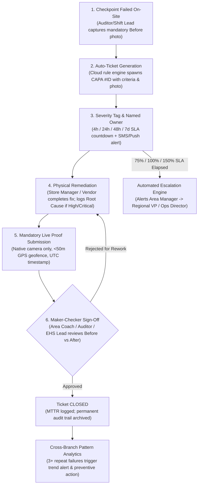

# 03 — Corrective Actions, CAPA & Repeat-Failure Prevention

## 0. Module Scope & Source Inventory

- **Priority Tier:** P2 / P3 Core Differentiator — Corrective Actions, CAPA & Repeat-Failure Prevention
- **Core Operational Thesis:** *"You can't be everywhere."* Finding a defect during an inspection creates zero operational change by itself. Multi-location chains only stop repeat failures when every failed checkpoint automatically becomes a time-bounded Corrective and Preventive Action (CAPA) ticket owned by a named person, verified with live on-site photo proof, gated by maker-checker sign-off, and analyzed for cross-branch patterns.
- **Target Personas:**
  - Founders, CEOs, and COOs of multi-outlet chains (QSRs, restaurants, bakeries, retail, clinics, franchises)
  - Regional Operations Directors, VPs of Operations, Area Managers, and Area Coaches
  - Quality, Food Safety, and EHS Directors
  - Facility, Engineering, and Maintenance Managers
  - Franchisees and Franchise Operations Leads
  - Store, Outlet, Branch, Clinic, and Warehouse Managers

### Primary Source Blogs (13 Full Posts)

| # | Blog Title | Canonical URL | Category | Words |
| :--- | :--- | :--- | :--- | :--- |
| 1 | Audit Software Where Failed Items Auto-Create Tasks with Deadlines | https://audiment.in/blog/audit-software-where-failed-items-auto-create-tasks-with-deadlines | Feature-Led Operations | 1,186 |
| 2 | CAPA management: fixing recurring audit failures | https://audiment.in/blog/capa-management-guide | Corrective Actions | 1,648 |
| 3 | How to Track Corrective Actions After an Audit | https://audiment.in/blog/corrective-action-plan-after-audit | Audit Management | 2,029 |
| 4 | How to Track Corrective Actions Across Multiple Locations | https://audiment.in/blog/corrective-action-tracking | Corrective Actions | 1,623 |
| 5 | How Organisations Track Audit Findings and Corrective Actions: A Practical Guide | https://audiment.in/blog/corrective-actions-findings-continuous-improvement | Corrective Actions | 4,277 |
| 6 | How to Escalate Overdue Corrective Actions to Regional Heads Automatically | https://audiment.in/blog/how-to-escalate-overdue-corrective-actions-to-regional-heads | Feature-Led Operations | 1,145 |
| 7 | How to Follow Up on Issues Found During an Outlet Visit | https://audiment.in/blog/how-to-follow-up-on-issues-found-during-an-outlet-visit | Retail & Multi-Unit Operations | 1,148 |
| 8 | How to Get Trend Reports Showing Repeat Failures by Location | https://audiment.in/blog/how-to-get-trend-reports-showing-repeat-failures-by-location | Feature-Led Operations | 1,125 |
| 9 | How to Hold Restaurant Outlet Managers Accountable for Fixing Audit Issues | https://audiment.in/blog/how-to-hold-restaurant-outlet-managers-accountable-for-fixing-audit | Restaurant Operations | 1,793 |
| 10 | How to Manage Corrective Actions from a Franchisor's Audit Report | https://audiment.in/blog/how-to-manage-corrective-actions-from-a-franchisors-audit-report | Franchise Operations | 1,392 |
| 11 | How to Require Photo Proof Before a Corrective Action Can Be Closed | https://audiment.in/blog/how-to-require-photo-proof-before-a-corrective-action-can-be-closed | Feature-Led Operations | 1,223 |
| 12 | How to Track Maintenance from Discovery to Sign-Off with Photo Evidence | https://audiment.in/blog/how-to-track-maintenance-from-discovery-to-sign-off-with-photo-evidence | Facility Management | 1,654 |
| 13 | Why corrective actions fail across locations | https://audiment.in/blog/why-corrective-actions-fail-in-multi-location-operations | Accountability | 1,478 |

### Absorbed Routed Sections (23 Sibling Blogs)

| # | Source Blog | Primary Module | Absorbed Section(s) |
| :--- | :--- | :--- | :--- |
| 1 | [audit-software-for-a-10-outlet-restaurant-chain-a-simple-setup-guide](https://audiment.in/blog/audit-software-for-a-10-outlet-restaurant-chain-a-simple-setup-guide) | Mod 05 | Enforcing Accountability: The 48-Hour Corrective Action Loop |
| 2 | [audit-software-for-bakery-chains-with-outlets-in-multiple-cities](https://audiment.in/blog/audit-software-for-bakery-chains-with-outlets-in-multiple-cities) | Mod 05 | Enforcing the 48-Hour CAPA Rule on Bakery Refrigeration Failures |
| 3 | [audit-software-for-clinic-chains-in-india](https://audiment.in/blog/audit-software-for-clinic-chains-in-india) | Mod 12 | How Does Automated Corrective Action Tracking Close Clinic Deficiencies? |
| 4 | [audit-tracking-software](https://audiment.in/blog/audit-tracking-software) | Mod 10 | How Tracking Software Handles Remediation (The CAPA Loop) |
| 5 | [branch-audit-software-for-banks-and-nbfcs-with-geo-tagged-proof](https://audiment.in/blog/branch-audit-software-for-banks-and-nbfcs-with-geo-tagged-proof) | Mod 10 | Automated CAPA: Closing the Remediation Loop |
| 6 | [digital-fssai-hygiene-checklist-with-photo-evidence-free-template](https://audiment.in/blog/digital-fssai-hygiene-checklist-with-photo-evidence-free-template) | Mod 04 | What Happens When a Checklist Item Fails: The Automated 48-Hour CAPA Rule |
| 7 | [franchise-audit-software](https://audiment.in/blog/franchise-audit-software) | Mod 06 | The Franchise Corrective Action Loop |
| 8 | [freezer-temperature-and-cleanliness-audits-for-ice-cream-parlour-chains](https://audiment.in/blog/freezer-temperature-and-cleanliness-audits-for-ice-cream-parlour-chains) | Mod 04 | Enforcing 24-Hour CAPA Closure on Freezer Compressor Excursions |
| 9 | [goaudits-alternative-for-indian-restaurant-chains](https://audiment.in/blog/goaudits-alternative-for-indian-restaurant-chains) | Mod 09 | How Does Corrective Action Resolution Work for Restaurant Non-Conformances? |
| 10 | [how-franchisors-verify-franchisees-follow-brand-standards](https://audiment.in/blog/how-franchisors-verify-franchisees-follow-brand-standards) | Mod 06 | Enforcing Accountability: The 48-Hour Corrective Action SLA |
| 11 | [how-to-audit-franchise-diagnostic-centres-remotely](https://audiment.in/blog/how-to-audit-franchise-diagnostic-centres-remotely) | Mod 12 | How Does Automated Corrective Action Workflow Resolve Franchise Violations? |
| 12 | [how-to-enforce-a-48-hour-fix-on-warehouse-safety-failures](https://audiment.in/blog/how-to-enforce-a-48-hour-fix-on-warehouse-safety-failures) | Mod 12 | What Is the 48-Hour Safety Failure Remediation Protocol? |
| 13 | [how-to-maintain-consistent-hygiene-across-sweet-shop-outlets](https://audiment.in/blog/how-to-maintain-consistent-hygiene-across-sweet-shop-outlets) | Mod 05 | Enforcing 48-Hour CAPA Closure on Vessel Tinning and Cold Chain Excursions |
| 14 | [how-to-make-sure-opening-and-closing-checklists-are-done-at-every-qsr](https://audiment.in/blog/how-to-make-sure-opening-and-closing-checklists-are-done-at-every-qsr) | Mod 05 | How to Handle Critical Non-Compliance: The 48-Hour CAPA Rule |
| 15 | [how-to-replace-paper-store-audits-with-a-digital-system](https://audiment.in/blog/how-to-replace-paper-store-audits-with-a-digital-system) | Mod 08 | How Does a Digital System Automate Follow-Up and Maintenance? |
| 16 | [how-to-run-surprise-audits-at-qsr-outlets-without-managers-knowing](https://audiment.in/blog/how-to-run-surprise-audits-at-qsr-outlets-without-managers-knowing) | Mod 02 | How to Structure Scoring and the 48-Hour CAPA Closure Workflow |
| 17 | [how-to-track-ehs-audit-findings-through-to-closure](https://audiment.in/blog/how-to-track-ehs-audit-findings-through-to-closure) | Mod 12 | Closed-loop EHS CAPA workflow; EHS remediation metrics; 8D Root Cause Analysis (RCA) framework |
| 18 | [multi-location-compliance-guide](https://audiment.in/blog/multi-location-compliance-guide) | Mod 01 | The Closed-Loop CAPA Escalation Matrix |
| 19 | [role-based-access-in-audit-software-admins-managers-and-auditors](https://audiment.in/blog/role-based-access-in-audit-software-admins-managers-and-auditors) | Mod 11 | What role permissions are required for closed-loop CAPA workflows? |
| 20 | [safety-audit-software-for-warehouses-and-logistics-hubs](https://audiment.in/blog/safety-audit-software-for-warehouses-and-logistics-hubs) | Mod 10 | How Do Automated Corrective Action Workflows Resolve Safety Non-Conformances? |
| 21 | [what-is-a-surprise-audit](https://audiment.in/blog/what-is-a-surprise-audit) | Mod 02 | Surprise Audits and the Corrective Action Connection |
| 22 | [why-audit-software-failed-the-last-time-and-how-to-get-adoption-right](https://audiment.in/blog/why-audit-software-failed-the-last-time-and-how-to-get-adoption-right) | Mod 08 | Why Does a Broken Corrective Action Loop Cause Staff to Stop Auditing? |
| 23 | [why-corrective-actions-in-a-notebook-never-get-closed-and-what-to-use](https://audiment.in/blog/why-corrective-actions-in-a-notebook-never-get-closed-and-what-to-use) | Mod 08 | Digital closed-loop framework; Paper Notebooks vs Digital CAPA Software; Preventing repeat failures; FAQ schema |

---

## 1. Core Definitions: Findings, Nonconformances, Corrections, CAPA & Effectiveness

### 1.1 Audit Finding vs. Nonconformance
- **Audit Finding:** The result of evaluating objective evidence against defined audit criteria. A useful negative finding follows the formula **`Requirement → Observation → Evidence`**. Compare vague feedback (*"Store standards not followed"*) against an actionable finding (*"The required opening checklist was not completed for two of the five sampled days; the location's records were reviewed during the audit"*) [corrective-actions-findings-continuous-improvement](https://audiment.in/blog/corrective-actions-findings-continuous-improvement).
- **Nonconformance:** A failure to meet a specified requirement from a standard, regulation, customer contract, or internal SOP. It must reference a pre-existing criterion (e.g., *"Requirement: weekly inspection completed → Evidence: records reviewed → Finding: missed during required period"*) rather than subjective opinions like *"the process does not look right"* [corrective-actions-findings-continuous-improvement](https://audiment.in/blog/corrective-actions-findings-continuous-improvement).

### 1.2 Correction vs. Corrective Action vs. Preventive Action
Multi-location operators frequently confuse immediate fixes with systemic prevention [capa-management-guide](https://audiment.in/blog/capa-management-guide), [corrective-action-plan-after-audit](https://audiment.in/blog/corrective-action-plan-after-audit), [corrective-actions-findings-continuous-improvement](https://audiment.in/blog/corrective-actions-findings-continuous-improvement):

| Term | Operational Meaning | Concrete Example (Chiller / Hygiene / Prep) |
| :--- | :--- | :--- |
| **Correction** | Fix what happened right now (immediate containment). | Move food out of a warm refrigerator and restore temperature; complete missing temperature log; apply label to unlabelled container. |
| **Corrective Action** | Address *why* the detected problem happened to stop recurrence. | Investigate why the refrigerator drifted (damaged seal from harsh cleaning, faulty thermostat) or why the log was skipped (training/process gap), fix the cause, and verify subsequent checks hold. |
| **Preventive Action** | Change the upstream process, checklist, or physical control before future failures occur. | Add hairnet availability to the daily equipment checklist and pre-shift briefing; add a consumable stock check to opening checklists so label dispensers are never empty; require photo verification so cleaning checks cannot be skipped. |

### 1.3 Anatomy of a Corrective Action Plan (CAPA Record)
A post-audit corrective action plan is the documented bridge between identifying a problem and proving it is resolved [corrective-action-plan-after-audit](https://audiment.in/blog/corrective-action-plan-after-audit), [corrective-actions-findings-continuous-improvement](https://audiment.in/blog/corrective-actions-findings-continuous-improvement):

| Field | Operational Purpose |
| :--- | :--- |
| **Finding & Requirement** | Exact nonconformance observed and the standard/SOP breached |
| **Root Cause** | Why the failure occurred (mandatory prompt for High/Critical severity) [capa-management-guide](https://audiment.in/blog/capa-management-guide) |
| **Required Action** | Specific physical repair, replacement, or retraining required |
| **Owner** | Single named individual responsible for execution |
| **Due Date (SLA)** | Time-bound deadline calibrated to risk severity |
| **Evidence** | Live photo proof, invoices, work orders, or retraining sign-off sheets |
| **Verification** | How a supervisor/auditor reviews evidence and confirms process compliance |
| **Status** | `Open` → `In Progress` → `Pending Verification` → `Closed` (or `Rejected for Rework`) |

**Handling Audit Recommendations & Obsolete Documents:**
- Not every observation requires a formal CAPA. For auditor recommendations (e.g., *"Consider making the equipment check more explicit on the opening checklist"*), management must log an explicit decision—**Accept**, **Modify**, or **Decline**—alongside owner, action, due date, status, evidence, and review so suggestions do not vanish [corrective-actions-findings-continuous-improvement](https://audiment.in/blog/corrective-actions-findings-continuous-improvement).
- Quality records must remain version-controlled (answering what the current version is, who owns it, where it is used, when it changed, and how obsolete checklists/forms are retired) so remote sites do not audit against outdated SOPs [corrective-actions-findings-continuous-improvement](https://audiment.in/blog/corrective-actions-findings-continuous-improvement).

### 1.4 Completion vs. Corrective-Action Effectiveness
Marking a ticket `Status = Closed` is not proof of effectiveness. Completion means the assigned step occurred; **effectiveness** asks: *"Did the corrective action change the outcome?"* If staff repeatedly miss a required check and the corrective action is *"Send a reminder email,"* the action is technically complete when sent—yet if staff keep missing the check, the action failed. Effectiveness requires follow-up checks, repeated measurements, or subsequent audit verification [corrective-actions-findings-continuous-improvement](https://audiment.in/blog/corrective-actions-findings-continuous-improvement).

---

## 2. Why Corrective Actions Fail Across Multi-Location Chains

At one or two locations, a founder can remember open issues and confirm fixes in person. At 10, 20, 50, or 100+ outlets, memory-based follow-up collapses [corrective-action-plan-after-audit](https://audiment.in/blog/corrective-action-plan-after-audit), [corrective-action-tracking](https://audiment.in/blog/corrective-action-tracking). Multi-unit operations repeatedly fall into the cycle: **`Audit → Finding → Report → Repeat`**.

### 2.1 The Five Structural Failure Modes
1. **No Single Named Owner:** Assigning issues to *"The Store,"* *"The Kitchen Team,"* *"The Evening Shift,"* or dropping a message in a group chat (getting 12 thumbs-up reactions) creates diffused responsibility. Everyone assumes someone else will handle it [capa-management-guide](https://audiment.in/blog/capa-management-guide), [how-to-hold-restaurant-outlet-managers-accountable-for-fixing-audit](https://audiment.in/blog/how-to-hold-restaurant-outlet-managers-accountable-for-fixing-audit), [why-corrective-actions-fail-in-multi-location-operations](https://audiment.in/blog/why-corrective-actions-fail-in-multi-location-operations).
2. **No Timeline Discipline (Informal Deadlines):** Telling a supervisor *"Get this sorted soon"* carries zero enforcement weight. Within 48 hours, daily sales rushes and 300 customer service tasks push unscheduled repairs aside [audit-software-where-failed-items-auto-create-tasks-with-deadlines](https://audiment.in/blog/audit-software-where-failed-items-auto-create-tasks-with-deadlines), [corrective-action-tracking](https://audiment.in/blog/corrective-action-tracking).
3. **No Closure Proof (Verbal Promises & Ghost Repairs):** Accepting *"Yes, chef, I spoke to the kitchen staff"* or *"Done sir"*—or letting technicians close text-only tickets—produces false closures and ghost repairs while hazards persist [how-to-hold-restaurant-outlet-managers-accountable-for-fixing-audit](https://audiment.in/blog/how-to-hold-restaurant-outlet-managers-accountable-for-fixing-audit), [how-to-require-photo-proof-before-a-corrective-action-can-be-closed](https://audiment.in/blog/how-to-require-photo-proof-before-a-corrective-action-can-be-closed).
4. **No Severity Routing:** When a walk-in cooler temperature failure sits in the same flat queue as a crooked poster or scuffed paint, teams close easy cosmetic items first under workload pressure while critical safety risks wait [why-corrective-actions-fail-in-multi-location-operations](https://audiment.in/blog/why-corrective-actions-fail-in-multi-location-operations), [corrective-actions-findings-continuous-improvement](https://audiment.in/blog/corrective-actions-findings-continuous-improvement).
5. **No Central Queue or Cross-Branch Pattern Review:** Leadership cannot see open or overdue actions across 50 stores without chasing managers manually, and recurring defects across multiple outlets go unnoticed [corrective-action-tracking](https://audiment.in/blog/corrective-action-tracking), [why-corrective-actions-fail-in-multi-location-operations](https://audiment.in/blog/why-corrective-actions-fail-in-multi-location-operations).

### 2.2 Why Legacy Tools Break Down

- **Static PDF Reports ("Passive PDF Syndrome"):** An auditor compiles 6–20 defects into an 18-to-30 page PDF emailed to the store manager. The manager checks if the overall score passes 80% and archives the email. Result: **83% repeat failure rate** (5 of 6 defects still open 30 days later) and wasted auditor travel [audit-software-where-failed-items-auto-create-tasks-with-deadlines](https://audiment.in/blog/audit-software-where-failed-items-auto-create-tasks-with-deadlines), [how-to-hold-restaurant-outlet-managers-accountable-for-fixing-audit](https://audiment.in/blog/how-to-hold-restaurant-outlet-managers-accountable-for-fixing-audit).
- **Verbal Agreements & Visitor Notebooks:** When an Area Manager tells an afternoon shift supervisor to fix a flickering light and leaves, that supervisor clocks out 3 hours later without briefing the next shift. Combined with WhatsApp and paper notes, **70% of defects remain uncorrected** a month later, and driving 45 km just to re-inspect a washroom latch is economically unviable [how-to-follow-up-on-issues-found-during-an-outlet-visit](https://audiment.in/blog/how-to-follow-up-on-issues-found-during-an-outlet-visit). Notebooks also foster superficial band-aids (wiping down a leaking ice machine without servicing the pump, or taping over a frayed electrical cord) [why-corrective-actions-in-a-notebook-never-get-closed-and-what-to-use](https://audiment.in/blog/why-corrective-actions-in-a-notebook-never-get-closed-and-what-to-use).
- **Shared WhatsApp Groups:** Posting 14 defect photos into a store WhatsApp group fails because inventory deliveries, leave requests, and sales updates bury the thread within 48 hours [how-to-follow-up-on-issues-found-during-an-outlet-visit](https://audiment.in/blog/how-to-follow-up-on-issues-found-during-an-outlet-visit), [how-to-hold-restaurant-outlet-managers-accountable-for-fixing-audit](https://audiment.in/blog/how-to-hold-restaurant-outlet-managers-accountable-for-fixing-audit).

| Dimension | Store Manager Notebook | Shared WhatsApp Group | Manual Spreadsheets & Email | Generic Project Tools (Jira, Trello, Asana) | Dedicated CAPA & Audit Software (Audiment) |
| :--- | :--- | :--- | :--- | :--- | :--- |
| **Task Creation** | Handwritten during visit | Manual typing & photo drops | Manual email compilation | Manual ticket entry | **Auto-generated on audit failure** |
| **Ownership** | Ambiguous ("Store Team") | Ambiguous chat participants | Unclear / inbox-siloed | Named seat (if licensed) | **Named site owner automatically bound** |
| **Deadline Enforcement** | Verbal / unmonitored | None (lost in chat scroll) | Static dates, version drift | Manual due dates | **Risk-based SLA countdowns (4h/24h/48h)** |
| **Proof of Resolution** | Verbal claim next month | Unstructured gallery pics | Self-reported claims | Manual file attachments | **Live camera photo + GPS + UTC timestamp** |
| **Overdue Escalation** | None | Manual chasing | Manual email follow-up | Limited / manual | **Automated multi-tier escalation alerts** |
| **Scalability (10+ Sites)** | Zero (single-branch only) | Fragmented regional chats | Fails (version drift) | Moderate (high per-seat cost) | **High (central multi-store queue & trends)** |
| **Audit Context & Trail** | Lost, soiled, or destroyed | Rolls away in chat history | Disconnected from finding | Stripped from audit criteria | **Permanent immutable DB linked to audit** |

*Sources: [why-corrective-actions-in-a-notebook-never-get-closed-and-what-to-use](https://audiment.in/blog/why-corrective-actions-in-a-notebook-never-get-closed-and-what-to-use), [corrective-actions-findings-continuous-improvement](https://audiment.in/blog/corrective-actions-findings-continuous-improvement), [capa-management-guide](https://audiment.in/blog/capa-management-guide).*

### 2.3 Downstream Operational Consequences & Frontline Adoption Failure
- **Normalization of Failure & Audit Fatigue:** When the same hygiene or equipment defect reappears monthly without consequence, teams stop treating audits as improvement tools and treat them as meaningless paperwork [corrective-action-plan-after-audit](https://audiment.in/blog/corrective-action-plan-after-audit).
- **The Adoption Killer:** If a restaurant manager diligently flags an uncalibrated undercounter cooler for three consecutive weeks and corporate maintenance never dispatches a technician, the manager concludes: *"Completing this checklist changes nothing."* Conversely, when flagging a broken ice machine automatically dispatches a technician within 48 hours, managers become active champions of the system [why-audit-software-failed-the-last-time-and-how-to-get-adoption-right](https://audiment.in/blog/why-audit-software-failed-the-last-time-and-how-to-get-adoption-right).

---

## 3. Closed-Loop CAPA Architecture: Auto-Ticketing, Severity SLAs & Escalation Rules

### 3.1 End-to-End Automated CAPA Lifecycle
A closed-loop system keeps the original finding, owner, deadline, evidence, supervisory verification, and trend history on one continuous record [audit-software-where-failed-items-auto-create-tasks-with-deadlines](https://audiment.in/blog/audit-software-where-failed-items-auto-create-tasks-with-deadlines), [corrective-action-tracking](https://audiment.in/blog/corrective-action-tracking), [how-to-hold-restaurant-outlet-managers-accountable-for-fixing-audit](https://audiment.in/blog/how-to-hold-restaurant-outlet-managers-accountable-for-fixing-audit), [capa-management-guide](https://audiment.in/blog/capa-management-guide):

- **Decoupling Task Creation from Admin Effort:** 100% of failed critical checkpoints immediately spawn a ticket containing the exact failed question, auditor's timestamped photo, severity tier, named owner (e.g., Store Manager), and SLA deadline [audit-software-where-failed-items-auto-create-tasks-with-deadlines](https://audiment.in/blog/audit-software-where-failed-items-auto-create-tasks-with-deadlines), [why-corrective-actions-in-a-notebook-never-get-closed-and-what-to-use](https://audiment.in/blog/why-corrective-actions-in-a-notebook-never-get-closed-and-what-to-use).
- **Surprise Audits Feed the Same Loop:** Unannounced inspections carry identical follow-up rules—critical items (often weighted 15–20% of total score or triggering automatic audit failure on statutory FSSAI breaches) route straight into the 48-hour CAPA workflow [how-to-run-surprise-audits-at-qsr-outlets-without-managers-knowing](https://audiment.in/blog/how-to-run-surprise-audits-at-qsr-outlets-without-managers-knowing), [what-is-a-surprise-audit](https://audiment.in/blog/what-is-a-surprise-audit).

### 3.2 Risk-Calibrated Severity Tiers & SLA Matrices

#### A. Standard 4-Tier Enterprise Operations & Compliance Matrix
Used across multi-unit retail, QSRs, clinics, and commercial facilities [audit-software-where-failed-items-auto-create-tasks-with-deadlines](https://audiment.in/blog/audit-software-where-failed-items-auto-create-tasks-with-deadlines), [how-to-escalate-overdue-corrective-actions-to-regional-heads](https://audiment.in/blog/how-to-escalate-overdue-corrective-actions-to-regional-heads), [multi-location-compliance-guide](https://audiment.in/blog/multi-location-compliance-guide), [capa-management-guide](https://audiment.in/blog/capa-management-guide):

| Priority Tier | Risk Definition & Concrete Examples | Target SLA | Tier 1 Escalation (Warning) | Tier 2 Escalation (Overdue Breach) |
| :--- | :--- | :--- | :--- | :--- |
| **Tier 1: Critical** | Cold storage >6°C / >8°C, blocked fire exit, bare 415V wiring, active pest sighting, unlocked POS cash drawer, expired emergency adrenaline ampoule, sharps container >75%, buckled warehouse rack | **4 Hours** (Same-Day) | At **2 Hours** (50%) or **3 Hours** (75%): SMS/Push to Store Lead / VP Ops alert if unassigned | At **4 Hours** (100%): Red dashboard banner + SMS/Email/Call to VP Operations; **6 Hours** (150%): Regional VP & Quality Director |
| **Tier 2: High** | Customer AC failure, broken POS printer, unserviced pest trap, CCTV camera offline, hot water heater out, chemical sanitizer dilution failure, dipping freezer at -8°C | **24 Hours** | At **18 Hours** (75%): WhatsApp/Push to Store GM & Area Manager | At **24 Hours** (100%): Alert to Regional Facilities Director / Executive Dashboard |
| **Tier 3: Medium** | Promo banner/vinyl torn, price talker misaligned, staff badge missing, handwashing soap empty, cracked prep tile, faded POP | **48 Hours** (or up to 7 Days in Facilities) | At **36 Hours** (75%): App Push reminder | At **48 Hours** (100%): Weekly Regional / Area Manager Digest flag |
| **Tier 4: Low** | Minor wall paint scuff, unpalletized dry storage boxes, loose cabinet/locker handle, noticeboard loose | **72 Hours – 7 Days** (up to 14 Days) | At **Day 5**: Email reminder | At **Day 7**: Rolled into monthly maintenance round |

#### B. Why the 48-Hour CAPA Rule Is the Operational Benchmark
Across QSR, restaurant, bakery, sweet shop, and franchise deployments, the **48-hour SLA** is the standard default for critical/high operational defects because it is [capa-management-guide](https://audiment.in/blog/capa-management-guide), [corrective-action-tracking](https://audiment.in/blog/corrective-action-tracking):
1. Short enough to stop refrigeration drift, hygiene gaps, or brand violations from compounding into food safety incidents or customer complaints.
2. Realistic enough for store managers to schedule technicians or vendor repairs without triggering daily operational chaos.
3. Sharp enough to draw an unambiguous accountability line enforced by automated escalation at hour 36 and hour 48 [digital-fssai-hygiene-checklist-with-photo-evidence-free-template](https://audiment.in/blog/digital-fssai-hygiene-checklist-with-photo-evidence-free-template), [how-to-hold-restaurant-outlet-managers-accountable-for-fixing-audit](https://audiment.in/blog/how-to-hold-restaurant-outlet-managers-accountable-for-fixing-audit).

#### C. Restaurant-Specific 3-Tier SLA Model
Restaurants operating high-velocity kitchens segment defects into three enforceable windows [how-to-hold-restaurant-outlet-managers-accountable-for-fixing-audit](https://audiment.in/blog/how-to-hold-restaurant-outlet-managers-accountable-for-fixing-audit):
- **24 Hours (Critical Food Safety):** Raw meat cross-contact with ready-to-eat salad pans, expired dairy, 0 PPM sanitizer in 3-compartment sink, handwashing sinks without soap/water, active pests/unsealed exterior doors. (Ultra-urgent chiller milk excursions at 9°C may use a **12-hour SLA** [goaudits-alternative-for-indian-restaurant-chains](https://audiment.in/blog/goaudits-alternative-for-indian-restaurant-chains)).
- **48 Hours (Core Equipment & Cold Chain):** Walk-in chiller at 6°C (target 1°C–4°C), frying oil >25% TPM requiring filtration/replacement, overdue exhaust hood degreasing, broken digital probe thermometers, missing FIFO prep labels, burnt-out kitchen bulbs.
- **7 Days (Aesthetic & Facilities):** Chipped dining/dry-storage tiles, scuffed baseboards, loose restroom door handle, faded signage/posters.

#### D. Franchise Contractual SLA & Cure Windows
Franchisors map CAPA tiers directly to franchise agreement enforcement [how-to-manage-corrective-actions-from-a-franchisors-audit-report](https://audiment.in/blog/how-to-manage-corrective-actions-from-a-franchisors-audit-report):
- **Tier 1 Critical Non-Conformance (12–24 Hours):** Food temp >5°C, cross-contamination, pests, missing FSSAI licence display → *Risk:* immediate closure risk, formal default notice, mandatory corporate re-audit at franchisee expense. (Contractual emergency cure window: 24–48 hours).
- **Tier 2 Major Brand Standards (48–72 Hours):** Unapproved supplier ingredients (e.g., unauthorized sauce pouches), broken POS, uncalibrated gear, missing uniforms → *Risk:* financial penalty, audit score capped at 75%, marketing fee withholding. (Standard contractual cure window: 7–14 days).
- **Tier 3 Minor Operational Defect (7 Calendar Days):** Chipped tile, burnt display light, loose hinge → *Risk:* point deduction on annual franchise scorecard.

#### E. The 48-Hour Warehouse Safety Remediation Protocol (4 Gates)
For structural hazards such as a severely buckled racking upright in Aisle 14, Bay C [how-to-enforce-a-48-hour-fix-on-warehouse-safety-failures](https://audiment.in/blog/how-to-enforce-a-48-hour-fix-on-warehouse-safety-failures), [safety-audit-software-for-warehouses-and-logistics-hubs](https://audiment.in/blog/safety-audit-software-for-warehouses-and-logistics-hubs):
1. **Hours 0–4 (Discovery & Operational Quarantine):** Inspector flags defect → CAPA issued (4h containment SLA) → red danger tape applied + Warehouse Management System (WMS) digitally quarantines/locks affected pallet positions.
2. **Hours 4–24 (Work Order Dispatch & Staging):** Facilities lead dispatches certified rack contractor; replacement columns, uprights, and bolted baseplate anchor bolts staged on site.
3. **Hours 24–44 (Physical Execution & De-Stressing):** Warehouse team de-stacks pallets from damaged bays; contractor installs replacement hardware.
4. **Hours 44–48 (Proof-Verified Sign-Off & Bay Release):** Technician submits live in-app photo of repaired rack leg and anchor bolts → Safety Director approves from web dashboard → WMS unlocks bay for active storage.

### 3.3 SLA Extensions & Parts Delays
When repairs depend on third-party spare parts (e.g., commercial refrigeration compressor), managers or technicians cannot silently let timers lapse. They transition the ticket to **"Pending Spare Parts"** or submit an **SLA Extension Request** attaching the vendor's signed work order, purchase order (PO) number, shipping tracking number, and estimated delivery date. The Area Manager approves the extension on mobile, pausing escalation alerts while keeping the open defect visible to leadership [audit-software-where-failed-items-auto-create-tasks-with-deadlines](https://audiment.in/blog/audit-software-where-failed-items-auto-create-tasks-with-deadlines), [how-to-escalate-overdue-corrective-actions-to-regional-heads](https://audiment.in/blog/how-to-escalate-overdue-corrective-actions-to-regional-heads), [how-to-hold-restaurant-outlet-managers-accountable-for-fixing-audit](https://audiment.in/blog/how-to-hold-restaurant-outlet-managers-accountable-for-fixing-audit), [how-to-track-maintenance-from-discovery-to-sign-off-with-photo-evidence](https://audiment.in/blog/how-to-track-maintenance-from-discovery-to-sign-off-with-photo-evidence).

---

## 4. Maker-Checker Closure Controls, Anti-Fake-Fix Safeguards & Maintenance Workflows

### 4.1 The "Ghost Repair" Failure Mode
When software allows technicians or store managers to close tickets with a text comment (*"Drain pipe tightened and tested"* or *"Washroom sink pipe tightened"*), swamped staff close tickets remotely to hit quotas without visiting the site—resulting in catastrophic downstream losses (e.g., ₹1,20,000 ruined dining room parquet flooring from an unfixed dishwasher leak, or ₹80,000 tenant office carpet damage from sink #04 overflow) [how-to-require-photo-proof-before-a-corrective-action-can-be-closed](https://audiment.in/blog/how-to-require-photo-proof-before-a-corrective-action-can-be-closed), [how-to-track-maintenance-from-discovery-to-sign-off-with-photo-evidence](https://audiment.in/blog/how-to-track-maintenance-from-discovery-to-sign-off-with-photo-evidence).

### 4.2 Role-Based Maker-Checker Gatekeeping (RBAC)
Closed-loop verification strictly decouples execution from closure [role-based-access-in-audit-software-admins-managers-and-auditors](https://audiment.in/blog/role-based-access-in-audit-software-admins-managers-and-auditors), [how-to-require-photo-proof-before-a-corrective-action-can-be-closed](https://audiment.in/blog/how-to-require-photo-proof-before-a-corrective-action-can-be-closed), [why-corrective-actions-in-a-notebook-never-get-closed-and-what-to-use](https://audiment.in/blog/why-corrective-actions-in-a-notebook-never-get-closed-and-what-to-use):
- **Maker (Unit / Store Manager / Technician):** Can view original failure photo and auditor notes, delegate to shift leads or on-site technicians, and capture live repair photos to click **"Submit for Verification"**. The **"CLOSE TICKET"** button is disabled by software policy.
- **Checker (Area Manager / Regional Manager / Quality Auditor / EHS Officer):** Receives `"Pending Verification"` alert, reviews **side-by-side Before-and-After photos** (completing visual QA in ~5 seconds) plus embedded GPS and UTC metadata, and holds exclusive permission to click **"APPROVE & CLOSE"** or **"REJECT FOR REWORK"** (entering a specific rejection reason—e.g., *"Oil was wiped with a rag, but leaking hydraulic fitting was not replaced"*—which returns the ticket to `"Active Incomplete"` and restarts the timer) [how-to-require-photo-proof-before-a-corrective-action-can-be-closed](https://audiment.in/blog/how-to-require-photo-proof-before-a-corrective-action-can-be-closed), [audit-software-where-failed-items-auto-create-tasks-with-deadlines](https://audiment.in/blog/audit-software-where-failed-items-auto-create-tasks-with-deadlines).

### 4.3 Technical Safeguards Against Faked Repair Photos
| Safeguard | Technical Mechanism | Fraud / Evasion Blocked |
| :--- | :--- | :--- |
| **Native Camera Hardware Lock** | App connects directly to phone camera sensor; OS/app gallery picker disabled | Uploading old photos, screenshots, downloaded images, or WhatsApp forwards |
| **Sub-50m GPS Geofence** | Device satellite coordinates checked against store/facility perimeter (<50m) | Resolving maintenance tickets from home or while in transit |
| **Network UTC Timestamping** | Network Time Protocol (NTP) server timestamps embedded in metadata | Changing local phone system clock to falsify repair timing |
| **Asset QR-Code Match** | Technician scans durable aluminum 2D QR tag mounted on specific machine | Photographing an undamaged twin unit on another line or floor |

*Sources: [how-to-require-photo-proof-before-a-corrective-action-can-be-closed](https://audiment.in/blog/how-to-require-photo-proof-before-a-corrective-action-can-be-closed), [how-to-follow-up-on-issues-found-during-an-outlet-visit](https://audiment.in/blog/how-to-follow-up-on-issues-found-during-an-outlet-visit), [how-to-track-maintenance-from-discovery-to-sign-off-with-photo-evidence](https://audiment.in/blog/how-to-track-maintenance-from-discovery-to-sign-off-with-photo-evidence).*

### 4.4 Audit-Ready Visual CAPA Compliance Dossier
Every closed ticket compiles an immutable, exportable (PDF/CSV) dossier proving physical resolution to regulators (FSSAI, OSHA, RBI), brand licensors, and insurers [how-to-require-photo-proof-before-a-corrective-action-can-be-closed](https://audiment.in/blog/how-to-require-photo-proof-before-a-corrective-action-can-be-closed):
- **Header:** Record ID (`#408`), Facility (`Store #104, Bandra West`), Category (`Food Safety & Cold Chain`), Failed Checkpoint (`Walk-In Freezer Door Gasket Airtight & Uncracked = FAIL`).
- **Before Evidence:** Macro photo of torn magnetic rubber seal, NTP timestamp (`2026-10-24 09:14:22 IST`), Auditor ID (`#108`), GPS (`19.0596° N, 72.8295° E`, accuracy `3.8m`).
- **After Evidence:** Live camera photo of sealed OEM gasket, spare part serial (`OEM-FRZ-GK-884`), work order (`WO-921`), Technician ID (`#44`), timestamp (`2026-10-25 14:20:10 IST`), resolution duration (`29h 06m` vs 48h SLA = `COMPLIANT`).
- **Supervisory Approval:** Approver name/role (`Regional Operations Director`) + cryptographic digital signature hash.

### 4.5 External Maintenance Contractors & Multi-Trade Facility Verification
- **Frictionless Contractor Portal:** External HVAC, plumbing, or electrical vendors receive a **single-use SMS mobile web link**—no app store download or enterprise seat required. The link displays the original failure photo, enforces live browser camera capture + GPS check-in, and collects vendor work orders, invoices, and replacement part serial numbers (automatically tracking **component warranty expiration** to flag repeat failures within the warranty window) [audit-software-where-failed-items-auto-create-tasks-with-deadlines](https://audiment.in/blog/audit-software-where-failed-items-auto-create-tasks-with-deadlines), [how-to-require-photo-proof-before-a-corrective-action-can-be-closed](https://audiment.in/blog/how-to-require-photo-proof-before-a-corrective-action-can-be-closed), [how-to-track-maintenance-from-discovery-to-sign-off-with-photo-evidence](https://audiment.in/blog/how-to-track-maintenance-from-discovery-to-sign-off-with-photo-evidence).
- **4-Gate Maintenance Verification Workflow:** `[Gate 1: Discovery & Wide-Angle Flagging]` → `[Gate 2: Skill/Location Automated Dispatch + Spare Requisition]` → `[Gate 3: QR Scan + Physical Repair + Live Wide-Angle & Close-Up After-Photo + Part Serial]` → `[Gate 4: Facility Manager Side-by-Side Sign-Off or Rework Rejection]` [how-to-track-maintenance-from-discovery-to-sign-off-with-photo-evidence](https://audiment.in/blog/how-to-track-maintenance-from-discovery-to-sign-off-with-photo-evidence).
- **Multi-Trade Maintenance Verification Standards:**

| Trade | Asset Class | Mandatory "Before" Proof | Mandatory "After" Proof | Verification Instrument |
| :--- | :--- | :--- | :--- | :--- |
| **HVAC & Cooling** | Chiller compressor & AHUs | Wide-angle icing coil + oily flare nut leak | Macro braze joint + vacuum gauge **<500 microns** | Digital vacuum micron gauge & refrigerant leak sniffer |
| **Electrical Power** | LT breaker panels & busbars | Thermal IR image showing hotspot **>85°C** | Replaced contactor + clamp meter showing balanced phase current | **Fluke/FLIR thermal imager** (radiometric JPEG supported) & clamp multimeter |
| **Plumbing & Fire Lines** | Fire jockey pump & boosters | Video of spraying coupling + gauge at **2 bar** | New victaulic coupling + gauge holding **7 bar** | Hydrostatic pressure gauge test rig |
| **Civil Infrastructure** | Granite flooring & wet areas | Photo of cracked tile with measuring tape | Newly laid tile with straight grout & clean finish | Visual alignment & tap hammer test |
| **Vertical Transport** | Passenger elevators & shafts | Worn door roller & erratic landing alignment | New roller bearing + level alignment against sill | Digital spirit level & clearance gauge |

*Source: [how-to-track-maintenance-from-discovery-to-sign-off-with-photo-evidence](https://audiment.in/blog/how-to-track-maintenance-from-discovery-to-sign-off-with-photo-evidence).*

---

## 5. Automated Escalation Matrices & Regional Executive Routing

### 5.1 Why Manual Escalations Break Down
In manual operations: Day 1 auditor flags a dead emergency light (48h verbal instruction) → Day 3 weekend rush buries it → Day 7 Area Manager oversees 15+ stores and forgets → Day 30 next audit finds the emergency light still dead (**30 days of active life-safety risk** with zero leadership awareness) [how-to-escalate-overdue-corrective-actions-to-regional-heads](https://audiment.in/blog/how-to-escalate-overdue-corrective-actions-to-regional-heads).

### 5.2 The 75% / 100% / 150% Automated Escalation Engine
An hourly cloud cron listener monitors every active CAPA countdown timer and triggers deterministic, non-discretionary escalations [corrective-action-tracking](https://audiment.in/blog/corrective-action-tracking), [how-to-escalate-overdue-corrective-actions-to-regional-heads](https://audiment.in/blog/how-to-escalate-overdue-corrective-actions-to-regional-heads), [how-to-hold-restaurant-outlet-managers-accountable-for-fixing-audit](https://audiment.in/blog/how-to-hold-restaurant-outlet-managers-accountable-for-fixing-audit):
- **75% SLA Elapsed (Warning Trigger):** E.g., Hour 3 of a 4h Critical ticket, Hour 18 of a 24h High ticket, or Hour 36 of a 48h CAPA. Pushes urgent SMS & mobile push warning to the Store Manager (*"12 hours remaining to upload photo proof"*).
- **100% SLA Breach (Tier 1 Escalation — OVERDUE):** E.g., Hour 4 / Hour 24 / Hour 48. Ticket flips to red **`OVERDUE`** status; automated alert dispatches via WhatsApp/email/push to Area Coach / Area Manager and Operations VP.
- **150% SLA Breach (Tier 2 Executive Intervention):** E.g., Hour 6 on a 4h Critical ticket, or Hour 60 on a 48h restaurant ticket. Escalates directly to Regional VP of Operations with a prominent red executive dashboard banner, email summary to Central Quality Director, and operational remedies (emergency Area Coach visit, monthly compliance bonus deduction, or HQ-dispatched third-party technician).

### 5.3 Multi-Channel Delivery Matrix & Edge Cases
Frontline managers live on store floors, not in email inboxes [how-to-escalate-overdue-corrective-actions-to-regional-heads](https://audiment.in/blog/how-to-escalate-overdue-corrective-actions-to-regional-heads):

| Escalation Level | Primary Delivery Channel | Delivery Latency |
| :--- | :--- | :--- |
| Standard Task Assignment | Mobile App Inbox & Push Notification | Instant (<5 seconds) |
| 75% SLA Warning | Mobile Push & SMS Alert | Instant (<10 seconds) |
| 100% Overdue Breach | Automated WhatsApp Business Message | Instant (<10 seconds) |
| Executive Tier 2 Alert | Live Operational Dashboard Red Banner | Real-Time WebSocket |
| Board Governance Summary | Executive PDF Digest | Scheduled Monday 08:00 AM |

- **Leave Delegation Rules:** When an Area Manager is marked on annual leave, all automated escalations and approval rights automatically reroute to a designated secondary supervisor [how-to-escalate-overdue-corrective-actions-to-regional-heads](https://audiment.in/blog/how-to-escalate-overdue-corrective-actions-to-regional-heads).
- **Contractor SLA Escalations:** Overdue third-party vendor tickets trigger automated SMS warnings to the vendor's account manager and corporate procurement lead [how-to-escalate-overdue-corrective-actions-to-regional-heads](https://audiment.in/blog/how-to-escalate-overdue-corrective-actions-to-regional-heads).

---

## 6. Repeat-Failure Detection, Operational Drift & Root-Cause Prevention

### 6.1 Why Overall Audit Scores Hide Chronic Failure
In spreadsheet workflows, separate quarterly files mask recurring defects. Example: **Store #12** fails the exact `Food Storage FIFO` checkpoint in January, February, and March, yet scores **84% (Passing)** on quarterly averages—leaving the brand exposed to food poisoning liabilities for 90 consecutive days [how-to-get-trend-reports-showing-repeat-failures-by-location](https://audiment.in/blog/how-to-get-trend-reports-showing-repeat-failures-by-location). Similarly, if Stores 7, 12, and 19 all have open chiller failures, those are symptoms of a shared faulty equipment model, supplier defect, or regional training gap [why-corrective-actions-fail-in-multi-location-operations](https://audiment.in/blog/why-corrective-actions-fail-in-multi-location-operations).

### 6.2 Analytical Views & Rolling 90-Day Recurrence Matrix
Accurate repeat-failure analytics require **at least 3 completed audit cycles over a 60–90 day window**, with seasonal promotional questions date-tagged so temporary campaigns do not distort core safety trend lines [how-to-get-trend-reports-showing-repeat-failures-by-location](https://audiment.in/blog/how-to-get-trend-reports-showing-repeat-failures-by-location).

**Sample Rolling 90-Day Location-by-Checkpoint Matrix** [how-to-get-trend-reports-showing-repeat-failures-by-location](https://audiment.in/blog/how-to-get-trend-reports-showing-repeat-failures-by-location):

| Checkpoint Question | Store #04 | Store #08 | Store #12 | Network Failure Rate |
| :--- | :--- | :--- | :--- | :--- |
| Refrigeration Temp (<=4°C) | 1 Failure | 0 Failures | **3 FAILURES** | 8.4% *(Chronic at #12)* |
| Sanitizer Titration (200 ppm) | 0 Failures | **3 FAILURES** | 2 Failures | **14.2% *(Systemic Risk)*** |
| FIFO Inventory Rotation Clean | 0 Failures | 0 Failures | **3 FAILURES** | 6.1% *(Chronic at #12)* |
| Emergency Fire Exit Unblocked | 0 Failures | 0 Failures | 0 Failures | 0.0% *(Compliant)* |
| POS Cash Float Balanced | 2 Failures | 1 Failure | 0 Failures | 4.8% *(Watchlist at #04)* |
| **Store Trajectory** | Improving | Degrading | **CRITICAL** | **Portfolio: 89.2%** |

**Four Core Analytical Views** [how-to-get-trend-reports-showing-repeat-failures-by-location](https://audiment.in/blog/how-to-get-trend-reports-showing-repeat-failures-by-location):
1. **Checkpoint Defect Pareto Curve:** Ranks all questions by total failure volume (e.g., exposing that 60% of failures stem from 3 questions).
2. **Facility Recurrence Heatmap:** Flags any branch failing the same checkpoint across `>= 2` or `3 consecutive` cycles (triggering automated admin trend alerts) [corrective-action-tracking](https://audiment.in/blog/corrective-action-tracking), [how-to-get-trend-reports-showing-repeat-failures-by-location](https://audiment.in/blog/how-to-get-trend-reports-showing-repeat-failures-by-location).
3. **Category Degradation Curve:** Plots category scores (e.g., Food Safety vs. Cleanliness) over 6 months to catch operational drift before overall audit scores fail.
4. **Vendor Failure Correlation:** Maps equipment failure rates against contracted HVAC/refrigeration AMC vendors.

**Pattern-to-Diagnostic Mapping** [corrective-actions-findings-continuous-improvement](https://audiment.in/blog/corrective-actions-findings-continuous-improvement):

| Observed Pattern | Management Diagnostic Question |
| :--- | :--- |
| Same issue at **one location** | What is locally different there (equipment age, manager, staffing)? |
| Same issue across **one region** | Is there a regional supervisor or supplier gap? |
| Same issue across **all locations** | Is the corporate SOP, equipment spec, or training unclear? |
| Issue appears **after a process change** | Did the new rollout create an unintended bottleneck? |
| Finding **returns after closure** | Was the previous corrective action superficial instead of root-cause? |

### 6.3 Weekly Leadership Review Cadence
Operations leaders review four metrics every week: **(1)** open actions by severity, **(2)** overdue actions by location, **(3)** repeat failures with `2+` reopen cycles, and **(4)** average closure time by region. If overdue critical actions rise for **two consecutive weeks**, leadership treats it as a management process failure rather than an individual store issue [why-corrective-actions-fail-in-multi-location-operations](https://audiment.in/blog/why-corrective-actions-fail-in-multi-location-operations).

### 6.4 Root-Cause Analysis (RCA) & Elimination Frameworks

1. **3-Step Recurring Defect Elimination Protocol (Machine vs. Human)** [how-to-get-trend-reports-showing-repeat-failures-by-location](https://audiment.in/blog/how-to-get-trend-reports-showing-repeat-failures-by-location):
   - *Trigger:* Store #08 fails Sanitizer Titration 3 times in 60 days.
   - *Step 1 (Physical Diagnostic):* Area Manager tests on-site—is the chemical dispenser venturi valve corroded (*Machine*), or are staff pouring without measuring (*Human*)?
   - *Step 2 (Targeted Fix):* Replace corroded valve within 24h under warranty AMC **OR** run a 5-minute hands-on titration micro-drill with all kitchen staff.
   - *Step 3 (Locked Verification):* Store #08 checklist mandates a **daily photo of a green test strip for 14 days** until recurrence is zeroed out.
2. **5-Why Root Cause Analysis (Franchise & Kitchen SOPs)** [how-to-manage-corrective-actions-from-a-franchisors-audit-report](https://audiment.in/blog/how-to-manage-corrective-actions-from-a-franchisors-audit-report):
   - *Problem:* Prepped chicken tub had no day-dot expiration label.
   - *Why 1:* Morning cook didn't apply it → *Why 2:* Couldn't find dispenser → *Why 3:* Dispenser empty, rolls locked in manager's office → *Why 4:* Shift supervisor skipped prep readiness check → *Why 5 (Root Cause):* Opening checklist lacks a verified consumable stock check before prep begins. *Fix:* Add mandatory opening consumable check rather than just slapping a sticker on one tub.
3. **8D Root Cause Analysis Framework (High-Severity Industrial & EHS CAPAs)** [how-to-track-ehs-audit-findings-through-to-closure](https://audiment.in/blog/how-to-track-ehs-audit-findings-through-to-closure):

| 8D Discipline | Operational EHS Action | Time Limit | Required Digital Artifact |
| :--- | :--- | :--- | :--- |
| **D1: Assemble Team** | Assign EHS officer, line supervisor, maintenance tech | **2 Hours** | In-app user assignment & role tags |
| **D2: Define Problem** | Quantify defect via 5W2H | **4 Hours** | Live photos, asset serial, GPS coordinates |
| **D3: Interim Containment** | Isolate hazard (Lockout/Tagout LOTO or barrier) | **4 Hours** | Photo of padlock, safety tag, yellow barrier tape |
| **D4: Root Cause (RCA)** | 5-Why / Ishikawa fishbone analysis (e.g., worn hydraulic seal) | **48 Hours** | Structured 5-Why causal tree in app |
| **D5: Choose Permanent Fix** | Engineering control over workaround (replace manifold) | **5 Days** | Engineering work order & vendor PO upload |
| **D6: Implement & Validate** | Install parts, pressure-test under operating load | **10 Days** | Live photo of new part & gauge pressure reading |
| **D7: Prevent Recurrence** | Update preventive maintenance (PM) checklist & SOP | **15 Days** | Revision sign-off by Plant Engineering Head |
| **D8: Team Recognition** | Close CAPA & archive trail for regulatory review | **30 Days** | Digital sign-off by Corporate EHS Director |

---

## 7. Vertical & Operational Playbooks

- **Restaurants & QSR Chains:**
  - *Triggers & Thresholds:* Reach-in cooler at 8°C (standard `<4°C`, 48h SLA → coil clean/tech repair → live photo at 2.8°C + invoice) [audit-software-for-a-10-outlet-restaurant-chain-a-simple-setup-guide](https://audiment.in/blog/audit-software-for-a-10-outlet-restaurant-chain-a-simple-setup-guide); undercounter milk chiller at 9°C (`<5°C`, 12h SLA → 3.2°C) [goaudits-alternative-for-indian-restaurant-chains](https://audiment.in/blog/goaudits-alternative-for-indian-restaurant-chains); meat patty holding cabinet at 45°C (required `>=60°C`, 48h Critical SLA → recalibrate heating element & discard out-of-temp batch) [how-to-make-sure-opening-and-closing-checklists-are-done-at-every-qsr](https://audiment.in/blog/how-to-make-sure-opening-and-closing-checklists-are-done-at-every-qsr); frying oil `>25% TPM` [how-to-hold-restaurant-outlet-managers-accountable-for-fixing-audit](https://audiment.in/blog/how-to-hold-restaurant-outlet-managers-accountable-for-fixing-audit).
  - *Outlet Ticket Volume Benchmark:* A healthy restaurant outlet carries **2 to 4 active open CAPA tickets** concurrently with **0 overdue**. Accumulating **>8 open tickets** signals operational neglect, understaffing, or obsolete equipment requiring executive intervention [how-to-hold-restaurant-outlet-managers-accountable-for-fixing-audit](https://audiment.in/blog/how-to-hold-restaurant-outlet-managers-accountable-for-fixing-audit).
  - *FSSAI Defense:* Unannounced FSSAI officers inspect historical remediation; immutable timestamped before/after photo trails prove proactive Schedule 4 compliance [how-to-hold-restaurant-outlet-managers-accountable-for-fixing-audit](https://audiment.in/blog/how-to-hold-restaurant-outlet-managers-accountable-for-fixing-audit), [digital-fssai-hygiene-checklist-with-photo-evidence-free-template](https://audiment.in/blog/digital-fssai-hygiene-checklist-with-photo-evidence-free-template).
- **Bakery Chains, Sweet Shops & Ice Cream Parlours:**
  - *Bakery Display Chillers:* Case at 7°C–7.5°C → immediate stock relocation to walk-in chiller → thermostat/defrost repair → live photo at 2.8°C + service receipt (24–48h SLA) [audit-software-for-bakery-chains-with-outlets-in-multiple-cities](https://audiment.in/blog/audit-software-for-bakery-chains-with-outlets-in-multiple-cities).
  - *Expired Shelf Stock:* Expired pastry on active retail shelf → immediate removal, slashed & discarded in disposal bin with live photo → 48h RCA SLA + full display audit + FIFO staff retraining [how-to-track-shelf-life-and-expiry-compliance-in-bakery-outlets](https://audiment.in/blog/how-to-track-shelf-life-and-expiry-compliance-in-bakery-outlets).
  - *Ice Cream Dipping Cabinets:* Cabinet warms to `-8°C` → immediate stock transfer to backup freezer → refrigerant recharge/fan repair → live photo restored to `-15.5°C` + technician slip (**24h CAPA SLA**) [freezer-temperature-and-cleanliness-audits-for-ice-cream-parlour-chains](https://audiment.in/blog/freezer-temperature-and-cleanliness-audits-for-ice-cream-parlour-chains).
  - *Sweet Shop Vessel Tinning (Kalai):* Peeling tin coating on Halwa Kadai → vessel immediately tagged **`"OUT OF SERVICE"`** → certified Kalai craftsman completes re-tinning within **48h SLA** → live photo of smooth silver inner surface + vendor receipt [how-to-maintain-consistent-hygiene-across-sweet-shop-outlets](https://audiment.in/blog/how-to-maintain-consistent-hygiene-across-sweet-shop-outlets).
- **Franchise Networks & Franchisor Audit Rectification:**
  - *Brand Integrity Violations:* Unauthorized sauce pouches replaced with approved corporate stock → live shelf photo + corporate warehouse invoice uploaded within **48h SLA** [how-franchisors-verify-franchisees-follow-brand-standards](https://audiment.in/blog/how-franchisors-verify-franchisees-follow-brand-standards), [franchise-audit-software](https://audiment.in/blog/franchise-audit-software).
  - *Franchisor Report Rectification Pipeline:* `0–24h Intake & Triage` (acknowledge report, assign named owners, triage Critical/Major/Minor) → `24–48h 5-Why RCA & Physical Fix` → `48–72h Rectification Pack Sign-Off` (before/after wide+close-up photos, device GPS/UTC metadata, vendor invoices, signed staff retraining logs). Includes 30-day peer mock audits and creates a tamper-proof legal defense against wrongful termination [how-to-manage-corrective-actions-from-a-franchisors-audit-report](https://audiment.in/blog/how-to-manage-corrective-actions-from-a-franchisors-audit-report).
- **Clinics & Diagnostic Centres:**
  - *Expired Emergency Drugs:* Expired adrenaline ampoule in emergency kit → **4h Critical SLA** (statutory/life-safety) + immediate alert to Regional Clinical Director → live photo of fresh ampoules with valid batch & expiry [audit-software-for-clinic-chains-in-india](https://audiment.in/blog/audit-software-for-clinic-chains-in-india).
  - *Infection Control:* Overfilled sharps container (`>75% capacity`) → **4h SLA** with warning of monthly franchise tier bonus deduction → live photo of sealed old box and installed fresh puncture-proof unit [how-to-audit-franchise-diagnostic-centres-remotely](https://audiment.in/blog/how-to-audit-franchise-diagnostic-centres-remotely).
- **Banks & NBFCs:**
  - *Cash Counter Security:* Failed CCTV camera in cash counter area → **24h Critical SLA** → SMS/email to Branch Manager & facility vendor → live photo of restored CCTV feed + work-order number + signature + GPS check → Regional Security Officer closes for permanent **RBI examiner audit trail** [branch-audit-software-for-banks-and-nbfcs-with-geo-tagged-proof](https://audiment.in/blog/branch-audit-software-for-banks-and-nbfcs-with-geo-tagged-proof).
- **Manufacturing Plants (EHS) & Warehouses:**
  - Furnace hydraulic oil leak → **24h High SLA** → gasket replacement → live photo of dry floor & seal → EHS Officer sign-off (plus 8D RCA for major incidents) [how-to-track-ehs-audit-findings-through-to-closure](https://audiment.in/blog/how-to-track-ehs-audit-findings-through-to-closure). Buckled warehouse racking → **4h Critical containment / 48h full structural protocol** with WMS bay quarantine lock [how-to-enforce-a-48-hour-fix-on-warehouse-safety-failures](https://audiment.in/blog/how-to-enforce-a-48-hour-fix-on-warehouse-safety-failures), [safety-audit-software-for-warehouses-and-logistics-hubs](https://audiment.in/blog/safety-audit-software-for-warehouses-and-logistics-hubs).

---

## 8. CAPA Performance Metrics & Operational Benchmarks

| Metric | Definition / Calculation | Target Benchmark | Diagnostic Signal When Breached |
| :--- | :--- | :--- | :--- |
| **Mean Time to Resolution / Repair (MTTR)** | Average hours from ticket creation to verified supervisory closure | **<18h to <20h** (High-priority items) | Slow dispatch, unclear ownership, or vendor bottlenecks |
| **SLA Adherence Rate (%)** | % of CAPA tickets closed within assigned severity deadline | **95%+** | Weak deadline enforcement or overloaded store leads |
| **Overdue Ticket Ratio (%)** | % of open tickets past SLA expiry | **<4% to <5%** | **>5%** signals store management fatigue or understaffing |
| **First-Time Fix / Acceptance Rate (%)** | % of submissions approved on first review without rework rejection | High & rising | Substandard vendor repairs or unclear photo framing |
| **Photo Rejection Ratio (%)** | % of repair photos rejected for poor proof or incomplete work | **5%–10%** | **0%** suggests supervisory rubber-stamping; **>15%** signals poor technician training |
| **Supervisory Sign-Off Latency** | Average hours between technician proof upload and manager review | **<4 Hours** | Area Manager bottleneck delaying ticket closure |
| **Repeat Non-Conformance / Recidivism Rate (%)** | % of closed issues failing again at same site within 90 days (or 30 days in maintenance) | **<6%** (90-day window) | Superficial fixes instead of root-cause remediation |
| **Top-3 Pareto Concentration (%)** | Share of total network point deductions from top 3 failed questions | Tracked quarterly | **>50%** signals high-ROI target for network-wide retraining |
| **Chronic Facility / Repeat Offender Ratio (%)** | % of stores with `>=2` recurring alerts/quarter or `>=3` overdue escalations in 30 days | Trend toward 0% | Chronic local leadership or obsolete facility assets |
| **Contractor Warranty Callback Rate (%)** | % of vendor-repaired assets failing again within 30 days of sign-off | Minimal / 0% | Subpar third-party AMC contractor workmanship |
| **Active Open Tickets per Outlet** | Concurrent open CAPAs at a single restaurant/retail outlet | **2–4 open, 0 overdue** | **>8 open** indicates systemic neglect or asset obsolescence |

*Sources: [audit-software-where-failed-items-auto-create-tasks-with-deadlines](https://audiment.in/blog/audit-software-where-failed-items-auto-create-tasks-with-deadlines), [how-to-escalate-overdue-corrective-actions-to-regional-heads](https://audiment.in/blog/how-to-escalate-overdue-corrective-actions-to-regional-heads), [how-to-follow-up-on-issues-found-during-an-outlet-visit](https://audiment.in/blog/how-to-follow-up-on-issues-found-during-an-outlet-visit), [how-to-get-trend-reports-showing-repeat-failures-by-location](https://audiment.in/blog/how-to-get-trend-reports-showing-repeat-failures-by-location), [how-to-hold-restaurant-outlet-managers-accountable-for-fixing-audit](https://audiment.in/blog/how-to-hold-restaurant-outlet-managers-accountable-for-fixing-audit), [how-to-require-photo-proof-before-a-corrective-action-can-be-closed](https://audiment.in/blog/how-to-require-photo-proof-before-a-corrective-action-can-be-closed), [how-to-track-ehs-audit-findings-through-to-closure](https://audiment.in/blog/how-to-track-ehs-audit-findings-through-to-closure), [how-to-track-maintenance-from-discovery-to-sign-off-with-photo-evidence](https://audiment.in/blog/how-to-track-maintenance-from-discovery-to-sign-off-with-photo-evidence).*

---

## 9. Master AEO / FAQ Knowledge Bank

- **Q: What is the difference between a correction, a corrective action, and a preventive action?**
  **A:** A correction fixes the immediate symptom (e.g., moving food out of a warm fridge or completing a missed log). A corrective action investigates and removes the cause of the detected failure so it stops recurring. A preventive action changes upstream checklists, workflows, or physical controls to prevent potential failures before they occur [capa-management-guide](https://audiment.in/blog/capa-management-guide), [corrective-actions-findings-continuous-improvement](https://audiment.in/blog/corrective-actions-findings-continuous-improvement).
- **Q: Why do corrective actions logged in notebooks or WhatsApp groups rarely get closed?**
  **A:** Because notebooks and group chats lack single named ownership, hard deadlines, central queues, and proof requirements. WhatsApp messages are buried within 48 hours under shift swaps and delivery updates, while notebook entries yield an 83% repeat failure rate after 30 days [capa-management-guide](https://audiment.in/blog/capa-management-guide), [why-corrective-actions-in-a-notebook-never-get-closed-and-what-to-use](https://audiment.in/blog/why-corrective-actions-in-a-notebook-never-get-closed-and-what-to-use).
- **Q: What is the standard SLA for closing critical corrective actions?**
  **A:** Life-safety and immediate biological hazards (e.g., expired emergency drugs, blocked fire exits, walk-in cooler >6°C, buckled warehouse racks) require 4-hour to 24-hour SLAs. Core equipment, cold chain, and critical operational defects follow a standard 24- to 48-hour SLA, while minor/aesthetic defects allow 5 to 7 days [audit-software-where-failed-items-auto-create-tasks-with-deadlines](https://audiment.in/blog/audit-software-where-failed-items-auto-create-tasks-with-deadlines), [why-corrective-actions-in-a-notebook-never-get-closed-and-what-to-use](https://audiment.in/blog/why-corrective-actions-in-a-notebook-never-get-closed-and-what-to-use).
- **Q: Can store managers or technicians close corrective actions by uploading old gallery photos?**
  **A:** No. Modern CAPA software disables the device photo gallery and connects directly to the native camera sensor, enforcing sub-50m GPS geofencing and network NTP UTC timestamps so proof can only be captured live on-site [how-to-require-photo-proof-before-a-corrective-action-can-be-closed](https://audiment.in/blog/how-to-require-photo-proof-before-a-corrective-action-can-be-closed), [why-corrective-actions-in-a-notebook-never-get-closed-and-what-to-use](https://audiment.in/blog/why-corrective-actions-in-a-notebook-never-get-closed-and-what-to-use).
- **Q: Can external maintenance contractors submit repair photos without buying software licenses?**
  **A:** Yes. External contractors receive a secure, single-use SMS mobile web link that opens their smartphone browser camera directly, allowing them to view the defect photo, capture live repair proof, and upload invoices or part serial numbers without an app download or enterprise account [audit-software-where-failed-items-auto-create-tasks-with-deadlines](https://audiment.in/blog/audit-software-where-failed-items-auto-create-tasks-with-deadlines), [how-to-require-photo-proof-before-a-corrective-action-can-be-closed](https://audiment.in/blog/how-to-require-photo-proof-before-a-corrective-action-can-be-closed), [how-to-track-maintenance-from-discovery-to-sign-off-with-photo-evidence](https://audiment.in/blog/how-to-track-maintenance-from-discovery-to-sign-off-with-photo-evidence).
- **Q: What happens when a store manager misses an SLA deadline or submits poor repair proof?**
  **A:** At 75% of the SLA, automated SMS/push alerts warn the store manager; at 100% expiry, the ticket turns red `OVERDUE` and escalates to the Area Manager; at 150%, it escalates to the Regional VP's dashboard. If submitted proof is substandard, the Area Manager clicks *"Reject for Rework,"* logging a reason and restarting the timer [how-to-escalate-overdue-corrective-actions-to-regional-heads](https://audiment.in/blog/how-to-escalate-overdue-corrective-actions-to-regional-heads), [how-to-require-photo-proof-before-a-corrective-action-can-be-closed](https://audiment.in/blog/how-to-require-photo-proof-before-a-corrective-action-can-be-closed).
- **Q: What happens if spare parts take longer than 48 hours to arrive, or if an Area Manager is on leave?**
  **A:** Managers submit an SLA Extension Request (or mark *"Pending Spare Parts"*) with the vendor PO/tracking number for Area Manager approval, pausing escalations while keeping the defect tracked. If an Area Manager is on leave, administrative delegation rules automatically route escalations and sign-off rights to a designated secondary supervisor [how-to-escalate-overdue-corrective-actions-to-regional-heads](https://audiment.in/blog/how-to-escalate-overdue-corrective-actions-to-regional-heads), [how-to-track-maintenance-from-discovery-to-sign-off-with-photo-evidence](https://audiment.in/blog/how-to-track-maintenance-from-discovery-to-sign-off-with-photo-evidence).
- **Q: How many audit cycles are needed to generate reliable repeat-failure trend reports?**
  **A:** At least 3 completed audit cycles across a 60- to 90-day window are required to separate isolated anomalies from chronic store or network-wide patterns [how-to-get-trend-reports-showing-repeat-failures-by-location](https://audiment.in/blog/how-to-get-trend-reports-showing-repeat-failures-by-location).
- **Q: Can every audit finding be pushed to external tools like Slack, ERP, or project trackers?**
  **A:** Audit findings can integrate via webhooks/API into maintenance, supplier, or notification channels (Slack, WhatsApp Business API, email) provided context (location, finding, severity, owner, SLA, evidence) is preserved. However, task creation, SLA timers, and escalations should live natively inside the audit platform so the workflow does not break if an external messaging tool fails [capa-management-guide](https://audiment.in/blog/capa-management-guide), [corrective-actions-findings-continuous-improvement](https://audiment.in/blog/corrective-actions-findings-continuous-improvement).
- **Q: Should every audit observation generate a formal corrective action?**
  **A:** No. High/Critical nonconformities trigger formal CAPAs, while lower-risk suggestions or observations can be logged as management recommendations (Accept / Modify / Decline) or monitored for trends [corrective-actions-findings-continuous-improvement](https://audiment.in/blog/corrective-actions-findings-continuous-improvement).
- **Q: How does digital CAPA tracking protect franchisees and restaurant chains during inspections or legal disputes?**
  **A:** It creates a permanent, tamper-proof timeline—linking the initial UTC-stamped failure photo, repair invoice, after-fix photo, and supervisor digital hash—proving proactive FSSAI compliance during unannounced inspections and proving contractual cure against wrongful franchise termination [how-to-hold-restaurant-outlet-managers-accountable-for-fixing-audit](https://audiment.in/blog/how-to-hold-restaurant-outlet-managers-accountable-for-fixing-audit), [how-to-manage-corrective-actions-from-a-franchisors-audit-report](https://audiment.in/blog/how-to-manage-corrective-actions-from-a-franchisors-audit-report).

---

## 10. Audiment Positioning, Capabilities & Internal Link Map

### Product Capabilities & Operational Differentiators
Audiment is an audit management system built for multi-location businesses where **corrective actions run inside the audit workflow** rather than as a separate post-audit spreadsheet [corrective-action-tracking](https://audiment.in/blog/corrective-action-tracking), [corrective-actions-findings-continuous-improvement](https://audiment.in/blog/corrective-actions-findings-continuous-improvement):
- **Auto-Ticketing on Critical Failures:** Automatically converts failed critical checkpoints into assigned CAPA tickets with a **48-hour default SLA** (configurable by severity tier) [corrective-action-tracking](https://audiment.in/blog/corrective-action-tracking), [franchise-audit-software](https://audiment.in/blog/franchise-audit-software).
- **Mandatory Proof & Maker-Checker Sign-Off:** Blocks ticket closure until the unit manager uploads a note and live, camera-locked, GPS-verified, UTC-timestamped photo proof; only authorized reviewers/admins close tickets [corrective-action-tracking](https://audiment.in/blog/corrective-action-tracking), [role-based-access-in-audit-software-admins-managers-and-auditors](https://audiment.in/blog/role-based-access-in-audit-software-admins-managers-and-auditors).
- **Hourly Escalation Engine & Central Queue:** An hourly cron job monitors deadlines, sends automated approaching-deadline reminders and overdue escalations, and puts all open/overdue CAPAs across every location in one central admin queue [corrective-action-tracking](https://audiment.in/blog/corrective-action-tracking).
- **Repeat-Failure Trend Alerts:** Automatically flags locations failing the same checkpoint across three consecutive audits and compiles Pareto/recurrence views [corrective-action-tracking](https://audiment.in/blog/corrective-action-tracking), [how-to-get-trend-reports-showing-repeat-failures-by-location](https://audiment.in/blog/how-to-get-trend-reports-showing-repeat-failures-by-location).
- **Industrial & Maintenance Support:** Supports radiometric JPEG thermal images (FLIR/Fluke), QR asset verification, external contractor mobile links, and one-click PDF/CSV CAPA compliance dossiers [how-to-track-maintenance-from-discovery-to-sign-off-with-photo-evidence](https://audiment.in/blog/how-to-track-maintenance-from-discovery-to-sign-off-with-photo-evidence), [how-to-require-photo-proof-before-a-corrective-action-can-be-closed](https://audiment.in/blog/how-to-require-photo-proof-before-a-corrective-action-can-be-closed).
- **Pricing Structure Reference:** Offers a transparent two-tier model (Free Tier and Custom Unlimited Paid Tier) [audit-software-for-clinic-chains-in-india](https://audiment.in/blog/audit-software-for-clinic-chains-in-india), [safety-audit-software-for-warehouses-and-logistics-hubs](https://audiment.in/blog/safety-audit-software-for-warehouses-and-logistics-hubs).

### Canonical Internal Link Map & Anchor Suggestions

| Target URL | Suggested Anchor Text | Context |
| :--- | :--- | :--- |
| `/use-cases/corrective-action-tracking` | `corrective action tracking software` | Primary use-case landing page for multi-location CAPA workflows |
| `/platform/corrective-actions` | `automated corrective actions` | Platform capability overview for auto-tickets, SLAs, and proof |
| `/platform/issue-tracking` | `issue tracking` | Central queue and open-finding management |
| `/docs/capa-workflows` | `CAPA workflow documentation` | Technical docs for severity rules, SLAs, and escalation triggers |
| `/improving-accountability` | `accountability across locations` | Outcome pillar on manager ownership and follow-through |
| `/hidden-operational-issues` | `hidden operational issues` | Diagnosing recurring failures masked by passing averages |
| `/multi-location-audit-software` | `multi-location audit software` | Core multi-branch audit & follow-up platform |
| `/use-cases/multi-location-compliance` | `multi-location compliance` | Cross-branch regulatory and brand-standard tracking |
| `/use-cases/audit-checklist-software` | `audit checklists` | Linking failed checklist questions directly to CAPAs |
| `/solutions/retail-audit-software` | `retail audit software` | Retail chain store visit follow-up & merchandising fixes |
| `/solutions/restaurant-audit-software` | `restaurant audit software` | QSR/kitchen accountability & 48h food-safety CAPAs |
| `/solutions/franchise-audit-software` | `franchise audit software` | Franchisor-to-franchisee brand rectification loops |
| `/compare/audiment-vs-maintainx` | `Audiment vs MaintainX: Automated CAPA Workflows` | Comparison for maintenance vs audit-driven CAPA teams |
| `/#contact` & `/signup` | `Book a call with Audiment` / `Try for Free` | Primary conversion CTAs |

---

## 11. SEO Keywords & Search Intent Bank

- **Primary Keywords:** `corrective action tracking`, `CAPA management`, `corrective action plan after audit`, `audit software where failed items auto-create tasks`, `how to track corrective actions across multiple locations`, `how organisations track audit findings and corrective actions`, `how to require photo proof before a corrective action can be closed`, `escalate overdue corrective actions automatically`, `trend reports repeat audit failures by location`, `why corrective actions fail in multi-location operations`.
- **Long-Tail & Vertical Keywords:** `how are corrective actions tracked post-audit`, `auto-create corrective action task from failed checklist item`, `48-hour corrective action SLA`, `prevent ghost repairs maintenance photo proof`, `how to hold restaurant outlet managers accountable for fixing audit issues`, `how to manage corrective actions from a franchisor's audit report`, `maintenance audit photo evidence discovery to sign-off`, `EHS corrective action tracking 8D RCA`, `why corrective actions in a notebook never get closed`, `follow up on issues found during outlet visit`.
- **Frontmatter Tags Bank:** `CAPA`, `corrective action`, `corrective action tracking`, `corrective action software`, `audit management`, `non-conformance`, `multi-location`, `accountability`, `issue tracking`, `continuous improvement`, `Overdue Corrective Action Escalation`, `Corrective Action Photo Proof`, `Repeat Audit Failures Report`, `EHS Audit Findings Tracking`, `Facility Maintenance Tracking`, `restaurant management accountability`, `franchise compliance`, `Audit Follow-Up`.
- **Core Search Intents:**
  1. *Informational / Definitional:* What is CAPA in auditing; correction vs corrective action; what a corrective action plan includes.
  2. *Diagnostic / Pain-Driven:* Why audit findings keep recurring; why WhatsApp/PDF/notebook follow-up fails; how to stop ghost maintenance repairs.
  3. *Workflow / Implementation:* How to structure 4h/24h/48h/7d SLAs; how to configure 75%/100%/150% regional escalations; how to run 5-Why and 8D RCA; how to respond to a franchisor audit report.
  4. *Software Evaluation:* Tools that auto-create tasks from failed items, block gallery uploads, enforce maker-checker sign-off, and generate 90-day repeat-failure heatmaps.

---

## 12. Authoritative External Citations & Standards

*Note: All 13 primary source blogs and 23 routed sections in the raw extract contain zero outbound external hyperlinks (`EXT_URLS: None`). Below are every statutory agency, standard, and technical protocol referenced across the extract, mapped to their source blogs.*

| Standard / Regulatory Body / Framework | Domain & Operational Requirement Cited | Supporting Source Blog(s) |
| :--- | :--- | :--- |
| **FSSAI & FSSAI Schedule 4** | Indian statutory food safety compliance; cold storage limits (`<4°C` / `<5°C`), hot holding (`>=60°C`), sanitizer titration (`200 PPM`), Kalai tinning, license display, unannounced FSO audit defense trail | [digital-fssai-hygiene-checklist-with-photo-evidence-free-template](https://audiment.in/blog/digital-fssai-hygiene-checklist-with-photo-evidence-free-template), [how-to-hold-restaurant-outlet-managers-accountable-for-fixing-audit](https://audiment.in/blog/how-to-hold-restaurant-outlet-managers-accountable-for-fixing-audit), [how-to-manage-corrective-actions-from-a-franchisors-audit-report](https://audiment.in/blog/how-to-manage-corrective-actions-from-a-franchisors-audit-report), [goaudits-alternative-for-indian-restaurant-chains](https://audiment.in/blog/goaudits-alternative-for-indian-restaurant-chains), [multi-location-compliance-guide](https://audiment.in/blog/multi-location-compliance-guide), [how-to-maintain-consistent-hygiene-across-sweet-shop-outlets](https://audiment.in/blog/how-to-maintain-consistent-hygiene-across-sweet-shop-outlets) |
| **Form IX** | Bakery, sweet shop, and ice cream chain statutory calibration/testing record compliance | [audit-software-for-bakery-chains-with-outlets-in-multiple-cities](https://audiment.in/blog/audit-software-for-bakery-chains-with-outlets-in-multiple-cities), [freezer-temperature-and-cleanliness-audits-for-ice-cream-parlour-chains](https://audiment.in/blog/freezer-temperature-and-cleanliness-audits-for-ice-cream-parlour-chains), [how-to-maintain-consistent-hygiene-across-sweet-shop-outlets](https://audiment.in/blog/how-to-maintain-consistent-hygiene-across-sweet-shop-outlets) |
| **FDA & FDA Food Code** | US/international food safety cold-chain and hygiene benchmarks | [goaudits-alternative-for-indian-restaurant-chains](https://audiment.in/blog/goaudits-alternative-for-indian-restaurant-chains), [multi-location-compliance-guide](https://audiment.in/blog/multi-location-compliance-guide) |
| **HACCP** | Hazard Analysis Critical Control Points for multi-location food compliance | [multi-location-compliance-guide](https://audiment.in/blog/multi-location-compliance-guide) |
| **ISO 45001 & OSHA 1910** | Occupational Health & Safety (EHS) audit finding closure, LOTO containment, and industrial CAPA controls | [how-to-track-ehs-audit-findings-through-to-closure](https://audiment.in/blog/how-to-track-ehs-audit-findings-through-to-closure), [multi-location-compliance-guide](https://audiment.in/blog/multi-location-compliance-guide) |
| **5S Methodology** | Workplace organization & housekeeping audit remediation | [corrective-action-tracking](https://audiment.in/blog/corrective-action-tracking), [how-to-follow-up-on-issues-found-during-an-outlet-visit](https://audiment.in/blog/how-to-follow-up-on-issues-found-during-an-outlet-visit), [how-to-track-ehs-audit-findings-through-to-closure](https://audiment.in/blog/how-to-track-ehs-audit-findings-through-to-closure) |
| **NABH** | Hospital and outpatient clinic accreditation & emergency drug safety compliance | [audit-software-for-clinic-chains-in-india](https://audiment.in/blog/audit-software-for-clinic-chains-in-india) |
| **NABL** | Diagnostic lab & testing calibration standards (sharps safety, thermal/probe logs) | [how-to-audit-franchise-diagnostic-centres-remotely](https://audiment.in/blog/how-to-audit-franchise-diagnostic-centres-remotely), [goaudits-alternative-for-indian-restaurant-chains](https://audiment.in/blog/goaudits-alternative-for-indian-restaurant-chains), [freezer-temperature-and-cleanliness-audits-for-ice-cream-parlour-chains](https://audiment.in/blog/freezer-temperature-and-cleanliness-audits-for-ice-cream-parlour-chains) |
| **RBI (Reserve Bank of India)** | Bank & NBFC branch audit trail for cash vault and CCTV non-conformance closure | [branch-audit-software-for-banks-and-nbfcs-with-geo-tagged-proof](https://audiment.in/blog/branch-audit-software-for-banks-and-nbfcs-with-geo-tagged-proof) |
| **8D / 5-Why / Ishikawa / 5W2H / LOTO** | Industrial and franchise root-cause analysis & interim hazard containment methodologies | [how-to-track-ehs-audit-findings-through-to-closure](https://audiment.in/blog/how-to-track-ehs-audit-findings-through-to-closure), [how-to-manage-corrective-actions-from-a-franchisors-audit-report](https://audiment.in/blog/how-to-manage-corrective-actions-from-a-franchisors-audit-report) |
| **NTP & SHA-256 Digital Hashing** | Network-synchronized UTC timestamping and immutable cryptographic proof dossiers | [how-to-require-photo-proof-before-a-corrective-action-can-be-closed](https://audiment.in/blog/how-to-require-photo-proof-before-a-corrective-action-can-be-closed) |

---

## 13. Cross-Platform SEO Remodeling Angles

1. **LinkedIn Carousel / Founder Post — *"Why Your Store Passing With 84% Is Hiding a 90-Day Food Safety Lawsuit"***
   - *Core Facts to Pull:* The Store #12 rolling 90-day FIFO failure example (fails Jan, Feb, Mar in separate Excel sheets while quarterly score sits at 84% passing); 83% repeat failure rate from static 18-page PDFs; 70% uncorrected defects from verbal/WhatsApp follow-ups.
   - *Target Backlink:* `https://audiment.in/blog/how-to-get-trend-reports-showing-repeat-failures-by-location` & `https://audiment.in/use-cases/corrective-action-tracking`

2. **Medium Deep-Dive — *"Ghost Repairs: How One 'Done' Text Message Cost ₹1,20,000 in Ruined Flooring (And the 4-Guardrail Fix)"***
   - *Core Facts to Pull:* The 10:00 AM dishwasher leak → 4:00 PM remote `"Drain pipe tightened"` closure → 8:00 PM ₹1,20,000 parquet flood (plus ₹80,000 sink overflow example); Native Camera Lock + `<50m` GPS geofence + NTP UTC timestamp + Maker-Checker RBAC disabling the `"CLOSE TICKET"` button for submitters.
   - *Target Backlink:* `https://audiment.in/blog/how-to-require-photo-proof-before-a-corrective-action-can-be-closed` & `https://audiment.in/platform/corrective-actions`

3. **Quora / Reddit (`r/restaurateur`, `r/smallbusiness`, `r/franchising`) Tactical Answer — *"How do multi-unit restaurant operators actually get store managers to fix audit issues?"***
   - *Core Facts to Pull:* The 48-hour CAPA SLA framework (24h critical food safety / 48h cold chain / 7d aesthetic), why WhatsApp threads die in 48 hours, healthy outlet benchmark (2–4 open tickets, 0 overdue, `>8` = systemic neglect), and the 75%/100%/150% escalation ladder (Hour 36 SMS → Hour 48 Area Coach → Hour 60 HQ intervention).
   - *Target Backlink:* `https://audiment.in/blog/how-to-hold-restaurant-outlet-managers-accountable-for-fixing-audit`

4. **Operations Newsletter Issue — *"The Hidden Adoption Killer: Why Your Store Managers Stopped Filling Out Checklists"***
   - *Core Facts to Pull:* Contrast the store manager who flags an uncalibrated cooler for 3 weeks and gets zero maintenance response (*"Completing this checklist changes nothing"*) vs. automated CAPA dispatch replacing an ice machine compressor within 48 hours; include the SMS single-use contractor web link workflow so external vendors don't stall internal queues.
   - *Target Backlink:* `https://audiment.in/blog/why-audit-software-failed-the-last-time-and-how-to-get-adoption-right` & `https://audiment.in/blog/corrective-action-tracking`

5. **Franchisee Playbook / Guest Post — *"Got Red Marks on Your Franchisor Brand Audit? The 72-Hour Rectification Pack That Protects Your License"***
   - *Core Facts to Pull:* 0–24h triage (12–24h Critical vs 48–72h Major vs 7d Minor), 5-Why RCA on the missing chicken day-dot label dispenser, and the 4-part proof pack (wide+close-up before/after photos, device GPS/UTC metadata, HVAC/vendor invoices, signed staff retraining sheets) as defense against wrongful termination.
   - *Target Backlink:* `https://audiment.in/blog/how-to-manage-corrective-actions-from-a-franchisors-audit-report`

6. **Facility & EHS Engineering Breakdown — *"From Discovery to Sign-Off: The 5-Trade Visual Proof Standard (HVAC, Electrical, Plumbing, Civil, Elevators)"***
   - *Core Facts to Pull:* The 5-trade verification table (`<500 microns` vacuum gauge, `>85°C` FLIR/Fluke thermal hotspot to balanced clamp current, 2 bar to 7 bar hydrostatic fire-line hold), aluminum asset QR plates, warranty expiration tracking, and the 8D EHS RCA timeline (D1 2h → D3 4h LOTO → D4 48h 5-Why → D8 30d EHS Director sign-off).
   - *Target Backlink:* `https://audiment.in/blog/how-to-track-maintenance-from-discovery-to-sign-off-with-photo-evidence` & `https://audiment.in/blog/how-to-track-ehs-audit-findings-through-to-closure`
