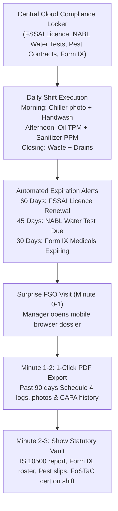

# Food Safety, FSSAI Compliance, Cold Chain & HACCP/GMP Knowledge Base

## 0. Module Scope & Source Inventory

* **Priority Tier:** P1 — Primary ICP Focus (Food Safety, FSSAI, Cold Chain & HACCP/GMP)
* **Narrative Anchor:** *"You can't be everywhere."* Multi-outlet founders, quality heads, and operations directors cannot inspect every kitchen, cold room, or retail display case daily. Audiment replaces paper clipboards and WhatsApp reporting with proof-backed digital inspections, live camera verification, and tracked corrective actions.
* **Target Personas:**
  * QSR, Casual Dining & Cloud Kitchen Founders / Operations Heads
  * Mithai, Bakery & Ice Cream Parlour Chain Operators
  * Quality Assurance (QA), Food Safety & FoSTaC Leads
  * Cold Storage, Reefer 3PL & Supermarket Cold-Chain Directors
  * Hospital, School & Corporate Contract Catering Heads
  * Food Processing Plant QA & GMP Compliance Managers

### Complete Source Inventory

This Knowledge Base synthesizes **18 standalone blogs** and **7 routed sections from 6 cross-module blogs** (**24 unique source URLs** total):

| # | Type | Source Title & Slug | Canonical URL | Category / Primary Mod | Standards Referenced |
| :--- | :--- | :--- | :--- | :--- | :--- |
| 1 | Standalone | [Digital FSSAI Hygiene Checklist with Photo Evidence (Free Template Included)](https://audiment.in/blog/digital-fssai-hygiene-checklist-with-photo-evidence-free-template) | `https://audiment.in/blog/digital-fssai-hygiene-checklist-with-photo-evidence-free-template` | Food Safety | FSSAI, FSSAI Schedule 4 |
| 2 | Standalone | [Food Safety Audit Software for Catering Units Serving Hospitals and Schools](https://audiment.in/blog/food-safety-audit-software-for-catering-units-serving-hospitals) | `https://audiment.in/blog/food-safety-audit-software-for-catering-units-serving-hospitals` | Catering & Institutional Food | FSSAI, HACCP, NABH, JCI |
| 3 | Standalone | [Food Safety Compliance Software for Restaurants: What Indian Chains Need](https://audiment.in/blog/food-safety-compliance-software-restaurants) | `https://audiment.in/blog/food-safety-compliance-software-restaurants` | Compliance | FDA Food Code, FSSAI, HACCP |
| 4 | Standalone | [Freezer Temperature and Cleanliness Audits for Ice Cream Parlour Chains](https://audiment.in/blog/freezer-temperature-and-cleanliness-audits-for-ice-cream-parlour-chains) | `https://audiment.in/blog/freezer-temperature-and-cleanliness-audits-for-ice-cream-parlour-chains` | Retail & Bakery Operations | FSSAI, Form IX, NABL |
| 5 | Standalone | [FSSAI Audit Software for Restaurants and Food Chains: What to Look For](https://audiment.in/blog/fssai-audit-software-for-restaurants-and-food-chains-what-to-look) | `https://audiment.in/blog/fssai-audit-software-for-restaurants-and-food-chains-what-to-look` | Food Safety | FSSAI, FSSAI Schedule 4, FoSCoS, FoSTaC, Form IX, HACCP, IS 10500, NABL |
| 6 | Standalone | [FSSAI compliance for multi-outlet restaurants](https://audiment.in/blog/fssai-compliance-guide) | `https://audiment.in/blog/fssai-compliance-guide` | Compliance | FSSAI, FSSAI Schedule 4, FoSCoS |
| 7 | Standalone | [How to Audit Cold Storage Temperature Compliance Across Facilities](https://audiment.in/blog/how-to-audit-cold-storage-temperature-compliance-across-facilities) | `https://audiment.in/blog/how-to-audit-cold-storage-temperature-compliance-across-facilities` | Logistics & Warehousing | NABL, ISO 17025 |
| 8 | Standalone | [How to Check Expiry Date Compliance on Shelves Across All Stores](https://audiment.in/blog/how-to-check-expiry-date-compliance-on-shelves-across-all-stores) | `https://audiment.in/blog/how-to-check-expiry-date-compliance-on-shelves-across-all-stores` | Retail Operations | FSSAI |
| 9 | Standalone | [How to Digitise HACCP Checklists for Restaurant Chains](https://audiment.in/blog/how-to-digitise-haccp-checklists-for-restaurant-chains) | `https://audiment.in/blog/how-to-digitise-haccp-checklists-for-restaurant-chains` | Food Safety | FSSAI, HACCP, ISO 22000 |
| 10 | Standalone | [How to Get Automatic Alerts When a Temperature Log Is Skipped](https://audiment.in/blog/how-to-get-automatic-alerts-when-a-temperature-log-is-skipped) | `https://audiment.in/blog/how-to-get-automatic-alerts-when-a-temperature-log-is-skipped` | Logistics & Warehousing | FSSAI, NIST |
| 11 | Standalone | [How to Handle Local Food Safety Rules in Audit Templates Across Countries](https://audiment.in/blog/how-to-handle-local-food-safety-rules-in-audit-templates) | `https://audiment.in/blog/how-to-handle-local-food-safety-rules-in-audit-templates` | International & Regional Operations | FDA, FSSAI, FSSAI Schedule 4, FSA, HACCP |
| 12 | Standalone | [How to Keep FSSAI Inspection Records Ready at Every Outlet, All the Time](https://audiment.in/blog/how-to-keep-fssai-inspection-records-ready-at-every-outlet-all-the-time) | `https://audiment.in/blog/how-to-keep-fssai-inspection-records-ready-at-every-outlet-all-the-time` | Food Safety | FSSAI, FSSAI Schedule 4, FoSCoS, FoSTaC, Form IX, IS 10500, NABL |
| 13 | Standalone | [How to Prove Cold Chain Compliance to Retail Clients](https://audiment.in/blog/how-to-prove-cold-chain-compliance-to-retail-clients) | `https://audiment.in/blog/how-to-prove-cold-chain-compliance-to-retail-clients` | Logistics & Warehousing | HACCP, NABL, ISO 17025 |
| 14 | Standalone | [How to Prove Hygiene Compliance to Corporate Clients at Each Canteen](https://audiment.in/blog/how-to-prove-hygiene-compliance-to-corporate-clients-at-each-canteen) | `https://audiment.in/blog/how-to-prove-hygiene-compliance-to-corporate-clients-at-each-canteen` | Catering & Institutional Food | FSSAI Schedule 4, BIS/IS 10500, NABL |
| 15 | Standalone | [How to Run GMP Audits Across Food Processing Units](https://audiment.in/blog/how-to-run-gmp-audits-across-food-processing-units) | `https://audiment.in/blog/how-to-run-gmp-audits-across-food-processing-units` | Manufacturing | FDA 21 CFR Part 117, FSSAI Schedule 4, GMP, HACCP, BRCGS Issue 9, FSSC 22000 |
| 16 | Standalone | [How to Show Timestamped Audit Records to an FSSAI Inspector in Minutes](https://audiment.in/blog/how-to-show-timestamped-audit-records-to-an-fssai-inspector-in-minutes) | `https://audiment.in/blog/how-to-show-timestamped-audit-records-to-an-fssai-inspector-in-minutes` | Food Safety | FSSAI, FoSTaC, Form IX, IS 10500, NABL |
| 17 | Standalone | [How to Track Cold Chain and Freezer Temperature Compliance Across Supermarkets](https://audiment.in/blog/how-to-track-cold-chain-and-freezer-temperature-compliance) | `https://audiment.in/blog/how-to-track-cold-chain-and-freezer-temperature-compliance` | Retail Operations | FSSAI |
| 18 | Standalone | [How to Track Shelf Life and Expiry Compliance in Bakery Outlets](https://audiment.in/blog/how-to-track-shelf-life-and-expiry-compliance-in-bakery-outlets) | `https://audiment.in/blog/how-to-track-shelf-life-and-expiry-compliance-in-bakery-outlets` | Retail & Bakery Operations | FSSAI (Section 59) |
| 19 | Routed | [GoAudits Alternative for Indian Restaurant Chains](https://audiment.in/blog/goaudits-alternative-for-indian-restaurant-chains) — *How Does FSSAI Compliance Differ from General Hospitality Auditing?* | `https://audiment.in/blog/goaudits-alternative-for-indian-restaurant-chains` | Primary Mod 09 | FDA, FSSAI, FSSAI Schedule 4, FoSTaC, NABL |
| 20 | Routed (2) | [How to Audit Cloud Kitchen Hygiene When There's No Customer-Facing Area to Inspect](https://audiment.in/blog/how-to-audit-cloud-kitchen-hygiene-when-theres-no-customer-facing-area) — *Enforcing Chemical Sanitizer & Cold Chain Compliance* + *Preparing Dark Kitchens for Aggregator & FSSAI Inspections* | `https://audiment.in/blog/how-to-audit-cloud-kitchen-hygiene-when-theres-no-customer-facing-area` | Primary Mod 05 | FSSAI, FoSTaC |
| 21 | Routed | [How to Maintain Consistent Hygiene Across Sweet Shop Outlets](https://audiment.in/blog/how-to-maintain-consistent-hygiene-across-sweet-shop-outlets) — *Enforcing FSSAI "Best Before Date" Labelling on Loose Sweets* | `https://audiment.in/blog/how-to-maintain-consistent-hygiene-across-sweet-shop-outlets` | Primary Mod 05 | FSSAI (Order dated 25 Sep 2020), FSSAI Schedule 4, Form IX, NABL |
| 22 | Routed | [How to Run Shift-by-Shift Hygiene Checks Across 50 QSR Outlets Without Hiring More Auditors](https://audiment.in/blog/how-to-run-shift-by-shift-hygiene-checks-across-50-qsr-outlets) — *FSSAI Schedule 4 Compliance: Keeping 50 Branches Inspection-Ready Every Day* | `https://audiment.in/blog/how-to-run-shift-by-shift-hygiene-checks-across-50-qsr-outlets` | Primary Mod 05 | FSSAI, FSSAI Schedule 4, HACCP |
| 23 | Routed | [Restaurant, Hotel & Industry Inspection Checklists](https://audiment.in/blog/restaurant-hotel-industry-inspection-checklists) — *How should restaurant inspection checklists handle temperature checks?* | `https://audiment.in/blog/restaurant-hotel-industry-inspection-checklists` | Primary Mod 05 | FSSAI |
| 24 | Routed | [SafetyCulture Alternative for Indian Multi-Location Businesses](https://audiment.in/blog/safetyculture-alternative-for-indian-multi-location-businesses) — *How Does Local Compliance Like FSSAI Differ from Global Safety Standards?* | `https://audiment.in/blog/safetyculture-alternative-for-indian-multi-location-businesses` | Primary Mod 09 | FSSAI, FSSAI Schedule 4, ISO 45001, OSHA |

---

## 1. Why Paper Checklists & Self-Reporting Fail at Multi-Outlet Scale

At one restaurant or store, a founder spots weak hygiene immediately. At 10, 20, or 50 locations, direct sight disappears and headquarters becomes dependent on local self-reporting—which is structurally unreliable because branch managers face pressure to show smooth operations and avoid escalation ([food-safety-compliance-software-restaurants](https://audiment.in/blog/food-safety-compliance-software-restaurants)).

### Operational Failure Modes of Paper & Trust-Based Logs

1. **Unverifiable Checkmarks & "Flatline" Logs:** A pen mark in a box proves only that ink touched paper—not that a walk-in chiller held 3°C, frying oil tested under 25% TPM, or handwash sinks held soap ([digital-fssai-hygiene-checklist-with-photo-evidence-free-template](https://audiment.in/blog/digital-fssai-hygiene-checklist-with-photo-evidence-free-template)). In supermarkets and cold rooms, paper sheets show identical "flatline" entries (e.g., `3.0°C` at 09:00, 14:00, and 20:00 for 90 days), which inspectors recognize immediately because real chillers fluctuate during defrost cycles and door openings ([how-to-track-cold-chain-and-freezer-temperature-compliance](https://audiment.in/blog/how-to-track-cold-chain-and-freezer-temperature-compliance), [how-to-keep-fssai-inspection-records-ready-at-every-outlet-all-the-time](https://audiment.in/blog/how-to-keep-fssai-inspection-records-ready-at-every-outlet-all-the-time)).
2. **Retrospective Backdating & Delegated Completion:** Line cooks and supervisors fill in 8:00 AM, 10:00 AM, and 12:00 PM temperature slots at 3:00 PM or 4:00 PM from memory, or fill two weeks of blank sheets in 10 minutes before an area manager arrives ([digital-fssai-hygiene-checklist-with-photo-evidence-free-template](https://audiment.in/blog/digital-fssai-hygiene-checklist-with-photo-evidence-free-template), [how-to-digitise-haccp-checklists-for-restaurant-chains](https://audiment.in/blog/how-to-digitise-haccp-checklists-for-restaurant-chains), [how-to-prove-hygiene-compliance-to-corporate-clients-at-each-canteen](https://audiment.in/blog/how-to-prove-hygiene-compliance-to-corporate-clients-at-each-canteen)). Managers also delegate checklists to junior staff who copy last week's entries ([fssai-compliance-guide](https://audiment.in/blog/fssai-compliance-guide)).
3. **Inspection-Window Cleanup:** Outlets deep-clean in the 48 hours before an expected quarterly visit or after a rival is raided; standards vanish outside that window ([fssai-compliance-guide](https://audiment.in/blog/fssai-compliance-guide)).
4. **Ad-Hoc WhatsApp Photo Loops:** Managers send head office photos taken last month, at another branch, or cropped to hide grime behind ranges ([fssai-compliance-guide](https://audiment.in/blog/fssai-compliance-guide), [how-to-prove-hygiene-compliance-to-corporate-clients-at-each-canteen](https://audiment.in/blog/how-to-prove-hygiene-compliance-to-corporate-clients-at-each-canteen)).
5. **Silent Failure Accumulation & Nullified Insurance:** When a compressor trips at 10:00 AM or 14:15 PM and afternoon checks are skipped, cold rooms climb to 14°C before anyone notices ([how-to-get-automatic-alerts-when-a-temperature-log-is-skipped](https://audiment.in/blog/how-to-get-automatic-alerts-when-a-temperature-log-is-skipped), [how-to-track-cold-chain-and-freezer-temperature-compliance](https://audiment.in/blog/how-to-track-cold-chain-and-freezer-temperature-compliance)). Insurers require unbroken timestamped logs to settle multi-lakh spoilage claims; a 6-hour gap gives underwriters legal grounds to reject payouts ([how-to-get-automatic-alerts-when-a-temperature-log-is-skipped](https://audiment.in/blog/how-to-get-automatic-alerts-when-a-temperature-log-is-skipped)).
6. **Physical Degradation, Head-Office Silos & Turnover Amnesia:** Prep-counter registers absorb grease and moisture, tear, or go missing ([digital-fssai-hygiene-checklist-with-photo-evidence-free-template](https://audiment.in/blog/digital-fssai-hygiene-checklist-with-photo-evidence-free-template), [how-to-keep-fssai-inspection-records-ready-at-every-outlet-all-the-time](https://audiment.in/blog/how-to-keep-fssai-inspection-records-ready-at-every-outlet-all-the-time)). Pest contracts and water reports sit in head-office filing cabinets, and outgoing managers take binder locations with them ([how-to-keep-fssai-inspection-records-ready-at-every-outlet-all-the-time](https://audiment.in/blog/how-to-keep-fssai-inspection-records-ready-at-every-outlet-all-the-time)).

### Paper vs. Generic Forms vs. Proof-Based Digital Audits

| Capability | Paper Checklists | Generic Forms App | Proof-Based Digital Audit |
| :--- | :--- | :--- | :--- |
| **Proof of physical presence** | None | GPS only (easily spoofed) | Geo-tagged live photo + immutable UTC server timestamp |
| **Cold storage temperature proof** | Handwritten log | Text entry (allows `"OK"` / `"Cold"`) | Numeric decimal gate + live display/probe photo |
| **Corrective action tracking** | Post-it note or group chat | Manual email | Automated SLA (2h / 24h / 48h) with after-fix photo |
| **FSSAI inspection-ready report** | Folder of papers | Manual PDF export | Automated 1-click 90-day PDF dossier per branch |
| **Cross-branch trend tracking** | Monthly spreadsheet | Self-reported dashboard | Real-time, evidence-backed weighted severity scoring |
| **Tamper resistance** | None (backdated easily) | Low (gallery uploads allowed) | High (gallery uploads disabled, Exif + server timestamp) |

*(Source: [fssai-compliance-guide](https://audiment.in/blog/fssai-compliance-guide), [how-to-track-cold-chain-and-freezer-temperature-compliance](https://audiment.in/blog/how-to-track-cold-chain-and-freezer-temperature-compliance))*

### How Checklist Temperature Questions Must Be Structured

Never write vague binary questions like `"Temperature okay?"`. Every thermal checklist item must define six fields ([restaurant-hotel-industry-inspection-checklists](https://audiment.in/blog/restaurant-hotel-industry-inspection-checklists)):

1. **Item:** Exact asset (e.g., Walk-In Chiller #1, Dairy Multideck #2).
2. **Measurement:** Core product temp vs. ambient cabinet air temp.
3. **Requirement:** Exact acceptable range tied to the food, equipment, and statutory standard (never copy generic numbers across categories).
4. **Result:** Numeric decimal input (`3.2`), rejecting non-numeric text ([how-to-track-cold-chain-and-freezer-temperature-compliance](https://audiment.in/blog/how-to-track-cold-chain-and-freezer-temperature-compliance)).
5. **Failure:** Explicit triggered response/CAPA when out of range.
6. **Evidence:** Live camera photo of thermometer display or Bluetooth probe sync.

---

## 2. FSSAI Statutory Compliance Dossier & Surprise Inspection Playbook

### 2.1 FoSCoS Licensing Tiers

Under the FSSAI Food Safety Compliance System ([FoSCoS](https://foscos.fssai.gov.in/)), businesses require a valid 14-digit licence renewed annually; non-renewal after the grace period triggers statutory penalties ([fssai-compliance-guide](https://audiment.in/blog/fssai-compliance-guide), [how-to-keep-fssai-inspection-records-ready-at-every-outlet-all-the-time](https://audiment.in/blog/how-to-keep-fssai-inspection-records-ready-at-every-outlet-all-the-time)):

| License Tier | Applicable Businesses | Annual Turnover Threshold |
| :--- | :--- | :--- |
| **Basic Registration** | Petty food businesses, home kitchens | Below ₹12 lakh |
| **State License** | Small to mid-sized food businesses | ₹12 lakh to ₹20 crore |
| **Central License** | Large chains, importers, exporters, multi-state operations | Above ₹20 crore or operating in >1 state |

*(Source: [fssai-compliance-guide](https://audiment.in/blog/fssai-compliance-guide))*

### 2.2 FSSAI Schedule 4 Five Statutory Pillars (Food Safety and Standards Act, 2006 — Part II)

1. **Premises & Facility Design (Part II, Section 1):** Separation of prep areas from external contamination, smooth washable walls, stainless steel food-contact surfaces, commercial kitchen ventilation, functional insect light traps (ILTs), and sealed external door sweeps ([fssai-audit-software-for-restaurants-and-food-chains-what-to-look](https://audiment.in/blog/fssai-audit-software-for-restaurants-and-food-chains-what-to-look), [goaudits-alternative-for-indian-restaurant-chains](https://audiment.in/blog/goaudits-alternative-for-indian-restaurant-chains)).
2. **Equipment & Temperature Controls (Part II, Section 2):** Cold storage `< 4°C` (`<= 5°C` cold holding for dairy/poultry/sauces), freezers `<= -18°C`, hot holding `>= 60°C` (`>= 65°C` in FSSAI/canteen tables), and daily frying oil Total Polar Materials (TPM) under **25%** ([fssai-audit-software-for-restaurants-and-food-chains-what-to-look](https://audiment.in/blog/fssai-audit-software-for-restaurants-and-food-chains-what-to-look), [goaudits-alternative-for-indian-restaurant-chains](https://audiment.in/blog/goaudits-alternative-for-indian-restaurant-chains)).
3. **Food Handler Grooming & Medical Fitness (Part II, Section 3):** Signed **Form IX** medical fitness certificates for all cooks/servers/dishwashers, daily screening for cuts/skin lesions/respiratory or gastrointestinal symptoms, clean aprons, hairnets, and beard nets ([fssai-audit-software-for-restaurants-and-food-chains-what-to-look](https://audiment.in/blog/fssai-audit-software-for-restaurants-and-food-chains-what-to-look), [how-to-keep-fssai-inspection-records-ready-at-every-outlet-all-the-time](https://audiment.in/blog/how-to-keep-fssai-inspection-records-ready-at-every-outlet-all-the-time)).
4. **Water Quality & Pest Control (Part II, Section 4):** Biannual potable water testing under **IS 10500** from **NABL-accredited** labs (for cooking water and ice machines), monthly licensed pest management logs, and foot-operated covered waste bins ([fssai-audit-software-for-restaurants-and-food-chains-what-to-look](https://audiment.in/blog/fssai-audit-software-for-restaurants-and-food-chains-what-to-look), [goaudits-alternative-for-indian-restaurant-chains](https://audiment.in/blog/goaudits-alternative-for-indian-restaurant-chains)).
5. **Traceability & Recall Records (Part II, Section 5):** Batch manufacturing records, supplier FSSAI licence verifications, and FIFO day-dot prep labelling ([fssai-audit-software-for-restaurants-and-food-chains-what-to-look](https://audiment.in/blog/fssai-audit-software-for-restaurants-and-food-chains-what-to-look)).

### 2.3 The 7 Mandatory FSSAI On-Premises Records

| Statutory Record | Mandatory Standard & Renewal Cadence | Mandated Retention | Common Compliance Failure |
| :--- | :--- | :--- | :--- |
| **1. FSSAI Licence Display** | Active 14-digit licence with QR code framed at customer entrance matching physical kitchen address/layout | Current validity (1 to 5 years) | Expired licence or outlet address mismatch |
| **2. NABL Water Test Report** | Chemical & microbiological potability analysis under **IS 10500** by an NABL-accredited lab (**every 6 months / 180 days**; zero coliforms). Canteens also log daily RO TDS & free residual chlorine (`0.2–0.5 ppm`) | 1 year | Report > 6 months old or from non-NABL lab |
| **3. Medical Fitness (Form IX)** | Signed by a registered medical practitioner confirming staff are vaccinated for Typhoid (Ty2) and free from skin infections, TB, and contagious GI/enteric pathogens (**renewed annually**) | 1 year | New hires (dishwashers/prep cooks) missing slips; departed staff unarchived |
| **4. Pest Control Service Slips** | Active annual service contract + **monthly** signed treatment logs from licensed PCO agency | 1 year | Slips lost behind counters or stored only at head office |
| **5. Cold Chain Temperature Logs** | Twice-daily (or 3x-daily) logs for chillers (`1°C–4°C`) and deep freezers (`<= -18°C`) | 1 year | Blank sheets or identical-ink backdated entries |
| **6. Frying Oil TPM Register** | Daily Total Polar Materials reading (`< 25% TPM`) tested in hot oil (`150°C–180°C`) using calibrated digital meter (e.g., Testo 270) or certified strips; disposed oil stained with blue food dye | 1 year | No daily log; oil used until blackened/rancid |
| **7. FoSTaC Supervisor Certificate** | At least **1 certified Food Safety Supervisor per 25 food handlers**, present on active shift | **2 years** (cert validity) | Certified supervisor resigned, leaving shifts uncovered |

*(Sources: [how-to-keep-fssai-inspection-records-ready-at-every-outlet-all-the-time](https://audiment.in/blog/how-to-keep-fssai-inspection-records-ready-at-every-outlet-all-the-time), [digital-fssai-hygiene-checklist-with-photo-evidence-free-template](https://audiment.in/blog/digital-fssai-hygiene-checklist-with-photo-evidence-free-template), [fssai-audit-software-for-restaurants-and-food-chains-what-to-look](https://audiment.in/blog/fssai-audit-software-for-restaurants-and-food-chains-what-to-look), [how-to-prove-hygiene-compliance-to-corporate-clients-at-each-canteen](https://audiment.in/blog/how-to-prove-hygiene-compliance-to-corporate-clients-at-each-canteen), [goaudits-alternative-for-indian-restaurant-chains](https://audiment.in/blog/goaudits-alternative-for-indian-restaurant-chains))*

### 2.4 Statutory Penalties & Enforcement Provisions (FSS Act, 2006)

* **Minor Violations:** Fines starting at **₹25,000** ([fssai-compliance-guide](https://audiment.in/blog/fssai-compliance-guide)).
* **Section 32 (Improvement Notice):** Issued for operational or documentation gaps, specifying deficiencies and a mandatory rectification window (typically **14 days**) ([fssai-audit-software-for-restaurants-and-food-chains-what-to-look](https://audiment.in/blog/fssai-audit-software-for-restaurants-and-food-chains-what-to-look), [how-to-keep-fssai-inspection-records-ready-at-every-outlet-all-the-time](https://audiment.in/blog/how-to-keep-fssai-inspection-records-ready-at-every-outlet-all-the-time)).
* **Section 34 (Emergency Prohibition Notice):** Immediate outlet shutdown if the Food Safety Officer (FSO) finds active sewage leakage into prep lines, widespread pest infestation, or heavily contaminated food ([how-to-show-timestamped-audit-records-to-an-fssai-inspector-in-minutes](https://audiment.in/blog/how-to-show-timestamped-audit-records-to-an-fssai-inspector-in-minutes)).
* **Sections 51, 56 & 58:** Monetary fines up to **₹5 lakh** per outlet for sub-standard/unhygienic food or operating without a valid licence, plus licence cancellation ([fssai-audit-software-for-restaurants-and-food-chains-what-to-look](https://audiment.in/blog/fssai-audit-software-for-restaurants-and-food-chains-what-to-look), [fssai-compliance-guide](https://audiment.in/blog/fssai-compliance-guide)).
* **Section 59:** Selling expired or unsafe food posing human health risk carries fines up to **₹5 lakh** and imprisonment from **6 months up to life imprisonment** depending on harm severity ([how-to-track-shelf-life-and-expiry-compliance-in-bakery-outlets](https://audiment.in/blog/how-to-track-shelf-life-and-expiry-compliance-in-bakery-outlets)).
* **Inspection Triggers:** Inspections are unannounced; complaint-triggered FSO inspections can occur within **48 hours** of a consumer report ([fssai-compliance-guide](https://audiment.in/blog/fssai-compliance-guide)).

### 2.5 Complete 10-Point FSSAI Schedule 4 Digital Hygiene Checklist Template

| Checklist Item | FSSAI Schedule 4 Standard | Mandatory Photo Proof Requirement | Acceptable Tolerance |
| :--- | :--- | :--- | :--- |
| **1. Staff Grooming & Uniforms** | Clean aprons, hairnets, and beard nets; zero hand/wrist jewellery; trimmed nails; no open cuts/illness | Wide-angle live photo of kitchen crew during morning muster | 100% compliance; zero exposed hair or jewellery |
| **2. Handwash Station Stock** | Dedicated unobstructed sink, warm running water, antibacterial liquid soap, single-use paper towels | Live photo showing clear basin, filled soap dispenser, towel supply | Zero dishes or prep pans stored inside handwash basin |
| **3. Cold Storage Chillers** | Walk-in chillers and reach-in undercounter fridges holding raw proteins and dairy | Live photo of internal calibrated digital thermometer display | **1°C to 4°C** (automatic CAPA if `> 4°C`) |
| **4. Deep Freezer Integrity** | Commercial deep freezers holding pre-frozen proteins, ice cream, prepped bases | Live photo of freezer temperature gauge readout | **-18°C or colder** (zero frost buildup on packaging) |
| **5. Cooking Oil TPM Quality** | Total Polar Materials (TPM) monitored daily before lunch and dinner frying shifts | Live photo of digital oil tester (e.g., Testo 270) or certified comparator strip | **< 25% TPM** (statutory FSSAI ceiling) |
| **6. Raw vs. Cooked Separation** | Raw meats/eggs and ready-to-eat foods on separate shelves in colour-coded covered containers | Photo of walk-in shelving showing raw chicken on bottom shelf | Zero direct or drip contact between raw proteins and cooked food |
| **7. Chemical Sanitizer Titration** | Active surface sanitizer buckets maintained at prep lines and warewashing sinks | Photo of chemical test strip held beside manufacturer PPM colour chart | **Quat: 200 PPM** (replace if `< 150 PPM`) / **Chlorine: 50–100 PPM** (warm water, not hot) |
| **8. FIFO Prep Pan Labelling** | Every prepped pan has a legible day-dot label with item name, prep date, and discard time | Close-up photo of prep station tubs showing clear date-coding tags | Zero unlabelled or expired containers on prep lines |
| **9. Pest Exclusion Barriers** | Operational ILTs, secured drain covers, exterior doors fitted with rubber sweep seals | Photo of clean insect glue board and tightly sealed external door base | Zero visible gaps **> 2mm** under external doors |
| **10. Waste Management** | Lined kitchen bins with foot-operated lids, emptied before overflow, washed daily | Photo of emptied, clean kitchen waste containers at closing | Zero organic waste left inside kitchen overnight |

*(Sources: [digital-fssai-hygiene-checklist-with-photo-evidence-free-template](https://audiment.in/blog/digital-fssai-hygiene-checklist-with-photo-evidence-free-template), [how-to-audit-cloud-kitchen-hygiene-when-theres-no-customer-facing-area](https://audiment.in/blog/how-to-audit-cloud-kitchen-hygiene-when-theres-no-customer-facing-area), [how-to-run-shift-by-shift-hygiene-checks-across-50-qsr-outlets](https://audiment.in/blog/how-to-run-shift-by-shift-hygiene-checks-across-50-qsr-outlets))*

### 2.6 Perpetual Compliance Engine & 2-Minute FSO Inspection Playbook

* **5-Minute Internal Readiness Audit (Area Coach):** (1) Verify framed 14-digit FSSAI licence & QR at entrance; (2) Check 30-day digital temp dashboard for gaps or `> 4°C` excursions; (3) Cross-reference live kitchen roster (including new dishwashers) against Form IX slips; (4) Confirm NABL water report is `< 180 days` old with zero coliforms; (5) Confirm all prior-week CAPAs closed with after-fix photos within 48h ([how-to-keep-fssai-inspection-records-ready-at-every-outlet-all-the-time](https://audiment.in/blog/how-to-keep-fssai-inspection-records-ready-at-every-outlet-all-the-time)).
* **Quarterly Mock Drill:** Area coach times the store manager (*"You have 3 minutes to produce the water report, yesterday's oil log, and the pest slip"*); `> 3 minutes` triggers immediate retraining ([how-to-keep-fssai-inspection-records-ready-at-every-outlet-all-the-time](https://audiment.in/blog/how-to-keep-fssai-inspection-records-ready-at-every-outlet-all-the-time)).
* **If an FSO Flags a Minor Defect:** Do not argue. Photograph the defect (e.g., damaged gasket or unsealed drain) live in front of the officer, auto-generate a **24–48 hour SLA CAPA ticket**, dispatch the technician, and submit the closed ticket with after-fix photo and repair invoice to the regulatory department ([how-to-show-timestamped-audit-records-to-an-fssai-inspector-in-minutes](https://audiment.in/blog/how-to-show-timestamped-audit-records-to-an-fssai-inspector-in-minutes)).
* **Digital Legal Validity:** FSSAI recognizes and encourages digital records via FoSCoS; server-timestamped, geo-tagged logs with live photos carry stronger evidentiary reliability than paper ([fssai-audit-software-for-restaurants-and-food-chains-what-to-look](https://audiment.in/blog/fssai-audit-software-for-restaurants-and-food-chains-what-to-look), [how-to-show-timestamped-audit-records-to-an-fssai-inspector-in-minutes](https://audiment.in/blog/how-to-show-timestamped-audit-records-to-an-fssai-inspector-in-minutes)). Records remain accessible offline in basement kitchens without cellular reception ([how-to-show-timestamped-audit-records-to-an-fssai-inspector-in-minutes](https://audiment.in/blog/how-to-show-timestamped-audit-records-to-an-fssai-inspector-in-minutes)).

### 2.7 Swiggy, Zomato & Third-Party Hygiene Rating Readiness

* **Statutory vs. Voluntary Hygiene Rating Audits:** Government FSOs conduct statutory checks for legal minimums, whereas **FSSAI-empaneled third-party auditing agencies** conduct voluntary assessments under the **Hygiene Rating Scheme** (1-to-5 star storefront/platform rating) ([fssai-audit-software-for-restaurants-and-food-chains-what-to-look](https://audiment.in/blog/fssai-audit-software-for-restaurants-and-food-chains-what-to-look)).
* **Cloud Kitchens & Aggregator Badges:** Dark kitchens face regular inspections from both FSOs and third-party auditing agencies appointed by **Swiggy and Zomato**. High audit scores unlock **"Hygiene Verified"** or **"5-Star Food Safety"** badges on Swiggy and Zomato, directly lifting delivery conversion rates—requiring centralized mobile access to daily hygiene logs, NABL water certificates, pest control slips, and active shift FoSTaC records ([how-to-audit-cloud-kitchen-hygiene-when-theres-no-customer-facing-area](https://audiment.in/blog/how-to-audit-cloud-kitchen-hygiene-when-theres-no-customer-facing-area)). *(For the full 6-document Swiggy/Zomato aggregator dossier, complaint-keyword triggers, tamper-evident dispatch protocol, and 24-hour de-listing reinstatement workflow, see [05-qsr-restaurant-cloud-kitchen-and-bakery-ops.md](file:///Users/sanskar/Documents/Asellus/Audiment/docs/knowledge-base/05-qsr-restaurant-cloud-kitchen-and-bakery-ops.md) and [how-to-prove-food-safety-compliance-to-swiggy-and-zomato](https://audiment.in/blog/how-to-prove-food-safety-compliance-to-swiggy-and-zomato).)*

---

## 3. Cold Chain, Freezer & Temperature Compliance Engineering

### 3.1 Master Cold Chain & Thermal Threshold Matrix

| Asset / Equipment Category | Target Operating Range | Warning / Auto-Fail Trigger | Critical Breach & Quarantine Action | Max Excursion Window | Measurement & Calibration Standard |
| :--- | :--- | :--- | :--- | :--- | :--- |
| **Ultra-Low Freezers (Biologics/Plasma)** | `-75°C to -86°C` | Warns `> -70°C` | `> -65°C`: Immediate dry ice injection & backup transfer | 15 mins max | Dual calibrated Pt100 RTD probes (NIST cert) |
| **Blast Freezers (Shock Cooling)** | `-35°C to -40°C` | — | Warmer than `-30°C` during active cycle | Immediate | Calibrated multi-channel logger |
| **Deep Storage Freezers (Meat, IQF, Bulk Ice Cream)** | `-18°C to -25°C` (`-20°C to -25°C` bulk ice cream) | Warns `> -15°C` | `> -12°C`: Stop outbound loading; 2h compressor check (`24h` CAPA in parlours; never re-freeze melted ice cream `> -10°C`) | 45 mins max (`> 30 min` action) | Type-T thermocouple penetration probe & digital display |
| **Ice Cream Front Dipping Cabinets** | `-14°C to -16°C` | `> -12°C` during rush; `< -18°C` too hard to scoop | `> -10°C`: Heat shock melt; discard if dairy `> 4°C` | Immediate | Calibrated internal gauge display + frost `< 5mm` |
| **Fresh Seafood Display Beds** | `0.0°C to 2.0°C` (deep clean flake ice) | `> 2.0°C` | Replenish flake ice immediately | Immediate | Calibrated needle probe |
| **Fresh Meat & Poultry Cases / Walk-Ins** | `0.0°C to 2.0°C` | `> 3.0°C` (display) / `> 4.0°C` (walk-in) | Reject incoming raw meat if core `> 4°C`; poultry receiving target `< 2°C` | Immediate | Calibrated needle penetration probe |
| **Walk-In Chillers & Dairy Multidecks** | `1.0°C to 4.0°C` (`2°C–4°C` dairy/deli) | Warns `> 4.5°C`; Fail `> 5.0°C` | `> 7.0°C`: Red hold tag; discard opened deli/stock held `> 5°C` for `> 2 hours` | 30 mins max | Calibrated air thermistor & liquid glycol buffer vial |
| **Pharma Cool Chambers (Vaccines)** | `2.0°C to 8.0°C` | Outside `2.5°C–7.5°C` | `< 1.5°C` or `> 8.5°C`: Quarantine entire lot | **0 mins (Zero Tolerance)** | Continuous data logger + Haynes MKT calculation |
| **Ripening & Produce Chambers** | `8°C–12°C` (retail) / `10°C–14°C` (ripening) | Outside `9.0°C–15.0°C` | `> 18.0°C`: Accelerated decay warning | 120 mins | Wall sensor + Relative Humidity (RH) probe |
| **Controlled Ambient / Bread Display** | `15°C to 25°C` (`< 24°C` bread) | `> 25°C` or `RH > 60%–65%` | Relocate heat-sensitive stock (chocolates, dry APIs) | — | Ambient digital thermometer + hygrometer |

*(Sources: [how-to-get-automatic-alerts-when-a-temperature-log-is-skipped](https://audiment.in/blog/how-to-get-automatic-alerts-when-a-temperature-log-is-skipped), [how-to-audit-cold-storage-temperature-compliance-across-facilities](https://audiment.in/blog/how-to-audit-cold-storage-temperature-compliance-across-facilities), [how-to-track-cold-chain-and-freezer-temperature-compliance](https://audiment.in/blog/how-to-track-cold-chain-and-freezer-temperature-compliance), [freezer-temperature-and-cleanliness-audits-for-ice-cream-parlour-chains](https://audiment.in/blog/freezer-temperature-and-cleanliness-audits-for-ice-cream-parlour-chains), [how-to-track-shelf-life-and-expiry-compliance-in-bakery-outlets](https://audiment.in/blog/how-to-track-shelf-life-and-expiry-compliance-in-bakery-outlets))*

### 3.2 Preventive Mechanical Audits & Ice Cream Parlour Controls

In **80%** of catastrophic refrigeration failures, compressors burn out from choked condenser coils, torn door gaskets, or iced evaporator coils ([how-to-track-cold-chain-and-freezer-temperature-compliance](https://audiment.in/blog/how-to-track-cold-chain-and-freezer-temperature-compliance)).

* **Equipment Preventive Checklist:**
  * **Magnetic Gasket Dollar-Bill Test:** Slip a paper bill between gasket and frame; must resist pulling ([how-to-audit-cold-storage-temperature-compliance-across-facilities](https://audiment.in/blog/how-to-audit-cold-storage-temperature-compliance-across-facilities), [how-to-track-cold-chain-and-freezer-temperature-compliance](https://audiment.in/blog/how-to-track-cold-chain-and-freezer-temperature-compliance)).
  * **Condenser Coil Clearance:** Bi-weekly photo check confirming zero dust, lint, or stacked waffle-cone boxes blocking airflow ([freezer-temperature-and-cleanliness-audits-for-ice-cream-parlour-chains](https://audiment.in/blog/freezer-temperature-and-cleanliness-audits-for-ice-cream-parlour-chains), [how-to-track-cold-chain-and-freezer-temperature-compliance](https://audiment.in/blog/how-to-track-cold-chain-and-freezer-temperature-compliance)).
  * **Defrost & Frost Thickness:** Interior cabinet frost must stay **<= 5mm (quarter-inch)**; evaporator coils and defrost drain troughs clear of ice dams ([freezer-temperature-and-cleanliness-audits-for-ice-cream-parlour-chains](https://audiment.in/blog/freezer-temperature-and-cleanliness-audits-for-ice-cream-parlour-chains), [how-to-track-cold-chain-and-freezer-temperature-compliance](https://audiment.in/blog/how-to-track-cold-chain-and-freezer-temperature-compliance)).
  * **Multideck Load Limit Line & Strip Curtains:** Stock stacked strictly below the red "Load Limit Line" (overstocking warms front items to `10°C`); walk-in PVC strip curtains 100% overlapping ([how-to-audit-cold-storage-temperature-compliance-across-facilities](https://audiment.in/blog/how-to-audit-cold-storage-temperature-compliance-across-facilities), [how-to-track-cold-chain-and-freezer-temperature-compliance](https://audiment.in/blog/how-to-track-cold-chain-and-freezer-temperature-compliance)).
* **Ice Cream Heat Shock & Dipper Well Sanitation:**
  * Warming from `-16°C` to `-10°C` melts micro-crystals that re-freeze coarse and grainy ("heat shock") ([freezer-temperature-and-cleanliness-audits-for-ice-cream-parlour-chains](https://audiment.in/blog/freezer-temperature-and-cleanliness-audits-for-ice-cream-parlour-chains)).
  * Standing dipper wells are the **#1 bacterial hazard** (*Listeria monocytogenes*) in parlours. Require either **continuous freshwater flow** with unobstructed overflow drain, or in unplumbed kiosks **dry sanitized stainless steel pans** rotating freshly sanitized scoops every **60 minutes**, plus twice-daily **200 PPM quat** scrub verified by live photo ([freezer-temperature-and-cleanliness-audits-for-ice-cream-parlour-chains](https://audiment.in/blog/freezer-temperature-and-cleanliness-audits-for-ice-cream-parlour-chains)). Topping rail purees `< 4°C` with FIFO tags ([freezer-temperature-and-cleanliness-audits-for-ice-cream-parlour-chains](https://audiment.in/blog/freezer-temperature-and-cleanliness-audits-for-ice-cream-parlour-chains)).

### 3.3 Automated Missed-Log Alerts, Excursion Escalations & IoT Reconciliation

* **Missed-Log Cron Architecture:** Checks scheduled every **2 hours** (deep freezers/vaccines) or **4 hours** (chilled staging) with a **±15-minute completion buffer** (e.g., `09:45–10:15` for a `10:00` slot) and role-based (not person-based) shift inheritance. Cannot be snoozed or dismissed without live controller photo + reading ([how-to-get-automatic-alerts-when-a-temperature-log-is-skipped](https://audiment.in/blog/how-to-get-automatic-alerts-when-a-temperature-log-is-skipped)).

| Escalation Channel | Delivery Latency | Recipient | Typical Trigger |
| :--- | :--- | :--- | :--- |
| **Mobile Push Notification** | `< 5 seconds` | Floor Shift Supervisor | Check `10–16 mins` overdue |
| **Automated WhatsApp** | `< 10 seconds` | Warehouse Operations Lead | Check `20 mins` overdue |
| **Automated SMS** | `< 15 seconds` | Regional Quality Manager | Check `35 mins` overdue |
| **Twilio Voice Call Webhook** | Immediate | Emergency HVAC Technician | Breach unacknowledged `> 10 mins` |
| **Central Dashboard / Email** | Real-time / Daily | Control Tower / VP Operations | Any critical miss or daily completion digest |

*(Source: [how-to-get-automatic-alerts-when-a-temperature-log-is-skipped](https://audiment.in/blog/how-to-get-automatic-alerts-when-a-temperature-log-is-skipped))*

* **Temperature Excursion Escalation Timeline:**
  * **Minute 0:** Breach detected (e.g., freezer `-12°C` vs `-18°C` limit, or dairy multideck `6.8°C` vs `4.0°C`) → Push/SMS to Store/Facility Supervisor + emergency **2-hour SLA CAPA** (supermarkets) or immediate stock transfer ([how-to-audit-cold-storage-temperature-compliance-across-facilities](https://audiment.in/blog/how-to-audit-cold-storage-temperature-compliance-across-facilities), [how-to-track-cold-chain-and-freezer-temperature-compliance](https://audiment.in/blog/how-to-track-cold-chain-and-freezer-temperature-compliance)).
  * **Minute 20:** Unresolved → Automated SMS & voice call to Regional Maintenance Engineer.
  * **Minute 45:** Still rising → High-priority Operations Director alert ([how-to-audit-cold-storage-temperature-compliance-across-facilities](https://audiment.in/blog/how-to-audit-cold-storage-temperature-compliance-across-facilities)).
* **IoT Telemetry + Human Checklist Reconciliation:** Wall-mounted IoT probes streaming every **300 seconds (5 min)** can read `3.5°C` while blocked pallet airflow pushes corner food to `9°C`. Every **4 hours**, operators scan evaporator QR tags, insert a calibrated Bluetooth probe into a glycol simulator, photograph the Dixell/Carel/Eliwell LED controller, and inspect gaskets. Variance **`> ±0.5°C` to `1.5°C`** flags sensor calibration drift or a **"Thermal Airflow Inversion / Dead Zone"** ([how-to-audit-cold-storage-temperature-compliance-across-facilities](https://audiment.in/blog/how-to-audit-cold-storage-temperature-compliance-across-facilities), [how-to-get-automatic-alerts-when-a-temperature-log-is-skipped](https://audiment.in/blog/how-to-get-automatic-alerts-when-a-temperature-log-is-skipped), [how-to-track-cold-chain-and-freezer-temperature-compliance](https://audiment.in/blog/how-to-track-cold-chain-and-freezer-temperature-compliance)).
* **Calibration & MKT:** Controllers, loggers, and probes require annual **NABL or ISO 17025** calibration certificates ([how-to-audit-cold-storage-temperature-compliance-across-facilities](https://audiment.in/blog/how-to-audit-cold-storage-temperature-compliance-across-facilities), [how-to-prove-cold-chain-compliance-to-retail-clients](https://audiment.in/blog/how-to-prove-cold-chain-compliance-to-retail-clients)). Pharma vaults and multi-drop reefer routes apply the **Haynes Mean Kinetic Temperature (MKT)** formula to weight thermal excursions ([how-to-get-automatic-alerts-when-a-temperature-log-is-skipped](https://audiment.in/blog/how-to-get-automatic-alerts-when-a-temperature-log-is-skipped), [how-to-prove-cold-chain-compliance-to-retail-clients](https://audiment.in/blog/how-to-prove-cold-chain-compliance-to-retail-clients)).
* **Cold-Room KPIs:** **Thermal Stability Index** (% hours in spec), **Schedule / Checklist Adherence Rate** (top hubs `> 98%`), **Response Latency** (mins from alert to log), **CAPA Resolution Velocity**, **Repeat Excursion Ratio**, and **Sensor Drift Discrepancy Rate** ([how-to-audit-cold-storage-temperature-compliance-across-facilities](https://audiment.in/blog/how-to-audit-cold-storage-temperature-compliance-across-facilities), [how-to-get-automatic-alerts-when-a-temperature-log-is-skipped](https://audiment.in/blog/how-to-get-automatic-alerts-when-a-temperature-log-is-skipped)).

### 3.4 3PL & Retail Client Cold Chain Proof Standard

Retail DCs reject shipments over unverified reefer pre-cooling, handwritten sheets, `90-minute` ambient dock staging abuse, or dead USB logger batteries ([how-to-prove-cold-chain-compliance-to-retail-clients](https://audiment.in/blog/how-to-prove-cold-chain-compliance-to-retail-clients)).

| Milestone | Target Spec | Instrument & Proof | Rejection / Hold Rule |
| :--- | :--- | :--- | :--- |
| **1. Pre-Cooling Reefer** | Pre-cooled **45 mins** prior: `< 4°C` (chilled) or `-18°C` (frozen) | Wall air probe + live controller photo + floor drain check | Abort loading; run reefer 30 more mins |
| **2. Origin Dispatch Probe** | Dairy `< 4°C`, poultry `< 2°C` + thermal wrap & roof clearance | Penetration probe in core carton + pallet wrap photo + serialized door seal | Red-tag lot; return to cold storage |
| **3. In-Transit Telemetry** | Readings every **3–15 mins**; zero `> +2.0°C` excursions; door sensor clean | GPS/GSM logger or telematics curve (no gaps) | Retailer QA triggers 100% manual pallet probing |
| **4. Retail Dock Arrival** | Surface temp checked on door open (`< 20 mins` staging into cold bay) | Infrared laser pyrometer aimed at top & bottom pallets | If surface `> 6°C` (`> +2°C` above target), pause for core probe |
| **5. Receiving Acceptance** | 3 random cartons (front, middle, back) core-probed | Penetration needle probe photo in center-tier carton | Reject consignment with formal RTV manifest |

*(Source: [how-to-prove-cold-chain-compliance-to-retail-clients](https://audiment.in/blog/how-to-prove-cold-chain-compliance-to-retail-clients))*

* **Commercial Impact:** Drivers present a **QR-coded Inbound Compliance Dossier** on screen (verified in `15 seconds` at the dock), cutting DC dwell times by **up to 45 minutes/trip**, blocking unfair chargebacks, integrating via **REST API / ERP / WMS webhooks**, and earning **5%–8% contract rate premiums** ([how-to-prove-cold-chain-compliance-to-retail-clients](https://audiment.in/blog/how-to-prove-cold-chain-compliance-to-retail-clients)).

---

## 4. Digital HACCP, Institutional Catering & Corporate Canteens

### 4.1 Five Commercial Restaurant CCPs & Limits

A **Standard Operating Procedure (SOP)** covers general hygiene (wiping counters), whereas a **Critical Control Point (CCP)** is a specific stage that prevents, eliminates, or reduces a food safety hazard to a safe level ([how-to-digitise-haccp-checklists-for-restaurant-chains](https://audiment.in/blog/how-to-digitise-haccp-checklists-for-restaurant-chains)):

| Critical Control Point (CCP) | Target Pathogen / Hazard | Mandatory Critical Limit | Immediate Corrective Action |
| :--- | :--- | :--- | :--- |
| **CCP 1: Cold Storage & Receiving** | *Salmonella*, *Listeria* | Chillers: `1°C–4°C` / Freezers: `<= -18°C` | Adjust thermostat, move stock; discard if `> 5°C` for `> 2 hours` |
| **CCP 2: Thermal Cooking Core Temp** | *Campylobacter*, *E. coli* | Poultry/Pork: `>= 75°C` / Ground Meats: `>= 70°C` | Continue cooking until probe confirms threshold |
| **CCP 3: Hot Holding Service Lines** | *Clostridium perfringens* spores | Internal core temp `>= 60°C` | Reheat to `75°C` if `< 60°C` for `< 2 hours`; else discard |
| **CCP 4: Two-Stage Rapid Cooling** | *Bacillus cereus* toxin (rice, curries, stocks) | `60°C -> 21°C` within **2 hours**; `21°C -> < 4°C` within **4 hours** | Shallow metal pans, ice baths, or blast chiller; discard if time exceeded |
| **CCP 5: Chemical Surface Sanitization** | RTE cross-contamination | **Quat: 200 PPM** / **Chlorine: 50–100 PPM** | Drain bucket, clean, remix fresh solution to exact PPM |

*(Source: [how-to-digitise-haccp-checklists-for-restaurant-chains](https://audiment.in/blog/how-to-digitise-haccp-checklists-for-restaurant-chains))*

* **7-Day Multi-Outlet HACCP Rollout:** Day 1 map menu CCPs -> Day 2 configure auto-deviation CAPAs -> Day 3 pilot at 2 high-volume kitchens with live probe photos (or synced **Testo / Cooper-Atkins Bluetooth probes**) -> Days 4–5 distribute web links + 20-min video training -> Days 6–7 track central completion & 48h CAPAs. Retain HACCP logs **>= 1 year** or **product shelf-life + 1 year** ([how-to-digitise-haccp-checklists-for-restaurant-chains](https://audiment.in/blog/how-to-digitise-haccp-checklists-for-restaurant-chains), [food-safety-audit-software-for-catering-units-serving-hospitals](https://audiment.in/blog/food-safety-audit-software-for-catering-units-serving-hospitals)).

### 4.2 Hospital & School Institutional Catering Controls (NABH / JCI / FSSAI)

Immunocompromised patients (oncology, ICU, neonatal) and pediatric school diners have zero margin for microbial contamination (*Listeria monocytogenes*, *Salmonella enterica*, *Bacillus cereus*), allergen anaphylaxis, or therapeutic diet errors (renal low-sodium/potassium/500ml fluid cap, diabetic sugar-free, neutropenic zero raw produce) ([food-safety-audit-software-for-catering-units-serving-hospitals](https://audiment.in/blog/food-safety-audit-software-for-catering-units-serving-hospitals)):

* **Clinical CCP Thresholds:** Raw meat receiving `< 4°C`; protein cooking `>= 75°C` for **minimum 120 seconds**; blast chilling cook-chill from `70°C -> < 3°C` in **90 mins** (or `60°C -> < 10°C` in **120 mins**, else discard batch); ward delivery carts pre-heated to **85°C**, holding cavity `> 65°C` and bedside food arrival `>= 63°C` (discard if `< 60°C`); raw salad greens washed in **50 ppm chlorine** rinse (test strip photo required) ([food-safety-audit-software-for-catering-units-serving-hospitals](https://audiment.in/blog/food-safety-audit-software-for-catering-units-serving-hospitals)).
* **Allergen Line Clearance & Bedside Barcoding:** Between runs, staff scrub stainless tables with quat, deploy **purple allergen-safe boards/knives**, change nitrile gloves, and get QA sign-off. At patient wards, runners scan the **EMR patient QR wristband** and **thermal-printed tray QR tag**—a mismatch sounds an **audible siren** and blocks handover ([food-safety-audit-software-for-catering-units-serving-hospitals](https://audiment.in/blog/food-safety-audit-software-for-catering-units-serving-hospitals)).
* **IPC Medical Registry:** Tracks annual **stool culture, typhoid vaccinations, and chest X-rays**; expired medical clearance blocks line sign-in ([food-safety-audit-software-for-catering-units-serving-hospitals](https://audiment.in/blog/food-safety-audit-software-for-catering-units-serving-hospitals)).
* **Institutional KPIs:** **Dietary Compliance Index (DCI %)**, **CCP First-Time Pass Rate (%)**, **Ward Delivery Temp Compliance (%)** (hot `> 63°C`, cold `< 4°C`), and **Allergen Near-Miss Frequency** ([food-safety-audit-software-for-catering-units-serving-hospitals](https://audiment.in/blog/food-safety-audit-software-for-catering-units-serving-hospitals)).

### 4.3 Corporate Canteen & Contract Catering Verification

* **Service & Sanitation Standards:** Bain-marie hot holding `> 63°C–65°C` (discard if `< 60°C` for `> 120 mins`); cold salad bar `2°C–4°C`; **ATP bioluminescence swabs `< 30 RLU`**; Testo 270 oil **TPC `< 25.0%`**; daily free residual chlorine **`0.2–0.5 ppm`** + monthly NABL water certs; pre-service clearance focused to **6 binary questions + 2 probe photos (`< 4 minutes`)**; ILT glue boards changed weekly (4-hour emergency PCO recall) ([how-to-prove-hygiene-compliance-to-corporate-clients-at-each-canteen](https://audiment.in/blog/how-to-prove-hygiene-compliance-to-corporate-clients-at-each-canteen)).
* **48-Hour Food Retention Sampling Protocol:** At `14:30` post-lunch, the chef collects **100g** of every cooked dish using sterile tongs into **barcoded, heat-sealed tamper-evident pouches** (Dish, Batch ID, Date, Cook Time, Chef ID), photographs pouches in the wire rack, scans the sample fridge QR, logs `1.0°C–3.0°C` (`1°C–4°C`), and locks samples for **48 hours** for NABL lab dispatch if illness claims arise ([how-to-prove-hygiene-compliance-to-corporate-clients-at-each-canteen](https://audiment.in/blog/how-to-prove-hygiene-compliance-to-corporate-clients-at-each-canteen)).
* **Client Transparency:** Read-only client facility portals, automated PDF hygiene certificates attached to monthly invoices, and public **QR plaques** at dining tray lines showing daily hygiene scores and pest clearance ([how-to-prove-hygiene-compliance-to-corporate-clients-at-each-canteen](https://audiment.in/blog/how-to-prove-hygiene-compliance-to-corporate-clients-at-each-canteen)).
* **Canteen KPIs:** **Kitchen Hygiene Score (KHS %)**, **Temperature Check Adherence (%)**, **Defect Resolution Latency (Hours)**, and **Client Audit Pass Rate (%)** ([how-to-prove-hygiene-compliance-to-corporate-clients-at-each-canteen](https://audiment.in/blog/how-to-prove-hygiene-compliance-to-corporate-clients-at-each-canteen)).

---

## 5. Food Processing GMP Audits & Industrial Line Controls

Aligned with **FSSAI Schedule 4**, **BRCGS Issue 9**, **FSSC 22000**, and **US FDA 21 CFR Part 117**, industrial food plants run mobile audits on **IP68 waterproof tablets** in wet-washdown zones ([how-to-run-gmp-audits-across-food-processing-units](https://audiment.in/blog/how-to-run-gmp-audits-across-food-processing-units)):

| GMP Audit Pillar | Mandatory Inspection Criteria | Measurement & Proof Artifact | Failure / Stop-Line Protocol |
| :--- | :--- | :--- | :--- |
| **1. Personal Hygiene** | Cleanroom uniform, captive footwear, hairnet/beard cover, nitrile gloves, hand sanitiser baths, zero jewellery | Airlock visual muster + spot live photo | Reassign operator to dry packaging warehouse; re-train |
| **2. Sanitary Facility Design** | Wall-to-floor coving intact (**50mm radius**); sloped drains, zero standing water, hygienic welding (zero crevices) | Spirit level & drain basket live photo | Maintenance work order; 48h civil repair SLA |
| **3. CIP Washdown & Thermal Processing** | Caustic CIP wash **75°C**; final rinse conductivity **`< 50 µS/cm`**; surface ATP **`< 30 RLU`**; pasteuriser **`>= 72°C` for 15s** | CIP LCD conductivity/pH photo, luminometer RLU entry, chart recorder photo | Repeat CIP cycle; line startup interlocked; divert flow |
| **4. Glass & Brittle Plastics** | Shatterproof overhead lights, intact dial gauges, zero cracked acrylic (**45-item** plant register) | Visual register + live photo of fixture inspection tag | Immediate line shutdown; 100% foreign-body check |
| **5. Metal Detection & X-Ray** | **Hourly (every 60 min)** + changeover test with **1.5mm Fe, 2.0mm Non-Fe (Brass), 2.5mm SS 316** test wands + air-line failsafe test | Live photo of 3 diverted cartons in locked bin / reject arm activation | **STOP-LINE**: belt locks; quarantine all cartons since last pass; ERP **"Issue Red Quarantine"** webhook |
| **6. Allergen Segregation** | Dedicated purple tools, physical barrier curtains, wet washdowns | Lateral flow allergen swab test strip negative live photo | Re-clean and re-swab mixer before clearance |
| **7. Pest Exclusion** | Dock door rubber seals gap **`< 3mm`**; functional air curtains & UV catch trays | Feeler gauge + door base zero-light-gap photo + UV count | 4-hour emergency PCO callout; quarantine adjacent pallets |

*(Source: [how-to-run-gmp-audits-across-food-processing-units](https://audiment.in/blog/how-to-run-gmp-audits-across-food-processing-units))*

* **Plant GMP KPIs:** **Sanitation First-Time Pass Rate (FTPR)**, **Hygiene CAPA Resolution Speed (Hours)**, **Foreign Body Incident Ratio**, and **Metal Detector Challenge Compliance (%)** ([how-to-run-gmp-audits-across-food-processing-units](https://audiment.in/blog/how-to-run-gmp-audits-across-food-processing-units)).

---

## 6. Shelf-Life, Expiry & FIFO Compliance (Retail, Bakery & Sweet Shops)

### 6.1 Supermarket Rotating Category Cycle Audit (15,000–25,000 SKUs/Store)

Stockers cut corners under delivery pressure by placing fresh cartons in front and pushing older stock back. Auditing 25,000 SKUs daily is impossible, so supermarkets use a **4-tier rotating cycle** that covers **100% of store inventory every 30 days** ([how-to-check-expiry-date-compliance-on-shelves-across-all-stores](https://audiment.in/blog/how-to-check-expiry-date-compliance-on-shelves-across-all-stores)):

| Risk Tier | Product Examples | Audit Frequency | Inspection & Rotation Rule |
| :--- | :--- | :--- | :--- |
| **Tier 1: Ultra-Perishable** | Fresh milk, yogurt, paneer, fresh bread, sliced deli meats | **Daily (Morning shift)** | 100% front-row check; remove items with `< 24h` remaining |
| **Tier 2: Short-Life Chilled** | Cheese blocks, fresh juices, packaged sausages, vacuum meats | **Twice Weekly (Mon / Thu)** | Pull older batches forward; verify secondary expiry stickers |
| **Tier 3: Packaged Ambient** | Cereals, biscuits, cooking oils, snacks, pasta | **Weekly Aisle Rotation** | Check 10 random SKUs per bay; inspect corner & bottom shelves |
| **Tier 4: Long-Life & Non-Food** | Canned goods, condiments, baby care, personal hygiene | **Monthly Cycle Audit** | Inspect master case mfg & expiry dates on high risers |

*(Source: [how-to-check-expiry-date-compliance-on-shelves-across-all-stores](https://audiment.in/blog/how-to-check-expiry-date-compliance-on-shelves-across-all-stores))*

* **Dual-Date Comparative FIFO Photo Proof:** Associates take one live in-app photo showing the **frontmost package date stamp side-by-side with the rear package date stamp**, proving older stock is in front, and enter the earliest expiry date numerically ([how-to-check-expiry-date-compliance-on-shelves-across-all-stores](https://audiment.in/blog/how-to-check-expiry-date-compliance-on-shelves-across-all-stores)).
* **Near-Expiry Markdown Workflow:** Items hitting **15, 30, or 45-day** thresholds (e.g., `3 days` for milk, `30 days` for dry grocery) trigger automated markdown tasks: apply a **20%–30% yellow clearance barcode**, relocate to the **Quick-Sale end-cap gondola**, and photograph—cutting perishable write-offs by **25%–40%** ([how-to-check-expiry-date-compliance-on-shelves-across-all-stores](https://audiment.in/blog/how-to-check-expiry-date-compliance-on-shelves-across-all-stores)).
* **Expired Stock Protocol:** Immediately pull all units of the batch off the shelf, capture live photo of the expired code, quarantine in backroom scrap bin (RTV credit or deface & dispose), and open a CAPA for associate retraining ([how-to-check-expiry-date-compliance-on-shelves-across-all-stores](https://audiment.in/blog/how-to-check-expiry-date-compliance-on-shelves-across-all-stores)).

### 6.2 Bakery Shelf-Life Matrix & Anti-"Re-Dating" Controls

| Bakery Product Tier | Representative Items | Max Shelf Life | Mandatory Storage Temp |
| :--- | :--- | :--- | :--- |
| **Tier 1: Ultra-Perishable Dairy** | Fresh cream pastries, fruit tarts, mousses, éclairs, cheesecakes | **24 to 36 hours** | `1°C to 4°C` (chilled case) |
| **Tier 2: Baked Breads & Viennoiserie** | Croissants, brioche, sliced sandwich breads, sourdough | **48 to 72 hours** | Ambient dry (`< 24°C`, `< 60% RH`) |
| **Tier 3: Cooked Savoury Bakes** | Chicken puffs, veg quiches, paneer rolls, savoury pies | **24h (hot) / 48h (chilled)** | Hot `> 60°C` or chilled `< 4°C` |
| **Tier 4: Dry Ambient Confectionery** | Tea cakes, cookies, biscotti, macarons, dry rusks | **14 to 30 days** | Ambient sealed away from sun |

*(Source: [how-to-track-shelf-life-and-expiry-compliance-in-bakery-outlets](https://audiment.in/blog/how-to-track-shelf-life-and-expiry-compliance-in-bakery-outlets))*

* **Stopping Re-Dating Fraud:** (1) Color-coded day-of-week stickers (e.g., Blue = Monday, Yellow = Tuesday) make holdovers obvious at a glance; (2) Commissary crate dispatch labels (product, batch, production & expiry timestamps) matched on receipt; (3) Closing audits require **live camera photos of discarded pastries physically slashed or stained with food-grade dye** in the waste bin; (4) Photographed waste counts must reconcile against **POS shrinkage write-offs** ([how-to-track-shelf-life-and-expiry-compliance-in-bakery-outlets](https://audiment.in/blog/how-to-track-shelf-life-and-expiry-compliance-in-bakery-outlets)).

### 6.3 Mithai / Loose Sweets FSSAI "Best Before Date" Rules

Following the **FSSAI order dated 25 September 2020**, loose unpackaged sweet trays must display the **"Best Before Date"** ([how-to-maintain-consistent-hygiene-across-sweet-shop-outlets](https://audiment.in/blog/how-to-maintain-consistent-hygiene-across-sweet-shop-outlets)):

* **Opening Display Case Photo:** Wide-angle live photo verifying legible shelf-life cards and allergen disclosures on every tray before opening.
* **Mithai Shelf-Life Tiers & Automated Alerts:**
  * *Tier 1 (24–48 Hours, `< 4°C` chilled):* Kalakand, rasmalai, rabri, chenna sweets.
  * *Tier 2 (3–4 Days):* Mawa burfi, milk cake, motichoor laddu.
  * *Tier 3 (7–10 Days):* Kaju katli, dry fruit burfi, besan laddu, soan papdi.
  * Automated discard warnings trigger **6 hours** before batch expiry ([how-to-maintain-consistent-hygiene-across-sweet-shop-outlets](https://audiment.in/blog/how-to-maintain-consistent-hygiene-across-sweet-shop-outlets)).

---

## 7. Global-to-Local Multi-Country Template Localization

A rigid global checklist fails local inspections because statutory limits conflict across jurisdictions ([how-to-handle-local-food-safety-rules-in-audit-templates](https://audiment.in/blog/how-to-handle-local-food-safety-rules-in-audit-templates)):

| Regulatory Domain | US (FDA Food Code) | UK / EU (FSA) | India (FSSAI Schedule 4) | UAE / GCC (Dubai Municipality) |
| :--- | :--- | :--- | :--- | :--- |
| **Cold Holding Limit** | `<= 41°F (5°C)` | `<= 8°C` legal max (`5°C` rec) | `<= 4°C` (high-risk dairy) | `<= 4°C` (flag fail `> 5°C`) |
| **Hot Holding Limit** | `>= 135°F (57.2°C)` | `>= 63°C` | `>= 65°C` | — |
| **Allergen Governance** | US Big 9 Allergens | 14 Major Allergens (Natasha's Law PPDS labels) | Menu disclosure board; milk/nut segregation | Halal separation + menu allergen icons |
| **Food Handler Health** | Employee health agreement & illness log | Return-to-work fitness form (48h symptom-free) | Annual Form IX medical card + Ty2 vaccination | Baladiya occupational health card + blood tests |
| **Water & Pest Records** | EPA municipal cert; licensed PCO + pesticide MSDS | Potable + backflow check; EFK count + bait map | Daily RO TDS + biannual NABL test; FSSAI PCO card + monsoon mesh | Municipality potable log + tank cleaning card; municipality PCO card |

*(Source: [how-to-handle-local-food-safety-rules-in-audit-templates](https://audiment.in/blog/how-to-handle-local-food-safety-rules-in-audit-templates))*

* **70/30 Dynamic Template Architecture:** Locks a **70% Global HACCP Core** (cooking poultry `>= 74°C`, cooling `60°C -> < 5°C` in 120 min, separate boards, handwashing, live photos) and dynamically attaches a **30% Country Statutory Plug-In** based on the store's country tag (units in °C/°F, local thresholds, Halal/FSSAI/Natasha's Law modules), with **1-tap multilingual switching** (English, Arabic, Hindi, Tagalog, Urdu) and a **normalized Global Core score** so leadership compares London, Mumbai, New York, and Dubai fairly ([how-to-handle-local-food-safety-rules-in-audit-templates](https://audiment.in/blog/how-to-handle-local-food-safety-rules-in-audit-templates)).
* **Why Indian Chains Replace Generic Western Tools (GoAudits / SafetyCulture):** Generic overseas tools default to OSHA, UK HSE, UK FSA, US FDA, or ISO 45001/WorkSafe checklists—requiring weeks of manual customization to map FSSAI Schedule 4, FoSTaC, NABL IS 10500, Form IX, municipal health trade licences, and 1-click FSO dossier exports ([goaudits-alternative-for-indian-restaurant-chains](https://audiment.in/blog/goaudits-alternative-for-indian-restaurant-chains), [safetyculture-alternative-for-indian-multi-location-businesses](https://audiment.in/blog/safetyculture-alternative-for-indian-multi-location-businesses)).

---

## 8. Consolidated AEO / FAQ Knowledge Bank

* **Q: What is the penalty for failing an FSSAI inspection or selling expired food in India?**
  **A:** Under the Food Safety and Standards Act (2006), minor violations carry fines starting at ₹25,000, while Section 32 issues Improvement Notices (typically 14 days to rectify). Sections 51, 56, 58, and 59 impose fines up to ₹5 lakh per outlet for unhygienic food, operating without a valid licence, or selling expired food (with imprisonment from 6 months to life under Section 59 for severe health harm), plus licence cancellation or immediate Emergency Prohibition closure under Section 34 for active sewage/pest/contamination hazards ([fssai-compliance-guide](https://audiment.in/blog/fssai-compliance-guide), [fssai-audit-software-for-restaurants-and-food-chains-what-to-look](https://audiment.in/blog/fssai-audit-software-for-restaurants-and-food-chains-what-to-look), [how-to-show-timestamped-audit-records-to-an-fssai-inspector-in-minutes](https://audiment.in/blog/how-to-show-timestamped-audit-records-to-an-fssai-inspector-in-minutes), [how-to-track-shelf-life-and-expiry-compliance-in-bakery-outlets](https://audiment.in/blog/how-to-track-shelf-life-and-expiry-compliance-in-bakery-outlets)).
* **Q: Will an FSSAI Food Safety Officer accept digital audit records on a smartphone?**
  **A:** Yes. FSSAI officially recognizes digital records via FoSCoS. Server-timestamped, geo-tagged logs with live thermometer and equipment photos provide stronger legal validity than easily backdated paper binders, and managers can email the 90-day PDF dossier directly to the FSO ([fssai-audit-software-for-restaurants-and-food-chains-what-to-look](https://audiment.in/blog/fssai-audit-software-for-restaurants-and-food-chains-what-to-look), [how-to-show-timestamped-audit-records-to-an-fssai-inspector-in-minutes](https://audiment.in/blog/how-to-show-timestamped-audit-records-to-an-fssai-inspector-in-minutes)).
* **Q: How often must water potability and cooking oil TPM be tested under FSSAI?**
  **A:** Potable water must be tested **every 6 months (180 days)** chemically and microbiologically under **IS 10500** at an **NABL-accredited lab** (zero coliforms). Cooking oil must be tested **daily** at `150°C–180°C` using a digital TPM tester (e.g., Testo 270) or certified strips and discarded if **Total Polar Materials reach/exceed 25%** ([digital-fssai-hygiene-checklist-with-photo-evidence-free-template](https://audiment.in/blog/digital-fssai-hygiene-checklist-with-photo-evidence-free-template), [fssai-audit-software-for-restaurants-and-food-chains-what-to-look](https://audiment.in/blog/fssai-audit-software-for-restaurants-and-food-chains-what-to-look)).
* **Q: What is Form IX and how does FoSTaC staffing work?**
  **A:** Form IX is the mandatory annual medical fitness certificate signed by a registered medical practitioner confirming a food handler is vaccinated for Typhoid and free from infectious skin lesions, TB, and contagious GI infections. Every commercial kitchen must also have at least **one FoSTaC-certified Food Safety Supervisor per 25 food handlers** (valid 2 years) on shift ([fssai-audit-software-for-restaurants-and-food-chains-what-to-look](https://audiment.in/blog/fssai-audit-software-for-restaurants-and-food-chains-what-to-look), [how-to-keep-fssai-inspection-records-ready-at-every-outlet-all-the-time](https://audiment.in/blog/how-to-keep-fssai-inspection-records-ready-at-every-outlet-all-the-time)).
* **Q: How long must digital FSSAI hygiene and HACCP records be stored?**
  **A:** FSSAI requires retaining operational hygiene and temperature logs for **at least 1 year**; international HACCP guidance recommends **at least 1 year** or **product shelf-life plus 1 year** ([digital-fssai-hygiene-checklist-with-photo-evidence-free-template](https://audiment.in/blog/digital-fssai-hygiene-checklist-with-photo-evidence-free-template), [how-to-digitise-haccp-checklists-for-restaurant-chains](https://audiment.in/blog/how-to-digitise-haccp-checklists-for-restaurant-chains)).
* **Q: How do digital checklists work inside walk-in freezers or basement kitchens with no signal?**
  **A:** Offline-first mobile browser/app execution caches statutory vaults, prior logs, and checklists locally, stamps entries with local device UTC time and GPS, and syncs automatically once Wi-Fi or cellular signal returns ([freezer-temperature-and-cleanliness-audits-for-ice-cream-parlour-chains](https://audiment.in/blog/freezer-temperature-and-cleanliness-audits-for-ice-cream-parlour-chains), [how-to-get-automatic-alerts-when-a-temperature-log-is-skipped](https://audiment.in/blog/how-to-get-automatic-alerts-when-a-temperature-log-is-skipped), [how-to-show-timestamped-audit-records-to-an-fssai-inspector-in-minutes](https://audiment.in/blog/how-to-show-timestamped-audit-records-to-an-fssai-inspector-in-minutes)).
* **Q: Can Bluetooth food probes sync directly without manual typing?**
  **A:** Yes. Industrial Bluetooth penetration probes (e.g., **Testo**, **Cooper-Atkins**) sync stabilized core temperatures directly into digital checklists, eliminating transcription errors and fabricated entries ([food-safety-audit-software-for-catering-units-serving-hospitals](https://audiment.in/blog/food-safety-audit-software-for-catering-units-serving-hospitals), [how-to-digitise-haccp-checklists-for-restaurant-chains](https://audiment.in/blog/how-to-digitise-haccp-checklists-for-restaurant-chains)).
* **Q: What should ice cream parlours do if ice cream partially melts during a power cut?**
  **A:** If ice cream warms above **`-10°C`** and softens/melts, **never re-freeze it** for sale—re-freezing destroys overrun and creates coarse ice crystals. If dairy reaches `> 4°C`, discard immediately due to pathogen risk ([freezer-temperature-and-cleanliness-audits-for-ice-cream-parlour-chains](https://audiment.in/blog/freezer-temperature-and-cleanliness-audits-for-ice-cream-parlour-chains)).

---

## Audiment Positioning, Capabilities & Mentions

Audiment is an **audit management system built for multi-location teams**—giving QSR chains, cloud kitchens, bakeries, supermarkets, caterers, and cold-chain networks ground-truth operational accountability without needing founders or QA heads on-site everywhere.

### Concrete Product Capabilities Referenced Across This Module

1. **One-Click FSSAI Schedule 4, HACCP & GMP Blueprints:** Pre-built statutory checklists (Schedule 4 hygiene, commercial CCPs, BRCGS Issue 9 / FDA 21 CFR Part 117 GMP, NABH/JCI catering, 70/30 multi-country localization) deployable across 10, 50, or 200+ branches ([food-safety-compliance-software-restaurants](https://audiment.in/blog/food-safety-compliance-software-restaurants), [how-to-run-gmp-audits-across-food-processing-units](https://audiment.in/blog/how-to-run-gmp-audits-across-food-processing-units), [how-to-handle-local-food-safety-rules-in-audit-templates](https://audiment.in/blog/how-to-handle-local-food-safety-rules-in-audit-templates)).
2. **Browser-Based, Zero App Downloads + Offline Sync:** Line cooks, store clerks, and supervisors open secure links directly in Chrome or Safari (plus IP68 washdown tablets), with full offline caching inside deep freezers and basement kitchens ([digital-fssai-hygiene-checklist-with-photo-evidence-free-template](https://audiment.in/blog/digital-fssai-hygiene-checklist-with-photo-evidence-free-template), [how-to-show-timestamped-audit-records-to-an-fssai-inspector-in-minutes](https://audiment.in/blog/how-to-show-timestamped-audit-records-to-an-fssai-inspector-in-minutes)).
3. **Tamper-Proof Live Camera, GPS Geofencing & Exif Metadata:** Blocks smartphone gallery uploads; locks to live camera capture for thermometer gauges, oil TPM strips, sanitizer titration, dual-date FIFO shelves, and slashed bakery waste, stamped with immutable server UTC time and outlet GPS coordinates ([fssai-audit-software-for-restaurants-and-food-chains-what-to-look](https://audiment.in/blog/fssai-audit-software-for-restaurants-and-food-chains-what-to-look), [how-to-check-expiry-date-compliance-on-shelves-across-all-stores](https://audiment.in/blog/how-to-check-expiry-date-compliance-on-shelves-across-all-stores), [how-to-run-gmp-audits-across-food-processing-units](https://audiment.in/blog/how-to-run-gmp-audits-across-food-processing-units)).
4. **Automated Missed-Log & Excursion CAPA Engine:** Cron-monitored log windows (`±15 min` buffer) trigger Push (`<5s`), WhatsApp (`<10s`), SMS (`<15s`), and Twilio voice webhooks; failed checkpoints auto-assign binding **2-hour (supermarket cold chain), 24-hour (freezer/cloud kitchen), or 48-hour (general hygiene)** SLAs requiring after-fix photo proof before closure ([how-to-get-automatic-alerts-when-a-temperature-log-is-skipped](https://audiment.in/blog/how-to-get-automatic-alerts-when-a-temperature-log-is-skipped), [how-to-track-cold-chain-and-freezer-temperature-compliance](https://audiment.in/blog/how-to-track-cold-chain-and-freezer-temperature-compliance), [food-safety-compliance-software-restaurants](https://audiment.in/blog/food-safety-compliance-software-restaurants)).
5. **Centralized Statutory Document Locker & Expiration Alerts:** Stores 14-digit FSSAI licences, 6-month NABL IS 10500 water reports, annual Form IX medicals, monthly pest slips, and 2-year FoSTaC certs with automated `60 / 45 / 30`-day renewal reminders ([how-to-keep-fssai-inspection-records-ready-at-every-outlet-all-the-time](https://audiment.in/blog/how-to-keep-fssai-inspection-records-ready-at-every-outlet-all-the-time)).
6. **1-Click 90-Day Inspector PDF & QR Verification Dossiers:** Exports chronological, photo-verified compliance dossiers in under 2 minutes for FSOs, or renders QR certificates on 3PL dispatch manifests and corporate cafeteria plaques ([how-to-show-timestamped-audit-records-to-an-fssai-inspector-in-minutes](https://audiment.in/blog/how-to-show-timestamped-audit-records-to-an-fssai-inspector-in-minutes), [how-to-prove-cold-chain-compliance-to-retail-clients](https://audiment.in/blog/how-to-prove-cold-chain-compliance-to-retail-clients), [how-to-prove-hygiene-compliance-to-corporate-clients-at-each-canteen](https://audiment.in/blog/how-to-prove-hygiene-compliance-to-corporate-clients-at-each-canteen)).
7. **Hardware, Telemetry & ERP Integrations:** Syncs with Bluetooth food probes (Testo, Cooper-Atkins), reconciles 300s IoT telemetry, computes Haynes MKT, and fires REST API webhooks (e.g., `"Issue Red Quarantine"` lot holds in plant ERP/WMS) ([food-safety-audit-software-for-catering-units-serving-hospitals](https://audiment.in/blog/food-safety-audit-software-for-catering-units-serving-hospitals), [how-to-get-automatic-alerts-when-a-temperature-log-is-skipped](https://audiment.in/blog/how-to-get-automatic-alerts-when-a-temperature-log-is-skipped), [how-to-run-gmp-audits-across-food-processing-units](https://audiment.in/blog/how-to-run-gmp-audits-across-food-processing-units)).

### Internal Links & Anchor Text Bank

* `/solutions/food-safety-audit-software` — *"food safety audit software"*, *"FSSAI Schedule 4 templates and automated CAPA"*
* `/solutions/retail-audit-software` — *"retail audit software for multi-outlet chains"*
* `/fssai-audit-software` — *"FSSAI audit software"*
* `/platform/proof-based-audits` — *"proof-based audits with mandatory live photos"*
* `/platform/corrective-actions` — *"automated corrective action tracking"*
* `/use-cases/multi-location-compliance` — *"multi-location compliance across outlets"*
* `/use-cases/audit-checklist-software` — *"standardized audit checklist software"*
* `/staying-ahead-of-compliance` — *"staying ahead of compliance"*
* `/signup` / `/#contact` — *"Try for Free"*, *"Book a 20-minute walkthrough"*
* Cross-referenced blog pages cited in extract: `/blog/corrective-action-tracking`, `/blog/how-to-prevent-fake-audits`, `/blog/how-to-prove-food-safety-compliance-to-swiggy-and-zomato`, `/blog/multi-location-restaurant-compliance`, `/blog/best-food-safety-audit-software`, `/blog/best-food-processing-haccp-audit-software`, `/blog/audit-evidence-collection-verification`, `/blog/restaurant-operations-checklist`, `/blog/restaurant-audit-guide`, `/blog/outlet-audit-software`, `/blog/audit-software-for-grocery-chains-with-15-to-40-stores`, `/blog/how-to-replace-paper-checklists-for-a-grocery-chain`, `/blog/quality-control-vs-quality-assurance`, `/blog/quality-audit-templates-checklists-reports`.

---

## SEO Keywords & Search Intent Bank

### Primary & High-Intent Commercial Keywords
* `FSSAI audit software` / `FSSAI compliance software` / `FSSAI checklist app`
* `food safety audit software` / `food safety compliance software`
* `digital FSSAI hygiene checklist` / `FSSAI hygiene checklist` / `Schedule 4 checklist`
* `digital HACCP checklist` / `HACCP audit software` / `HACCP checklist restaurant`
* `cold chain audit` / `cold storage temperature audit` / `freezer temperature log app`
* `GMP audit checklist` / `food processing GMP audit` / `GMP audit software`
* `catering food safety audit software` / `corporate canteen audit`

### Long-Tail & Niche Operational Keywords / Tags
* `FSSAI inspection records` / `FSSAI inspection audit records` / `inspector-ready audit trail`
* `temperature log alert software` / `missed temperature log alert`
* `cold chain compliance proof` / `cold chain audit records` / `cold room temperature log`
* `supermarket temperature compliance` / `grocery food safety` / `expiry date audit` / `shelf expiry checklist`
* `expiry compliance audit` / `bakery expiry audit` / `shelf life checklist` / `FIFO rotation`
* `ice cream parlour audit` / `ice cream shop hygiene checklist` / `dipper well sanitation`
* `canteen hygiene compliance` / `contract catering` / `hospital food safety` / `school catering`
* `multi-country audit templates` / `local food safety compliance templates`
* `GoAudits alternative` / `SafetyCulture alternative India` / `iAuditor alternative India`

### Core Search Intents
1. **Regulatory Readiness (FSO Panic):** *"How to keep FSSAI records ready"*, *"What FSSAI inspector checks first"*, *"Show timestamped audit records to FSSAI officer"*, *"FSSAI penalty Section 32 / 59"*.
2. **Template & Checklist Downloads:** *"FSSAI Schedule 4 hygiene checklist template"*, *"Hospital HACCP CCP schedule"*, *"Food processing 7-pillar GMP checklist"*, *"Bakery shelf life chart"*.
3. **Cold Chain Failure Prevention:** *"Ideal freezer temp for ice cream dipping vs storage"*, *"Automatic alerts when cold room temperature log skipped"*, *"How 3PL proves reefer cold chain compliance to supermarkets"*.
4. **Tool Evaluation & Switching:** *"FSSAI audit software India vs GoAudits / SafetyCulture"*, *"Replacing paper HACCP binders across 50 outlets"*.

---

## Authoritative External Citations & Standards

| Standard / Statute / Agency | Exact Details Cited in Extract | External URL (if present) | Supporting Source Blogs |
| :--- | :--- | :--- | :--- |
| **FSSAI (Food Safety and Standards Authority of India)** | Statutory regulator; Food Safety and Standards Act, 2006 (Sections 32, 34, 51, 56, 58, 59); Licensing & Registration Regulations; Hygiene Rating Scheme (1–5 star); Loose Sweets Best Before order (25 Sep 2020) | `https://www.fssai.gov.in/`   `https://www.fssai.gov.in/cms/food-safety-and-standards-regulations.php` | All FSSAI blogs, `food-safety-compliance-software-restaurants`, `fssai-compliance-guide`, `how-to-maintain-consistent-hygiene-across-sweet-shop-outlets`, `how-to-track-shelf-life-and-expiry-compliance-in-bakery-outlets` |
| **FoSCoS (Food Safety Compliance System)** | Tiered Basic / State / Central 14-digit licensing portal & digital record recognition | `https://foscos.fssai.gov.in/` | `fssai-compliance-guide`, `fssai-audit-software-for-restaurants-and-food-chains-what-to-look`, `how-to-keep-fssai-inspection-records-ready-at-every-outlet-all-the-time` |
| **FSSAI Schedule 4 (Part II, Sections 1–5)** | General Hygienic and Sanitary Practices for catering, retail & food manufacturing | — | `digital-fssai-hygiene-checklist-with-photo-evidence-free-template`, `fssai-audit-software-for-restaurants-and-food-chains-what-to-look`, `how-to-prove-hygiene-compliance-to-corporate-clients-at-each-canteen`, `how-to-run-gmp-audits-across-food-processing-units` |
| **FoSTaC & Form IX** | 1 trained Food Safety Supervisor per 25 food handlers (2-yr cert); annual Form IX medical fitness cert (Typhoid, TB, skin, GI) | — | `fssai-audit-software-for-restaurants-and-food-chains-what-to-look`, `how-to-keep-fssai-inspection-records-ready-at-every-outlet-all-the-time`, `how-to-show-timestamped-audit-records-to-an-fssai-inspector-in-minutes` |
| **NABL / IS 10500 (BIS 10500) / ISO 17025** | Biannual water potability standard (IS 10500) via NABL-accredited labs; annual thermal sensor/probe calibration (NABL / ISO 17025 / NIST) | — | `fssai-audit-software-for-restaurants-and-food-chains-what-to-look`, `how-to-audit-cold-storage-temperature-compliance-across-facilities`, `how-to-prove-cold-chain-compliance-to-retail-clients`, `how-to-prove-hygiene-compliance-to-corporate-clients-at-each-canteen` |
| **US FDA Food Code & FDA 21 CFR Part 117** | Cold hold `<= 41°F (5°C)`, hot hold `>= 135°F (57.2°C)`, Big 9 Allergens, industrial GMP | `https://www.fda.gov/food/retail-food-industry-regulatory-assistance-training/fda-food-code` | `food-safety-compliance-software-restaurants`, `how-to-handle-local-food-safety-rules-in-audit-templates`, `how-to-run-gmp-audits-across-food-processing-units` |
| **HACCP & ISO 22000 / FSSC 22000 / BRCGS Issue 9** | 5 restaurant CCPs, two-stage cooling, industrial food manufacturing & certification standards | — | `how-to-digitise-haccp-checklists-for-restaurant-chains`, `how-to-run-gmp-audits-across-food-processing-units` |
| **NABH & JCI** | Hospital dietary service accreditation & clinical tray safety standards | — | `food-safety-audit-software-for-catering-units-serving-hospitals` |
| **UK FSA (Natasha's Law), Dubai Municipality (Baladiya), OSHA, ISO 45001** | Country-specific cold/hot holding, 14 allergens PPDS, Baladiya health cards, Western safety benchmarks | — | `how-to-handle-local-food-safety-rules-in-audit-templates`, `safetyculture-alternative-for-indian-multi-location-businesses` |

---

## Cross-Platform SEO Remodeling Angles

1. **LinkedIn Carousel — *"The 7 FSSAI Documents an Inspector Asks For in Minute 1 (And Why Paper Binders Fail)"***
   * **Exact Data Points:** Pull the 7-record table (14-digit licence, 6-month NABL IS 10500 water report, annual Form IX medicals, monthly PCO slips, twice-daily chiller `1–4°C`/freezer `-18°C` logs, daily `<25%` TPM oil test, 2-year FoSTaC 1:25 ratio), plus Sections 32 (`14-day` Improvement Notice), 34 (Emergency Prohibition), and 51–59 (`₹5 lakh` fines) and the 2-Minute Mobile Dossier flow.
   * **Backlink URL:** `https://audiment.in/blog/how-to-show-timestamped-audit-records-to-an-fssai-inspector-in-minutes` & `https://audiment.in/solutions/food-safety-audit-software`.

2. **Medium Long-Form Case Analysis — *"Why '3.0°C' Every Shift Proves Your Cold Chain Logs Are Fake (And How to Catch Compressor Drift Before Stock Spoils)"***
   * **Exact Data Points:** Contrast the "flatline log phenomenon" and 6-hour insurance payout voiding against the `±15-minute` cron missed-log escalation (`Push <5s -> WhatsApp <10s -> SMS <15s -> Twilio call`), `300s` IoT vs. 4-hour manual glycol-probe reconciliation (`>1.5°C` Thermal Airflow Inversion alert), and the `80%` compressor burnout causes (dollar-bill gasket test, `<5mm` frost limit, red Load Limit Line).
   * **Backlink URL:** `https://audiment.in/blog/how-to-get-automatic-alerts-when-a-temperature-log-is-skipped` & `https://audiment.in/blog/how-to-track-cold-chain-and-freezer-temperature-compliance`.

3. **Quora / Reddit (`r/restaurateur`, `r/indianfoodbiz`, `r/supplychain`) Tactical Answer — *"How do multi-outlet QSRs and dark kitchens pass surprise FSSAI and Swiggy/Zomato hygiene checks without hiring extra QA managers?"***
   * **Exact Data Points:** Explain the 10-point Schedule 4 photo checklist (Quat `200 PPM` / Chlorine `50–100 PPM` strips beside colour chart, Testo 270 `<25%` TPM, `<2mm` door sweep gaps, live camera gallery-lockout), FoSTaC shift handovers, and the `60/45/30`-day automated document expiry alerts.
   * **Backlink URL:** `https://audiment.in/blog/digital-fssai-hygiene-checklist-with-photo-evidence-free-template` & `https://audiment.in/blog/how-to-keep-fssai-inspection-records-ready-at-every-outlet-all-the-time`.

4. **Founder / Operations Newsletter — *"The ₹0-Hardware Fix Cutting Supermarket & Bakery Shrinkage by 25%–40% Without Encouraging Re-Dating Fraud"***
   * **Exact Data Points:** Combine the 4-tier supermarket rotating cycle (auditing `15,000–25,000` SKUs every 30 days), dual-date front/rear FIFO photo verification, `15/30/45`-day `20%–30%` yellow clearance markdowns, bakery 4-tier shelf-life matrix (`24–36h` cream pastries at `1–4°C`), mithai September 2020 FSSAI "Best Before Date" tiers, and closing photos of slashed/food-dyed discarded pastries reconciled against POS write-offs.
   * **Backlink URL:** `https://audiment.in/blog/how-to-check-expiry-date-compliance-on-shelves-across-all-stores` & `https://audiment.in/blog/how-to-track-shelf-life-and-expiry-compliance-in-bakery-outlets`.

5. **3PL & Food Manufacturing Guest Post — *"From Dock Rejections to 45-Minute Faster Clearances: The 5-Point Digital Chain-of-Custody Standard for Cold 3PLs"***
   * **Exact Data Points:** Detail the 4 retail rejection traps (`90-min` dock staging abuse, unverified pre-cool, handwritten logs, dead USB loggers), the 5-point receiving rubric (`45-min` pre-cool, `<2°C` poultry / `<4°C` dairy dispatch probe, `3–15 min` telemetry, `<6°C` dock IR check, 3-carton core probe), Haynes MKT on multi-drop routes, and how QR-coded instant dossiers cut dwell times by `45 minutes` and unlock `5%–8%` contract rate premiums.
   * **Backlink URL:** `https://audiment.in/blog/how-to-prove-cold-chain-compliance-to-retail-clients`.

6. **Global QSR / Institutional Catering Whitepaper Snippet — *"Why One Global Food Safety Checklist Fails in India, the UK, and the GCC (The 70/30 Localization Blueprint)"***
   * **Exact Data Points:** Show the statutory conflict matrix (cold holding `5°C` FDA vs `4°C` FSSAI vs `8°C` UK FSA; hot holding `57.2°C` vs `65°C` vs `63°C`; Big 9 vs 14 Natasha's Law allergens vs Halal + Baladiya cards) alongside the `70%` Global HACCP Core + `30%` Country Plug-In architecture and normalized executive scoring.
   * **Backlink URL:** `https://audiment.in/blog/how-to-handle-local-food-safety-rules-in-audit-templates`.
