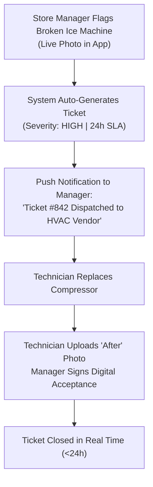

# Retail, Grocery & Multi-Unit Store Operations Knowledge Base

## 0. Module Scope & Source Inventory

- **Priority Tier:** **P2 Core Focus (Retail, Grocery, Visual Merchandising & Multi-Unit Store Ops)**
- **Target Personas:** Retail COOs, VPs of Operations, Visual Merchandising (VM) Directors, Retail Marketing & Campaign Leads, Supermarket/Grocery Operations Directors (15–40 stores), Regional & District Managers, HR & Training Directors, Store General Managers.
- **Core Operational Anchor:** *"You can't be everywhere."* Founders and operations leads can inspect 3–5 stores in person; at 15–500+ stores, execution drifts unless every location runs proof-backed checks tied to instant reporting and closed-loop corrective actions.

### Source Blog Inventory (14 Source Blogs)

| # | Blog Title & Canonical URL | Category | Words | Core Focus & Routed Notes |
| :---: | :--- | :--- | :---: | :--- |
| 1 | [Audit Software for Grocery Chains with 15 to 40 Stores](https://audiment.in/blog/audit-software-for-grocery-chains-with-15-to-40-stores) | Retail Operations | 1,432 | Cold-chain monitoring, FIFO shelf expiry cycles, 5 supermarket modules, 2-week rollout |
| 2 | [Audit Software for Retail Chains with 50+ Stores](https://audiment.in/blog/audit-software-for-retail-chains-with-50-stores) | Retail Operations | 1,365 | 50+ store drift, 5 retail audit modules, gallery lockout, 30m geofence, DM CAPA SLAs |
| 3 | [How to Audit Visual Merchandising Across Hundreds of Brand Stores](https://audiment.in/blog/how-to-audit-visual-merchandising-across-hundreds-of-brand-stores) | Retail Operations | 1,444 | VM touchpoints, side-by-side photo reference benchmarks, 24h launch checks, VM CAPA |
| 4 | [How to Compare Store Compliance Scores Across Districts and Regions](https://audiment.in/blog/how-to-compare-store-compliance-scores-across-districts-and-regions) | Retail Operations | 1,339 | Format-normalized scoring weights (60/40), risk multipliers, Tier A/B/C, weekly governance |
| 5 | [How to Get Branch Audit Results in Hours Instead of Weeks](https://audiment.in/blog/how-to-get-branch-audit-results-in-hours-instead-of-weeks) | Logistics & Warehousing | 1,597 | Compressing 21-day reporting lag to <4 hours, edge exception routing, offline sync, ROI |
| 6 | [How to Link Audit Results to Manager Performance Reviews](https://audiment.in/blog/how-to-link-audit-results-to-manager-performance-reviews) | HR & Training | 1,121 | Balanced KPI scorecard (40/40/20), bonus multipliers (0–130%), anti-gaming, 60-day PIP |
| 7 | [How to Reduce Audit Fatigue Among Store Managers](https://audiment.in/blog/how-to-reduce-audit-fatigue-among-store-managers) | HR & Training | 1,940 | Checklist Burden Index (CBI), 3-tier Checklist Diet, weekly micro-audits, reciprocal maintenance loop |
| 8 | [How to Use Audit Data to Find Training Gaps Across Outlets](https://audiment.in/blog/how-to-use-audit-data-to-find-training-gaps-across-outlets) | HR & Training | 1,181 | Defect Pareto clustering, 4 segmentation cuts, 5-min floor micro-drills, training ROI |
| 9 | [How to Verify Campaign and Signage Rollouts Across Stores with Photos](https://audiment.in/blog/how-to-verify-campaign-and-signage-rollouts-across-stores-with-photos) | Retail Operations | 1,436 | 72h rollout framework, 5 signage photos, 6h local reprint routing *(Routed to Mod 02: GPS geofencing/timestamping mechanics)* |
| 10 | [Outlet & Retail Audit Execution, Compliance & Analytics](https://audiment.in/blog/outlet-retail-audit-execution-compliance-analytics) | Outlet Audit | 5,286 | End-to-end outlet audit framework, outsourcing vs in-house, assortment/promo analytics, AI & security |
| 11 | [Retail Store Audit Reports & Compliance Checklists: A Practical Guide](https://audiment.in/blog/retail-store-audit-reports-compliance-checklists) | Retail | 4,000 | Checklist design, format modularity, opening checklist, report structure, score vs. finding nuance |
| 12 | [Retail Store Audit: How to Run One and What to Cover](https://audiment.in/blog/retail-store-audit) | Audit Management | 1,508 | 5 core retail audit zones, standardized blueprints, surprise audits, common mistakes |
| 13 | [What Are Retail Operations? A Practical Guide for Multi-Location Businesses](https://audiment.in/blog/what-are-retail-operations) | Retail Operations | 1,877 | 6 pillars of retail ops, store management vs retail ops, recording vs verification tech |
| 14 | [What is an outlet audit? (And why every multi-location business needs one)](https://audiment.in/blog/what-is-an-outlet-audit) | Outlet Audit | 2,304 | Store visit vs outlet audit, sector metrics matrix, Flash Verification, eliminating audit prep culture |

---

## 1. Retail Operations Fundamentals & Why Multi-Store Standards Drift

### 1.1 Retail Operations vs. Store Management
- **Store management** is location-specific: a store manager runs daily execution at a single site ([what-are-retail-operations](https://audiment.in/blog/what-are-retail-operations)).
- **Retail operations** is the central system that sets brand, merchandising, safety, inventory, and service standards across all locations and measures every store against one baseline ([what-are-retail-operations](https://audiment.in/blog/what-are-retail-operations)).
- At 1–5 outlets, the founder or ops head can personally inspect stores weekly; once a chain reaches 15–50+ locations, relying on informal visits, WhatsApp photos, and verbal updates creates blind spots where managers prioritize whatever they *assume* head office cares about ([audit-software-for-grocery-chains-with-15-to-40-stores](https://audiment.in/blog/audit-software-for-grocery-chains-with-15-to-40-stores), [audit-software-for-retail-chains-with-50-stores](https://audiment.in/blog/audit-software-for-retail-chains-with-50-stores), [retail-store-audit](https://audiment.in/blog/retail-store-audit), [what-is-an-outlet-audit](https://audiment.in/blog/what-is-an-outlet-audit)).

### 1.2 The Six Pillars of Retail Operations
Every multi-unit retail network depends on six interconnected pillars ([what-are-retail-operations](https://audiment.in/blog/what-are-retail-operations)):
1. **Store Standards & Compliance:** Physical store condition, visual merchandising, planogram adherence, hygiene, safety, and brand guidelines.
2. **Staff Management:** Hiring, shift scheduling, training, grooming/conduct standards, and performance accountability.
3. **Inventory & Supply Chain:** Stock levels, shelf replenishment, shrinkage control, FIFO rotation, and waste reduction.
4. **Customer Experience:** Greeting, fitting room/checkout standards, pricing clarity, and complaint handling.
5. **Reporting & Analytics:** Store-to-HQ flow of sales, audit scores, compliance rates, and multi-period trend data.
6. **Technology & Systems:** Divided into **recording tools** (POS for transactions, scheduling tools for shifts, inventory software for stock receipts) and **verification tools** (audit and compliance platforms that prove whether floors are clean, displays are up, and SOPs are actually followed) ([what-are-retail-operations](https://audiment.in/blog/what-are-retail-operations)).

### 1.3 Why Multi-Location Standards Break Down at Scale
Standardizing multi-store operations requires three connected components: **documented standards + consistent evidence-backed verification + closed-loop follow-up** ([what-are-retail-operations](https://audiment.in/blog/what-are-retail-operations)). When any element is missing, four recurring failure modes emerge:
- **Standards Drift:** Minor local shortcuts (moved displays, shortened checklists, skipped hygiene steps during rush hours) compound across 30–200 stores until the brand experience fractures ([what-are-retail-operations](https://audiment.in/blog/what-are-retail-operations)).
- **Pencil-Whipped / Fake Audits:** Rushed store managers fill out daily checklists from memory at shift end, complete forms from the car park, or re-upload old photos of pristine displays ([audit-software-for-retail-chains-with-50-stores](https://audiment.in/blog/audit-software-for-retail-chains-with-50-stores), [what-is-an-outlet-audit](https://audiment.in/blog/what-is-an-outlet-audit)).
- **Audit Theatre:** When inspections are strictly scheduled, stores spend Wednesday cleaning for Thursday's visit and revert to neglect on Friday ([retail-store-audit](https://audiment.in/blog/retail-store-audit), [what-is-an-outlet-audit](https://audiment.in/blog/what-is-an-outlet-audit)).
- **Unresolved Defects & Delayed Reporting:** Broken shelf lights, damaged EAS security pedestals, or POS scanner failures get buried in WhatsApp threads, while paper binders sit with travelling district managers for 7–21 days before reaching HQ ([audit-software-for-retail-chains-with-50-stores](https://audiment.in/blog/audit-software-for-retail-chains-with-50-stores), [how-to-get-branch-audit-results-in-hours-instead-of-weeks](https://audiment.in/blog/how-to-get-branch-audit-results-in-hours-instead-of-weeks), [what-is-an-outlet-audit](https://audiment.in/blog/what-is-an-outlet-audit)).

### 1.4 Informal Store Visit vs. Structured Outlet/Retail Audit

| Dimension | Informal Store Visit | Structured Outlet / Retail Audit |
| :--- | :--- | :--- |
| **Structure** | Ad hoc walkthrough, conversational coaching | Fixed, standardized checklist across all stores |
| **Evidence** | None or memory-based | Live photos, videos, timestamps, GPS per question |
| **Scoring** | Subjective (*"Display looks good"*) | Weighted, graded percentage score against binary criteria |
| **Record** | Informal notes or verbal recap | Timestamped, signed-off digital record and PDF report |
| **Follow-up** | Relies on manager memory | Auto-generates assigned Corrective Actions (CAPA) with SLAs |
| **Accountability** | Manager's word | Documented, comparable, and traceable across regions |

*Sources: [retail-store-audit-reports-compliance-checklists](https://audiment.in/blog/retail-store-audit-reports-compliance-checklists), [what-is-an-outlet-audit](https://audiment.in/blog/what-is-an-outlet-audit).*

---

## 2. Retail Store & Outlet Audit Execution Framework

### 2.1 Core Execution Lifecycle & Five Audit Zones
Every useful outlet audit follows a continuous closed loop ([outlet-retail-audit-execution-compliance-analytics](https://audiment.in/blog/outlet-retail-audit-execution-compliance-analytics), [retail-store-audit-reports-compliance-checklists](https://audiment.in/blog/retail-store-audit-reports-compliance-checklists)):

```
Standard → Checklist → Field Visit & Observation → Verified Evidence → Finding → Corrective Action → Analytics & Review
```

To eliminate blind spots, every general retail store audit blueprint must inspect **five core zones** ([retail-store-audit](https://audiment.in/blog/retail-store-audit), [audit-software-for-retail-chains-with-50-stores](https://audiment.in/blog/audit-software-for-retail-chains-with-50-stores)):

| Audit Zone | Specific Inspection Parameters | Business & Risk Impact |
| :--- | :--- | :--- |
| **1. Visual Merchandising (VM)** | Window displays, planograms, focal tables, mannequin styling, promo signage alignment vs. corporate photo benchmarks | Protects brand consistency and turns marketing spend into floor conversion |
| **2. Store Cleanliness & Condition** | Floors, shelves, cash counters, fitting/trial rooms, lighting fixtures, waste handling, dust control | Directly impacts customer experience and Net Promoter Score (NPS) |
| **3. Staff Readiness & Touchpoints** | Uniform/grooming, floor greeting standards, SOP awareness, fitting room queue management | Prevents inconsistent service delivery across branches |
| **4. Safety & Statutory Compliance** | Emergency exit clearance, fire extinguisher inspections, electrical panel accessibility, first aid, statutory notices | Prevents municipal closure notices and regulatory liability |
| **5. Stock, Cash & Shrink Control** | Shelf availability, eye-level facings, damaged product handling, EAS hard-tag compliance, high-value cage locks, cash drawer reconciliation, safe drop adherence, receipt rolls | Cuts unexplained inventory shrinkage and cash leakage |

### 2.2 Cross-Sector Outlet Audit Metrics Matrix
While core governance stays shared, specific line items adapt by retail vertical ([what-is-an-outlet-audit](https://audiment.in/blog/what-is-an-outlet-audit), [outlet-retail-audit-execution-compliance-analytics](https://audiment.in/blog/outlet-retail-audit-execution-compliance-analytics)):

| Metric Area | Apparel / Specialty Retail Chain | Grocery / Supermarket | FMCG / CPG Distribution |
| :--- | :--- | :--- | :--- |
| **Shelf & Display** | Planogram adherence, size availability, folding/hanger spacing | Shelf availability, FIFO facing, end-cap displays | Share of shelf, facing count, placement near entrance |
| **Pricing Accuracy** | Shelf/tag ticket vs. POS system price | Shelf tag vs. POS barcode database (Legal Metrology) | MRP compliance and promotional price visibility |
| **Hygiene & Cold Chain** | Sales floor, fitting rooms, restrooms | Chiller/freezer temps, produce misting, meat/seafood sanitation | Storage condition and absence of damaged packs |
| **Staff Conduct** | Uniform, grooming, customer greeting | Department food-handling hygiene, checkout speed | Delivery rep execution and merchandiser standards |
| **Promo Execution** | Window vinyls, focal tables, POP standees | End-cap header cards, shelf-talkers, clearance tags | Activation displays, wobblers, branded POSM |
| **Inventory & Safety** | Stock vs. system count, EAS tags, fire exits | SKU count, 30/60/90-day expiry checks, FSSAI compliance | SKU presence, batch/expiry checks, handling safety |

### 2.3 Checklist Engineering, Modularity & Practical Opening Template

#### 7-Step Checklist Build & Pruning Rules ([retail-store-audit-reports-compliance-checklists](https://audiment.in/blog/retail-store-audit-reports-compliance-checklists))
1. **Define Objective:** State exactly what the audit verifies (e.g., merchandising execution vs. safety readiness).
2. **Define Criteria:** Write the measurable standard (*"Promotional display must be installed at the approved entrance position"*).
3. **Convert Criteria into Binary Checks:** Replace vague questions (*"Is the store well maintained?"* or *"Is the store clean?"*) with observable Yes/No/NA checks (*"Are customer-facing floors free of visible debris and spills?"* or *"Are shelves dust-free and product-facing at eye level in zones A through C?"*) ([retail-store-audit](https://audiment.in/blog/retail-store-audit), [retail-store-audit-reports-compliance-checklists](https://audiment.in/blog/retail-store-audit-reports-compliance-checklists)).
4. **Assign Response Types:** Pass / Fail / Not Applicable, numeric score, or structured observation.
5. **Define Mandatory Evidence:** Photo, timestamp, measurement, or document per risk level.
6. **Define Failure Consequences:** Finding log, automated CAPA ticket, SLA, and escalation rule.
7. **Field-Test & Prune:** Test at a live store before network rollout. Before keeping any question, apply the pruning filter: *"What decision will this result help us make?"* ([retail-store-audit-reports-compliance-checklists](https://audiment.in/blog/retail-store-audit-reports-compliance-checklists)).

#### Multi-Format Modularity & Version Control
To avoid maintaining completely separate audit programs for a 5,000 sq ft high-street flagship vs. a 1,000 sq ft mall kiosk, structure checklists in three layers ([how-to-compare-store-compliance-scores-across-districts-and-regions](https://audiment.in/blog/how-to-compare-store-compliance-scores-across-districts-and-regions), [retail-store-audit-reports-compliance-checklists](https://audiment.in/blog/retail-store-audit-reports-compliance-checklists)):
- **Core Standard (Shared):** Customer-facing cleanliness, pricing accuracy, cash controls, required safety checks, current POS collateral.
- **Format-Specific Modules:** Activated automatically by store metadata (e.g., exterior façade/parking/restrooms for standalone stores; fitting rooms for apparel; cold-chain/expiry for grocery).
- **Region-Specific Modules:** Local statutory or language signage rules.
- **Version Change Log:** Every update must record *what changed, why, effective date, and which stores run the new version* so multi-period comparisons stay valid ([retail-store-audit-reports-compliance-checklists](https://audiment.in/blog/retail-store-audit-reports-compliance-checklists)).

#### Practical 10-Section Retail Checklist & Opening Inspection Template
A standard retail audit blueprint organizes checks into 10 sections: **Store Information, Merchandising, Pricing, Availability, Promotion, Store Condition, Safety, Documentation, Findings, and Follow-Up** ([retail-store-audit-reports-compliance-checklists](https://audiment.in/blog/retail-store-audit-reports-compliance-checklists)).

**Pre-Open Store Readiness Checklist** ([retail-store-audit-reports-compliance-checklists](https://audiment.in/blog/retail-store-audit-reports-compliance-checklists)):
- **Store Condition:** `[ ]` Sales floor free of debris/spills | `[ ]` Customer areas and fitting rooms ready | `[ ]` Fixtures and lighting operational
- **Merchandising:** `[ ]` Approved promotional displays installed | `[ ]` Products placed to planogram | `[ ]` Required campaign signage present
- **Pricing:** `[ ]` Shelf price displays visible | `[ ]` Promotional pricing matches current campaign
- **Availability:** `[ ]` Required core/hero SKUs stocked on floor | `[ ]` Out-of-stock gaps logged for replenishment
- **Safety & Operations:** `[ ]` Fire exits clear and unlocked | `[ ]` Opening cash float and POS checks complete | `[ ]` Required operating equipment powered and verified

### 2.4 Evidence Discipline, Findings & Anti-Falsification Controls
- **Three-Element Finding Standard:** Never log vague remarks like *"Promotion execution poor."* Every finding must capture ([outlet-retail-audit-execution-compliance-analytics](https://audiment.in/blog/outlet-retail-audit-execution-compliance-analytics), [retail-store-audit-reports-compliance-checklists](https://audiment.in/blog/retail-store-audit-reports-compliance-checklists)):
  1. **Requirement:** *"Approved promotional signage must be displayed at the entrance."*
  2. **Observation:** *"Required signage was missing during the store visit."*
  3. **Evidence + Action:** Live photo of entrance + Owner (Store Manager) + Action + Deadline.
- **Evidence Relevance Rule:** *"Photo attached"* is not automatically proof. Verify that the photo directly proves the specific claim being scored (e.g., close-up showing price tag vs. wide aisle shot; document record for license checks) ([outlet-retail-audit-execution-compliance-analytics](https://audiment.in/blog/outlet-retail-audit-execution-compliance-analytics), [retail-store-audit-reports-compliance-checklists](https://audiment.in/blog/retail-store-audit-reports-compliance-checklists)).
- **Programmatic Anti-Falsification Controls:**
  - **Flash Verification:** Auditors record a 20-second geo-tagged video and verified selfie on-site before audit submission is permitted; GPS coordinates and UTC timestamps lock at submission ([what-is-an-outlet-audit](https://audiment.in/blog/what-is-an-outlet-audit)).
  - **Gallery Upload Lockout:** File-picker APIs are disabled; photos must be captured live via the device's native camera sensor ([audit-software-for-retail-chains-with-50-stores](https://audiment.in/blog/audit-software-for-retail-chains-with-50-stores), [how-to-link-audit-results-to-manager-performance-reviews](https://audiment.in/blog/how-to-link-audit-results-to-manager-performance-reviews)).
  - **GPS Geofencing:** Blocks submission outside a 30-metre perimeter (50m max for strict HR/KPI controls) ([audit-software-for-retail-chains-with-50-stores](https://audiment.in/blog/audit-software-for-retail-chains-with-50-stores), [how-to-link-audit-results-to-manager-performance-reviews](https://audiment.in/blog/how-to-link-audit-results-to-manager-performance-reviews)).
  - **Time-Gated Windows & Surprise Audits:** Morning opening checks lock after 09:30 AM (09:00–09:30 AM window), flagging late submissions to the district manager; unannounced surprise audits remain hidden from store managers until published with same-day deadlines ([audit-software-for-retail-chains-with-50-stores](https://audiment.in/blog/audit-software-for-retail-chains-with-50-stores), [what-is-an-outlet-audit](https://audiment.in/blog/what-is-an-outlet-audit)).

### 2.5 In-House vs. Outsourced Field Audits
- **When to Outsource:** Outsource only when internal teams lack field capacity, geographic reach, or independence (e.g., an internal team can cover 200 locations, but the brand needs 1,000 outlets audited quarterly). Do not outsource if the real constraint is poor scheduling, missing software, or weak follow-up ([outlet-retail-audit-execution-compliance-analytics](https://audiment.in/blog/outlet-retail-audit-execution-compliance-analytics)).
- **Governance Rule:** Even when outsourcing fieldwork, the brand must still own the standards across six dimensions: **Scope, Coverage, Frequency, Evidence, Reporting, and Follow-Up** ([outlet-retail-audit-execution-compliance-analytics](https://audiment.in/blog/outlet-retail-audit-execution-compliance-analytics)).
- **10-Point Vendor Evaluation & Cost Drivers:** Pricing varies by outlet count, travel, frequency, duration, checklist complexity, evidence specs, reporting, turnaround, and auditor qualifications. Before signing, run a live pilot audit and ask the provider how they: (1) train auditors on client standards, (2) QC submitted audits, (3) enforce evidence capture, (4) handle questionable/incomplete submissions, (5) hit delivery turnarounds, (6) customize reports, (7) protect field data, (8) manage auditors/locations, (9) handle CAPA follow-ups, and (10) scope all included vs. extra fees ([outlet-retail-audit-execution-compliance-analytics](https://audiment.in/blog/outlet-retail-audit-execution-compliance-analytics)).

---

## 3. Visual Merchandising (VM) Audits & Campaign/Signage Rollout Verification

### 3.1 Why VM and Campaign Rollouts Fail Across 50–250+ Stores
In fashion, lifestyle, cosmetics, electronics, and FMCG retail, **25% to 40% of stores** fail to execute national campaigns (Festive Sale, EOSS, Black Friday, New Product Launches) on launch morning ([how-to-verify-campaign-and-signage-rollouts-across-stores-with-photos](https://audiment.in/blog/how-to-verify-campaign-and-signage-rollouts-across-stores-with-photos)). Five operational breakdowns cause visual drift ([how-to-audit-visual-merchandising-across-hundreds-of-brand-stores](https://audiment.in/blog/how-to-audit-visual-merchandising-across-hundreds-of-brand-stores), [how-to-verify-campaign-and-signage-rollouts-across-stores-with-photos](https://audiment.in/blog/how-to-verify-campaign-and-signage-rollouts-across-stores-with-photos)):
1. **Complex PDF Manuals Ignored:** Store associates skim or ignore 40–60 page corporate PDF elevation decks during busy shift rotations.
2. **The "Unopened Box" Syndrome:** Printed POS kits arrive 3 days early, sit unopened in backrooms while staff prioritize opening registers on launch morning.
3. **Coexisting Campaigns & Improper Installation:** Staff put up new sale posters without tearing down last month's promo (causing checkout price disputes) or apply window vinyls with air bubbles, creases, and crooked alignment.
4. **Unapproved Mannequin Substitutions & Selective WhatsApp Photos:** When hero window stock sells out, staff dress mannequins in random clearance stock and send tight-angle WhatsApp photos that hide clutter or burnt-out track lights.
5. **Slow Field Visits:** Travelling VM specialists visit each door only once every 60–90 days, allowing visual decay for months.

### 3.2 Standardized VM & Signage Photo Audit Matrix
Structured by physical customer sightlines, a complete VM or campaign signage audit takes **under 15 minutes** and enforces exact camera framing ([how-to-audit-visual-merchandising-across-hundreds-of-brand-stores](https://audiment.in/blog/how-to-audit-visual-merchandising-across-hundreds-of-brand-stores), [how-to-verify-campaign-and-signage-rollouts-across-stores-with-photos](https://audiment.in/blog/how-to-verify-campaign-and-signage-rollouts-across-stores-with-photos)):

| Visual / Campaign Touchpoint | Specific Inspection Parameters | Mandatory Live Photo Framing |
| :--- | :--- | :--- |
| **Main Window Displays & Decals** | Vinyl level alignment, zero air bubbles, designated backdrop lighting, clean exterior glass | Wide-angle exterior storefront shot from **5 metres away** |
| **Entrance Focal Table / Archway** | Hero product color blocking, prop placement, acrylic signage, anchored archway, unobstructed walkway | High-angle **360-degree table shot** / straight-on entrance clearance shot |
| **Feature Wall Bays & Gondola End-Caps** | Hanger spacing (**1.5 fingers**), folding board uniformity, size sticker orientation, 100% hero SKU stock, header card | Straight-on frontal shot showing top-to-bottom tiering and stocked merchandise |
| **Mannequin Execution** | Approved seasonal outfit, steam-pressed garments, correct wig/pose posture, footwear & accessories | Close-up of complete styled ensemble |
| **Shelf-Talkers & Wobblers** | Affixed to exact SKU pricing channel, zero bent or damaged cardstock | Close-up showing **product barcode + shelf-talker** |
| **Lighting, Fixtures & Cash Desk POS** | Zero burnt-out LEDs, track heads angled at **45 degrees** toward hero walls; counter acrylics with current QR codes & visible T&Cs | Wide ceiling lighting shot + eye-level customer perspective shot of checkout counter |

### 3.3 Photographic Reference Benchmarks (Eliminating Subjective Scoring)
To eliminate grader bias (*"Is the entrance table styled to standard?"*), embed corporate reference photos directly inside the mobile audit screen ([how-to-audit-visual-merchandising-across-hundreds-of-brand-stores](https://audiment.in/blog/how-to-audit-visual-merchandising-across-hundreds-of-brand-stores)):
1. **Target Standard Image:** Displays the approved HQ photo (e.g., October denim focal table) on-screen.
2. **Side-by-Side Live Viewfinder:** Live camera feed opens next to the corporate reference image with gallery upload disabled.
3. **Binary Evaluation:** Auditor answers an objective check: *"Does the live table layout match the reference photo across all 4 quadrants? (Yes / No)."*

### 3.4 The 72-Hour Synchronized Campaign Rollout Verification Workflow
Synchronized launches (preventing 4–6 day promo delays) run on pre-launch and launch-morning gates ([how-to-verify-campaign-and-signage-rollouts-across-stores-with-photos](https://audiment.in/blog/how-to-verify-campaign-and-signage-rollouts-across-stores-with-photos), [how-to-audit-visual-merchandising-across-hundreds-of-brand-stores](https://audiment.in/blog/how-to-audit-visual-merchandising-across-hundreds-of-brand-stores)):

```
T-48 Hours (Delivery Confirmation):
  Store manager scans POS kit barcode + submits live photo of unopened carton in stockroom
  (Allows HQ to reroute replacement kits immediately if a courier failed)
      │
      ▼
T-12 Hours (Unboxing & Teardown):
  Manager checks kit contents against packing list + verifies removal of previous campaign POS
      │
      ├──► [If Damaged/Missing on Arrival] ──► Selects "Damaged on Arrival" + live photo
      │       ──► Auto-routes reprint work order to pre-approved local digital printer in city
      │       ──► Same-day courier replacement delivered within 6 hours before evening peak
      ▼
Launch Morning (07:00 – 09:30 AM):
  Staff install window vinyls, focal tables, shelf-talkers, & cash counter POS
  Manager submits geofenced live photos before 10:00 AM
      │
      ▼
Launch Morning (10:00 AM – 12:00 PM Executive Visual Wall Review):
  Central VM team reviews aggregated visual wall (200 stores reviewed within 4 hours of launch)
  Non-compliant displays rejected with written feedback ──► 2-hour restyling task / 24–48h VM CAPA
```

### 3.5 Connecting Merchandising & Execution Audits to Commercial Data
Audit data measures **in-store execution**; sales and inventory systems measure **commercial outcome** ([outlet-retail-audit-execution-compliance-analytics](https://audiment.in/blog/outlet-retail-audit-execution-compliance-analytics)):
- **Execution vs. Outcome Example:** A beverage promo across 1,000 outlets may show **850 compliant, 100 partial, 50 non-compliant**—confirming display execution without assuming causation until paired with POS sales lift ([outlet-retail-audit-execution-compliance-analytics](https://audiment.in/blog/outlet-retail-audit-execution-compliance-analytics)).
- **Diagnosing Assortment vs. Stockout vs. Execution:** If a SKU is missing from 40 outlets, audit spot-checks separate four distinct causes: (1) excluded from local assortment, (2) genuinely out of stock, (3) sitting in the back stockroom instead of on-shelf, or (4) displayed outside planogram ([outlet-retail-audit-execution-compliance-analytics](https://audiment.in/blog/outlet-retail-audit-execution-compliance-analytics), [what-is-an-outlet-audit](https://audiment.in/blog/what-is-an-outlet-audit)).
- **Regional Diagnostic Separation:** Audit data prevents masking distinct root causes under one score—for instance, separating **Region A** (strong display execution, weak stock availability) from **Region B** (inventory present, repeatedly misses approved display) ([outlet-retail-audit-execution-compliance-analytics](https://audiment.in/blog/outlet-retail-audit-execution-compliance-analytics)). If 30–40 stores fail the exact same display, investigate fixture difficulty, missing materials, unclear instructions, or store-format mismatch ([outlet-retail-audit-execution-compliance-analytics](https://audiment.in/blog/outlet-retail-audit-execution-compliance-analytics), [retail-store-audit-reports-compliance-checklists](https://audiment.in/blog/retail-store-audit-reports-compliance-checklists)).

---

## 4. Grocery & Supermarket Chain Operations (15–40 Stores)

### 4.1 Margin Economics & Regulatory Risks
Supermarkets operate on tight **18% to 24% gross margins** across thousands of perishable, temperature-sensitive SKUs ([audit-software-for-grocery-chains-with-15-to-40-stores](https://audiment.in/blog/audit-software-for-grocery-chains-with-15-to-40-stores)). Once a regional grocer scales to 15–40 stores, four margin-destroying risks arise ([audit-software-for-grocery-chains-with-15-to-40-stores](https://audiment.in/blog/audit-software-for-grocery-chains-with-15-to-40-stores)):
1. **Cold-Chain Spoilage:** Chiller compressors sound normal while refrigerant leaks and temperatures climb to 9°C–12°C, spoiling thousands of dollars of dairy, poultry, and prepared food overnight.
2. **Expired Stock Liability:** Front-facing restocking pushes older yogurt, bread, or baby formula to the back—or leaves expired batches on front shelves—triggering **FSSAI** penalties.
3. **Department Cross-Contamination:** Produce, butchery, seafood, dairy, dry grocery, and checkouts each require separate daily hygiene controls.
4. **Legal Metrology & Price Discrepancies:** Outdated shelf tags that mismatch the POS barcode database cause checkout disputes and **Legal Metrology** fines.

### 4.2 Five Essential Supermarket Department Audit Modules

| Department Module | Critical Inspection Parameters | Operational & Financial Impact |
| :--- | :--- | :--- |
| **Cold Storage & Chillers** | Multi-deck dairy chillers (**< 4°C**), meat chillers (**0–2°C**), island freezers (**< -18°C**) | Prevents perishable spoilage, cuts energy waste, protects food safety |
| **Shelf Stock & Expiry** | FIFO rotation adherence, damaged carton write-offs, clearance shelf tagging | Lowers unsaleable write-offs and prevents FSSAI expiry violations |
| **Fresh Produce (F&V)** | Misting system operation, morning culling of bruised fruit, crate cleanliness | Boosts visual appeal, turnover velocity, and basket size |
| **Butchery & Seafood** | Cutting block sanitization, ice bed depth, raw/cooked utensil color coding | Prevents cross-contamination and passes municipal health inspections |
| **Checkout & Front-End** | Express lane queue times, bag replenishment, POS price scanner accuracy | Speeds checkout throughput and eliminates Legal Metrology/price disputes |

*Source: [audit-software-for-grocery-chains-with-15-to-40-stores](https://audiment.in/blog/audit-software-for-grocery-chains-with-15-to-40-stores).*

### 4.3 Automated Cold-Chain & Shelf Expiry Protocols
- **Twice-Daily Live Thermometer Readouts:** Dairy supervisors photograph digital probe thermometer displays on open multidecks and walk-in coolers twice per shift with gallery uploads locked out ([audit-software-for-grocery-chains-with-15-to-40-stores](https://audiment.in/blog/audit-software-for-grocery-chains-with-15-to-40-stores)).
- **Threshold Breach Escalation:** Temperatures exceeding **> 4.0°C (dairy)** or **> -15.0°C (frozen food)** fire instant emergency alerts to the store manager and facilities maintenance, generating a high-priority CAPA ticket with a **4-hour SLA** to relocate stock to backup coolers or dispatch an HVAC technician ([audit-software-for-grocery-chains-with-15-to-40-stores](https://audiment.in/blog/audit-software-for-grocery-chains-with-15-to-40-stores)).
- **Risk-Stratified Shelf Expiry Cycle Auditing:** Because inspecting 20,000 SKUs daily is impossible, high-performing grocers split checks by shelf-life risk ([audit-software-for-grocery-chains-with-15-to-40-stores](https://audiment.in/blog/audit-software-for-grocery-chains-with-15-to-40-stores)):
  - **Daily (Ultra-Perishables):** Milk, bread, fresh juices, and pre-cut produce inspected every morning during restocking.
  - **Weekly Category Rotation:** **Monday** (Dairy & chilled goods), **Tuesday** (Cereal, biscuits, snacks), **Wednesday** (Canned goods & condiments), **Thursday** (Personal care & baby products).
  - **30/60/90-Day Markdown & RTV Enforcement:** Items within **30 days** of expiry receive yellow clearance stickers logged with live photo proof; 30-, 60-, and 90-day expiry scans auto-generate markdown tasks or vendor return-to-vendor (RTV) claims ([audit-software-for-grocery-chains-with-15-to-40-stores](https://audiment.in/blog/audit-software-for-grocery-chains-with-15-to-40-stores)).

### 4.4 Two-Week Rollout Across 30 Supermarkets
Because frontline grocery staff have high turnover, zero-install access and short shift routines are mandatory ([audit-software-for-grocery-chains-with-15-to-40-stores](https://audiment.in/blog/audit-software-for-grocery-chains-with-15-to-40-stores)):
1. **Browser Magic Links & Backroom QR Codes:** Staff open department checklists in mobile browsers with zero app installation or complex provisioning.
2. **20-Minute Virtual Briefings + 3-Store Pilot:** Brief department leads virtually while a roving QA team validates templates across 3 pilot stores.
3. **Sub-10-Minute Department Routines:** Break checks into bite-sized routines—**10-minute dairy check**, **8-minute produce check**, **5-minute checkout check**—and permanently strip paper clipboards off walk-in cooler doors.
4. **Area Manager Time Savings:** Instant PDF and task generation saves area managers **2 hours per store visit** previously spent typing Excel summaries, enabling **3 to 4 supermarket audits per day** ([audit-software-for-grocery-chains-with-15-to-40-stores](https://audiment.in/blog/audit-software-for-grocery-chains-with-15-to-40-stores)).

---

## 5. Real-Time Branch Audit Reporting, Regional Benchmarking & Analytics

### 5.1 Compressing Branch Reporting from 21–28 Days to Under 4 Hours
Traditional paper-and-Excel branch reporting suffers a **14-to-21+ day lag**: Days 1–5 (10 paper branch visits) → Days 6–10 (travel back with binders) → Days 11–14 (transcribing Excel + downloading 200+ WhatsApp photos) → Days 15–18 (manual scoring & formatting decks) → Days 19–21 (emailing PDFs and waiting for sign-off) ([how-to-get-branch-audit-results-in-hours-instead-of-weeks](https://audiment.in/blog/how-to-get-branch-audit-results-in-hours-instead-of-weeks)).

| Audit Milestone | Traditional Paper & Courier Workflow | Automated Audiment Cloud Workflow | Velocity Gain |
| :--- | :--- | :--- | :--- |
| **Field Observation & Logging** | Paper binders or laptop notes | Mobile checklist with mandatory photo prompts | **40% less site time** |
| **Media & Photo Matching** | Camera roll transferred to PC folders manually | Auto-tagged with UTC time, GPS, checkpoint ID | **100% automated** |
| **Score & Weight Computation** | Manual Excel formulas | Instant weighted risk scoring | **0 seconds** |
| **Report PDF Distribution** | 3–5 business days drafting/emailing | Branded PDF emailed/WhatsApped on submit | **< 30 seconds** *(<=60s max)* |
| **Defect Remediation Dispatch** | 10–14 days waiting for regional review | Automated work orders fired via webhook | **Within 5 minutes** |
| **Executive Governance Rollup** | 21 days post-month-end | Live interactive dashboards | **100% continuous** |
| **Total Turnaround Cycle** | **21 to 28 Days** | **Under 4 Hours** | **95% cycle compression** |

*Financial ROI:* Saves **8 to 12 hours weekly per auditor** (up to **40 hours/month**), increases monthly inspections per auditor by **35%**, and compresses critical safety hazard remediation from **30 days / 4 weeks down to under 48 hours** ([how-to-get-branch-audit-results-in-hours-instead-of-weeks](https://audiment.in/blog/how-to-get-branch-audit-results-in-hours-instead-of-weeks)).

### 5.2 Instant Report Structure, Offline Queuing & Exception Routing
- **9-Part Retail/Branch Report Structure:** Audit Details (store, region, audit type, auditor, GPS, duration), Scope, Executive Summary (total score, category grades, prior-audit variance), Priority Non-Conformances (red-flagged failures + risk rating), Photographic Proof (high-res before photos + timestamp/GPS overlay), Actionable CAPA Table (task, owner, 24h/48h SLA), Ownership, Status, and Management Conclusion ([how-to-get-branch-audit-results-in-hours-instead-of-weeks](https://audiment.in/blog/how-to-get-branch-audit-results-in-hours-instead-of-weeks), [retail-store-audit-reports-compliance-checklists](https://audiment.in/blog/retail-store-audit-reports-compliance-checklists)).
- **Offline Encrypted Queuing & Appeals:** In basement godowns or rural hubs without signal, responses, scores, and media queue encrypted locally on the device and auto-sync within seconds of 4G/Wi-Fi reconnection. Branch managers can attach contextual remarks or contest findings before CAPA plans finalize ([how-to-get-branch-audit-results-in-hours-instead-of-weeks](https://audiment.in/blog/how-to-get-branch-audit-results-in-hours-instead-of-weeks)).
- **Alert Gating & Cloud-Edge Exception Routing:** Minor cosmetic issues batch into weekly digests so executives are never spammed, while severe findings route in real time across 3 automated paths ([how-to-get-branch-audit-results-in-hours-instead-of-weeks](https://audiment.in/blog/how-to-get-branch-audit-results-in-hours-instead-of-weeks)):
  1. **Path 1 — Standard Routine Log:** e.g., 94% pass stored in database; executive league table updates live.
  2. **Path 2 — Vendor Work Order:** e.g., cracked customer counter glass fires a facility vendor webhook with a **24-hour SLA clock**.
  3. **Path 3 — Emergency Executive Escalation:** e.g., fire pump failure, dual-control vault breach, or <30-day CCTV retention fires SMS + WhatsApp to VP Ops within 5 minutes with a **2-hour containment mandate**.

### 5.3 Regional Benchmarking: Format-Normalized Weights & Compliance Tiers
To compare 5,000 sq ft flagships fairly against 1,000 sq ft mall kiosks, split scoring into **60% Core Operational Baseline** (universal across every store) and **40% Format-Specific Modules** (activated via store metadata), weighted by risk severity ([how-to-compare-store-compliance-scores-across-districts-and-regions](https://audiment.in/blog/how-to-compare-store-compliance-scores-across-districts-and-regions)):

| Category | Typical Line Items | Weight | Penalty Multiplier |
| :--- | :--- | :---: | :--- |
| **Life Safety & Compliance** | Fire exits, extinguisher inspection, emergency lights | **30%** | **Critical:** Immediate 15-point drop |
| **Visual Merchandising (VM)** | Window displays, focal tables, promotional end-caps | **25%** | **Major:** 5-point deduction per failure |
| **Cash Desk & Shrinkage** | Safe drops, drawer limits, EAS security tags | **25%** | **Major:** 5-point deduction per failure |
| **Store Maintenance & Hygiene** | Fitting room cleanliness, lighting fixtures, floor polish | **20%** | **Minor:** 1–2 point deduction |

#### Rolling 90-Day Performance Tiers & Weekly Governance Rhythm
Evaluating a single visit can mislead due to one-off staffing shortages; track **rolling 90-day averages** across three tiers ([how-to-compare-store-compliance-scores-across-districts-and-regions](https://audiment.in/blog/how-to-compare-store-compliance-scores-across-districts-and-regions)):
- **Tier A (Excellence — > 92%):** Pristine visual standards, zero overdue CAPA, high on-time opening checks. *(Example: North District 94.2%, 100% promo verified).*
- **Tier B (Standard — 80% to 91%):** Minor cosmetic drift; audited on standard monthly cycle. *(Example: West District 88.5%, 2 open tickets).*
- **Tier C (High Risk — < 80%):** Recurring failures, unresolved safety issues, missed daily checks. Automatically reclassified for **bi-weekly surprise audits** until **3 consecutive inspections hit 90%+**. *(Example: South District 78.1%, severe backroom clutter, 14 overdue CAPAs—when 5 stores in one district drop to Tier C, investigate DM coaching or regional supply chain issues).*
- **Weekly Executive Review (COO / VP Ops / Regional Directors):** Review Top 5 & Bottom 5 stores, verify 100% promo rollout compliance, flag any store with **> 3 overdue CAPA tickets**, deploy VM coaches to Bottom 5, and reroute DM travel to Tier-C clusters. Prevent auditor grading bias via calibration audits and rotating territory auditors every **6 to 12 months** ([how-to-compare-store-compliance-scores-across-districts-and-regions](https://audiment.in/blog/how-to-compare-store-compliance-scores-across-districts-and-regions)).

### 5.4 Beyond Headline Scores: Diagnostic Analytics, AI & Field Security
- **Scores Never Replace Findings:** A **94% overall score with 1 significant safety failure** (Store A) demands faster intervention than an **87% score with 0 significant failures** (Store B) ([retail-store-audit-reports-compliance-checklists](https://audiment.in/blog/retail-store-audit-reports-compliance-checklists)). Similarly, two stores scoring 91% vs. 88% require category breakdown: if Pricing is 98%/99% and Availability is 91%/94%, but Displays are **95% vs. 78%**, leadership isolates display execution immediately ([retail-store-audit-reports-compliance-checklists](https://audiment.in/blog/retail-store-audit-reports-compliance-checklists)).
- **Co-Tracked Operational KPIs:** Pair audit scores with **CAPA Mean Time to Resolution (MTTR)** (a 90% score with a 14-day MTTR exposes ignored follow-up), **Audit-to-Shrink Correlation**, **Google Maps/social ratings**, and **Checklist Submission Punctuality** ([how-to-compare-store-compliance-scores-across-districts-and-regions](https://audiment.in/blog/how-to-compare-store-compliance-scores-across-districts-and-regions), [how-to-get-branch-audit-results-in-hours-instead-of-weeks](https://audiment.in/blog/how-to-get-branch-audit-results-in-hours-instead-of-weeks)).
- **Continuous Retail Monitoring & Drill-Down Funnel:** Combine weekly outlet checks, monthly network analysis, and triggered extra checks on repeat failures across four analytical patterns (**Location, Regional, Network, Time**). Dashboards must support drill-down from `1,000 outlets → 62 requiring attention → 14 recurring merchandising failures → specific outlets → individual findings → supporting evidence` ([outlet-retail-audit-execution-compliance-analytics](https://audiment.in/blog/outlet-retail-audit-execution-compliance-analytics), [retail-store-audit-reports-compliance-checklists](https://audiment.in/blog/retail-store-audit-reports-compliance-checklists)).
- **AI Analytics Guardrail:** Use AI to cluster similar findings or flag emerging trends across regions via `AI identifies signal → Manager investigates → Audit evidence confirms context → Team acts`—never accept automated conclusions blindly without inspecting underlying photos/records ([outlet-retail-audit-execution-compliance-analytics](https://audiment.in/blog/outlet-retail-audit-execution-compliance-analytics)).
- **Field Data Security & Privacy:** Because audit photos capture employees, customer data, screens, and documents, enforce strict role-based access (field auditor vs. regional manager vs. HQ), encrypted transmission/storage, and explicit retention/export/deletion rules ([outlet-retail-audit-execution-compliance-analytics](https://audiment.in/blog/outlet-retail-audit-execution-compliance-analytics)).

---

## 6. Store Manager Accountability, Training Gaps & Eliminating Audit Fatigue

### 6.1 Linking Audit Results to Store Manager Performance Reviews
Evaluating managers on revenue alone creates the **Revenue-Only Bonus Trap**: managers defer quarterly HVAC servicing, skip deep freezer temperature logs, and leave washrooms broken to hit ₹1,50,000/day sales targets (collecting ₹25,000 bonuses in Months 1–3) right before a chiller compressor seizes in Month 4, spoiling ₹85,000 of dairy stock and triggering a municipal closure notice ([how-to-link-audit-results-to-manager-performance-reviews](https://audiment.in/blog/how-to-link-audit-results-to-manager-performance-reviews)).

#### Balanced Store Manager KPI Scorecard (40% Financial / 40% Operational / 20% People & CX)

| KPI Dimension | Specific Metric Evaluated | Target Benchmark | Bonus Pool Weight |
| :--- | :--- | :--- | :---: |
| **Financial Delivery** | Monthly Net Sales vs. Target & Gross Margin % | 100% of Monthly Target | **40%** |
| **Operational Compliance** | Monthly Average Digital Audit Score | **>= 90%** | **25%** |
| **CAPA Remediation Speed** | Mean Time to Resolve (MTTR) Maintenance Tasks | **< 24 Hours** (High Risk) | **15%** |
| **Customer Experience** | Google Review Rating & Mystery Shopper Score | >= 4.3 Stars / 85% Score | **10%** |
| **Team Retention** | Frontline Store Staff Attrition Rate | < 15% Quarterly Turnover | **10%** |

*Notes:* Track weekly, compute monthly bonuses, and roll into quarterly averages for annual reviews. Allocate **25% to 30%** of the operational bonus pool to assistant store managers and shift leads so standards hold on manager rest days ([how-to-link-audit-results-to-manager-performance-reviews](https://audiment.in/blog/how-to-link-audit-results-to-manager-performance-reviews)).

#### Phased Bonus Multiplier Matrix & Anti-Gaming Controls

| Operational Audit Score | On-Time CAPA Resolution Rate | Bonus Payout Multiplier |
| :---: | :---: | :--- |
| **< 80.0%** | Any | **0%** (Zero Bonus Eligibility) |
| **80.0% – 84.9%** | < 80% on-time | **0%** (Zero Bonus Eligibility) |
| **85.0% – 89.9%** | >= 85% on-time | **100%** Base Operational Bonus |
| **90.0% – 94.9%** | >= 90% on-time | **115%** Enhanced Bonus |
| **>= 95.0%** | 100% on-time (Zero overdue) | **130% Leadership Accelerator** *(1.25x–1.30x)* |

- **Four Anti-Gaming Safeguards:** (1) Native camera hardware lock, (2) Sub-50m GPS geofence, (3) **Cross-Auditor Variance Calibration** (if self-audit scores 96% vs. unannounced Area Manager spot-check at 78%, an **18% Scoring Variance Penalty** triggers automatic review), and (4) **Decoupled Ticket Closure** (managers upload repair photos, but only the Area Manager holds cryptographic permission to close the CAPA ticket) ([how-to-link-audit-results-to-manager-performance-reviews](https://audiment.in/blog/how-to-link-audit-results-to-manager-performance-reviews)).
- **60-Day Operational Retraining Protocol (PIP) & Appeals:**
  - *Month 1:* Two consecutive months **< 80%** → defect Pareto isolates root cause (e.g., 70% lost points in FIFO).
  - *Month 2:* 2-hour hands-on refresher + weekly calibrated spot-audits + mandatory daily FIFO shelf photos.
  - *Month 3:* Must score **>= 88%** on an unannounced corporate audit to exit PIP; failure leads to reassignment or separation.
  - *Appeals:* Documented landlord infrastructure failures (e.g., building water shutoff) or approved corporate CAPEX delays can be appealed with vendor receipts for a Regional Operations Director scoring waiver ([how-to-link-audit-results-to-manager-performance-reviews](https://audiment.in/blog/how-to-link-audit-results-to-manager-performance-reviews)).

### 6.2 Using Audit Data to Pinpoint Staff Training Gaps
Generic 40-slide HQ workshops fail because they rely on anecdotal AM feedback and track attendance instead of store defect reduction ([how-to-use-audit-data-to-find-training-gaps-across-outlets](https://audiment.in/blog/how-to-use-audit-data-to-find-training-gaps-across-outlets)).

- **Monthly Defect Pareto Clustering:** Across 50 outlets x 4 weekly audits (**200 inspections / 10,000 checkpoints**), if 840 total defects show **520 failures (62%)** concentrated in just 4 items—e.g., *Sanitizer titration strips expired/missing (180), Deep freezer FIFO unorganized (145), POS cash registers unsigned (110), Promo end-cap price talkers misaligned (85)*—cancel generic workshops and deploy targeted **10-minute micro-training** on those 4 items ([how-to-use-audit-data-to-find-training-gaps-across-outlets](https://audiment.in/blog/how-to-use-audit-data-to-find-training-gaps-across-outlets)).
- **Four Analytical Segmentation Dimensions:**

| Segmentation Dimension | Analytical Query Example | Operational Root Cause Revealed |
| :--- | :--- | :--- |
| **Geographic Region** | North averages 94% on Food Safety vs. South at 76% | South regional trainer skipping cold-chain calibration during orientation |
| **Store Age / Maturity** | Stores < 6 months old vs. > 3 years old | New stores fail cash control SOPs at **3x higher rate** in first 90 days |
| **Shift Timing Split** | Morning opening vs. evening closing audits | Closing crews rush scrub-downs to catch last transit buses; need closing drill |
| **Manager Tenure** | Internal promotions vs. external hires | Externally hired managers struggle with corporate POS return procedures |

- **5-Minute On-Floor Micro-Drills & Training ROI:** Replace 2-hour classrooms with 3-step workstation drills (**Min 0–1:** 45–60 sec mobile video embedded in checklist; **Min 1–3:** hands-on execution, e.g., dipping sanitizer test strip to 200 ppm chart; **Min 3–5:** live verification photo logged to HR dashboard). Measure ROI by tracking a **>= 70% drop in specific failure frequency within 30 days**. *Proven Case:* Deep freezer FIFO failures fell from **145 (29% failure rate)** in Month 1 to **18 (3.6% failure rate)** in Month 3 after a 10-minute micro-drill—an **87.5% defect reduction** saving **₹4,80,000** in perishable spoilage. If an outlet keeps failing post-training, the Area Manager conducts a site interview to catch non-training blockers (e.g., broken dispenser valve or vendor packaging mismatch) ([how-to-use-audit-data-to-find-training-gaps-across-outlets](https://audiment.in/blog/how-to-use-audit-data-to-find-training-gaps-across-outlets)).

### 6.3 Eliminating Store Manager Audit Fatigue
Layering a 90-question opening checklist, 45-point mid-day food log, and 70-question closing check onto busy managers triggers mechanical speed-clicking ([how-to-reduce-audit-fatigue-among-store-managers](https://audiment.in/blog/how-to-reduce-audit-fatigue-among-store-managers)).

- **4 Burnout Drivers:** (1) Unchecked Checklist Bloat (20 items ballooning to 120 over two years), (2) Static Administrative Questioning (re-checking trade license dates or extinguisher tags daily), (3) Departmental Silos & Duplicate Forms (Marketing, Food Safety, HR, Maintenance, LP asking the same thing across separate apps), and (4) The **"Black Hole" Effect** (logging broken equipment for 4 weeks with zero HQ repair dispatch) ([how-to-reduce-audit-fatigue-among-store-managers](https://audiment.in/blog/how-to-reduce-audit-fatigue-among-store-managers)).
- **Checklist Burden Index (CBI) Formula:**
  `Daily Audit Minutes = ((Total Daily Questions × 20s) / 60s) + (Mandatory Photos × 45s / 60s)`
  - *Anti-Pattern:* 110 daily questions (36.6 min) + 25 mandatory photos (18.7 min) = **55.3 minutes/day (11.5% of an 8-hour shift)**.
  - *Operational Rule of Thumb:* Daily checklists must never exceed **15 total minutes per shift (< 3% of working hours)**. Enforce mandatory photos only on critical control points (e.g., fridge gauges, cash safe locks) and failed items—never on every passing question ([how-to-reduce-audit-fatigue-among-store-managers](https://audiment.in/blog/how-to-reduce-audit-fatigue-among-store-managers)).

#### The 3-Tier "Checklist Diet" & Weekly Thematic Micro-Auditing
Apply the **Pruning Decision Rule** to every daily item: *"If this failed at 8:00 AM, would it cause food illness, guest injury, immediate revenue loss, or brand catastrophe before 2:00 PM?"* If No, move it out of daily checks—cutting daily question volume by **60% to 70%** overnight ([how-to-reduce-audit-fatigue-among-store-managers](https://audiment.in/blog/how-to-reduce-audit-fatigue-among-store-managers)):

| Inspection Tier | Operational Focus | Frequency | Target Questions | Max App Time |
| :--- | :--- | :--- | :---: | :---: |
| **Tier 1: Daily Operational Pulse** | Perishable safety, cash floats, customer-facing presentation | Daily (Opening & Shift Handovers) | **12 to 18** | **5–7 mins** |
| **Tier 2: Weekly Quality & Deep Clean** | Back-of-house storage, FIFO rotation, equipment sanitization | 1x Weekly (Low-traffic weekday) | **25 to 35** | **15 mins** |
| **Tier 3: Monthly / Quarterly Asset Audit** | Structural assets, fire tags, license renewals, HVAC | Monthly / Quarterly (Area Manager) | **40 to 60** | **30–45 mins** |

Instead of a 50-question Friday dump, rotate **Weekly Thematic Micro-Audits (3–5 mins/day)**: **Mon:** Sanitation & Touchpoints (4 mins / 10 checks) | **Tue:** Food Safety & Temps (4 mins / 8 checks) | **Wed:** VM & POS Readiness (3 mins / 7 checks) | **Thu:** Back-of-House & Safety Clearance (4 mins / 9 checks) | **Fri:** Weekend Rush Prep & Staging (5 mins / 10 checks) ([how-to-reduce-audit-fatigue-among-store-managers](https://audiment.in/blog/how-to-reduce-audit-fatigue-among-store-managers)).

#### The Reciprocal Maintenance Loop & Fatigue Warning Metrics
Closing the **"Black Hole" Effect** shifts manager mindset from *"Corporate is tracking my mistakes"* to *"This app gets broken store equipment fixed"* ([how-to-reduce-audit-fatigue-among-store-managers](https://audiment.in/blog/how-to-reduce-audit-fatigue-among-store-managers)):



Monitor **four warning metrics** on operational dashboards to catch silent audit fatigue ([how-to-reduce-audit-fatigue-among-store-managers](https://audiment.in/blog/how-to-reduce-audit-fatigue-among-store-managers)):
1. **Abnormal Completion Velocity:** A 30-question floor walk requiring 6–8 minutes submitted in **75–90 seconds**.
2. **"Straight-Line" Score Trap:** Identical **100% passing scores for 8 consecutive weeks** while store revenue drops.
3. **Zero-Defect Submission Ratio:** Healthy physical stores log **2 to 4 minor defects/week**; zero defects over 30 days signals rubber-stamping.
4. **Shift-End Batch Upload Spike:** **75% of daily opening checks** submitted in a burst between **9:00 PM and 10:30 PM**.

---

## 7. Consolidated Retail & Grocery Operations FAQ (AEO Bank)

- **Q: What is the difference between a retail store visit and a retail/outlet audit?**  
  **A:** A store visit is an informal walkthrough for coaching and general observation. A retail or outlet audit is a structured assessment against standardized criteria that captures live photo/GPS evidence, computes a weighted score, generates a traceable report, and triggers tracked corrective actions ([retail-store-audit-reports-compliance-checklists](https://audiment.in/blog/retail-store-audit-reports-compliance-checklists), [what-is-an-outlet-audit](https://audiment.in/blog/what-is-an-outlet-audit)).

- **Q: How many questions should a daily retail store opening checklist have?**  
  **A:** Keep daily opening checklists to **12–18 focused, binary questions** taking **5 to 7 minutes** (and never exceed **15 minutes/shift** across all daily checklists) so managers inspect thoroughly before doors open ([how-to-reduce-audit-fatigue-among-store-managers](https://audiment.in/blog/how-to-reduce-audit-fatigue-among-store-managers)).

- **Q: Should managers take photos for every passing checklist item?**  
  **A:** No. Requiring photos on every passing question causes severe fatigue and data bloat. Enforce mandatory live photos strictly on high-risk critical control points (e.g., chiller gauges, safe locks, campaign launches) and automatically whenever an item fails ([how-to-reduce-audit-fatigue-among-store-managers](https://audiment.in/blog/how-to-reduce-audit-fatigue-among-store-managers)).

- **Q: How do grocery chains prevent expiry losses across thousands of center-store SKUs?**  
  **A:** Use risk-stratified cycle auditing: inspect ultra-perishables (milk, bread, fresh juice, pre-cut produce) daily, rotate center-store FMCG categories Monday–Thursday, and scan items entering 30-, 60-, and 90-day expiry windows to trigger yellow clearance markdowns or vendor RTV claims ([audit-software-for-grocery-chains-with-15-to-40-stores](https://audiment.in/blog/audit-software-for-grocery-chains-with-15-to-40-stores)).

- **Q: How quickly can central VM teams verify a national campaign launch across 200 stores?**  
  **A:** Using a 72-hour rollout workflow (`T-48h` kit scan, `T-12h` unboxing/teardown, and launch-morning geofenced photos before 10:00 AM), all storefront, focal table, shelf-talker, and checkout photos aggregate onto one visual wall so central VM teams can review 200 stores and flag non-compliant displays within **4 hours** of morning launch ([how-to-audit-visual-merchandising-across-hundreds-of-brand-stores](https://audiment.in/blog/how-to-audit-visual-merchandising-across-hundreds-of-brand-stores), [how-to-verify-campaign-and-signage-rollouts-across-stores-with-photos](https://audiment.in/blog/how-to-verify-campaign-and-signage-rollouts-across-stores-with-photos)).

- **Q: How do operations teams stop store managers from faking or backdating audits—or gaming bonus-linked scores?**  
  **A:** Lock native camera hardware (disabling gallery uploads), enforce 30–50m GPS geofences and 20-second Flash Verification video/selfie checks, gate morning forms to narrow windows (e.g., 09:00–09:30 AM), decouple CAPA ticket closure from self-approval, and run unannounced surprise audits with cross-auditor variance calibration ([audit-software-for-retail-chains-with-50-stores](https://audiment.in/blog/audit-software-for-retail-chains-with-50-stores), [how-to-link-audit-results-to-manager-performance-reviews](https://audiment.in/blog/how-to-link-audit-results-to-manager-performance-reviews), [what-is-an-outlet-audit](https://audiment.in/blog/what-is-an-outlet-audit)).

- **Q: What happens if a branch audit is conducted in a basement godown or rural store with no mobile signal?**  
  **A:** Mobile audit apps queue responses, scores, and media locally in an encrypted state and auto-sync within seconds once 4G or Wi-Fi reconnects ([how-to-get-branch-audit-results-in-hours-instead-of-weeks](https://audiment.in/blog/how-to-get-branch-audit-results-in-hours-instead-of-weeks)).

- **Q: Should assistant store managers share in operational audit bonuses, and can external infrastructure failures be appealed?**  
  **A:** Yes. Allocating **25%–30%** of the operational bonus pool to assistant managers and shift leads keeps standards consistent on manager rest days. For documented landlord utility failures or corporate CAPEX delays, managers submit vendor receipts via digital appeal for a Regional Operations Director waiver ([how-to-link-audit-results-to-manager-performance-reviews](https://audiment.in/blog/how-to-link-audit-results-to-manager-performance-reviews)).

- **Q: How do retail audit reports compare stores fairly across different store formats?**  
  **A:** Keep core compliance baseline weights (60%) identical across all stores, activate format-specific modules (40%) dynamically via store metadata, compare category-level scores (e.g., Displays vs. Pricing) rather than headline averages alone, and always surface critical safety failures even inside 90%+ overall scores ([how-to-compare-store-compliance-scores-across-districts-and-regions](https://audiment.in/blog/how-to-compare-store-compliance-scores-across-districts-and-regions), [retail-store-audit-reports-compliance-checklists](https://audiment.in/blog/retail-store-audit-reports-compliance-checklists)).

---

## 8. Audiment Positioning, Capabilities & Internal Link Map

- **Core Narrative:** *"You can't be everywhere."* Audiment is an audit management system for multi-location businesses—built to run proof-based audits across branches, verify on-site execution, and track corrective actions to resolution ([audit-software-for-grocery-chains-with-15-to-40-stores](https://audiment.in/blog/audit-software-for-grocery-chains-with-15-to-40-stores), [what-are-retail-operations](https://audiment.in/blog/what-are-retail-operations), [what-is-an-outlet-audit](https://audiment.in/blog/what-is-an-outlet-audit)).
- **Key Product Differentiators Cited:**
  - **Flash Verification & Anti-Fraud:** 20-second geo-tagged video + verified selfie before submission, locked GPS/UTC timestamps, 30–50m geofencing, and native camera capture with disabled gallery uploads ([audit-software-for-retail-chains-with-50-stores](https://audiment.in/blog/audit-software-for-retail-chains-with-50-stores), [how-to-link-audit-results-to-manager-performance-reviews](https://audiment.in/blog/how-to-link-audit-results-to-manager-performance-reviews), [what-is-an-outlet-audit](https://audiment.in/blog/what-is-an-outlet-audit)).
  - **Surprise Audits & Time Windows:** Hidden from store managers until launch with same-day deadlines, plus time-gated shift opening windows ([audit-software-for-retail-chains-with-50-stores](https://audiment.in/blog/audit-software-for-retail-chains-with-50-stores), [what-is-an-outlet-audit](https://audiment.in/blog/what-is-an-outlet-audit)).
  - **Smart Conditional Evidence & Visual Reference Benchmarks:** Side-by-side HQ planogram reference photos inside the live camera viewfinder; photo proof required only on critical checkpoints or failures ([how-to-audit-visual-merchandising-across-hundreds-of-brand-stores](https://audiment.in/blog/how-to-audit-visual-merchandising-across-hundreds-of-brand-stores), [how-to-reduce-audit-fatigue-among-store-managers](https://audiment.in/blog/how-to-reduce-audit-fatigue-among-store-managers)).
  - **Automated CAPA & Instant Branded Reporting:** Instant weighted scoring, custom-branded PDF reports delivered in under 30–60 seconds, 4h/12h/24h/48h SLA ticketing with mandatory "After" photo proof and decoupled manager approval, plus multi-level alert gating and 3-consecutive-low-score priority alerts ([how-to-get-branch-audit-results-in-hours-instead-of-weeks](https://audiment.in/blog/how-to-get-branch-audit-results-in-hours-instead-of-weeks), [what-is-an-outlet-audit](https://audiment.in/blog/what-is-an-outlet-audit)).
  - **Fatigue Detection & Browser-First Access:** Speed-detection alerts for abnormal completion velocity or straight-line 100% scores; zero-install browser magic links / backroom QR codes ([audit-software-for-grocery-chains-with-15-to-40-stores](https://audiment.in/blog/audit-software-for-grocery-chains-with-15-to-40-stores), [how-to-reduce-audit-fatigue-among-store-managers](https://audiment.in/blog/how-to-reduce-audit-fatigue-among-store-managers)).
- **Pricing Structure Referenced:**
  - **Free Tier (Free Forever):** 1 physical facility, up to 3 auditor logins, 25 monthly audits, complete proof verification ([how-to-reduce-audit-fatigue-among-store-managers](https://audiment.in/blog/how-to-reduce-audit-fatigue-among-store-managers)).
  - **Paid Tier (Custom Flat Pricing):** Unlimited locations, unlimited users and auditor logins (zero per-seat licensing), unlimited monthly audits, and custom templates ([how-to-reduce-audit-fatigue-among-store-managers](https://audiment.in/blog/how-to-reduce-audit-fatigue-among-store-managers)).

### Internal Destination Links & Anchor Suggestions

| Destination Path | Suggested Anchor Text | Context |
| :--- | :--- | :--- |
| `/solutions/retail-audit-software` | `retail audit software` / `Audiment for multi-store retail` | Primary retail & store ops conversion hub |
| `/platform/corrective-actions` | `corrective action tracking` / `automated CAPA` | Ticket generation, SLAs, photo-verified closure |
| `/platform/operational-dashboards` | `operational dashboards` | Regional scorecards, MTTR, fatigue metrics |
| `/use-cases/audit-checklist-software` | `audit checklist software` | Modular templates & opening checklists |
| `/use-cases/multi-location-compliance` | `multi-location compliance` | Standardizing operations across 15–500+ doors |
| `/compare/audiment-vs-bindy` | `Audiment vs Bindy` | Retail brand standards & VM software comparison |
| `/compare/audiment-vs-form-com` | `Audiment vs Form.com` | Enterprise mobile forms vs. proof-based store audits |

---

## 9. SEO Keywords & Search Intent Bank

- **Primary Keywords:** `retail store audit`, `retail audit software`, `outlet audit`, `outlet audit software`, `grocery store audit software`, `supermarket audit software`, `visual merchandising audit`, `retail audit checklist`, `retail audit report`, `what are retail operations`, `store compliance scores`.
- **Long-Tail & Commercial Intent Keywords:** `audit software for grocery chains with 15 to 40 stores`, `audit software for retail chains with 50+ stores`, `how to audit visual merchandising across hundreds of brand stores`, `how to verify campaign and signage rollouts across stores with photos`, `how to compare store compliance scores across districts and regions`, `how to get branch audit results in hours instead of weeks`, `how to reduce audit fatigue among store managers`, `how to link audit results to manager performance reviews`, `how to use audit data to find training gaps across outlets`, `retail opening inspection checklist`, `store audit software with photo proof and GPS check-in`.
- **Core Tag Clusters:** `retail operations`, `multi-unit retail`, `retail compliance`, `store inspection`, `VM audit checklist`, `signage compliance audit`, `POS material audit`, `grocery store compliance`, `retail food safety`, `branch audit reporting`, `audit fatigue`, `outlet manager KPIs`, `SOP training gap analysis`.
- **Top Search Question Intents (AEO):**
  1. *What is an outlet / retail store audit, and how does it differ from a store visit?*
  2. *What are the 5 core zones and metrics of a retail or grocery store audit?*
  3. *How do you verify visual merchandising and campaign signage across 50–200+ stores on launch morning?*
  4. *How do supermarkets monitor cold-chain temperatures and shelf expiry dates across 15–40 locations?*
  5. *How do you standardize compliance scores across different store formats and districts?*
  6. *How do you reduce audit fatigue and stop store managers from faking or backdating checklists?*
  7. *How should audit scores factor into store manager bonuses and frontline training?*

---

## 10. Authoritative External Citations & Standards

| Regulatory Body / Standard / Metric Framework | Operational Context in Raw Extract | Source Blog(s) |
| :--- | :--- | :--- |
| **FSSAI (Food Safety and Standards Authority of India)** | Shelf expiry violations (yogurt, baby formula, bread), allergen labeling, cold-chain compliance, municipal closure risk | [audit-software-for-grocery-chains-with-15-to-40-stores](https://audiment.in/blog/audit-software-for-grocery-chains-with-15-to-40-stores), [what-is-an-outlet-audit](https://audiment.in/blog/what-is-an-outlet-audit) |
| **Legal Metrology** | Outdated shelf price tags mismatching POS barcode databases; MRP compliance and checkout pricing disputes | [audit-software-for-grocery-chains-with-15-to-40-stores](https://audiment.in/blog/audit-software-for-grocery-chains-with-15-to-40-stores), [what-is-an-outlet-audit](https://audiment.in/blog/what-is-an-outlet-audit) |
| **Cold-Chain Food Safety Thresholds** | Dairy chillers **< 4°C** (alert >4.0°C), meat chillers **0–2°C**, island freezers **< -18°C** (alert >-15.0°C); 4-hour transfer/HVAC SLA | [audit-software-for-grocery-chains-with-15-to-40-stores](https://audiment.in/blog/audit-software-for-grocery-chains-with-15-to-40-stores) |
| **Sanitizer Titration Standard** | **200 ppm** chemical sanitizer basin test-strip benchmark in 5-minute on-floor micro-drills | [how-to-use-audit-data-to-find-training-gaps-across-outlets](https://audiment.in/blog/how-to-use-audit-data-to-find-training-gaps-across-outlets) |
| **Schema.org `FAQPage` JSON-LD** | Structured FAQ markup embedded for retail store audit and outlet audit AEO extraction | [retail-store-audit](https://audiment.in/blog/retail-store-audit), [what-are-retail-operations](https://audiment.in/blog/what-are-retail-operations), [what-is-an-outlet-audit](https://audiment.in/blog/what-is-an-outlet-audit) |

*Note: Zero external outbound URLs (`EXT_URLS: None`) appeared in the 14 source blogs.*

---

## 11. Cross-Platform SEO Remodeling Angles

1. **LinkedIn Carousel / Founder Post — "The Revenue-Only Bonus Trap in Multi-Unit Retail"**
   - *Hook & Exact Facts:* Show the 4-month breakdown where a store hits 104% sales (`₹1,50,000/day`) and collects a `₹25,000` bonus by skipping HVAC servicing and freezer logs—until the compressor seizes in Month 4 (`₹85,000` spoiled dairy + closure notice). Present the **40/40/20 Balanced KPI Scorecard**, the **0%–130% Bonus Multiplier Matrix**, and the **18% Scoring Variance Penalty** (`96%` self-audit vs. `78%` surprise AM check).
   - *Backlink Target:* `https://audiment.in/blog/how-to-link-audit-results-to-manager-performance-reviews` + `/solutions/retail-audit-software`

2. **Medium / Substack Long-Form Deep Dive — "Your Store Managers Spend 55 Minutes a Day Clicking Checklists—Here Is the Checklist Diet"**
   - *Hook & Exact Facts:* Open with the **Checklist Burden Index (CBI)** math (`110 questions × 20s + 25 photos × 45s = 55.3 min/day = 11.5% of an 8-hour shift`). Walk through the **3-Tier Checklist Diet** (`12–18` daily checks in `5–7 min`, cutting daily volume `60%–70%`), the **Mon–Fri Thematic Micro-Auditing Matrix**, the **Reciprocal Maintenance Loop** curing "Black Hole" cynicism, and the **4 Fatigue Warning Metrics** (`75s` speed-runs, 8-week `100%` straight-lining, 30-day zero defects, `9:00–10:30 PM` batch spikes).
   - *Backlink Target:* `https://audiment.in/blog/how-to-reduce-audit-fatigue-among-store-managers`

3. **Retail Marketing Newsletter / LinkedIn Visual Guide — "Why 25%–40% of Stores Botch Launch Morning (and the 72-Hour Photo Gate That Fixes It)"**
   - *Hook & Exact Facts:* Contrast "Unopened Box Syndrome" and chaotic WhatsApp photo dumps against the **72-Hour Campaign Rollout Verification Framework** (`T-48h` kit barcode scan, `T-12h` unboxing/teardown, `07:00–09:30 AM` launch install, `10:00 AM` HQ visual wall reviewing **200 stores in 4 hours**) + **6-hour local reprint routing** for damaged collateral + the **5 exact camera framings** (5m window shot, 1.5-finger hanger spacing, 45-degree track lights, barcode + wobbler close-up, counter eye-level shot).
   - *Backlink Target:* `https://audiment.in/blog/how-to-verify-campaign-and-signage-rollouts-across-stores-with-photos` & `https://audiment.in/blog/how-to-audit-visual-merchandising-across-hundreds-of-brand-stores`

4. **Quora / Reddit (`r/retailmanagement`, `r/operations`) Diagnostic Answer — "How Do 15–40 Store Grocery Chains Stop Cold-Chain Spoilage and Shelf Expiry Fines?"**
   - *Hook & Exact Facts:* Break down why 18%–24% grocery margins cannot absorb compressor leaks (`9°C–12°C` while fans still hum) or FSSAI/Legal Metrology fines. Share the exact thresholds (`<4°C` dairy, `0–2°C` meat, `<-18°C` freezers, 4-hour HVAC/transfer SLA), **Mon–Thu shelf expiry rotation** across 20,000 SKUs, **30/60/90-day yellow clearance/RTV rules**, and the **2-week browser magic-link rollout** saving area managers `2 hours/visit`.
   - *Backlink Target:* `https://audiment.in/blog/audit-software-for-grocery-chains-with-15-to-40-stores`

5. **HR & L&D Leadership Brief — "Stop Running 40-Slide Workshops: Using Audit Pareto Charts & 5-Minute Floor Drills to Cut Spoilage by ₹4.8 Lakh"**
   - *Hook & Exact Facts:* Detail the **50-outlet / 10,000-checkpoint Pareto case study** where **62% of defects (520 of 840)** came from 4 questions, segmented across Region (`94%` North vs. `76%` South), Store Maturity (`3x` cash SOP failures in `<6-month` stores), Shift Timing, and Manager Tenure. Show the **5-minute workstation micro-drill** (200 ppm sanitizer strip test) and the **Month 1 → Month 3 FIFO ROI** (`29%` → `3.6%` failure rate = `87.5%` drop, `₹4,80,000` saved).
   - *Backlink Target:* `https://audiment.in/blog/how-to-use-audit-data-to-find-training-gaps-across-outlets`

6. **Operations Executive Brief / Guest Post — "From 21-Day Excel Binders to Under 4 Hours: Normalizing Store Scores Across Formats and Regions"**
   - *Hook & Exact Facts:* Combine the **21–28 day vs. <4 hour turnaround table** (`95%` cycle compression, `8–12h/week` saved, `35%` more inspections) with **60/40 Core-vs-Format scoring**, **Risk-Weighted Multipliers** (30% Life Safety with 15-pt critical drop), **Rolling 90-Day Tiers (A/B/C)**, and why a **94% store with 1 safety fail** beats an **87% store with zero critical fails** on the priority queue.
   - *Backlink Target:* `https://audiment.in/blog/how-to-get-branch-audit-results-in-hours-instead-of-weeks` & `https://audiment.in/blog/how-to-compare-store-compliance-scores-across-districts-and-regions`
