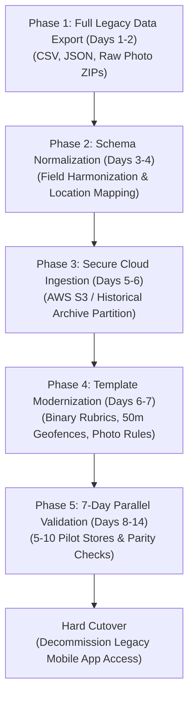

# Module 08: Migration, Frontline Adoption & Network Rollout

## 0. Module Scope & Source Inventory

- **Priority Tier:** **P2 / P3 Enablement** (Migration Off WhatsApp/Excel/Paper, Legacy Software Transition, Multi-Outlet Rollout & Frontline Adoption)
- **Target Personas:** Multi-Location Founders, COOs, VPs of Operations, Franchise Operations Heads, Procurement Directors, CIOs / IT Operations Leads, Compliance & QA Directors, Area / District Managers, Store / Outlet Managers
- **Core Operational Thesis:** Multi-location teams cannot be everywhere at once. Informal tools (WhatsApp, Excel, Google Forms, paper clipboards, and notebooks) work at 1–3 outlets, crack at 4–5 outlets, and collapse beyond 8+ branches. Switching to an audit management system succeeds only when operators combine clean data migration with lean checklists, zero-download browser workflows, and a firm cutover that eliminates legacy channels.

### Source Blog Inventory (18 Source Blogs)

| # | Blog Title & Canonical URL | Category | Words | Routed-Out Sections (Handled Elsewhere) |
| :--- | :--- | :--- | :---: | :--- |
| 1 | [Audit Software Migration, Scalability & Configuration: A Practical Guide](https://audiment.in/blog/audit-software-migration-scalability-configuration) | Audit Management | 3,033 | — |
| 2 | [How Long Does It Take to Onboard 50 Outlets onto an Audit Platform?](https://audiment.in/blog/how-long-does-it-take-to-onboard-50-outlets-onto-an-audit-platform) | Procurement & Evaluation | 1,128 | — |
| 3 | [How to Compile Outlet Audit Reports Without Spending a Weekend on Excel](https://audiment.in/blog/how-to-compile-outlet-audit-reports-without-spending-a-weekend-on-excel) | Retail & Multi-Unit Operations | 1,636 | — |
| 4 | [How to Compile Paper Audits Faster: From One Week to One Day](https://audiment.in/blog/how-to-compile-paper-audits-faster-from-one-week-to-one-day) | Platform Migration | 1,626 | — |
| 5 | [How to Migrate Audit Checklists from Google Forms or Excel to a Proper Platform](https://audiment.in/blog/how-to-migrate-audit-checklists-from-google-forms-or-excel-to-a-proper) | Platform Migration | 1,367 | — |
| 6 | [How to Migrate Templates from iAuditor to Another Audit Platform](https://audiment.in/blog/how-to-migrate-templates-from-iauditor-to-another-audit-platform) | Platform Migration | 1,372 | — |
| 7 | [How to Move from Paper Checklists to Digital Without Upsetting Your Staff](https://audiment.in/blog/how-to-move-from-paper-checklists-to-digital-without-upsetting) | Platform Migration | 1,571 | — |
| 8 | [How to Organise Audit Photos Scattered Across WhatsApp Groups](https://audiment.in/blog/how-to-organise-audit-photos-scattered-across-whatsapp-groups) | Platform Migration | 1,424 | — |
| 9 | [How to Replace Paper Checklists for a Grocery Chain](https://audiment.in/blog/how-to-replace-paper-checklists-for-a-grocery-chain) | Retail Operations | 1,428 | — |
| 10 | [How to Replace Paper Store Audits with a Digital System](https://audiment.in/blog/how-to-replace-paper-store-audits-with-a-digital-system) | Retail Operations | 1,380 | *How Does a Digital System Automate Follow-Up and Maintenance?* → Mod 03 |
| 11 | [How to Roll Out a Standard Audit Checklist Across 100 Franchise Outlets](https://audiment.in/blog/how-to-roll-out-a-standard-audit-checklist-across-100-franchise-outlets) | Franchise Operations | 1,434 | — |
| 12 | [How to Run a Paid Pilot of Audit Software with 5 Outlets](https://audiment.in/blog/how-to-run-a-paid-pilot-of-audit-software-with-5-outlets) | Procurement & Evaluation | 1,251 | — |
| 13 | [How to Switch Audit Software Without Losing Past Audit Data](https://audiment.in/blog/how-to-switch-audit-software-without-losing-past-audit-data) | Platform & Migration | 1,988 | — |
| 14 | [How to Train Outlet Staff on a New Audit App in One Session](https://audiment.in/blog/how-to-train-outlet-staff-on-a-new-audit-app-in-one-session) | HR & Training | 1,120 | — |
| 15 | [Moving from Excel and WhatsApp Audits to a Real System: A Transition Plan](https://audiment.in/blog/moving-from-excel-and-whatsapp-audits-to-a-real-system-a-transition-plan) | Platform Migration | 1,353 | — |
| 16 | [When to Move from WhatsApp to Proper Audit Software for Your Outlets](https://audiment.in/blog/when-to-move-from-whatsapp-to-proper-audit-software-for-your-outlets) | Multi-Location Growth | 1,191 | — |
| 17 | [Why Audit Software Failed the Last Time and How to Get Adoption Right](https://audiment.in/blog/why-audit-software-failed-the-last-time-and-how-to-get-adoption-right) | Platform Migration | 1,403 | *Why Does a Broken Corrective Action Loop Cause Staff to Stop Auditing?* → Mod 03 |
| 18 | [Why Corrective Actions in a Notebook Never Get Closed (and What to Use Instead)](https://audiment.in/blog/why-corrective-actions-in-a-notebook-never-get-closed-and-what-to-use) | Platform Migration | 1,626 | *What structural framework does corrective action tracking software use instead?*; *Paper Notebooks vs Digital Corrective Action Software*; *How does proof-based corrective action tracking prevent repeat audit failures?*; *Related Corrective Action & Audit Accountability Guides* → Mod 03 |

---

## 1. Why Legacy Audit Channels Fail at Multi-Location Scale

### 1.1 The 5-Outlet Scaling Inflection Point

Operators with 2 or 3 stores can survive on manual oversight, but the operational breaking point hits at **5 locations** [when-to-move-from-whatsapp-to-proper-audit-software-for-your-outlets](https://audiment.in/blog/when-to-move-from-whatsapp-to-proper-audit-software-for-your-outlets).

| Network Size | Daily Messaging & Audit Reality | Management Outcome |
| :--- | :--- | :--- |
| **1–3 Outlets** | Founder reads every WhatsApp update, spots defects personally, and follows up directly | Manageable chaos; informal checks hold together [when-to-move-from-whatsapp-to-proper-audit-software-for-your-outlets](https://audiment.in/blog/when-to-move-from-whatsapp-to-proper-audit-software-for-your-outlets) |
| **4–7 Outlets** | **150+ messages/day** across ~5 group chats (opening checks, cash register closing slips, customer complaint screenshots, leave requests) | Information overload; leadership skims chats and defects sit unaddressed for days [when-to-move-from-whatsapp-to-proper-audit-software-for-your-outlets](https://audiment.in/blog/when-to-move-from-whatsapp-to-proper-audit-software-for-your-outlets) |
| **8+ Outlets** | **400+ messages/day**; managers recycle photos from prior days; no cross-store ranking | Complete blind spots on lowest hygiene scores or highest open maintenance faults [when-to-move-from-whatsapp-to-proper-audit-software-for-your-outlets](https://audiment.in/blog/when-to-move-from-whatsapp-to-proper-audit-software-for-your-outlets) |

**Five clear signs an operator has outgrown WhatsApp:** (1) inability to rank outlets by compliance score, (2) staff posting recycled photos without detection, (3) maintenance issues repeatedly forgotten, (4) onboarding new managers takes weeks, and (5) leadership notification burnout [when-to-move-from-whatsapp-to-proper-audit-software-for-your-outlets](https://audiment.in/blog/when-to-move-from-whatsapp-to-proper-audit-software-for-your-outlets).

### 1.2 Why WhatsApp Destroys Evidentiary Chain of Custody

Using WhatsApp for store audits and repair photos destroys legal and operational proof through four mechanisms [how-to-organise-audit-photos-scattered-across-whatsapp-groups](https://audiment.in/blog/how-to-organise-audit-photos-scattered-across-whatsapp-groups):

1. **EXIF & GPS Metadata Stripping:** WhatsApp strips device-level EXIF tags (capture timestamps, latitude/longitude, camera hardware IDs), making it impossible to prove whether a photo came from Indiranagar or Koramangala [how-to-organise-audit-photos-scattered-across-whatsapp-groups](https://audiment.in/blog/how-to-organise-audit-photos-scattered-across-whatsapp-groups).
2. **Arbitrary File Renaming:** Files are renamed to generic strings like `IMG-20260314-WA0023.jpg` with zero outlet, equipment, or question context [how-to-organise-audit-photos-scattered-across-whatsapp-groups](https://audiment.in/blog/how-to-organise-audit-photos-scattered-across-whatsapp-groups).
3. **Aggressive Image Compression:** Compression blurs critical inspection details—expiry dates on food labels, decimal points on digital thermometers, or pest droppings [how-to-organise-audit-photos-scattered-across-whatsapp-groups](https://audiment.in/blog/how-to-organise-audit-photos-scattered-across-whatsapp-groups).
4. **Buried Context & "Fixed, Sir" Culture:** Photos are severed from Pass/Fail questions and buried under 50+ subsequent chat messages; managers reply *"I will look into it"* or *"Fixed, sir"* with zero tracked SLA or verified follow-up [how-to-organise-audit-photos-scattered-across-whatsapp-groups](https://audiment.in/blog/how-to-organise-audit-photos-scattered-across-whatsapp-groups), [moving-from-excel-and-whatsapp-audits-to-a-real-system-a-transition-plan](https://audiment.in/blog/moving-from-excel-and-whatsapp-audits-to-a-real-system-a-transition-plan).

### 1.3 Why Google Forms & Excel Collapse at Scale

Google Forms and Excel sheets break down around 15–75 outlets due to four structural defects [how-to-migrate-audit-checklists-from-google-forms-or-excel-to-a-proper](https://audiment.in/blog/how-to-migrate-audit-checklists-from-google-forms-or-excel-to-a-proper), [how-to-compile-outlet-audit-reports-without-spending-a-weekend-on-excel](https://audiment.in/blog/how-to-compile-outlet-audit-reports-without-spending-a-weekend-on-excel):

- **Gallery Upload & Geolocation Loopholes:** Google Forms lets staff upload screenshots, old photos, or stock images from their gallery and submit inspections from home, a bus, or a café [how-to-migrate-audit-checklists-from-google-forms-or-excel-to-a-proper](https://audiment.in/blog/how-to-migrate-audit-checklists-from-google-forms-or-excel-to-a-proper).
- **Disconnected Google Drive Clutter:** Uploaded images land in Drive folders with arbitrary alphanumeric filenames (`IMG_9821_thumb.jpg`) unlinked from the spreadsheet row (`"Chiller: 8°C"`) [how-to-migrate-audit-checklists-from-google-forms-or-excel-to-a-proper](https://audiment.in/blog/how-to-migrate-audit-checklists-from-google-forms-or-excel-to-a-proper).
- **Zero Automated Task Routing:** Logging `"Broken Walk-In Freezer"` generates no repair ticket; operations leads must manually read rows and send separate WhatsApp messages [how-to-migrate-audit-checklists-from-google-forms-or-excel-to-a-proper](https://audiment.in/blog/how-to-migrate-audit-checklists-from-google-forms-or-excel-to-a-proper).
- **Weekend Compilation & Fragile Formulas:** Area Managers take ~240 photos across 12 visits and spend weekends guessing which broken freezer belongs to Store #4 vs. Store #9, fixing broken `VLOOKUP`/`SUM` formulas, and spending **30% of working hours** on clerical entry—delaying executive reporting by **7 to 14 days** [how-to-compile-outlet-audit-reports-without-spending-a-weekend-on-excel](https://audiment.in/blog/how-to-compile-outlet-audit-reports-without-spending-a-weekend-on-excel), [moving-from-excel-and-whatsapp-audits-to-a-real-system-a-transition-plan](https://audiment.in/blog/moving-from-excel-and-whatsapp-audits-to-a-real-system-a-transition-plan).

#### Time-Motion Comparison: Excel + WhatsApp vs. Automated Cloud Aggregation

| Operational Step | Manual Excel & WhatsApp Workflow | Automated Audiment Workflow | Time Saved Per Audit Cycle |
| :--- | :--- | :--- | :--- |
| **On-Site Field Recording** | 90 mins writing paper notes or typing into mobile sheets | 45 mins tapping native mobile checklist with required photo prompts | 45 mins per store [how-to-compile-outlet-audit-reports-without-spending-a-weekend-on-excel](https://audiment.in/blog/how-to-compile-outlet-audit-reports-without-spending-a-weekend-on-excel) |
| **Photo Sorting & Renaming** | 60 mins downloading chat photos, matching to store IDs | 0 mins (camera auto-tags timestamp, GPS, checkpoint ID) | 60 mins per audit day [how-to-compile-outlet-audit-reports-without-spending-a-weekend-on-excel](https://audiment.in/blog/how-to-compile-outlet-audit-reports-without-spending-a-weekend-on-excel) |
| **Formula & Score Tallying** | 45 mins verifying weighted percentages and broken `SUM` cells | 0 mins (scoring engine calculates category weights instantly) | 45 mins per audit day [how-to-compile-outlet-audit-reports-without-spending-a-weekend-on-excel](https://audiment.in/blog/how-to-compile-outlet-audit-reports-without-spending-a-weekend-on-excel) |
| **Individual Store PDF Export** | 90 mins assembling Word docs, cropping photos, converting PDF | 0 mins (unalterable PDF emailed/WhatsApped on submit) | 90 mins per audit day [how-to-compile-outlet-audit-reports-without-spending-a-weekend-on-excel](https://audiment.in/blog/how-to-compile-outlet-audit-reports-without-spending-a-weekend-on-excel) |
| **CAPA Assignment & Tracking** | 120 mins texting managers action items, updating follow-up rows | 0 mins (failed items auto-generate tracked tickets with SLAs) | 120 mins per week [how-to-compile-outlet-audit-reports-without-spending-a-weekend-on-excel](https://audiment.in/blog/how-to-compile-outlet-audit-reports-without-spending-a-weekend-on-excel) |
| **Regional Executive Rollup** | 240 mins consolidating 15 area manager sheets into master sheet | 0 mins (central analytics dashboard updates in real time) | 4 hours every weekend [how-to-compile-outlet-audit-reports-without-spending-a-weekend-on-excel](https://audiment.in/blog/how-to-compile-outlet-audit-reports-without-spending-a-weekend-on-excel) |
| **Total Weekly Burden** | **14.5 hours weekly per Area Manager** | **0.5 hours weekly** (governance review only) | **14 hours reclaimed weekly** [how-to-compile-outlet-audit-reports-without-spending-a-weekend-on-excel](https://audiment.in/blog/how-to-compile-outlet-audit-reports-without-spending-a-weekend-on-excel) |

### 1.4 Why Paper Binders, Clipboards & Notebooks Fail

Paper clipboards create a **5 to 7 business day** compilation lag across seven sequential handoffs (Day 1 On-Site Fieldwork → Day 2 Transit → Day 3 Manual Excel Entry at 45–75 min/store or 12.5–16 hrs for 10–12 stores → Day 4 WhatsApp Photo Reconciliation → Day 5 Clarification of illegible notes → Day 6 Word/PDF formatting → Day 7 Executive delivery) [how-to-compile-paper-audits-faster-from-one-week-to-one-day](https://audiment.in/blog/how-to-compile-paper-audits-faster-from-one-week-to-one-day), [how-to-replace-paper-store-audits-with-a-digital-system](https://audiment.in/blog/how-to-replace-paper-store-audits-with-a-digital-system).

- **High-Risk Perishable Failures in Grocery:** Walk-in condensation and grease ruin sheets; clerks pencil-whip raw poultry 2°C checks in 30 seconds before break; tripped compressors warm chillers to 11°C for hours without maintenance alerts, causing thousands of dollars in shrink and FSSAI fines for illegible/missing cold-chain, pest control, and water potability logs [how-to-replace-paper-checklists-for-a-grocery-chain](https://audiment.in/blog/how-to-replace-paper-checklists-for-a-grocery-chain).
- **70% Unclosed CAPAs in Spiral Notebooks:** Supervisors scribble 5–6 defects (cracked handwash sink, improper sanitiser dilution, missing price tags, blocked exits) in store logbooks; 3 weeks later, **70% remain unaddressed** because notebook ink creates collective rather than named individual ownership, zero reminder/escalation triggers, verbal sign-offs over phone calls, and zero central dashboard telemetry [why-corrective-actions-in-a-notebook-never-get-closed-and-what-to-use](https://audiment.in/blog/why-corrective-actions-in-a-notebook-never-get-closed-and-what-to-use).

| Performance Metric | Traditional Paper Auditing | Hybrid Paper + Excel Entry | Automated Digital Platform (Audiment) |
| :--- | :--- | :--- | :--- |
| **Field Data Collection** | Pen, clipboard, paper checklist | Pen and paper on-site | Mobile browser; zero app download [how-to-compile-paper-audits-faster-from-one-week-to-one-day](https://audiment.in/blog/how-to-compile-paper-audits-faster-from-one-week-to-one-day) |
| **Transcription Time** | 60–90 min per store | 45–60 min per store | 0 mins (instant edge ingestion) [how-to-compile-paper-audits-faster-from-one-week-to-one-day](https://audiment.in/blog/how-to-compile-paper-audits-faster-from-one-week-to-one-day) |
| **Photo Attribution** | Manual WhatsApp cross-referencing | Unsorted cloud drive links | Embedded directly inside inspection item [how-to-compile-paper-audits-faster-from-one-week-to-one-day](https://audiment.in/blog/how-to-compile-paper-audits-faster-from-one-week-to-one-day) |
| **Scoring Mechanism** | Manual mental arithmetic | Spreadsheet formulas (error-prone) | Automated weighted scoring (1, 2, 5 weights) [how-to-compile-paper-audits-faster-from-one-week-to-one-day](https://audiment.in/blog/how-to-compile-paper-audits-faster-from-one-week-to-one-day) |
| **Total Compilation Turnaround** | 5 to 7 business days | 3 to 4 business days | Under 2 hours (instant executive view) [how-to-compile-paper-audits-faster-from-one-week-to-one-day](https://audiment.in/blog/how-to-compile-paper-audits-faster-from-one-week-to-one-day) |
| **Falsification Risk** | High (backdating, remote completion) | High (unverified retrospective entry) | Zero (50m GPS geofencing, live camera lock, network UTC) [how-to-compile-paper-audits-faster-from-one-week-to-one-day](https://audiment.in/blog/how-to-compile-paper-audits-faster-from-one-week-to-one-day) |
| **Corrective Action Handoff** | Weekly summary meetings | Emailing spreadsheet rows | Auto-created tickets with 48h SLA + immediate manager sign-off [how-to-compile-paper-audits-faster-from-one-week-to-one-day](https://audiment.in/blog/how-to-compile-paper-audits-faster-from-one-week-to-one-day) |

---

## 2. Pre-Migration Data Governance, Extraction & Historical Preservation

### 2.1 Five Governance Rules & Six-Stage Migration Sequence

Before pressing import, distinguish between temporary operational friction (fixable via configuration) and structural software limits (requiring migration), and establish five data governance rules: (1) **Inventory** existing assets, (2) **Scope** what moves live, (3) **Cleanup** obsolete checklists and inactive users, (4) **Recreation** of modernized core templates, and (5) **Archiving** of compliance records [audit-software-migration-scalability-configuration](https://audiment.in/blog/audit-software-migration-scalability-configuration).

Execute migration in six stages: **Inventory → Clean → Map → Test (5-location sample) → Migrate (planned cutover window) → Validate** [audit-software-migration-scalability-configuration](https://audiment.in/blog/audit-software-migration-scalability-configuration).

| Audit Data Category | Migration Evaluation Questions |
| :--- | :--- |
| **Location Directory** | Which outlets are currently active, and how are regions structured? [audit-software-migration-scalability-configuration](https://audiment.in/blog/audit-software-migration-scalability-configuration) |
| **User Directory** | Which staff members require active role-based access? [audit-software-migration-scalability-configuration](https://audiment.in/blog/audit-software-migration-scalability-configuration) |
| **Audit Templates** | Which master checklists represent current brand standards? [audit-software-migration-scalability-configuration](https://audiment.in/blog/audit-software-migration-scalability-configuration) |
| **Completed Audits** | How many months or years of active audit history must remain searchable? [audit-software-migration-scalability-configuration](https://audiment.in/blog/audit-software-migration-scalability-configuration) |
| **Open Findings** | Which unresolved findings need to transfer to the new task workflow? [audit-software-migration-scalability-configuration](https://audiment.in/blog/audit-software-migration-scalability-configuration) |
| **Corrective Actions** | Which open corrective tasks require ongoing owner tracking? [audit-software-migration-scalability-configuration](https://audiment.in/blog/audit-software-migration-scalability-configuration) |
| **Historical Scores** | Do legacy scoring models map cleanly to new performance metrics? [audit-software-migration-scalability-configuration](https://audiment.in/blog/audit-software-migration-scalability-configuration) |
| **Photo Evidence** | Which historical evidence files must be retained for legal compliance? [audit-software-migration-scalability-configuration](https://audiment.in/blog/audit-software-migration-scalability-configuration) |

### 2.2 Four-Tier Historical Retention Model

Avoid clogging the live operational database with years of unformatted files by separating history into four tiers [audit-software-migration-scalability-configuration](https://audiment.in/blog/audit-software-migration-scalability-configuration):

- **Active Records:** Ongoing audits and open CAPA tasks requiring active follow-up [audit-software-migration-scalability-configuration](https://audiment.in/blog/audit-software-migration-scalability-configuration).
- **Analytical Records:** **12–24 months** of audit history kept searchable for network trend comparison [audit-software-migration-scalability-configuration](https://audiment.in/blog/audit-software-migration-scalability-configuration).
- **Reference Records:** Multi-year inspection records retained for statutory compliance [audit-software-migration-scalability-configuration](https://audiment.in/blog/audit-software-migration-scalability-configuration).
- **Archived Records:** Legacy files moved to external encrypted cloud storage (e.g., AWS S3, Azure Blob Storage, or secured Google Drive) [audit-software-migration-scalability-configuration](https://audiment.in/blog/audit-software-migration-scalability-configuration), [how-to-migrate-audit-checklists-from-google-forms-or-excel-to-a-proper](https://audiment.in/blog/how-to-migrate-audit-checklists-from-google-forms-or-excel-to-a-proper).

### 2.3 Pre-Migration Vendor Exit Checklist & Four Data Layers

Incumbent SaaS vendors often throttle APIs, disable bulk exports, or charge data extraction fees once cancellation notice is given. **Never cancel the incumbent contract until all exports are validated in enterprise-owned storage** [how-to-switch-audit-software-without-losing-past-audit-data](https://audiment.in/blog/how-to-switch-audit-software-without-losing-past-audit-data).

#### Four Critical Migration Vulnerabilities
1. **EXIF Metadata Stripping:** Bulk ZIP exports often strip raw EXIF device UTC timestamps, camera serial numbers, and GPS coordinates [how-to-switch-audit-software-without-losing-past-audit-data](https://audiment.in/blog/how-to-switch-audit-software-without-losing-past-audit-data).
2. **Orphaned CAPA Tasks:** Failed checklist responses become decoupled from maintenance work orders [how-to-switch-audit-software-without-losing-past-audit-data](https://audiment.in/blog/how-to-switch-audit-software-without-losing-past-audit-data).
3. **Proprietary Schema Lock-In:** Vendors export convoluted nested JSON or unstructured PDF blobs that resist relational SQL queries [how-to-switch-audit-software-without-losing-past-audit-data](https://audiment.in/blog/how-to-switch-audit-software-without-losing-past-audit-data).
4. **Unsynchronized Dual-System Cutover:** Running two systems without a cutover gate creates duplicate submissions and corrupted YTD compliance metrics [how-to-switch-audit-software-without-losing-past-audit-data](https://audiment.in/blog/how-to-switch-audit-software-without-losing-past-audit-data).

#### Pre-Migration Exit Audit & Required Data Layers

| Data Layer | Target Export Format | Critical Mandatory Fields Required |
| :--- | :--- | :--- |
| **1. Template Blueprints** | JSON / CSV / XLSX | Checklist title, section hierarchy, question unique IDs, response types, scoring weights, mandatory photo flags [how-to-switch-audit-software-without-losing-past-audit-data](https://audiment.in/blog/how-to-switch-audit-software-without-losing-past-audit-data) |
| **2. Inspection Submissions** | Relational CSV / JSON | Audit ID, Store/Branch ID, Auditor User ID, Scheduled Date, Submission UTC Timestamp, GPS Lat/Long, Total & Category Scores [how-to-switch-audit-software-without-losing-past-audit-data](https://audiment.in/blog/how-to-switch-audit-software-without-losing-past-audit-data) |
| **3. Photographic Evidence** | Raw JPEG / PNG Archives | High-res files preserving original EXIF metadata (camera hardware ID, GPS, capture time), keyed to Audit ID & Question ID—**NOT expiring CDN token links** [how-to-switch-audit-software-without-losing-past-audit-data](https://audiment.in/blog/how-to-switch-audit-software-without-losing-past-audit-data) |
| **4. Corrective Action (CAPA) Logs** | Tabular CSV / SQL Dump | Ticket ID, linked Audit ID, Checkpoint ID, Failure Description, Severity, Assigned Owner, Deadline, Closed Timestamp, Before/After Photo URLs [how-to-switch-audit-software-without-losing-past-audit-data](https://audiment.in/blog/how-to-switch-audit-software-without-losing-past-audit-data) |

Additional pre-exit checks: verify **Contractual IP Clause** confirming full ownership of raw data and media, document **Bulk API Rate Limits** (calls/min) for automated extraction if needed, and export **User & Location Hierarchies** (active and inactive stores, area manager mappings) [how-to-switch-audit-software-without-losing-past-audit-data](https://audiment.in/blog/how-to-switch-audit-software-without-losing-past-audit-data).

### 2.4 Rescuing Historical Google Forms & WhatsApp Media

- **Google Forms / Sheets:** (1) Freeze public response access, (2) export Google Sheets database as `.xlsx`/`.csv`, (3) bulk-download uploads via **Google Drive Takeout**, (4) archive in AWS S3 or secured Drive folder labeled `[Legacy_Audit_Archive_2023_2025]` rather than bloating the live database with 10,000 messy rows [how-to-migrate-audit-checklists-from-google-forms-or-excel-to-a-proper](https://audiment.in/blog/how-to-migrate-audit-checklists-from-google-forms-or-excel-to-a-proper).
- **WhatsApp Chat Media:** (1) Open **WhatsApp Web** → **Group Info** → **Media, Links, and Docs** → bulk download; (2) batch-rename files using **Bulk Rename Utility** (Windows) or **NameChanger** (Mac) to `[Store_ID]_[YYYY-MM-DD]_[Category]_[Original_Name].jpg` (e.g., `Store104_2026-02-18_KitchenLine_WA0023.jpg`); (3) upload to encrypted cloud folders partitioned by outlet and quarter (`Drive / Audit_Archive / 2026_Q1 / Store_104 /`) [how-to-organise-audit-photos-scattered-across-whatsapp-groups](https://audiment.in/blog/how-to-organise-audit-photos-scattered-across-whatsapp-groups).

---

## 3. Schema Normalization, Scoring Reconciliation & Technical Validation

### 3.1 Mapping Unstructured Legacy JSON to Normalized Ingestion Schema

Legacy tools (SafetyCulture/iAuditor, ProntoForms) export nested key-value arrays with expiring media URLs; proof-based platforms normalize records into relational entities keyed to `location_id`, `template_id`, `checkpoint_id`, durable `s3://` keys, `exif_metadata_verified`, and linked `capa_ticket` objects [how-to-switch-audit-software-without-losing-past-audit-data](https://audiment.in/blog/how-to-switch-audit-software-without-losing-past-audit-data):

```json
/* UNSTRUCTURED LEGACY EXPORT PAYLOAD */
{
  "inspection_uuid": "f81d4fae-7dec-11d0-a765-00a0c91e6bf6",
  "site_label": "Downtown Flagship #104",
  "conducted_on": "2024-11-14T09:42:15Z",
  "score_result": "88.5%",
  "items": [{
    "label": "Is the emergency fire exit completely unobstructed?",
    "selected": "FAIL",
    "attached_media": ["https://vendor-cdn.com/expiring-token/img902.jpg"],
    "action_item": "Boxes blocking rear stairwell. Manager notified."
  }]
}

/* NORMALIZED AUDIMENT INGESTION SCHEMA */
{
  "historical_audit_id": "LEGACY-F81D4FAE",
  "location_id": "STORE-104",
  "template_id": "FIRE-LIFE-SAFETY-V2",
  "auditor_email": "r.chen@brandops.com",
  "submitted_at_utc": "2024-11-14T09:42:15Z",
  "geofence_verified": true,
  "normalized_percentage_score": 88.5,
  "responses": [{
    "checkpoint_id": "FLS-EXIT-01",
    "status": "NON_CONFORMANCE",
    "severity": "CRITICAL",
    "evidence_media_key": "s3://brand-audit-archive/2024/11/img902.jpg",
    "exif_metadata_verified": true
  }],
  "capa_ticket": {
    "ticket_id": "CAPA-2024-104-01",
    "status": "CLOSED",
    "resolution_hours": 3.2,
    "closure_evidence_key": "s3://brand-audit-archive/2024/11/img902_resolved.jpg"
  }
}
```

### 3.2 Reconciling Divergent Historical Scoring Models

To preserve uninterrupted **36-month trend lines** without retroactively penalizing stores under new scoring rules, maintain a **Dual-View Longitudinal Partition** (Read-Only Historical Archive 2022–2025 + Active Operating Partition 2026+) and convert historical ratings using the **Normalized Percentage Formula** [how-to-switch-audit-software-without-losing-past-audit-data](https://audiment.in/blog/how-to-switch-audit-software-without-losing-past-audit-data):

> `Normalized Score (%) = (Total Points Earned / Total Maximum Points Available) * 100`

| Historic System Model | Raw Legacy Score | Conversion Formula | Normalized Historical Score |
| :--- | :---: | :--- | :---: |
| **5-Star Rating Model** | 4.2 / 5.0 Stars | `(4.2 / 5.0) * 100` | **84.0%** [how-to-switch-audit-software-without-losing-past-audit-data](https://audiment.in/blog/how-to-switch-audit-software-without-losing-past-audit-data) |
| **Point Deduction Model** | -18 Deductions (from 150) | `((150 - 18) / 150) * 100` | **88.0%** [how-to-switch-audit-software-without-losing-past-audit-data](https://audiment.in/blog/how-to-switch-audit-software-without-losing-past-audit-data) |
| **Binary Pass/Fail (80 checks)** | 72 Passed Checks | `(72 / 80) * 100` | **90.0%** [how-to-switch-audit-software-without-losing-past-audit-data](https://audiment.in/blog/how-to-switch-audit-software-without-losing-past-audit-data) |

### 3.3 Technical Data Migration Sequence & Validation Protocols

For a 100-location enterprise with 3–5 years of records, full extraction, schema normalization, media ingestion (including automated PDF parsing if a legacy vendor only supplies flat PDFs), and validation complete in **7 to 10 business days** (or 14 days with a 7-day parallel pilot) with zero store downtime [how-to-switch-audit-software-without-losing-past-audit-data](https://audiment.in/blog/how-to-switch-audit-software-without-losing-past-audit-data):



#### Migration Risk Mitigation Matrix

| Migration Risk | Preventive Action |
| :--- | :--- |
| **Data Mismapping** | Validate sample imports against source fields line-by-line [audit-software-migration-scalability-configuration](https://audiment.in/blog/audit-software-migration-scalability-configuration) |
| **Broken Checklist Logic** | Test conditional branching and scoring rules on mobile devices [audit-software-migration-scalability-configuration](https://audiment.in/blog/audit-software-migration-scalability-configuration) |
| **Permission Creep** | Verify role access boundaries before user go-live [audit-software-migration-scalability-configuration](https://audiment.in/blog/audit-software-migration-scalability-configuration) |
| **Missing Photo Proof** | Confirm legacy media attachments link to correct inspection items and return HTTP 200 [audit-software-migration-scalability-configuration](https://audiment.in/blog/audit-software-migration-scalability-configuration), [how-to-switch-audit-software-without-losing-past-audit-data](https://audiment.in/blog/how-to-switch-audit-software-without-losing-past-audit-data) |
| **Disrupted Field Schedules** | Run parallel audit cycles during initial cutover phase [audit-software-migration-scalability-configuration](https://audiment.in/blog/audit-software-migration-scalability-configuration) |

#### Three Mandatory Technical Validation Checks Before Decommissioning
1. **Database Row-Count Parity (100% Match):** `assert legacy_row_count == ingested_row_count` (e.g., if legacy has 14,280 completed audits from 2022–2025, exactly 14,280 must exist in the searchable archive) [how-to-switch-audit-software-without-losing-past-audit-data](https://audiment.in/blog/how-to-switch-audit-software-without-losing-past-audit-data).
2. **Zero-Broken-Link Media Audit:** Automated HTTP status check confirming 0 broken links (`status == 200`) across all migrated image URLs [how-to-switch-audit-software-without-losing-past-audit-data](https://audiment.in/blog/how-to-switch-audit-software-without-losing-past-audit-data).
3. **The 30-Second Regulatory Retrieval Drill:** Pull a random historical store audit from two years prior (e.g., Outlet #24 on August 12, 2024); the complete timestamped report with embedded photos must render in **under 30 seconds** [how-to-switch-audit-software-without-losing-past-audit-data](https://audiment.in/blog/how-to-switch-audit-software-without-losing-past-audit-data).

---

## 4. Checklist Refactoring & Platform Migration Playbooks

### 4.1 Converting Legacy Paper, Excel & Google Forms into Binary Digital Workflows

Never copy-paste bloated 80–180 question paper or spreadsheet forms directly into mobile software [audit-software-migration-scalability-configuration](https://audiment.in/blog/audit-software-migration-scalability-configuration), [how-to-move-from-paper-checklists-to-digital-without-upsetting](https://audiment.in/blog/how-to-move-from-paper-checklists-to-digital-without-upsetting). Refactor every item using objective conversions:

| Legacy Checklist Item | Why It Fails | Modern Proof-Based Digital Replacement |
| :--- | :--- | :--- |
| *Staff hygiene (Rating 1–5)* / *Following grooming policies?* | Subjective; Auditor A scores 4, Auditor B scores 2; too broad | **Pass / Fail:** Are 100% of kitchen food handlers wearing approved hair restraints, clean aprons, and trimmed nails? [how-to-migrate-audit-checklists-from-google-forms-or-excel-to-a-proper](https://audiment.in/blog/how-to-migrate-audit-checklists-from-google-forms-or-excel-to-a-proper), [how-to-migrate-templates-from-iauditor-to-another-audit-platform](https://audiment.in/blog/how-to-migrate-templates-from-iauditor-to-another-audit-platform) |
| *Walk-in temp (Text box)* / *Describe cold storage* | Staff type `"OK"` or `"Cold"`, guess from memory, or write 10-min paragraphs | **Numeric Range (`0.0°C–4.0°C`) / Pass-Fail (≤4°C)** + Mandatory live photo of digital thermometer probe readout [how-to-compile-paper-audits-faster-from-one-week-to-one-day](https://audiment.in/blog/how-to-compile-paper-audits-faster-from-one-week-to-one-day), [how-to-migrate-audit-checklists-from-google-forms-or-excel-to-a-proper](https://audiment.in/blog/how-to-migrate-audit-checklists-from-google-forms-or-excel-to-a-proper), [how-to-migrate-templates-from-iauditor-to-another-audit-platform](https://audiment.in/blog/how-to-migrate-templates-from-iauditor-to-another-audit-platform) |
| *Rate kitchen cleanliness (1–5)* / *Fitting room notes* | Defaults to "4" or vague notes (`"needs work"`, `"messy"`) | **Pass / Fail + Mandatory Live Photo:** Stainless steel prep counters sanitised with zero food residue / Fitting rooms clear of unreturned garments, clean mirrors, uniform hangers [how-to-migrate-audit-checklists-from-google-forms-or-excel-to-a-proper](https://audiment.in/blog/how-to-migrate-audit-checklists-from-google-forms-or-excel-to-a-proper), [how-to-migrate-templates-from-iauditor-to-another-audit-platform](https://audiment.in/blog/how-to-migrate-templates-from-iauditor-to-another-audit-platform), [how-to-replace-paper-store-audits-with-a-digital-system](https://audiment.in/blog/how-to-replace-paper-store-audits-with-a-digital-system) |
| *Window display (1–5)* / *Display signage (Yes/No)* | Subjective aesthetic scoring; false reporting | **Pass / Fail + Live Photo:** Mannequin styling, lighting, and vinyl graphics match current planogram guide (with "Golden Sample" reference photo embedded above question) [how-to-migrate-audit-checklists-from-google-forms-or-excel-to-a-proper](https://audiment.in/blog/how-to-migrate-audit-checklists-from-google-forms-or-excel-to-a-proper), [how-to-replace-paper-store-audits-with-a-digital-system](https://audiment.in/blog/how-to-replace-paper-store-audits-with-a-digital-system), [how-to-roll-out-a-standard-audit-checklist-across-100-franchise-outlets](https://audiment.in/blog/how-to-roll-out-a-standard-audit-checklist-across-100-franchise-outlets) |
| *Emergency exit checked (Tick)* / *POS desk cleanliness* | Ticked without checking; open to interpretation | **Pass / Fail + Live Photo:** Exit clear of inventory boxes and push bar operates freely / Counter free of personal items, concealed cables, current flyers [how-to-replace-paper-store-audits-with-a-digital-system](https://audiment.in/blog/how-to-replace-paper-store-audits-with-a-digital-system) |

#### Checklist Sizing, Walkthrough Grouping & Photo Rules
- **Prune by 30%–40%:** Aggressive pruning cuts inspection times by **35%** [how-to-migrate-templates-from-iauditor-to-another-audit-platform](https://audiment.in/blog/how-to-migrate-templates-from-iauditor-to-another-audit-platform), [how-to-move-from-paper-checklists-to-digital-without-upsetting](https://audiment.in/blog/how-to-move-from-paper-checklists-to-digital-without-upsetting).
- **The Rule of 30 (Daily Shift Checks):** Keep daily opening checklists **under 30 questions** (15–25 questions), strictly binary (Pass/Fail), and executable in **under 10 minutes** (target 6–8 minutes) [why-audit-software-failed-the-last-time-and-how-to-get-adoption-right](https://audiment.in/blog/why-audit-software-failed-the-last-time-and-how-to-get-adoption-right), [how-to-replace-paper-store-audits-with-a-digital-system](https://audiment.in/blog/how-to-replace-paper-store-audits-with-a-digital-system), [how-to-train-outlet-staff-on-a-new-audit-app-in-one-session](https://audiment.in/blog/how-to-train-outlet-staff-on-a-new-audit-app-in-one-session).
- **The 45-Question Rule (Routine Franchise / Weekly Audits):** Cap routine operational checklists at **35–45 items** (under 45 minutes); use format-specific blueprints (e.g., **25-point checklist** for compact mall kiosks vs. **45-point checklist** for 200-seat standalone restaurants), and reserve 80-question reviews for monthly audits [how-to-roll-out-a-standard-audit-checklist-across-100-franchise-outlets](https://audiment.in/blog/how-to-roll-out-a-standard-audit-checklist-across-100-franchise-outlets), [why-audit-software-failed-the-last-time-and-how-to-get-adoption-right](https://audiment.in/blog/why-audit-software-failed-the-last-time-and-how-to-get-adoption-right).
- **Physical Walkthrough Zone Grouping:** Organizing items in physical sequence (**Zone 1:** Exterior & Customer Frontage → **Zone 2:** Dining & POS Service Counter → **Zone 3:** Kitchen Line & Food Prep → **Zone 4:** Walk-in Cold Storage & Dry Pantry → **Zone 5:** Restrooms, Waste & Chemical Storage) cuts average walkthrough time by **25%** [how-to-migrate-audit-checklists-from-google-forms-or-excel-to-a-proper](https://audiment.in/blog/how-to-migrate-audit-checklists-from-google-forms-or-excel-to-a-proper).
- **Targeted Photo Protocol:** Never require 60 photos for 60 questions (which balloons audits to 2 hours). Require live camera-only photos exclusively on **failed items** plus **3 critical control points** on shift checks (e.g., walk-in temperature readout, fryer oil TPM <25% test strip, POS counter presentation) [how-to-organise-audit-photos-scattered-across-whatsapp-groups](https://audiment.in/blog/how-to-organise-audit-photos-scattered-across-whatsapp-groups), [how-to-roll-out-a-standard-audit-checklist-across-100-franchise-outlets](https://audiment.in/blog/how-to-roll-out-a-standard-audit-checklist-across-100-franchise-outlets).

#### Departmental Modularization for Supermarkets (5–10 Minute Modules)

| Department Module | Shift Inspection Focus | Key Evidence Requirement |
| :--- | :--- | :--- |
| **Fresh Produce (F&V)** | Morning culling of bruised fruit, misting system check, crate hygiene | Wide-angle photo of focal produce display table [how-to-replace-paper-checklists-for-a-grocery-chain](https://audiment.in/blog/how-to-replace-paper-checklists-for-a-grocery-chain) |
| **Dairy & Cold Storage** | Digital probe temperature logging, FIFO stock rotation, packaging integrity | In-app live photo of digital thermometer display [how-to-replace-paper-checklists-for-a-grocery-chain](https://audiment.in/blog/how-to-replace-paper-checklists-for-a-grocery-chain) |
| **Butchery & Seafood** | Cutting board sanitisation, separate raw/cooked knives, ice bed depth | Photo of calibrated meat core temperature probe [how-to-replace-paper-checklists-for-a-grocery-chain](https://audiment.in/blog/how-to-replace-paper-checklists-for-a-grocery-chain) |
| **Dry Grocery Aisles** | Expiry date spot-checks (catches items **3 days in advance**), shelf planograms, damaged cartons | Photo of promotional end-cap and clearance shelf [how-to-replace-paper-checklists-for-a-grocery-chain](https://audiment.in/blog/how-to-replace-paper-checklists-for-a-grocery-chain) |
| **Checkout & Front-End** | POS scanner speed, express lane queue management, floor cleanliness | Photo of customer checkout concourse [how-to-replace-paper-checklists-for-a-grocery-chain](https://audiment.in/blog/how-to-replace-paper-checklists-for-a-grocery-chain) |

### 4.2 Migrating Templates & Data from iAuditor (SafetyCulture)

Organizations leaving iAuditor/SafetyCulture (due to escalating per-seat licensing costs, currency conversion friction, or lack of hardware-enforced fraud controls) execute a 5-step migration with zero downtime [how-to-migrate-templates-from-iauditor-to-another-audit-platform](https://audiment.in/blog/how-to-migrate-templates-from-iauditor-to-another-audit-platform):

1. **Export Active Templates:** Admin login → **Templates** → open template → **More Options (`...`)** → **Export** → choose **CSV** (flat structures) or **JSON** (complex nested conditional branches) [how-to-migrate-templates-from-iauditor-to-another-audit-platform](https://audiment.in/blog/how-to-migrate-templates-from-iauditor-to-another-audit-platform).
2. **Archive Historical Inspections:** Go to **Audits / Inspections** → filter past **24–36 months** → **Export to CSV** (scores, timestamps, user IDs, locations) + bulk **PDF export** to AWS S3 or Google Drive [how-to-migrate-templates-from-iauditor-to-another-audit-platform](https://audiment.in/blog/how-to-migrate-templates-from-iauditor-to-another-audit-platform).
3. **Prune Using the "Ruthless Audit Rubric":** Cut bloated 120-item templates by **35%**, replacing 1–5 star ratings and open text boxes with binary Pass/Fail + live photo rules [how-to-migrate-templates-from-iauditor-to-another-audit-platform](https://audiment.in/blog/how-to-migrate-templates-from-iauditor-to-another-audit-platform).
4. **Flatten Deep Nested Logic into Binary Gates:** Deep 4-level iAuditor nested logic (*"If No → If Severity High → If Correctable Today → Question B"*) lags and crashes on older field phones in low-connectivity areas. Flatten trees by physical store zones; make `"Yes"` advance immediately and `"No"` expand: (a) mandatory live camera viewfinder (gallery disabled), (b) root-cause defect dropdown (Equipment Malfunction, Training Gap, Missing Stock), and (c) auto-generated CAPA ticket [how-to-migrate-templates-from-iauditor-to-another-audit-platform](https://audiment.in/blog/how-to-migrate-templates-from-iauditor-to-another-audit-platform).
5. **14-Day Parallel Pilot & Hard Cutover:**
   - **Days 1–7 (Parallel Pilot):** Run iAuditor and new platform side-by-side in **5 outlets (10% of network)** to compare speed, UI responsiveness, and photo capture [how-to-migrate-templates-from-iauditor-to-another-audit-platform](https://audiment.in/blog/how-to-migrate-templates-from-iauditor-to-another-audit-platform).
   - **Days 8–10 (Browser-First Training):** Send direct mobile browser links + 30-min training [how-to-migrate-templates-from-iauditor-to-another-audit-platform](https://audiment.in/blog/how-to-migrate-templates-from-iauditor-to-another-audit-platform).
   - **Day 14 (Hard Cutover):** Freeze edits in iAuditor and downgrade accounts to free/read-only tiers to block dual reporting [how-to-migrate-templates-from-iauditor-to-another-audit-platform](https://audiment.in/blog/how-to-migrate-templates-from-iauditor-to-another-audit-platform).

---

## 5. Multi-Outlet Onboarding & Rollout Schedules

### 5.1 Pre-Kickoff Assets & Vendor Technical Setup

Unlike legacy ERP/POS deployments taking 6–12 months, cloud-native audit platforms require **zero store servers or internal IT engineers** [how-long-does-it-take-to-onboard-50-outlets-onto-an-audit-platform](https://audiment.in/blog/how-long-does-it-take-to-onboard-50-outlets-onto-an-audit-platform). Kickoff requires four prepared assets [how-long-does-it-take-to-onboard-50-outlets-onto-an-audit-platform](https://audiment.in/blog/how-long-does-it-take-to-onboard-50-outlets-onto-an-audit-platform):

| Asset Category | Required Data Fields | Preparation Format |
| :--- | :--- | :--- |
| **Checklist Master Forms** | Questions, category groupings, pass/fail rules, scoring weights | Existing Word / Excel / PDF [how-long-does-it-take-to-onboard-50-outlets-onto-an-audit-platform](https://audiment.in/blog/how-long-does-it-take-to-onboard-50-outlets-onto-an-audit-platform) |
| **Store Master Register** | Store ID, store name, address, latitude/longitude, store format tier | Structured CSV / Spreadsheet [how-long-does-it-take-to-onboard-50-outlets-onto-an-audit-platform](https://audiment.in/blog/how-long-does-it-take-to-onboard-50-outlets-onto-an-audit-platform) |
| **Staff User Hierarchy** | Full name, role (Store Manager, Area Lead), email, mobile number | Structured CSV / Spreadsheet [how-long-does-it-take-to-onboard-50-outlets-onto-an-audit-platform](https://audiment.in/blog/how-to-migrate-audit-checklists-from-google-forms-or-excel-to-a-proper), [how-long-does-it-take-to-onboard-50-outlets-onto-an-audit-platform](https://audiment.in/blog/how-long-does-it-take-to-onboard-50-outlets-onto-an-audit-platform) |
| **Visual Reference Library** | "Golden Sample" photos of approved displays, clean prep lines, signage | JPEG/PNG images organized by topic [how-long-does-it-take-to-onboard-50-outlets-onto-an-audit-platform](https://audiment.in/blog/how-long-does-it-take-to-onboard-50-outlets-onto-an-audit-platform) |

**Vendor Implementation Steps:** (1) Dynamic checklist digitisation (binary inputs, percentage weights, live camera rules, embedded benchmark photos), (2) **50-metre satellite geofence** bounding boxes around store coordinates, (3) Automated CAPA SLA timers (**4-Hour SLA** Critical Food/Life Safety; **24-Hour SLA** Operational/Merchandising; **7-Day SLA** Low-Priority Maintenance—with **24–48h** critical and **5–7 day** cosmetic variants across hospitality/retail), and (4) Bulk user provisioning & optional Active Directory/Google SSO [how-long-does-it-take-to-onboard-50-outlets-onto-an-audit-platform](https://audiment.in/blog/how-long-does-it-take-to-onboard-50-outlets-onto-an-audit-platform), [why-corrective-actions-in-a-notebook-never-get-closed-and-what-to-use](https://audiment.in/blog/why-corrective-actions-in-a-notebook-never-get-closed-and-what-to-use). Note: critical food safety checks like sanitizer concentration (**200 PPM** test strip) can use a **2-Hour SLA** [how-to-migrate-audit-checklists-from-google-forms-or-excel-to-a-proper](https://audiment.in/blog/how-to-migrate-audit-checklists-from-google-forms-or-excel-to-a-proper).

### 5.2 Rollout Timelines by Network Context

| Rollout Context | Duration | Phase-by-Phase Execution Schedule |
| :--- | :---: | :--- |
| **Google Forms / Excel / WhatsApp Rapid Switch** | **7 Days** | **Days 1–2:** Standardize & import master checklists (15–20 daily, 30 weekly). **Days 3–4:** Configure store geofences, user roles, or run 5-store pilot. **Day 5:** 30-min virtual briefing via mobile web links. **Day 6:** Soft launch parallel run. **Day 7:** Hard cutover; archive WhatsApp groups and deprecate Forms/Excel [how-to-migrate-audit-checklists-from-google-forms-or-excel-to-a-proper](https://audiment.in/blog/how-to-migrate-audit-checklists-from-google-forms-or-excel-to-a-proper), [when-to-move-from-whatsapp-to-proper-audit-software-for-your-outlets](https://audiment.in/blog/when-to-move-from-whatsapp-to-proper-audit-software-for-your-outlets). |
| **50-Outlet Full Network Onboarding** | **7–14 Business Days (10-Day Core)** | **Days 1–3:** Convert checklists & bulk CSV import 50 stores, GPS coordinates, asset registers. **Days 4–5:** Provision hierarchy (50 Store Mgrs, 5 Area Mgrs, 1 Ops Director) & automated email/WhatsApp triggers. **Days 6–7:** Two 30-min webinars + practice audits. **Days 8–10:** Decommission WhatsApp/paper; 100% morning opening checks live. *(Phased option: 10 stores Week 1, 40 stores Week 2)* [how-long-does-it-take-to-onboard-50-outlets-onto-an-audit-platform](https://audiment.in/blog/how-long-does-it-take-to-onboard-50-outlets-onto-an-audit-platform). |
| **Grocery Chain Paper Replacement** | **14 Days** | **Days 1–3:** Build 5 modular department checklists. **Days 4–5:** Ingest stores & generate departmental QR links. **Days 6–8:** 3-store pilot with roving QA running parallel checks. **Days 9–10:** Refine questions & test offline sync. **Days 11–12:** 20-min manager briefing. **Day 13:** Soft launch. **Day 14:** Hard cutover & physically remove all clipboards [how-to-replace-paper-checklists-for-a-grocery-chain](https://audiment.in/blog/how-to-replace-paper-checklists-for-a-grocery-chain). |
| **100-Franchise Network Rollout** | **14 Days** | **Days 1–3:** VP Ops & Brand Standards consolidate regional forks into 1 master blueprint with reference photos. **Days 4–6:** Franchise Advisory Pilot across **10 stores** with **5 key multi-unit franchisees**. **Days 7–8:** Publish master blueprint to all 100 nodes in cloud. **Days 9–11:** Distribute authenticated browser links + 15-min video training. **Days 12–14:** Monitor first **500 inspections**, calibrate scores, track 48-hour CAPAs [how-to-roll-out-a-standard-audit-checklist-across-100-franchise-outlets](https://audiment.in/blog/how-to-roll-out-a-standard-audit-checklist-across-100-franchise-outlets). |
| **30-Day Full Paper / WhatsApp+Excel Transition** | **30 Days** | **Paper-to-Digital:** Days 1–5 Audit & prune; Days 6–8 Digital build & camera-only rules; Days 9–14 5-store parallel pilot; Days 15–20 30-min briefing + browser links; Day 30 Remove binders [how-to-replace-paper-store-audits-with-a-digital-system](https://audiment.in/blog/how-to-replace-paper-store-audits-with-a-digital-system). **WhatsApp+Excel:** Week 1 Standardize binary/zone checklists; Week 2 System setup + 5-store pilot; Week 3 30-min briefings + parallel audits; Week 4 Hard cutover & WhatsApp archive [moving-from-excel-and-whatsapp-audits-to-a-real-system-a-transition-plan](https://audiment.in/blog/moving-from-excel-and-whatsapp-audits-to-a-real-system-a-transition-plan). |

For complex enterprise software replacements, structure the project around a **9-step implementation roadmap**: (1) Inventory & Discovery → (2) Scope Definition → (3) Data Cleanup → (4) Field Mapping → (5) System Configuration → (6) Pilot Testing (5–10 outlets) → (7) User Acceptance Testing (UAT) → (8) Cutover & Go-Live → (9) Post-Launch Audit [audit-software-migration-scalability-configuration](https://audiment.in/blog/audit-software-migration-scalability-configuration).

---

## 6. Running a 5-Outlet Paid Pilot Before National Commitment

### 6.1 Why a 14-Day Paid Pilot Beats a Free Trial

Free trials use generic DIY templates and test data, causing teams to treat them as optional experiments. A **14-day paid pilot** (nominal fee e.g. **₹15,000–₹30,000**, typically **100% credited** to Year 1 upon contract execution) secures a dedicated implementation manager, vendor digitisation of actual SOPs (20-question opening + 40-question weekly audits), 50m geofences, equipment QR codes, and quantitative executive scoring—requiring only ~**3.5 hours** of corporate operations lead time (2h setup, 30m training, 1h Day 14 review) [how-to-run-a-paid-pilot-of-audit-software-with-5-outlets](https://audiment.in/blog/how-to-run-a-paid-pilot-of-audit-software-with-5-outlets).

### 6.2 Selecting the 5 Stress-Test Pilot Outlets

Never pilot solely in flagship HQ stores. Stress-test across five operational realities [how-to-run-a-paid-pilot-of-audit-software-with-5-outlets](https://audiment.in/blog/how-to-run-a-paid-pilot-of-audit-software-with-5-outlets):

| Pilot Store Profile | Selection Criteria | Operational Stress Test |
| :--- | :--- | :--- |
| **Store 1: Metro Flagship** | High-volume, disciplined staff, near corporate HQ | Tests high inspection frequency and detailed merchandising [how-to-run-a-paid-pilot-of-audit-software-with-5-outlets](https://audiment.in/blog/how-to-run-a-paid-pilot-of-audit-software-with-5-outlets) |
| **Store 2: Suburban Mall Unit** | Average sales, typical middle-tier store management | Validates standard daily opening/closing workflow adoption [how-to-run-a-paid-pilot-of-audit-software-with-5-outlets](https://audiment.in/blog/how-to-run-a-paid-pilot-of-audit-software-with-5-outlets) |
| **Store 3: High-Street Unit** | High footfall, busy cash desk, compact back-of-house | Tests inspection speed during live customer rushes [how-to-run-a-paid-pilot-of-audit-software-with-5-outlets](https://audiment.in/blog/how-to-run-a-paid-pilot-of-audit-software-with-5-outlets) |
| **Store 4: Basement / Remote Hub** | Concrete basement location with **zero 4G cellular signal** | Rigorous validation of offline capture and background auto-sync [how-to-run-a-paid-pilot-of-audit-software-with-5-outlets](https://audiment.in/blog/how-to-run-a-paid-pilot-of-audit-software-with-5-outlets) |
| **Store 5: Struggling Unit** | Low compliance history, recent manager turnover | Tests whether structured checklists raise poor store execution [how-to-run-a-paid-pilot-of-audit-software-with-5-outlets](https://audiment.in/blog/how-to-run-a-paid-pilot-of-audit-software-with-5-outlets) |

### 6.3 14-Day Pilot Schedule, Quantitative Scorecard & Day 12 Feedback

- **Days 1–3 (Setup):** Vendor digitizes 20-question opening & 40-question weekly checklists, maps 50m geofences, generates equipment QR codes, provisions 5 Store Managers + 1 Area Manager [how-to-run-a-paid-pilot-of-audit-software-with-5-outlets](https://audiment.in/blog/how-to-run-a-paid-pilot-of-audit-software-with-5-outlets).
- **Day 4 (Training):** 30-minute live virtual training + floor practice audit [how-to-run-a-paid-pilot-of-audit-software-with-5-outlets](https://audiment.in/blog/how-to-run-a-paid-pilot-of-audit-software-with-5-outlets).
- **Days 5–12 (Live Execution):** Daily morning opening self-checks with live photos + 2 scheduled Area Manager audits + 1 surprise spot-audit + CAPA resolution with After-photos [how-to-run-a-paid-pilot-of-audit-software-with-5-outlets](https://audiment.in/blog/how-to-run-a-paid-pilot-of-audit-software-with-5-outlets).
- **Day 12 (Qualitative Feedback):** Conduct **10-minute 1-on-1 phone interviews** + an **anonymous 5-question digital survey** asking whether the app froze during uploads, whether GPS ever locked them out inside the store, whether Before/After CAPA photos beat WhatsApp, and whether they prefer keeping the app over paper/WhatsApp [how-to-run-a-paid-pilot-of-audit-software-with-5-outlets](https://audiment.in/blog/how-to-run-a-paid-pilot-of-audit-software-with-5-outlets).
- **Days 13–14 (Go/No-Go Review):** Score against six quantitative benchmarks (no long-term obligation if critical benchmarks fail) [how-to-run-a-paid-pilot-of-audit-software-with-5-outlets](https://audiment.in/blog/how-to-run-a-paid-pilot-of-audit-software-with-5-outlets):

| Metric Category | Target Benchmark | Sample Verified Pilot Outcome |
| :--- | :--- | :--- |
| **Checklist Adherence** | `>= 95%` of checks completed on time | Pass: 98.2% [how-to-run-a-paid-pilot-of-audit-software-with-5-outlets](https://audiment.in/blog/how-to-run-a-paid-pilot-of-audit-software-with-5-outlets) |
| **Inspection Velocity** | `< 8 mins` for daily checks | Pass: 6.4 minutes avg [how-to-run-a-paid-pilot-of-audit-software-with-5-outlets](https://audiment.in/blog/how-to-run-a-paid-pilot-of-audit-software-with-5-outlets) |
| **Anti-Cheating Integrity** | `0%` gallery photos allowed | Pass: 100% native camera captures [how-to-run-a-paid-pilot-of-audit-software-with-5-outlets](https://audiment.in/blog/how-to-run-a-paid-pilot-of-audit-software-with-5-outlets) |
| **Offline Sync Reliability** | `0` dropped audit responses | Pass: 100% basement sync [how-to-run-a-paid-pilot-of-audit-software-with-5-outlets](https://audiment.in/blog/how-to-run-a-paid-pilot-of-audit-software-with-5-outlets) |
| **CAPA Resolution Speed** | `< 24h` average MTTR | Pass: 16.5 hours avg MTTR [how-to-run-a-paid-pilot-of-audit-software-with-5-outlets](https://audiment.in/blog/how-to-run-a-paid-pilot-of-audit-software-with-5-outlets) |
| **Store Manager Satisfaction** | `>= 4.0 / 5.0` rating | Pass: 4.4 / 5.0 survey score [how-to-run-a-paid-pilot-of-audit-software-with-5-outlets](https://audiment.in/blog/how-to-run-a-paid-pilot-of-audit-software-with-5-outlets) |

---

## 7. Frontline Training, Hardware Strategy & Sustained Adoption (95%+ Beyond Day 90)

### 7.1 Why Audit Software Fails Within 90 Days

Abandonment by Month 3 is rarely workforce laziness; it stems from three design failures [why-audit-software-failed-the-last-time-and-how-to-get-adoption-right](https://audiment.in/blog/why-audit-software-failed-the-last-time-and-how-to-get-adoption-right), [how-to-move-from-paper-checklists-to-digital-without-upsetting](https://audiment.in/blog/how-to-move-from-paper-checklists-to-digital-without-upsetting):

1. **Template Bloat:** 120–150+ item checklists stretch 12-minute checks into 45-minute rush-hour chores, causing pencil-whipping [how-to-move-from-paper-checklists-to-digital-without-upsetting](https://audiment.in/blog/how-to-move-from-paper-checklists-to-digital-without-upsetting), [why-audit-software-failed-the-last-time-and-how-to-get-adoption-right](https://audiment.in/blog/why-audit-software-failed-the-last-time-and-how-to-get-adoption-right).
2. **App-Store & Login Friction:** With store turnover exceeding **40%–50%+ annually**, forcing hires to install **80MB native apps** on low-storage personal Androids, wait on IT tickets, and manage multi-character passwords causes generic login sharing and Wednesday lockouts when an assistant manager quits on Tuesday [how-to-move-from-paper-checklists-to-digital-without-upsetting](https://audiment.in/blog/how-to-move-from-paper-checklists-to-digital-without-upsetting), [how-to-replace-paper-checklists-for-a-grocery-chain](https://audiment.in/blog/how-to-replace-paper-checklists-for-a-grocery-chain), [why-audit-software-failed-the-last-time-and-how-to-get-adoption-right](https://audiment.in/blog/why-audit-software-failed-the-last-time-and-how-to-get-adoption-right).
3. **Broken CAPA Loop & Surveillance Framing:** Defects logged in the app never get fixed by HQ, and GPS/photos framed as *"catching lazy workers"* trigger active workarounds [how-to-move-from-paper-checklists-to-digital-without-upsetting](https://audiment.in/blog/how-to-move-from-paper-checklists-to-digital-without-upsetting), [why-audit-software-failed-the-last-time-and-how-to-get-adoption-right](https://audiment.in/blog/why-audit-software-failed-the-last-time-and-how-to-get-adoption-right).

### 7.2 Browser-First Mobile & Hardware Strategy

Removing the native app-store barrier lifts first-week adoption from **45% to over 90%** [why-audit-software-failed-the-last-time-and-how-to-get-adoption-right](https://audiment.in/blog/why-audit-software-failed-the-last-time-and-how-to-get-adoption-right).

| Dimension | Legacy Native App / Wall Tablet | Browser-First Mobile Platform (Audiment) |
| :--- | :--- | :--- |
| **Installation & Cost** | 80MB App Store/Play download; $300–$500 wall tablets + waterproof cases | **Zero download**; 2-second load in Chrome/Safari on BYOD phones ($0 hardware CapEx) [how-to-replace-paper-checklists-for-a-grocery-chain](https://audiment.in/blog/how-to-replace-paper-checklists-for-a-grocery-chain), [why-audit-software-failed-the-last-time-and-how-to-get-adoption-right](https://audiment.in/blog/why-audit-software-failed-the-last-time-and-how-to-get-adoption-right) |
| **Authentication** | Username, complex password, SMS 2FA; IT provisioning ticket for new hires | Tokenized store magic links, QR check-in, mobile OTP, or individual store PINs [how-to-move-from-paper-checklists-to-digital-without-upsetting](https://audiment.in/blog/how-to-move-from-paper-checklists-to-digital-without-upsetting), [why-audit-software-failed-the-last-time-and-how-to-get-adoption-right](https://audiment.in/blog/why-audit-software-failed-the-last-time-and-how-to-get-adoption-right) |
| **Wet/Cold & Offline Resilience** | Wall tablets crack/fray and create queues + shared-screen cross-contamination; freezes without signal | Associates carry phones across aisles; local browser PWA caching captures offline responses/photos in basements and auto-syncs [how-to-move-from-paper-checklists-to-digital-without-upsetting](https://audiment.in/blog/how-to-move-from-paper-checklists-to-digital-without-upsetting), [how-to-replace-paper-checklists-for-a-grocery-chain](https://audiment.in/blog/how-to-replace-paper-checklists-for-a-grocery-chain) |
| **Multilingual Support** | English-only forms create literacy barriers | Single-tap UI & checklist toggles across **English, Hindi, Marathi, Tamil, Telugu, and Kannada** [how-to-replace-paper-checklists-for-a-grocery-chain](https://audiment.in/blog/how-to-replace-paper-checklists-for-a-grocery-chain), [how-to-train-outlet-staff-on-a-new-audit-app-in-one-session](https://audiment.in/blog/how-to-train-outlet-staff-on-a-new-audit-app-in-one-session) |

### 7.3 Collaborative Adoption & Single-Session Training Blueprint (30–35 Minutes)

Replace 60-page PDF manuals and 2-hour slide lectures (which fail within 72 hours) with a **4-stage collaborative rollout** and a **single 30–35 minute tactile mobile drill** [how-to-move-from-paper-checklists-to-digital-without-upsetting](https://audiment.in/blog/how-to-move-from-paper-checklists-to-digital-without-upsetting), [how-to-train-outlet-staff-on-a-new-audit-app-in-one-session](https://audiment.in/blog/how-to-train-outlet-staff-on-a-new-audit-app-in-one-session):

- **Reframe Proof as Staff Protection:** Show managers that timestamped morning logs (e.g., chiller running at **3°C at 09:00 AM**) legally shield them from unfair HQ or customer illness accusations [how-to-move-from-paper-checklists-to-digital-without-upsetting](https://audiment.in/blog/how-to-move-from-paper-checklists-to-digital-without-upsetting), [moving-from-excel-and-whatsapp-audits-to-a-real-system-a-transition-plan](https://audiment.in/blog/moving-from-excel-and-whatsapp-audits-to-a-real-system-a-transition-plan).
- **Peer-Led Champion Pilot:** Include **5 respected store managers plus 1 vocal sceptic**; when the sceptic saves 45 minutes of evening paperwork, they convert peers [how-to-move-from-paper-checklists-to-digital-without-upsetting](https://audiment.in/blog/how-to-move-from-paper-checklists-to-digital-without-upsetting).
- **Train at Least 2 Staff per Outlet:** Include assistant managers and shift supervisors alongside store managers, and record a **5-minute walkthrough video** of the 3 core workflows for Day-1 onboarding of future hires [how-to-train-outlet-staff-on-a-new-audit-app-in-one-session](https://audiment.in/blog/how-to-train-outlet-staff-on-a-new-audit-app-in-one-session).

#### The 35-Minute Interactive Training Sequence (4 Blocks)
1. **Block 1 — Manager's Payoff (Min 0–5):** Explain personal wins—no late-night WhatsApp chasing, faster HQ maintenance fixes, protection from unfair blame [how-to-train-outlet-staff-on-a-new-audit-app-in-one-session](https://audiment.in/blog/how-to-train-outlet-staff-on-a-new-audit-app-in-one-session).
2. **Block 2 — Live Android Screen Share (Min 5–15):** Trainer logs in via OTP/SSO/browser link on an actual Android phone, taps Pass/Fail, snaps a live locked-camera photo, and submits [how-to-train-outlet-staff-on-a-new-audit-app-in-one-session](https://audiment.in/blog/how-to-train-outlet-staff-on-a-new-audit-app-in-one-session).
3. **Block 3 — Simultaneous Field Drill (Min 15–30):** All 50 managers open the tool on their own phones in-store, complete a **5-to-10 question Practice Morning Check**, and trainer confirms all 50 submissions live on the central dashboard [how-long-does-it-take-to-onboard-50-outlets-onto-an-audit-platform](https://audiment.in/blog/how-long-does-it-take-to-onboard-50-outlets-onto-an-audit-platform), [how-to-train-outlet-staff-on-a-new-audit-app-in-one-session](https://audiment.in/blog/how-to-train-outlet-staff-on-a-new-audit-app-in-one-session).
4. **Block 4 — Mock CAPA & Report Review (Min 30–35):** Trainer triggers a test defect; managers upload a live "fix photo" (Before/After card), view the auto-generated PDF, and receive a **1-page quick-reference handover card** [how-to-move-from-paper-checklists-to-digital-without-upsetting](https://audiment.in/blog/how-to-move-from-paper-checklists-to-digital-without-upsetting), [how-to-train-outlet-staff-on-a-new-audit-app-in-one-session](https://audiment.in/blog/how-to-train-outlet-staff-on-a-new-audit-app-in-one-session).

#### Three Core Workflows & Live Technical Hurdle Fixes
Restrict frontline training to 3 workflows (never executive dashboards or weighting math): (1) **Morning Opening Check** (15 binary items in <20 min, GPS + UTC), (2) **Flagging a Store Hazard** (Fail + wide-angle live photo, gallery disabled), and (3) **Closing a Maintenance Ticket** (Before/After live photo + part notes) [how-to-train-outlet-staff-on-a-new-audit-app-in-one-session](https://audiment.in/blog/how-to-train-outlet-staff-on-a-new-audit-app-in-one-session). Resolve three Day-1 hurdles live on the call:
- *Camera blocked:* Walk 3 managers live through `Android Settings → Apps → Audiment → Permissions → Allow Camera Access` [how-to-train-outlet-staff-on-a-new-audit-app-in-one-session](https://audiment.in/blog/how-to-train-outlet-staff-on-a-new-audit-app-in-one-session).
- *Basement signal:* Have managers turn on **Airplane Mode**, answer 3 items + snap a photo, turn Airplane Mode off, and watch auto-sync [how-to-train-outlet-staff-on-a-new-audit-app-in-one-session](https://audiment.in/blog/how-to-train-outlet-staff-on-a-new-audit-app-in-one-session).
- *Forgotten passwords:* Eliminate passwords via mobile OTP (SMS/WhatsApp), store PINs, or SSO, backed by one dedicated support link [how-to-train-outlet-staff-on-a-new-audit-app-in-one-session](https://audiment.in/blog/how-to-train-outlet-staff-on-a-new-audit-app-in-one-session).

### 7.4 Sustaining 95%+ Adoption: The "Hard Switch" & Five Golden Rules

1. **Execute the "Hard Switch" on WhatsApp:** On cutover day (Day 7, Day 8, or Day 30), post the transition notice, switch operational WhatsApp groups to **"Only Admins Can Send Messages"** (or archive them), and instruct Area Managers to reply to chat photos with one canned line: *"Please log this via your store portal so a tracked ticket is generated."* When only one channel works, adoption hits **100% within 48 hours** [how-long-does-it-take-to-onboard-50-outlets-onto-an-audit-platform](https://audiment.in/blog/how-long-does-it-take-to-onboard-50-outlets-onto-an-audit-platform), [how-to-organise-audit-photos-scattered-across-whatsapp-groups](https://audiment.in/blog/how-to-organise-audit-photos-scattered-across-whatsapp-groups), [moving-from-excel-and-whatsapp-audits-to-a-real-system-a-transition-plan](https://audiment.in/blog/moving-from-excel-and-whatsapp-audits-to-a-real-system-a-transition-plan).
2. **10:30 AM Exception Tracking:** Ops directors check the Morning Check-In dashboard at 10:30 AM; missed stores trigger instant Area Manager follow-up [how-long-does-it-take-to-onboard-50-outlets-onto-an-audit-platform](https://audiment.in/blog/how-long-does-it-take-to-onboard-50-outlets-onto-an-audit-platform).
3. **Reward Defect Discovery & Top Champions:** Publish weekly **"Compliance Champions"** leaderboards celebrating top scores and fastest CAPA closure; never punish managers for honestly logging equipment breakdowns [how-long-does-it-take-to-onboard-50-outlets-onto-an-audit-platform](https://audiment.in/blog/how-long-does-it-take-to-onboard-50-outlets-onto-an-audit-platform), [why-audit-software-failed-the-last-time-and-how-to-get-adoption-right](https://audiment.in/blog/why-audit-software-failed-the-last-time-and-how-to-get-adoption-right).
4. **Weekly COO Compliance Review:** Store teams stay disciplined only when the COO and Head of Operations review the audit dashboard in weekly leadership meetings [why-audit-software-failed-the-last-time-and-how-to-get-adoption-right](https://audiment.in/blog/why-audit-software-failed-the-last-time-and-how-to-get-adoption-right).
5. **First-30-Day Telemetry Benchmarks:** Track Day-1 completion before 10:00 AM (target **>=95%–96%**), audit duration (**6–8 minutes** for 15 items; >25 min signals bloat), first-time login rate, mandatory photo attachment rate, CAPA resolution time, and repeat support inquiries [audit-software-migration-scalability-configuration](https://audiment.in/blog/audit-software-migration-scalability-configuration), [how-to-train-outlet-staff-on-a-new-audit-app-in-one-session](https://audiment.in/blog/how-to-train-outlet-staff-on-a-new-audit-app-in-one-session).

---

## 8. Scalability, Controlled Variation & Network Configuration

### 8.1 Configuration, Closed-Loop Workflows & Controlled Variation

- **No-Code Admin Configuration vs. Code Customization:** Buyers must distinguish routine no-code admin changes (building templates, adding locations, role permissions, scoring weights, schedules) from risky core-code customization that breaks upgrades [audit-software-migration-scalability-configuration](https://audiment.in/blog/audit-software-migration-scalability-configuration).
- **Closed-Loop Workflow:** `Auto Schedule → Field Execution → Finding Logged → Task Routed → Proof Closure → Regional Review`, with explicit severity deadlines, mandatory closure proof, and regional escalation rules [audit-software-migration-scalability-configuration](https://audiment.in/blog/audit-software-migration-scalability-configuration).
- **Controlled Variation Without Regional Forking:** Prevent regional managers from editing local Excel copies by structuring blueprints hierarchically: `Corporate Standards (Global) → Regional Compliance (Territory) → Format Specifics (Site-Type)` (e.g., adding drive-thru equipment checks or varying mall kiosk vs. standalone restaurant templates) [audit-software-migration-scalability-configuration](https://audiment.in/blog/audit-software-migration-scalability-configuration), [how-to-roll-out-a-standard-audit-checklist-across-100-franchise-outlets](https://audiment.in/blog/how-to-roll-out-a-standard-audit-checklist-across-100-franchise-outlets).
- **Template Version Integrity:** When corporate updates a checklist mid-year, changes publish instantly across all nodes while completed historical audits stay bound to the exact template version active during execution [how-to-compile-outlet-audit-reports-without-spending-a-weekend-on-excel](https://audiment.in/blog/how-to-compile-outlet-audit-reports-without-spending-a-weekend-on-excel), [how-to-roll-out-a-standard-audit-checklist-across-100-franchise-outlets](https://audiment.in/blog/how-to-roll-out-a-standard-audit-checklist-across-100-franchise-outlets).

### 8.2 Testing Scalability, Licensing Models & Financial ROI

- **Vendor Scalability Stress Test:** Require vendors to demonstrate onboarding **50 new locations and 150–200 user accounts simultaneously** via bulk CSV tools, assigning multi-region schedules, running concurrent mobile mock audits, and generating district trend rollups [audit-software-migration-scalability-configuration](https://audiment.in/blog/audit-software-migration-scalability-configuration).
- **3-Year Licensing Math:** Compare **Location-Based Licensing** (flat fee/site, unlimited seats), **User-Based Licensing** (per-seat penalty), and **Tiered Role Licensing** against projected **3-year location count** rather than current user count [audit-software-migration-scalability-configuration](https://audiment.in/blog/audit-software-migration-scalability-configuration).
- **Documented ROI Benchmarks Post-Migration:**
  - **12–18 hours/week saved per Area Manager** (**480 hours/month** reclaimed across 10 Area Managers), freeing **4 extra hours on store floors per visit** and lifting audit frequency by **35%** (monthly → bi-weekly) with zero added headcount [how-to-compile-outlet-audit-reports-without-spending-a-weekend-on-excel](https://audiment.in/blog/how-to-compile-outlet-audit-reports-without-spending-a-weekend-on-excel), [how-to-compile-paper-audits-faster-from-one-week-to-one-day](https://audiment.in/blog/how-to-compile-paper-audits-faster-from-one-week-to-one-day).
  - **Full payback within 60 days** for retail chains; **25% reduction in emergency equipment CapEx** (catching refrigeration/HVAC faults early); hazard remediation compressed from **14 days to 48 hours**; **3%–5% same-store sales lift**; and grocery expiry shrink prevented **3 days in advance** [how-to-compile-outlet-audit-reports-without-spending-a-weekend-on-excel](https://audiment.in/blog/how-to-compile-outlet-audit-reports-without-spending-a-weekend-on-excel), [how-to-replace-paper-checklists-for-a-grocery-chain](https://audiment.in/blog/how-to-replace-paper-checklists-for-a-grocery-chain), [how-to-replace-paper-store-audits-with-a-digital-system](https://audiment.in/blog/how-to-replace-paper-store-audits-with-a-digital-system), [when-to-move-from-whatsapp-to-proper-audit-software-for-your-outlets](https://audiment.in/blog/when-to-move-from-whatsapp-to-proper-audit-software-for-your-outlets).

---

## 9. Answer Engine Optimization (AEO) & Frequently Asked Questions

- **Q: What is the minimum store count where dedicated audit software becomes essential?**
  **A:** While 2–3 outlets can survive on manual checks, the breaking point occurs at **5 locations**—beyond which WhatsApp chats (150–400+ messages/day) and Excel sheets inevitably fail [when-to-move-from-whatsapp-to-proper-audit-software-for-your-outlets](https://audiment.in/blog/when-to-move-from-whatsapp-to-proper-audit-software-for-your-outlets).

- **Q: How long does it take to onboard 50 outlets or migrate 100 locations' historical data?**
  **A:** Onboarding 50 outlets takes **7 to 14 business days** (3 days setup/geofencing, 2 days user provisioning, 2 days virtual training, 3 days live cutover), with zero internal IT staff required [how-long-does-it-take-to-onboard-50-outlets-onto-an-audit-platform](https://audiment.in/blog/how-long-does-it-take-to-onboard-50-outlets-onto-an-audit-platform). Full historical migration (3–5 years of records across 100 locations) also completes in **7 to 10 business days** with zero store downtime [how-to-switch-audit-software-without-losing-past-audit-data](https://audiment.in/blog/how-to-switch-audit-software-without-losing-past-audit-data).

- **Q: What happens if a legacy vendor refuses CSV/JSON exports and only provides flat PDFs?**
  **A:** Automated PDF parsing extracts historical scores, dates, store codes, and embedded photos into a queryable historical archive—and organizations should never cancel their legacy contract until row-count parity and HTTP 200 media integrity are verified [how-to-switch-audit-software-without-losing-past-audit-data](https://audiment.in/blog/how-to-switch-audit-software-without-losing-past-audit-data).

- **Q: Do frontline staff need company smartphones, app store downloads, or expensive seat licenses?**
  **A:** No. Browser-first platforms run on existing Android/iOS phones via mobile web links (requiring zero app store downloads, under 2 minutes to learn on rollout morning, and supporting regional language toggles), and role-based links avoid per-seat licensing penalties for outlet managers [how-to-compile-paper-audits-faster-from-one-week-to-one-day](https://audiment.in/blog/how-to-compile-paper-audits-faster-from-one-week-to-one-day), [how-to-migrate-audit-checklists-from-google-forms-or-excel-to-a-proper](https://audiment.in/blog/how-to-migrate-audit-checklists-from-google-forms-or-excel-to-a-proper), [how-to-move-from-paper-checklists-to-digital-without-upsetting](https://audiment.in/blog/how-to-move-from-paper-checklists-to-digital-without-upsetting).

- **Q: What happens if an outlet loses Wi-Fi or cellular signal in a basement stockroom?**
  **A:** Progressive web caching stores checklists, calculated scores, and live camera photos locally on the device and auto-syncs over TLS 1.3 once connectivity returns [how-to-compile-outlet-audit-reports-without-spending-a-weekend-on-excel](https://audiment.in/blog/how-to-compile-outlet-audit-reports-without-spending-a-weekend-on-excel), [how-to-move-from-paper-checklists-to-digital-without-upsetting](https://audiment.in/blog/how-to-move-from-paper-checklists-to-digital-without-upsetting).

- **Q: Can finance teams still get Excel exports or managers receive WhatsApp alerts?**
  **A:** Yes. Teams can export clean CSV/Excel data in one click for financial modeling, and automated WhatsApp/Slack webhooks still alert technicians and regional directors on critical failures—linking directly to the secure portal for gallery-locked photographic closure [how-to-compile-outlet-audit-reports-without-spending-a-weekend-on-excel](https://audiment.in/blog/how-to-compile-outlet-audit-reports-without-spending-a-weekend-on-excel), [how-to-organise-audit-photos-scattered-across-whatsapp-groups](https://audiment.in/blog/how-to-organise-audit-photos-scattered-across-whatsapp-groups).

- **Q: What is the standard SLA for closing critical vs. non-critical corrective actions?**
  **A:** Critical food/life safety failures carry a **2-to-4 hour** or **24-to-48 hour** SLA depending on severity, operational/merchandising defects carry **24–48 hours**, and low-priority maintenance/cosmetic issues carry **5 to 7 days** [how-long-does-it-take-to-onboard-50-outlets-onto-an-audit-platform](https://audiment.in/blog/how-long-does-it-take-to-onboard-50-outlets-onto-an-audit-platform), [how-to-migrate-audit-checklists-from-google-forms-or-excel-to-a-proper](https://audiment.in/blog/how-to-migrate-audit-checklists-from-google-forms-or-excel-to-a-proper), [why-corrective-actions-in-a-notebook-never-get-closed-and-what-to-use](https://audiment.in/blog/why-corrective-actions-in-a-notebook-never-get-closed-and-what-to-use).

---

## Audiment Positioning, Capabilities & Mentions

- **Brand Narrative Anchor:** *"You can't be everywhere."* Audiment is an audit management system built for multi-location teams across QSR chains, franchise networks, retail/grocery outlets, and hospitality—giving operators ground-truth accountability across `Locations → Templates → Schedules → Mobile Audits → Verified Proof → Corrective Actions → Analytics` [audit-software-migration-scalability-configuration](https://audiment.in/blog/audit-software-migration-scalability-configuration).
- **Migration & Rollout Differentiators Mentioned Across Module 08:**
  - **Zero-App Browser Execution + Offline Caching:** Runs in mobile Chrome/Safari via authenticated store magic links, QR codes, OTP, or PINs; local device caching works in zero-4G basements and syncs over TLS 1.3 [how-to-compile-outlet-audit-reports-without-spending-a-weekend-on-excel](https://audiment.in/blog/how-to-compile-outlet-audit-reports-without-spending-a-weekend-on-excel), [how-to-roll-out-a-standard-audit-checklist-across-100-franchise-outlets](https://audiment.in/blog/how-to-roll-out-a-standard-audit-checklist-across-100-franchise-outlets), [why-audit-software-failed-the-last-time-and-how-to-get-adoption-right](https://audiment.in/blog/why-audit-software-failed-the-last-time-and-how-to-get-adoption-right).
  - **Hardware-Enforced Proof:** Disables phone gallery uploads (`in-app viewfinder only`), enforces **50-metre GPS geofences** and network UTC timestamps, and binds Before/After photos to CAPA closure [how-to-compile-paper-audits-faster-from-one-week-to-one-day](https://audiment.in/blog/how-to-compile-paper-audits-faster-from-one-week-to-one-day), [how-to-organise-audit-photos-scattered-across-whatsapp-groups](https://audiment.in/blog/how-to-organise-audit-photos-scattered-across-whatsapp-groups), [why-corrective-actions-in-a-notebook-never-get-closed-and-what-to-use](https://audiment.in/blog/why-corrective-actions-in-a-notebook-never-get-closed-and-what-to-use).
  - **White-Glove Data & Template Migration:** Dedicated team ingests iAuditor CSV/JSON, Excel sheets, and flat PDFs (at zero extra cost on paid multi-unit tiers), normalizes historical scores, preserves EXIF archives, and maps 3–5 years of history into dual-partition dashboards [how-to-migrate-templates-from-iauditor-to-another-audit-platform](https://audiment.in/blog/how-to-migrate-templates-from-iauditor-to-another-audit-platform), [how-to-switch-audit-software-without-losing-past-audit-data](https://audiment.in/blog/how-to-switch-audit-software-without-losing-past-audit-data).
  - **Instant Cloud Version Control & Multilanguage UI:** Single-click blueprint publishing across 100+ nodes without corrupting historical audit template versions; regional language toggles (Hindi, Marathi, Tamil, Telugu, Kannada) [how-to-compile-outlet-audit-reports-without-spending-a-weekend-on-excel](https://audiment.in/blog/how-to-compile-outlet-audit-reports-without-spending-a-weekend-on-excel), [how-to-roll-out-a-standard-audit-checklist-across-100-franchise-outlets](https://audiment.in/blog/how-to-roll-out-a-standard-audit-checklist-across-100-franchise-outlets), [how-to-train-outlet-staff-on-a-new-audit-app-in-one-session](https://audiment.in/blog/how-to-train-outlet-staff-on-a-new-audit-app-in-one-session).
- **Pricing Facts Stated in Extract:**
  - **Free Tier (Free Forever):** 1 physical location, up to 3 auditor logins, 25 audits/month, full proof verification (live camera capture + GPS check-in) [how-to-run-a-paid-pilot-of-audit-software-with-5-outlets](https://audiment.in/blog/how-to-run-a-paid-pilot-of-audit-software-with-5-outlets), [how-to-switch-audit-software-without-losing-past-audit-data](https://audiment.in/blog/how-to-switch-audit-software-without-losing-past-audit-data).
  - **Paid Tier (Custom Flat Pricing):** Unlimited locations, unlimited users and auditor logins (zero per-seat fees/taxes), unlimited monthly audits and templates, plus full historical data migration support [how-to-run-a-paid-pilot-of-audit-software-with-5-outlets](https://audiment.in/blog/how-to-run-a-paid-pilot-of-audit-software-with-5-outlets), [how-to-switch-audit-software-without-losing-past-audit-data](https://audiment.in/blog/how-to-switch-audit-software-without-losing-past-audit-data).
- **Internal Links & Recommended Anchor Text:**
  - `/solutions/retail-audit-software` — *"retail audit software"* / *"audit software for multi-location retail"* [audit-software-migration-scalability-configuration](https://audiment.in/blog/audit-software-migration-scalability-configuration)
  - `/solutions/franchise-audit-software` — *"franchise audit software"* [how-to-roll-out-a-standard-audit-checklist-across-100-franchise-outlets](https://audiment.in/blog/how-to-roll-out-a-standard-audit-checklist-across-100-franchise-outlets)
  - `/use-cases/audit-checklist-software` — *"audit checklist software"* [audit-software-migration-scalability-configuration](https://audiment.in/blog/audit-software-migration-scalability-configuration)
  - `/platform/corrective-actions` — *"automated corrective actions"* [audit-software-migration-scalability-configuration](https://audiment.in/blog/audit-software-migration-scalability-configuration)
  - `/platform/operational-dashboards` — *"operational dashboards"* [how-to-compile-outlet-audit-reports-without-spending-a-weekend-on-excel](https://audiment.in/blog/how-to-compile-outlet-audit-reports-without-spending-a-weekend-on-excel), [how-to-switch-audit-software-without-losing-past-audit-data](https://audiment.in/blog/how-to-switch-audit-software-without-losing-past-audit-data)
  - `/signup` — *"Try for Free"* [how-to-roll-out-a-standard-audit-checklist-across-100-franchise-outlets](https://audiment.in/blog/how-to-roll-out-a-standard-audit-checklist-across-100-franchise-outlets)
  - Cross-module blog anchors present in extract: `/blog/how-to-evaluate-audit-management-software`, `/blog/audit-management-software-pricing`, `/blog/best-audit-management-software`, `/blog/audit-reporting-scheduling-mobile-fieldwork`, `/blog/corrective-action-tracking`, `/blog/how-to-prevent-fake-audits`, `/blog/digital-inspection-checklists-evidence-security-implementation`, `/blog/what-is-audit-management`, `/blog/franchise-audit-software`, `/blog/audit-software-for-grocery-chains-with-15-to-40-stores`

---

## SEO Keywords & Search Intent Bank

- **Primary Keywords:** `audit software migration`, `migrate from iAuditor`, `replace paper checklists`, `Excel audit to software`, `move from WhatsApp audits`, `audit software onboarding`, `audit software adoption`, `audit software pilot`
- **Long-Tail Keywords:** `how to switch audit software without losing past audit data`, `migrate Google Forms to audit software`, `convert Excel checklist to digital`, `how long does it take to onboard 50 outlets onto an audit platform`, `how to train outlet staff on a new audit app in one session`, `how to compile outlet audit reports without spending a weekend on Excel`, `why audit software failed the last time`, `how to roll out a standard audit checklist across 100 franchise outlets`, `why corrective actions in a notebook never get closed`, `how to organise audit photos scattered across WhatsApp groups`
- **Aggregated Frontmatter Tags:** `audit software migration`, `audit software scalability`, `audit software configuration`, `audit management software`, `multi-location audit software`, `Audit Software Implementation Timeline`, `Audit Software Onboarding`, `Multi-Unit Retail`, `Store Operations`, `Change Management`, `Audit Report Compilation`, `Audit Reports Excel Alternative`, `Operational Reporting`, `Paper Audits`, `Operations Excellence`, `Audit Compilation`, `Fieldwork`, `migrate Google Forms to audit software`, `Excel checklist to app`, `convert Excel checklist to digital`, `audit software rollout`, `migrate from iAuditor`, `SafetyCulture template migration`, `audit template rollout`, `Digital Transformation`, `Audit Checklists`, `audit photo management`, `audit evidence storage`, `inspection photos`, `audit compliance`, `replace paper checklists`, `paper checklist to digital`, `grocery checklist app`, `supermarket operations`, `digital store audit`, `paper to digital audit`, `store audit app`, `retail compliance`, `standard audit checklist franchise`, `franchise checklist standardisation`, `franchise operations`, `multi-unit consistency`, `Audit Software Pilot`, `Audit Software Proof of Concept`, `Vendor Selection`, `Switch Audit Software Data`, `Migrate Audit History`, `Data Portability`, `IT Operations`, `Compliance Data Migration`, `SafetyCulture Alternative`, `Audit Software Transition`, `Train Staff Audit App`, `Audit App Training`, `Digital Inspection Checklists`, `Frontline Operations`, `Excel audit to software`, `WhatsApp audit tracking`, `audit operations transition`, `Move from WhatsApp Audits`, `WhatsApp Checklist Audit`, `Multi-Outlet Growth`, `audit software adoption`, `audit software not used`, `audit software failure`, `operations change management`, `Corrective Actions`, `CAPA`
- **Core Search Intent Questions:**
  1. *When should a multi-outlet brand stop using WhatsApp, Excel, or Google Forms for store audits?*
  2. *How do we export iAuditor (SafetyCulture) templates and 3 years of audit data without losing EXIF photos or score trends?*
  3. *How do we roll out digital checklists to 50–100 stores in 14 days without upsetting store staff or buying wall tablets?*
  4. *How do we structure a 5-outlet paid pilot and verify ROI before signing an annual contract?*
  5. *Why did our last audit software get abandoned in 90 days, and how do we enforce a hard cutover?*

---

## Authoritative External Citations & Standards

| Standard / Agency / External Reference | Context in Module 08 | Supporting Source Blog(s) |
| :--- | :--- | :--- |
| **FSSAI (Food Safety and Standards Authority of India)** | Traceable cold-chain, pest control, water potability, and calibration evidence threatened by WhatsApp compression and damp grocery clipboards | [how-to-organise-audit-photos-scattered-across-whatsapp-groups](https://audiment.in/blog/how-to-organise-audit-photos-scattered-across-whatsapp-groups), [how-to-replace-paper-checklists-for-a-grocery-chain](https://audiment.in/blog/how-to-replace-paper-checklists-for-a-grocery-chain) |
| **EXIF (Exchangeable Image File Format) & Atomic UTC** | Hardware camera ID, GPS lat/long, and network-derived timestamps stripped by WhatsApp / bulk ZIPs; preserved in normalized migration | [how-to-compile-paper-audits-faster-from-one-week-to-one-day](https://audiment.in/blog/how-to-compile-paper-audits-faster-from-one-week-to-one-day), [how-to-organise-audit-photos-scattered-across-whatsapp-groups](https://audiment.in/blog/how-to-organise-audit-photos-scattered-across-whatsapp-groups), [how-to-switch-audit-software-without-losing-past-audit-data](https://audiment.in/blog/how-to-switch-audit-software-without-losing-past-audit-data) |
| **TLS 1.3** | Encrypted mobile-to-cloud payload synchronization socket | [how-to-compile-outlet-audit-reports-without-spending-a-weekend-on-excel](https://audiment.in/blog/how-to-compile-outlet-audit-reports-without-spending-a-weekend-on-excel) |
| **Google Drive Takeout / AWS S3 / Azure Blob Storage** | Cold cloud archival targets for legacy Google Forms media and pre-exit vendor dumps | [how-to-migrate-audit-checklists-from-google-forms-or-excel-to-a-proper](https://audiment.in/blog/how-to-migrate-audit-checklists-from-google-forms-or-excel-to-a-proper), [how-to-switch-audit-software-without-losing-past-audit-data](https://audiment.in/blog/how-to-switch-audit-software-without-losing-past-audit-data) |
| **Bulk Rename Utility (Windows) / NameChanger (Mac)** | Batch renaming extracted WhatsApp media (`[Store_ID]_[YYYY-MM-DD]_[Category]_[Original_Name].jpg`) | [how-to-organise-audit-photos-scattered-across-whatsapp-groups](https://audiment.in/blog/how-to-organise-audit-photos-scattered-across-whatsapp-groups) |
| **Google SSO / Azure Active Directory (Azure AD)** | Enterprise Single Sign-On eliminating frontline password resets | [how-long-does-it-take-to-onboard-50-outlets-onto-an-audit-platform](https://audiment.in/blog/how-long-does-it-take-to-onboard-50-outlets-onto-an-audit-platform), [how-to-train-outlet-staff-on-a-new-audit-app-in-one-session](https://audiment.in/blog/how-to-train-outlet-staff-on-a-new-audit-app-in-one-session) |
| **Apple TestFlight / Apple App Store / Google Play** | Cited as native app installation friction (80MB downloads on entry-level phones) avoided by browser-first links | [how-to-move-from-paper-checklists-to-digital-without-upsetting](https://audiment.in/blog/how-to-move-from-paper-checklists-to-digital-without-upsetting), [how-to-roll-out-a-standard-audit-checklist-across-100-franchise-outlets](https://audiment.in/blog/how-to-roll-out-a-standard-audit-checklist-across-100-franchise-outlets), [why-audit-software-failed-the-last-time-and-how-to-get-adoption-right](https://audiment.in/blog/why-audit-software-failed-the-last-time-and-how-to-get-adoption-right) |
| **Illustrative Example URL (`https://vendor-cdn.com/expiring-token/img902.jpg`)** | Example of expiring vendor CDN token link to avoid during pre-migration export | [how-to-switch-audit-software-without-losing-past-audit-data](https://audiment.in/blog/how-to-switch-audit-software-without-losing-past-audit-data) |
| **Canonical Site Root (`https://audiment.in`)** | Direct product root URL cited in migration articles | [how-to-compile-paper-audits-faster-from-one-week-to-one-day](https://audiment.in/blog/how-to-compile-paper-audits-faster-from-one-week-to-one-day), [how-to-move-from-paper-checklists-to-digital-without-upsetting](https://audiment.in/blog/how-to-move-from-paper-checklists-to-digital-without-upsetting), [why-corrective-actions-in-a-notebook-never-get-closed-and-what-to-use](https://audiment.in/blog/why-corrective-actions-in-a-notebook-never-get-closed-and-what-to-use) |

---

## Cross-Platform SEO Remodeling Angles

1. **LinkedIn Operations Carousels — *"The 14.5-Hour Weekend Audit Tax (Time-Motion Breakdown)"***
   - **Exact Facts to Pull:** Area Managers waste 14.5 hrs/week (60 min sorting 240 WhatsApp photos across 12 visits, 45 min fixing Excel `SUM`/`VLOOKUP` formulas, 90 min Word/PDF assembly, 120 min texting CAPAs, 240 min weekend rollup = 480 hrs/month across 10 Area Managers), compressing to 0.5 hrs/week and 60-second report dispatch.
   - **Backlink Target:** `https://audiment.in/blog/how-to-compile-outlet-audit-reports-without-spending-a-weekend-on-excel`

2. **Medium Technical Playbook — *"How to Leave iAuditor (SafetyCulture) Without Losing 3 Years of EXIF Proof & Trend Lines"***
   - **Exact Facts to Pull:** Pre-exit check against expiring CDN links (`vendor-cdn.com/expiring-token/...`), 4 data layers, JSON schema normalization, Normalized Percentage Formula `(Earned / Max) * 100` for 5-star/deduction conversions, Python row-parity & HTTP 200 checks, and the 30-second 2-year retrieval drill.
   - **Backlink Target:** `https://audiment.in/blog/how-to-switch-audit-software-without-losing-past-audit-data` & `https://audiment.in/blog/how-to-migrate-templates-from-iauditor-to-another-audit-platform`

3. **Reddit (`r/restaurateur`, `r/retailmanagement`, `r/franchising`) & Quora Answer — *"Why Audit Software Gets Abandoned by Month 3 (and the 3 Fixes That Hit 95%+)"***
   - **Exact Facts to Pull:** 90-day failure triad (120-item bloat → pencil-whipping; 80MB native app + 50% turnover password lockouts; unfixed HQ CAPAs), the Rule of 30 (<30 binary items, <10 min), browser magic links lifting Week-1 adoption from 45% to 90%+, and the Day 8/30 WhatsApp "Only Admins Can Send Messages" hard switch.
   - **Backlink Target:** `https://audiment.in/blog/why-audit-software-failed-the-last-time-and-how-to-get-adoption-right`

4. **Founder / COO Newsletter Issue — *"The 5-Outlet Breaking Point: When WhatsApp Turns Into 400 Unread Messages a Day"***
   - **Exact Facts to Pull:** Trajectory from 1–3 outlets to 4–7 (150+ msgs/day) and 8+ (400+ msgs/day + recycled Monday photos); WhatsApp EXIF stripping & `IMG-20260314-WA0023.jpg` compression blurring expiry labels; 70% unclosed spiral-notebook CAPAs; and the 7-day transition schedule.
   - **Backlink Target:** `https://audiment.in/blog/when-to-move-from-whatsapp-to-proper-audit-software-for-your-outlets`

5. **Procurement & CIO Guest Post — *"Don't Sign a 100-Store Audit Contract Until You Run This 14-Day, 5-Outlet Stress Test"***
   - **Exact Facts to Pull:** Why free trials mislead vs. ₹15,000–₹30,000 paid pilot (100% credited to Year 1, 3.5 hrs corporate lead time), the 5-store cohort (Metro Flagship, Suburban Mall, High-Street, Zero-4G Basement, Struggling Unit), and the 6-metric pass/fail scorecard (>=95% adherence, <8 min check, 0% gallery photos, 100% basement sync, <24h MTTR, >=4.0/5.0 rating).
   - **Backlink Target:** `https://audiment.in/blog/how-to-run-a-paid-pilot-of-audit-software-with-5-outlets`

6. **HR & Store Training Enablement Post — *"How to Train 50 Store Managers on New Software in One 35-Minute Call (Without Slide Decks)"***
   - **Exact Facts to Pull:** 4-block 35-min live drill (0–5m staff-protection payoff, 5–15m Android screen share, 15–30m simultaneous 5-question check, 30–35m mock CAPA Before/After proof), live Airplane Mode offline drill, 3-workflow cap, 2 trained staff/store + 5-min hire video, and regional language toggles (Hindi, Marathi, Tamil, Telugu, Kannada).
   - **Backlink Target:** `https://audiment.in/blog/how-to-train-outlet-staff-on-a-new-audit-app-in-one-session`
