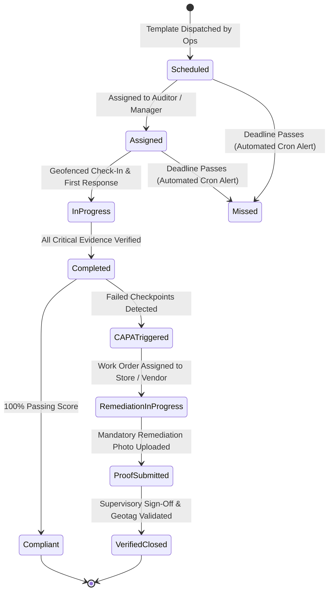

# 10: Software Buying, Features, Architecture & Pricing

## 0. Module Scope & Source Inventory

- **Priority Tier:** P2 / P3 — Commercial Buying Guides, Features, Technical Architecture, Procurement & ROI
- **Target Personas:** Multi-Unit Founders, VPs / Directors of Operations, CFOs & Finance Controllers, Procurement & Legal Teams, Chief Audit Executives (CAEs) & Chief Risk Officers (CROs), QA & Compliance Heads, IT & Systems Architects
- **Core Operational Thesis:** You can't be everywhere. When a business scales from 5 to 50 or 500 outlets, spreadsheets, paper checklists, and WhatsApp photo threads break down. The right audit platform is not the one with the longest feature list—it is the system that verifies on-site presence, enforces live photo proof, routes failed checks into accountable corrective actions, and scales across locations without per-seat pricing penalties.

### Source Blog Inventory (23 Source Blogs)

| # | Blog Title & Canonical URL | Source File | Words | Category | Routed-Out Sections |
| :-: | :--- | :--- | --: | :--- | :--- |
| 1 | [Audit App That Works Fully Offline and Syncs Later](https://audiment.in/blog/audit-app-that-works-fully-offline-and-syncs-later) | `audit-app-that-works-fully-offline-and-syncs-later.mdx` | 1,174 | Feature-Led Operations | — |
| 2 | [Audit Management Software Features & Dashboards: What to Look For](https://audiment.in/blog/audit-management-software-features) | `audit-management-software-features.mdx` | 3,786 | Audit Management | User roles & permissions → Mod 11 |
| 3 | [Audit Management Software Pricing: Costs, Pricing Models, Demos & ROI in 2026](https://audiment.in/blog/audit-management-software-pricing) | `audit-management-software-pricing.mdx` | 3,747 | Audit Management | — |
| 4 | [Audit Software Contract Terms and Notice Periods Explained](https://audiment.in/blog/audit-software-contract-terms-and-notice-periods-explained) | `audit-software-contract-terms-and-notice-periods-explained.mdx` | 1,214 | Procurement & Evaluation | — |
| 5 | [Audit Software Integrations: ERP, POS, Storage & Project Management Tools](https://audiment.in/blog/audit-software-integrations) | `audit-software-integrations.mdx` | 4,299 | Audit Management | — |
| 6 | [Audit Software That Alerts You When a Location Scores Low Three Times in a Row](https://audiment.in/blog/audit-software-that-alerts-you-when-a-location-scores-low-three-times) | `audit-software-that-alerts-you-when-a-location-scores-low-three-times.mdx` | 1,157 | Feature-Led Operations | — |
| 7 | [Audit Tracking Software: How to Monitor Audit Progress Across Locations](https://audiment.in/blog/audit-tracking-software) | `audit-tracking-software.mdx` | 1,708 | Audit Management | Tracking CAPA Loop → Mod 03 |
| 8 | [Branch Audit Software for Banks and NBFCs with Geo-Tagged Proof](https://audiment.in/blog/branch-audit-software-for-banks-and-nbfcs-with-geo-tagged-proof) | `branch-audit-software-for-banks-and-nbfcs-with-geo-tagged-proof.mdx` | 2,121 | Banking & Financial Services | Automated CAPA Loop → Mod 03 |
| 9 | [Cloud-Based Quality Audit Software: How to Compare It](https://audiment.in/blog/cloud-based-quality-audit-software-how-to-compare-it) | `cloud-based-quality-audit-software-how-to-compare-it.mdx` | 4,498 | Quality Audit | Cloud security evaluation → Mod 11 |
| 10 | [Compliance Audit Software: What Multi-Location Businesses Actually Need](https://audiment.in/blog/compliance-audit-software) | `compliance-audit-software.mdx` | 3,875 | Compliance Audit | — |
| 11 | [Hidden Costs of Audit Management Software: What to Check Before Signing](https://audiment.in/blog/hidden-costs-of-audit-management-software-what-to-check-before-signing) | `hidden-costs-of-audit-management-software-what-to-check-before-signing.mdx` | 1,239 | Finance & Operational ROI | — |
| 12 | [How to Evaluate Audit Management Software: A Practical Guide for Multi-Location Businesses](https://audiment.in/blog/how-to-evaluate-audit-management-software) | `how-to-evaluate-audit-management-software.mdx` | 3,573 | Audit Management | Permissions & security → Mod 11 |
| 13 | [How to Justify Audit Software Spend to the Board](https://audiment.in/blog/how-to-justify-audit-software-spend-to-the-board) | `how-to-justify-audit-software-spend-to-the-board.mdx` | 1,285 | Finance & Operational ROI | — |
| 14 | [Inspection Checklist Software & App Features: What to Look For](https://audiment.in/blog/inspection-checklist-software-features) | `inspection-checklist-software-features.mdx` | 3,875 | Inspection Management | GPS → Mod 02; Audit trail/versioning → Mod 11 |
| 15 | [Inspection Software: What It Is and How to Choose the Right One](https://audiment.in/blog/inspection-software) | `inspection-software.mdx` | 1,417 | Audit Management | — |
| 16 | [Internal Audit Software for Multi-Location Businesses](https://audiment.in/blog/internal-audit-software-for-multi-location-businesses) | `internal-audit-software-for-multi-location-businesses.mdx` | 1,575 | Internal Audit & Risk | — |
| 17 | [Is Audit Software Cheaper Than Hiring Regional Auditors?](https://audiment.in/blog/is-audit-software-cheaper-than-hiring-regional-auditors) | `is-audit-software-cheaper-than-hiring-regional-auditors.mdx` | 1,375 | Finance & Operational ROI | — |
| 18 | [Modern Audit Technology: Cloud, AI & Continuous Monitoring](https://audiment.in/blog/modern-audit-technology-cloud-ai-continuous-monitoring) | `modern-audit-technology-cloud-ai-continuous-monitoring.mdx` | 5,845 | Audit Management | — |
| 19 | [Best Outlet Audit Software: How to Digitize Your Field Audits](https://audiment.in/blog/outlet-audit-software) | `outlet-audit-software.mdx` | 3,060 | Outlet Audit | Flash Verification, Pencil-Whipping, Mandatory Photo → Mod 02 |
| 20 | [Quality Audit Software Selection & Analytics: How to Choose the Right Platform](https://audiment.in/blog/quality-audit-software-selection-analytics) | `quality-audit-software-selection-analytics.mdx` | 6,039 | Quality Audit | Quality software security → Mod 11 |
| 21 | [Safety Audit Software for Warehouses and Logistics Hubs](https://audiment.in/blog/safety-audit-software-for-warehouses-and-logistics-hubs) | `safety-audit-software-for-warehouses-and-logistics-hubs.mdx` | 1,480 | Logistics Operations | Safety CAPA resolution → Mod 03 |
| 22 | [What a 20-Minute Audit Software Demo Covers (and What to Ask)](https://audiment.in/blog/what-a-20-minute-audit-software-demo-covers-and-what-to-ask) | `what-a-20-minute-audit-software-demo-covers-and-what-to-ask.mdx` | 1,244 | Procurement & Evaluation | — |
| 23 | [What Should Be in an RFP for Multi-Location Audit Software?](https://audiment.in/blog/what-should-be-in-an-rfp-for-multi-location-audit-software) | `what-should-be-in-an-rfp-for-multi-location-audit-software.mdx` | 1,311 | Procurement & Evaluation | — |

---

## 1. When to Adopt Audit Software & Software Category Distinctions

### 1.1 Triggers for Moving Off Paper, Spreadsheets & WhatsApp
Location count alone does not dictate when to buy dedicated software: an 8-location food brand managing complex food safety checks faces more operational friction than a 50-location retail chain running basic opening checks ([how-to-evaluate-audit-management-software](https://audiment.in/blog/how-to-evaluate-audit-management-software)). At 10–20 locations, informal methods break down—photos get lost in chat, evidence cannot be tied to a date or branch, failed items go unfixed, and scores stop reflecting ground reality ([inspection-software](https://audiment.in/blog/inspection-software)).

Adopt a dedicated audit platform when any of these 8 warning signs appear ([how-to-evaluate-audit-management-software](https://audiment.in/blog/how-to-evaluate-audit-management-software)):
1. Scheduled audits are frequently missed or submitted late.
2. Branches run inconsistent or outdated versions of checklists.
3. Audit results live in disconnected spreadsheets and email threads.
4. Failed items are reported over informal messaging apps (WhatsApp).
5. Corrective actions lack named owners and explicit due dates.
6. Management reporting requires hours of manual spreadsheet consolidation.
7. Historical records are hard to retrieve during compliance reviews.
8. Field staff record notes on paper and re-type them onto desktop systems later.

### 1.2 Category Boundaries: What Software Solves Which Problem

| Category | Primary Problem Solved | Key Limitation for Multi-Location Field Ops | Source |
| :--- | :--- | :--- | :--- |
| **Form Builders** (Google Forms, Typeform, Zoho Forms) | Capturing basic answers | Static links; no scheduling, no missed-audit alerts, allows gallery photo uploads, no automated CAPA loop or SLA tracking | [audit-tracking-software](https://audiment.in/blog/audit-tracking-software), [how-to-justify-audit-software-spend-to-the-board](https://audiment.in/blog/how-to-justify-audit-software-spend-to-the-board) |
| **Basic Checklist Apps** (e.g., GoAudits) | Fast digitization of paper forms | Weak proof controls (optional/reusable photos), lighter follow-up and field discipline | [outlet-audit-software](https://audiment.in/blog/outlet-audit-software), [compliance-audit-software](https://audiment.in/blog/compliance-audit-software) |
| **General Inspection Tools** (e.g., SafetyCulture / iAuditor) | Cross-industry safety/quality forms, broad template library | High per-seat cost ($24–$39/user/mo); allows camera roll uploads; geo-tags at submission without real-time Flash Verification of physical presence | [audit-tracking-software](https://audiment.in/blog/audit-tracking-software), [compliance-audit-software](https://audiment.in/blog/compliance-audit-software), [outlet-audit-software](https://audiment.in/blog/outlet-audit-software) |
| **Regulatory & Policy Compliance** (e.g., VComply) | Managing statutory calendars, licenses, policy libraries, and legal obligations | Built for desk-based legal/compliance verification; lacks field execution, mandatory live photo proof, and store-level CAPA workflows | [compliance-audit-software](https://audiment.in/blog/compliance-audit-software) |
| **Enterprise EHS / Manufacturing QMS** (e.g., Cority, ETQ Reliance, Ideagen, MasterControl, Intelex) | Heavy industry EHS, supplier quality, document control, change management (e.g., IATF 16949) | Heavy implementation, multi-module complexity, enterprise pricing ($1,500–$5,000+/mo); overkill for retail, QSR, or franchise field ops | [compliance-audit-software](https://audiment.in/blog/compliance-audit-software), [quality-audit-software-selection-analytics](https://audiment.in/blog/quality-audit-software-selection-analytics) |
| **Legacy GRC Software** (e.g., corporate balance-sheet audit tools) | HQ financial audits and risk registers | Desktop-only web forms; relies on emailed scans weeks later; zero mobile offline engine, GPS lock, or frontline CAPA routing | [internal-audit-software-for-multi-location-businesses](https://audiment.in/blog/internal-audit-software-for-multi-location-businesses) |
| **Enterprise Internal Audit Analytics** (e.g., Diligent AuditAI / ACL Analytics) | Internal audit analytics, natural-language queries, continuous monitoring | Positioned for corporate internal audit/risk analytics rather than frontline store/QSR operational execution | [quality-audit-software-selection-analytics](https://audiment.in/blog/quality-audit-software-selection-analytics) |
| **Proof-Based Multi-Location Audit Management** (Audiment) | Operational compliance across branches (`Schedule → Verify → Audit → CAPA → Report`) | Not built for legal license libraries, heavy industrial EHS, or regulated manufacturing QMS/document control | [compliance-audit-software](https://audiment.in/blog/compliance-audit-software), [audit-tracking-software](https://audiment.in/blog/audit-tracking-software), [outlet-audit-software](https://audiment.in/blog/outlet-audit-software) |

### 1.3 Audit Software vs. Inspection Software & Operational vs. Regulatory Compliance
- **Audit vs. Inspection Software:** In most operational settings, the underlying workflow is identical: build a structured template, assign it to a site/person, collect evidence, score the result, and follow up on failures. "Inspection" is typically used for routine, practical on-the-ground checks (facilities, equipment, safety), while "Audit" sounds more formal and is tied to compliance or governance reviews ([inspection-software](https://audiment.in/blog/inspection-software), [inspection-checklist-software-features](https://audiment.in/blog/inspection-checklist-software-features)).
- **Outlet Audit vs. Store Visit:** A store visit is informal and observational; an outlet audit is structured, checklist-based, evidence-backed, and produces a reportable record that triggers follow-up ([outlet-audit-software](https://audiment.in/blog/outlet-audit-software)).
- **Regulatory vs. Operational Compliance:** Regulatory compliance is largely a *documentation* problem (current licenses, FSSAI/fire certificates, statutory filings) verifiable from a desk. Operational compliance is an *execution* problem—verifying that opening managers actually check freezer temperatures, staff wash hands, and closing teams sanitize surfaces on every shift. Most compliance tools solve the first; multi-location operators spend most of their time fighting the second ([compliance-audit-software](https://audiment.in/blog/compliance-audit-software)).

---

## 2. Software Evaluation Framework & Vendor Testing

### 2.1 The 17-Dimension Evaluation Matrix
Score competing platforms across the full lifecycle (`Plan → Schedule → Assign → Conduct → Record → Verify → Correct → Report`) rather than counting features in isolation ([how-to-evaluate-audit-management-software](https://audiment.in/blog/how-to-evaluate-audit-management-software), [audit-management-software-features](https://audiment.in/blog/audit-management-software-features), [cloud-based-quality-audit-software-how-to-compare-it](https://audiment.in/blog/cloud-based-quality-audit-software-how-to-compare-it), [quality-audit-software-selection-analytics](https://audiment.in/blog/quality-audit-software-selection-analytics)):

| # | Evaluation Dimension | Core Requirement to Verify |
| :-: | :--- | :--- |
| 1 | **Scheduling** | Plans and routes recurring (daily/weekly/monthly/quarterly) and unannounced audits automatically; adjusts frequency for high-risk sites without breaking historical reporting |
| 2 | **Checklist Management** | Centralizes reusable master templates, logical sections, conditional logic, required fields, scoring weights, and global version control (`Central standard + controlled local requirements`) |
| 3 | **Mobile Fieldwork** | Fast execution on actual phones/tablets online and 100% offline with auto-save and background sync |
| 4 | **Evidence Capture** | Mandatory per-question live photo capture (blocking camera roll uploads), notes, immutable UTC timestamps, and sub-50m GPS coordinates |
| 5 | **Findings & Issues** | Consistently records failures, severity levels, and supporting context across all sites |
| 6 | **Corrective Actions (CAPA)** | Auto-generates tasks from failed items with named owners, deadlines, automated escalations, and mandatory photo-backed closure |
| 7 | **Reporting & Dashboards** | Role-specific views with drill-down from network summary to individual audit photo; automated PDFs (<60s); pattern and repeat-failure analytics |
| 8 | **User Permissions** | Role- and location-based access (auditor, store manager, regional director, admin, read-only executive) |
| 9 | **Audit History & Trails** | Immutable logs showing which template version was active, who changed statuses/deadlines, and searchable multi-year archives |
| 10 | **Usability** | Field users complete audits accurately without desktop assistance or excessive typing |
| 11 | **Onboarding & Training** | Structured setup for outlet directories, geofences, initial master templates, and frontline training |
| 12 | **Customer Support** | Defined priority response SLAs and accessible support channels (phone/WhatsApp vs slow email queues) |
| 13 | **Security & Compliance** | Encryption at rest (AES-256) and in transit (TLS 1.3), SAML 2.0 SSO, SOC 2 Type II, backups, and data retention policies |
| 14 | **System Scalability** | Operational scale—adding 50+ new outlets, users, and schedules in minutes without proportional admin effort |
| 15 | **Integrations & APIs** | REST APIs, webhooks, native connectors, or structured CSV/JSON exports with preserved audit IDs and evidence links |
| 16 | **Collaboration** | Shared finding records with comments, status updates, and notifications tied to the source audit—avoiding WhatsApp/email fragmentation |
| 17 | **Total Cost of Ownership** | Transparent current and 3-year cost across locations, users, storage, onboarding, integrations, and support |

### 2.2 Problem-to-Feature Prioritization & Cloud vs. On-Premise

| Current Operational Problem | Feature to Prioritize First | Source |
| :--- | :--- | :--- |
| Missed or late audits | Automated scheduling, audit windows, and reminders | [audit-management-software-features](https://audiment.in/blog/audit-management-software-features) |
| Every branch runs a different checklist | Centralized template management and versioning | [audit-management-software-features](https://audiment.in/blog/audit-management-software-features) |
| Unverifiable "100% green" submissions | Hardware camera lock, mandatory per-question photos, GPS geofencing | [audit-management-software-features](https://audiment.in/blog/audit-management-software-features), [outlet-audit-software](https://audiment.in/blog/outlet-audit-software) |
| Open issues forgotten in chat | Automated CAPA assignment, SLAs, and proof-backed closure | [audit-management-software-features](https://audiment.in/blog/audit-management-software-features) |
| Weekend Excel report compilation | Cross-location dashboards, automated PDFs, drill-down reporting | [audit-management-software-features](https://audiment.in/blog/audit-management-software-features) |
| Users seeing wrong sites / altering scores | Role- and location-based permissions and score locks | [audit-management-software-features](https://audiment.in/blog/audit-management-software-features), [internal-audit-software-for-multi-location-businesses](https://audiment.in/blog/internal-audit-software-for-multi-location-businesses) |
| Lost historical evidence | Searchable audit history and immutable archives | [audit-management-software-features](https://audiment.in/blog/audit-management-software-features) |
| Re-typing findings into maintenance/BI tools | Webhooks, REST APIs, or structured exports | [audit-management-software-features](https://audiment.in/blog/audit-management-software-features), [audit-software-integrations](https://audiment.in/blog/audit-software-integrations) |
| Field staff abandoning clunky forms | Offline-first mobile UX with binary toggles and minimal taps | [audit-management-software-features](https://audiment.in/blog/audit-management-software-features), [what-a-20-minute-audit-software-demo-covers-and-what-to-ask](https://audiment.in/blog/what-a-20-minute-audit-software-demo-covers-and-what-to-ask) |

**Cloud vs. On-Premise Deployment (NIST SP 800-145):** Choose Cloud/SaaS when teams are geographically distributed, remote review is essential, internal IT maintenance capacity is limited, and rapid updates are acceptable. Choose On-Premise only when strict corporate policy mandates local hosting, internal IT can maintain servers/mobile updates, and local data/integration policies require it ([cloud-based-quality-audit-software-how-to-compare-it](https://audiment.in/blog/cloud-based-quality-audit-software-how-to-compare-it)).

### 2.3 Standardized 10-Step Vendor Test Protocol & Red Flags
Evaluate every shortlisted vendor using the exact same real checklist, outlets, and field staff ([cloud-based-quality-audit-software-how-to-compare-it](https://audiment.in/blog/cloud-based-quality-audit-software-how-to-compare-it), [quality-audit-software-selection-analytics](https://audiment.in/blog/quality-audit-software-selection-analytics), [how-to-evaluate-audit-management-software](https://audiment.in/blog/how-to-evaluate-audit-management-software)):
1. **Configure:** Build one actual master checklist.
2. **Schedule / Assign:** Assign it to representative outlets and actual field staff.
3. **Execute:** Have a real auditor complete it on their actual phone/tablet (including offline).
4. **Fail:** Log realistic failed checkpoints.
5. **Prove:** Capture mandatory live photo evidence and GPS/timestamps.
6. **Act:** Auto-generate and assign a corrective action with a due date and closure photo requirement.
7. **Review / Analyze:** Have a location and regional manager inspect findings and drill down in the dashboard.
8. **Report:** Generate the management summary / executive PDF.
9. **Export:** Download CSV/JSON/evidence and verify IDs, date formats, and evidence links remain intact.
10. **Scale:** Repeat onboarding steps for 50+ simulated outlets and users to test operational scalability (`Define → Configure → Pilot → Train → Launch → Review`) ([quality-audit-software-selection-analytics](https://audiment.in/blog/quality-audit-software-selection-analytics)).

**6 Vendor Red Flags to Interrogate Immediately** ([quality-audit-software-selection-analytics](https://audiment.in/blog/quality-audit-software-selection-analytics)):
- *"We support AI."* → Ask what specific task it performs, and test it on 500 real findings or 100 real store photos.
- *"We integrate with everything."* → Ask which systems, exact fields, failure handling, and whether connectors cost extra.
- *"We are infinitely customizable."* → Ask whether ops teams can edit templates in 10 minutes or must pay engineering/consulting retainers.
- *"Our platform scales to thousands of locations."* → Test how long it takes an admin to add 50 locations and assign permissions.
- *"You can export your data."* → Demand an actual sample export to verify linked evidence, finding IDs, and consistent dates.
- *"We are secure."* → Demand SOC 2 Type II documentation, encryption specs, and access-control proof.

---

## 3. Procurement Artifacts: RFPs, 20-Minute Demos, Pilots & Contracts

### 3.1 Multi-Location Audit Software RFP Blueprint
Generic IT RFPs over-index on server schemas while ignoring field constraints, leading buyers into desk-bound GRC tools ([what-should-be-in-an-rfp-for-multi-location-audit-software](https://audiment.in/blog/what-should-be-in-an-rfp-for-multi-location-audit-software)). Structure an enterprise RFP around **6 functional modules** and a **12-item mandatory technical matrix**:

| RFP ID | Functional Specification | Module | Priority |
| :--- | :--- | :--- | :---: |
| **FE-01** | Mobile app operates 100% offline; caches blueprints, responses, and photos locally | Mobile Field Execution | Mandatory |
| **FE-02** | Camera hardware lock disables mobile gallery uploads and screenshot imports | Anti-Cheating & Evidence | Mandatory |
| **FE-03** | GPS check-in validates device coordinates against facility perimeter (under 50m) | Anti-Cheating & Evidence | Mandatory |
| **FE-04** | Photo metadata contains immutable UTC network timestamps and GPS coordinates | Anti-Cheating & Evidence | Mandatory |
| **CA-01** | Failed checkpoints automatically generate CAPA tickets with priority SLAs | Closed-Loop CAPA | Mandatory |
| **CA-02** | CAPA closure requires mandatory live camera photograph of completed repair | Closed-Loop CAPA | Mandatory |
| **CA-03** | Multi-tier sign-off separates frontline repair submission from manager approval | Closed-Loop CAPA | Mandatory |
| **AN-01** | Real-time web operational dashboard ranks facilities by compliance score | Dynamic Scoring & Analytics | Mandatory |
| **AN-02** | Executive PDF reports compile automatically in under 60 seconds upon submission | Dynamic Scoring & Analytics | Mandatory |
| **IT-01** | Enterprise Single Sign-On via SAML 2.0 (Azure AD, Okta, Google Workspace) | Enterprise Security | Mandatory |
| **IT-02** | AES-256 encryption at rest; TLS 1.3 encryption in transit | Enterprise Security | Mandatory |
| **CO-01** | Flat per-location pricing with unlimited user accounts and unlimited photo storage | Commercial & Pricing | Mandatory |

**100-Point RFP Scoring Weight Model** ([what-should-be-in-an-rfp-for-multi-location-audit-software](https://audiment.in/blog/what-should-be-in-an-rfp-for-multi-location-audit-software)):
- **30%** — Mobile Usability & Anti-Cheating (offline speed, camera lock, GPS geofencing)
- **25%** — Closed-Loop CAPA & Automation (automated tasks, Before/After photo proof, SLAs)
- **20%** — Commercial Model & Total Cost (flat pricing, unlimited users, zero hidden fees)
- **15%** — IT Architecture & Security (SOC 2 Type II, encryption, SAML 2.0 SSO, DPDPA)
- **10%** — Vendor Experience & Reference Sites (minimum **3 references** in the same vertical with 30+ outlets; require **7-day full admin + mobile sandbox access**)

**8-Week RFP Procurement Timeline** ([what-should-be-in-an-rfp-for-multi-location-audit-software](https://audiment.in/blog/what-should-be-in-an-rfp-for-multi-location-audit-software)):
- **Week 1:** Issue RFP to 4 shortlisted vendors
- **Week 2:** Vendor query clarification window
- **Week 3:** Formal RFP submission deadline
- **Week 4:** Live scenario-based demos (mobile-first)
- **Weeks 5–6:** 14-day paid pilot across 5 real outlets
- **Week 7:** Commercial negotiation & MSA legal review
- **Week 8:** Board contract sign-off & project kickoff

### 3.2 The 20-Minute Audit Software Demo Script & 5 Live Stress-Tests
Do not let vendors spend 15 minutes on slide decks. Include the VP/Director of Operations, at least one active Area/Territory Manager, and an IT procurement rep; sign a mutual NDA if sharing proprietary SOPs, and give vendors **24–48 hours** to ingest one real PDF/Excel checklist into mobile before the call ([what-a-20-minute-audit-software-demo-covers-and-what-to-ask](https://audiment.in/blog/what-a-20-minute-audit-software-demo-covers-and-what-to-ask)).

**20-Minute Demo Agenda:**
- **Min 0–2 (Operational Framing):** State exact constraints (e.g., 45 stores, 90 shift supervisors, eliminating paper and WhatsApp photos).
- **Min 2–8 (Live Smartphone Screen-Share):** Checklist speed, offline capture, GPS check-in, camera lock.
- **Min 8–14 (Automated CAPA Loop):** Flag a failure, inspect auto-generated ticket, execute photo-backed closure.
- **Min 14–18 (Executive Console):** Cross-store league tables, recurring defect Pareto charts, overdue SLAs, drill-down to source photo.
- **Min 18–20 (Commercial & Contract Terms):** Flat per-location pricing, unlimited seats, storage caps, data export terms.

**5 Live Operational Stress-Tests** ([what-a-20-minute-audit-software-demo-covers-and-what-to-ask](https://audiment.in/blog/what-a-20-minute-audit-software-demo-covers-and-what-to-ask), [what-should-be-in-an-rfp-for-multi-location-audit-software](https://audiment.in/blog/what-should-be-in-an-rfp-for-multi-location-audit-software)):
1. **The "Airplane Mode" Drop Test:** Turn on Airplane Mode mid-call, answer 3–10 questions, take a photo, submit—verify zero crash, local queuing, and automatic duplicate-free sync on reconnect.
2. **The "Camera Roll Trap":** Tap photo attach—can they pick a saved gallery image? If yes, ask how yesterday's photos are blocked.
3. **The Automated CAPA Trigger:** Mark Question #4 (e.g., Cold Room Temp) as FAIL—verify a tracked task populates immediately with an assigned owner and SLA countdown.
4. **The Sub-50m Geofence Lockout:** Set geofence to current site, move coordinates 100m away—verify the app blocks submission rather than accepting it.
5. **The 60-Second PDF Challenge:** Click Submit and time how many seconds until the branded executive PDF arrives (modern systems: <60 seconds).

**Demo Usability & Commercial Litmus Tests** ([what-a-20-minute-audit-software-demo-covers-and-what-to-ask](https://audiment.in/blog/what-a-20-minute-audit-software-demo-covers-and-what-to-ask), [audit-management-software-pricing](https://audiment.in/blog/audit-management-software-pricing)):
- **Tap Efficiency:** A 20-question morning check should require **fewer than 30 total screen taps** (binary toggles over forced typing).
- **Visual Reference Aids & Translation:** Side-by-side "Golden Sample" benchmark photos per question; single-tap toggle to regional languages (e.g., Hindi, Bahasa, Spanish).
- **Template Rollout Test:** Ask *"How do I update a single safety check across all 100 locations simultaneously?"*—must be self-service in 5–10 minutes without vendor change requests or consulting fees.
- **Post-Demo Next Step:** Run a **14-day paid pilot across 5 diverse outlets** (top-performing, average, struggling), require vendor checklist digitization within **48 hours**, and lock all verbal promises into the MSA draft.

### 3.3 Contract Terms, Notice Periods, SLAs & Exit Clauses
Standard vendor MSAs often hide **90-day auto-renewal traps** (e.g., a Jan 1–Dec 31 contract requiring written notice by Oct 2; a notice sent Oct 25 is rejected as 67 days prior, auto-renewing a ₹12,00,000 invoice for another full year) ([audit-software-contract-terms-and-notice-periods-explained](https://audiment.in/blog/audit-software-contract-terms-and-notice-periods-explained)).

**Eliminate Auto-Renewal Traps:**
1. Negotiate a **30-day written notice window** (standard market range is 30–60 days).
2. Add a **mandatory vendor reminder clause** requiring written renewal notice 45 days before the deadline.
3. Require **month-to-month fallback** after the initial term instead of automatic 12-month lock-ins.

**5 Critical MSA Clauses to Negotiate** ([audit-software-contract-terms-and-notice-periods-explained](https://audiment.in/blog/audit-software-contract-terms-and-notice-periods-explained)):

| Clause | Standard Vendor Trap | Recommended Procurement Position |
| :--- | :--- | :--- |
| **Uptime SLA** | 99.0% with vague "commercially reasonable efforts" | **99.9% monthly uptime** backed by automatic pro-rata billing credits |
| **Annual Price Escalation** | Open-ended "standard market rates" at renewal | Capped at **3% to 5% max annually** or CPI |
| **User Scaling** | Named per-user seat licensing | **Flat per-location licensing** with unlimited named user accounts |
| **Data Extraction Rights** | Proprietary format or $180/hr extraction fees | **100% free self-service export** in CSV, JSON, PDF, and original photo ZIP archives anytime |
| **Termination for Cause** | 60-day cure period | **30-day cure period**; immediate termination for repeated SLA breaches |

**Enforceable SLA Credit Schedule & Support Latency** ([audit-software-contract-terms-and-notice-periods-explained](https://audiment.in/blog/audit-software-contract-terms-and-notice-periods-explained)):
- **99.9%+ Uptime:** Standard service (0% credit)
- **99.0% – 99.89%:** 10% service credit
- **98.0% – 98.99%:** 25% service credit
- **95.0% – 97.99%:** 50% service credit
- **Below 95.0%:** 100% credit + right to immediate termination
- **Support SLAs:** Priority 1 (Critical Outage) = **30-min engineering response** (24/7 resolution); Priority 2 (Mobile Sync Issues) = **2-hr response, 8-hr resolution**; Priority 3 (General Admin/Templates) = **1 business day**.

**Additional Commercial & Legal Protections** ([audit-software-contract-terms-and-notice-periods-explained](https://audiment.in/blog/audit-software-contract-terms-and-notice-periods-explained)):
- **Termination for Convenience:** Allows exit without proving breach on **60 days written notice** (protects if a chain restructures from 60 to 25 outlets, preventing millions in wasted 2-year license spend).
- **3-Year Price Predictability:** Lock unit costs for 36 months, pre-agree expansion tiers (30 → 50 → 75 → 100 outlets), and **grandfather all core features** against future paid "Add-On Module" repackaging.
- **Governing Law, OS Updates & Trial Guarantee:** Specify customer HQ jurisdiction (e.g., Indian law + Mumbai/Delhi/Bangalore arbitration); warrant Android/iOS compatibility updates within **30 days** of major OS releases; include a **30-Day Money-Back Satisfaction Guarantee** if technical requirements fail.

---

## 4. Pricing Models, Hidden Costs, TCO & Board ROI

### 4.1 Market Pricing Benchmarks & Cost Drivers

| Pricing Model | Typical Cost Range | Mechanics & Scaling Impact | Best Suited For | Source |
| :--- | :--- | :--- | :--- | :--- |
| **Per-Location** | **$15 – $60 / location / mo** | Flat rate per site/branch; predictable budgeting aligned to store count | Multi-location retail, QSR, franchise, hotel networks | [audit-management-software-pricing](https://audiment.in/blog/audit-management-software-pricing) |
| **Per-User (Seat)** | **$20 – $75 / user / mo** (field compliance SMB/mid-market: **$10 – $36 / user / mo** / ₹800–₹3,000) | Charged per named login (SafetyCulture ~$24–$39/user/mo; GoAudits lower end) | Small centralized audit teams with very few users | [audit-management-software-pricing](https://audiment.in/blog/audit-management-software-pricing), [compliance-audit-software](https://audiment.in/blog/compliance-audit-software), [audit-tracking-software](https://audiment.in/blog/audit-tracking-software) |
| **Flat Tiered Subscription** | e.g., **~$499+/month** (VComply) | Fixed fee up to defined location/user/audit caps; steep step-ups when exceeded | Regulatory compliance or predictable SMB footprints | [compliance-audit-software](https://audiment.in/blog/compliance-audit-software) |
| **Custom Enterprise** | **$5,000 – $30,000+ / yr** (EHS/QMS: **$1,500 – $5,000+ / mo**) | Bundled setup, custom integrations, dedicated AM, SLAs (Cority, MasterControl, Intelex) | Large enterprises with complex EHS/QMS/ERP scope | [audit-management-software-pricing](https://audiment.in/blog/audit-management-software-pricing), [compliance-audit-software](https://audiment.in/blog/compliance-audit-software) |

**6 Core Pricing Drivers & 3-Scenario TCO Modeling:** Pricing varies by (1) total locations, (2) user roles charged (auditors, store managers, regional leads, admins, read-only executives, external auditors), (3) audit submission frequency/caps, (4) photo/video storage limits, (5) ERP/POS API connectors, and (6) onboarding/implementation scope ([audit-management-software-pricing](https://audiment.in/blog/audit-management-software-pricing)). Always model **Current (20 sites / 40 users) → Expected (50 sites / 90–100 users) → Future (100 sites / 180–200 users)** using:
$$\text{Total Cost} = \text{Annual Subscription} + \text{Implementation Fees} + \text{User/Site Add-ons} + \text{Media Storage Fees} + \text{API Connectors}$$
([how-to-evaluate-audit-management-software](https://audiment.in/blog/how-to-evaluate-audit-management-software), [cloud-based-quality-audit-software-how-to-compare-it](https://audiment.in/blog/cloud-based-quality-audit-software-how-to-compare-it), [quality-audit-software-selection-analytics](https://audiment.in/blog/quality-audit-software-selection-analytics))

### 4.2 Hidden Costs & Contractual Traps (40%–120% Budget Inflation)
Headline quotes often inflate **40% to 120%**—and up to **18x** in Year 1—when fine print hits ([hidden-costs-of-audit-management-software-what-to-check-before-signing](https://audiment.in/blog/hidden-costs-of-audit-management-software-what-to-check-before-signing)):
- **18x Headline Inflation Example (40 Outlets):** Headline quote: `$1,200/yr` (assuming 1 regional auditor/seat @ $25/mo). Reality: +40 store manager seats for CAPA (`+$12,000`) + 15,000 monthly photos breaching 20GB cap (`+$2,400`) + custom PDF setup (`+$1,500`) + compulsory onboarding/training retainer (`+$3,000`) + ERP REST API (`+$2,500`) = **$22,600 True Year-1 Cost**.
- **The Per-User Licensing Dilemma:** 40 stores × (2 shift supervisors + 1 store manager) = **120 frontline users**. Buying 120 seats @ $29/mo = **$41,760/yr** (300% budget blowout). Sharing 1 login per store ($13,920/yr) destroys individual accountability and breaks the audit trail. Flat per-location pricing gives every frontline user a named login at zero incremental cost.
- **Cloud Photo Storage Overages:** Proof-based audits across 40 outlets easily generate **10,800 photos/month (~21.6 GB/month)**—3,600 daily opening photos (~7.2 GB) + 4,800 weekly manager audit photos (~9.6 GB) + 2,400 CAPA resolution photos (~4.8 GB)—breaching a 10 GB vendor cap by Month 2 and triggering **$0.20/GB/month** overage penalties or storage lockouts. Mandate unlimited photo storage, **70% client-side compression** preserving UTC/GPS/resolution, and **3–7 year retention** with zero archive retrieval fees.
- **Implementation & Alert Fees:** Check if template digitization is bundled (demand conversion of first 5 master checklists) or billed at **₹5,000–₹10,000 per template**, whether store geofences are configured by the vendor, and whether WhatsApp/SMS CAPA alerts or phone support cost extra.

**5 Essential Procurement Questions to Expose Hidden Fees** ([hidden-costs-of-audit-management-software-what-to-check-before-signing](https://audiment.in/blog/hidden-costs-of-audit-management-software-what-to-check-before-signing)):
1. *"If our store count remains at 40, but we add 80 assistant managers, will our monthly invoice increase by even one rupee?"*
2. *"If our inspectors upload 25,000 photos next month, will any storage overage or bandwidth surcharge appear?"*
3. *"Is there any charge for exporting all historical data, photos, and CAPA logs into CSV and ZIP archives if we cancel?"*
4. *"Can we modify, create, and re-weight our own templates without paying professional service fees?"*
5. *"Do you charge separately for automated WhatsApp and SMS incident alerts?"*

### 4.3 ROI Math & Board Business Case

**Standard ROI Formula** ([audit-management-software-pricing](https://audiment.in/blog/audit-management-software-pricing)):
$$\text{ROI (\%)} = \frac{\text{Annual Measurable Savings} - \text{Annual Software Cost}}{\text{Annual Software Cost}} \times 100$$

- **50-Outlet Labor-Only ROI Example (USD):** 80 hrs/mo consolidating paper/spreadsheets + 40 hrs/mo chasing CAPA updates = 120 hrs/mo (**1,440 hrs/yr**). At $25/hr blended labor = **$36,000/yr**. A 40% reduction saves **$14,400/yr**. Against a **$6,000/yr** subscription ($10/location/mo), Net Annual Benefit = $8,400 → **140% ROI** (before waste, fine avoidance, or retention gains) ([audit-management-software-pricing](https://audiment.in/blog/audit-management-software-pricing)).
- **4 Pillars of Financial Return (50-Store / ₹50 Cr Revenue Network):**
  1. **Management Bandwidth Recovery:** 10 Area Managers save 10 hrs/wk each eliminating Excel formatting = **100 hrs/wk** reallocated to store revenue.
  2. **Inventory Shrinkage Reduction:** Daily digital FIFO expiration audits cut perishable waste by **0.4% of revenue** = **₹20 Lakhs/yr** gross margin saved on ₹50 Cr turnover.
  3. **Preventative Asset Longevity:** Daily temperature/pressure logs catch refrigeration compressor faults before seizure, cutting emergency repair costs by **22%**.
  4. **Statutory Fine Avoidance:** Immutable compliance dossiers prevent recurring FSSAI, labor, or fire penalties averaging **₹25,000–₹1,00,000 per violation notice** ([how-to-justify-audit-software-spend-to-the-board](https://audiment.in/blog/how-to-justify-audit-software-spend-to-the-board)).

**3-Year Pro-Forma Board Financial Model (50 Outlets / ₹50 Cr Revenue)** ([how-to-justify-audit-software-spend-to-the-board](https://audiment.in/blog/how-to-justify-audit-software-spend-to-the-board)):

| Line Item | Year 1 (INR) | Year 2 (INR) | Year 3 (INR) | 3-Year Total (INR) |
| :--- | --: | --: | --: | --: |
| Software Platform Investment | (₹7,50,000) | (₹7,50,000) | (₹8,25,000) | **(₹23,25,000)** |
| Implementation & Staff Training | (₹1,50,000) | ₹0 | ₹0 | **(₹1,50,000)** |
| **Total Cash Outflow** | **(₹9,00,000)** | **(₹7,50,000)** | **(₹8,25,000)** | **(₹24,75,000)** |
| Savings: Travel & Auditor Overhead | ₹14,00,000 | ₹14,00,000 | ₹15,50,000 | ₹43,50,000 |
| Savings: Waste & Spoilage Reduction | ₹12,00,000 | ₹14,00,000 | ₹16,00,000 | ₹42,00,000 |
| Savings: Preventative Equipment Maint. | ₹4,50,000 | ₹5,50,000 | ₹6,50,000 | ₹16,50,000 |
| **Total Annual Financial Benefit** | **₹30,50,000** | **₹33,50,000** | **₹38,00,000** | **₹1,02,00,000** |
| **Net Operational Cash Flow** | **+₹21,50,000** | **+₹26,00,000** | **+₹29,75,000** | **+₹77,25,000** |

- **Payback Period:** 3.8 months | **3-Year NPV (@ 10% discount rate):** ₹61,42,000 | **3-Year ROI:** 312% ([how-to-justify-audit-software-spend-to-the-board](https://audiment.in/blog/how-to-justify-audit-software-spend-to-the-board)).
- **Rebutting "Why Not Build In-House?":** Custom internal builds cost **4–6x more** (**₹25L–₹40L upfront CapEx**), take **9–12 months** to first audit (vs 5–7 days), consume **2 dedicated engineers** for ongoing iOS/Android OS updates and offline sync bugs, rely on weak text/file inputs instead of kernel-level GPS/camera locks, and divert IT from revenue-generating POS/customer apps ([how-to-justify-audit-software-spend-to-the-board](https://audiment.in/blog/how-to-justify-audit-software-spend-to-the-board)).
- **3 Non-Financial Board Governance Risks Eliminated:** (1) Personal criminal/statutory liability of directors under FSSAI and State Factories Acts (digital trail proves due diligence), (2) viral social media hygiene disasters destroying crores in brand equity, and (3) M&A/PE/IPO due diligence valuation multipliers from clean 95%+ historical audit dossiers ([how-to-justify-audit-software-spend-to-the-board](https://audiment.in/blog/how-to-justify-audit-software-spend-to-the-board)).
- **90-Day Executive Rollout Plan:** Days 1–14 (5-store pilot across top, average, and struggling units) → Days 15–30 (45 remaining stores live, geofences & asset QR tags) → Days 31–60 (Before/After CAPA & SLA escalations) → Days 61–90 (First Board comparative analytics & ROI report; monthly 1-page digest thereafter) ([how-to-justify-audit-software-spend-to-the-board](https://audiment.in/blog/how-to-justify-audit-software-spend-to-the-board)).

### 4.4 Cost Math: Audit Software vs. Hiring Roving Regional Auditors
A single roving regional auditor in India costs **₹93,000–₹1,22,000/month (₹11,16,000–₹14,64,000/year)** when factoring base salary (₹45k–₹55k/mo), statutory benefits PF/gratuity (₹5.5k–₹6.5k/mo), inter-city flights/trains (₹12k–₹18k/mo), 12 nights/mo hotels (₹18k–₹24k/mo), per-diems (₹6k–₹9k/mo), local fuel/cabs (₹4.5k–₹6.5k/mo), and device allowances (₹2k–₹3k/mo). Four regional auditors across North/West/South/East cost **₹45L–₹58L/year** ([is-audit-software-cheaper-than-hiring-regional-auditors](https://audiment.in/blog/is-audit-software-cheaper-than-hiring-regional-auditors)).

- **Physical Capacity Ceiling:** Out of 22 monthly working days, 5 go to inter-city transit and 4 to report consolidation, leaving **13 active inspection days** × 1.2–1.5 stores/day = **16–20 stores/month** (16–22 max). A 60-store chain with 2 auditors sees each store only once every **45–55 days**.
- **Direct Financial Comparison (50 Outlets):** **3 roving auditors = ₹33L–₹43L/year** (1 visit every 45–60 days, 7–10 day report latency, 60–90 day hiring/onboarding) vs. **Audiment decentralized model = ₹6L–₹9L/year** (**75%–80% direct cash savings**, daily opening/closing + weekly AM checks, <60s reports, 5–7 day deployment).
- **Preventing Dishonest Self-Audits:** Hardware GPS lock (<50m), disabled photo gallery, live freezer gauge photos + chassis QR scans, and Area Manager random spot-checks on 10% of audits (triggering an integrity alert on the Regional VP dashboard if variance exceeds **15%**, e.g., 98% self-score vs 74% AM score).
- **The Hybrid Model (>30 Locations):** Daily 8-minute store manager self-checks (15 binary questions + 3 live photos) + weekly Area Manager coaching/audit visits (3–4 stores/wk) + **1 lean corporate quality auditor** doing surprise visits exclusively on the **bottom 10% risk-flagged outlets**, cutting travel budgets by **65%** ([is-audit-software-cheaper-than-hiring-regional-auditors](https://audiment.in/blog/is-audit-software-cheaper-than-hiring-regional-auditors)).

---

## 5. Core Platform Features: Checklists, Scoring, Mobile UX & Dashboards

### 5.1 Checklists, Blueprints & Weighted Scoring
- **Controlled Consistency:** Avoid both extremes ("one rigid checklist for every format" and "every branch makes its own checklist"). Maintain **central master templates + controlled local/format sections** (e.g., dynamically showing cold storage or jewelry safe sections only where applicable) with strict template versioning so historical audits preserve the exact rules active on the inspection date ([audit-management-software-features](https://audiment.in/blog/audit-management-software-features), [internal-audit-software-for-multi-location-businesses](https://audiment.in/blog/internal-audit-software-for-multi-location-businesses), [inspection-checklist-software-features](https://audiment.in/blog/inspection-checklist-software-features)).
- **Weighted Scoring & Critical Overrides:** Equal weights allow a store with a blocked fire exit or food-safety hazard to score 90%. In Audiment, severity weights are **Low = 1, Medium = 2, Critical = 5**, and a critical failure can override the entire grade to `criticalfail` regardless of the overall percentage ([inspection-software](https://audiment.in/blog/inspection-software)).
- **Mandatory Per-Question Photo Evidence:** Photo capture must be configurable and enforced *at the question level* ("No photo, no submission") rather than optional at the end, tied directly to the specific checkpoint, timestamp, and geo-tag ([outlet-audit-software](https://audiment.in/blog/outlet-audit-software), [inspection-software](https://audiment.in/blog/inspection-software)).

### 5.2 Field Mobile Capabilities & Specialized Add-Ons
- **Standard Field Flow:** `Open assignment → Check item → Record finding → Attach live evidence → Auto-save → Submit` ([audit-management-software-features](https://audiment.in/blog/audit-management-software-features), [inspection-checklist-software-features](https://audiment.in/blog/inspection-checklist-software-features)).
- **Barcode / QR Scanning:** Useful when physical equipment, racking aisles, or assets carry scannable IDs (`Scan asset → Open relevant checklist → Inspect → Record`) ([inspection-checklist-software-features](https://audiment.in/blog/inspection-checklist-software-features), [safety-audit-software-for-warehouses-and-logistics-hubs](https://audiment.in/blog/safety-audit-software-for-warehouses-and-logistics-hubs)).
- **Voice Input:** Useful for hands-busy dictation; test transcription accuracy in noisy environments, regional language support, editability, and audio retention ([inspection-checklist-software-features](https://audiment.in/blog/inspection-checklist-software-features)).
- **Wearable Devices:** Niche requirement—justified only in industrial, gloved, or hands-occupied workflows, not typical retail/restaurant audits ([inspection-checklist-software-features](https://audiment.in/blog/inspection-checklist-software-features)).

### 5.3 Role-Based Dashboards, Drill-Down Reporting & Exports
Dashboards must enable drill-down from summary to source evidence (`100 locations → 8 locations with recurring failures → 24 open findings → individual audit → photo proof → corrective action`) without redefining core metrics per manager ([audit-management-software-features](https://audiment.in/blog/audit-management-software-features), [cloud-based-quality-audit-software-how-to-compare-it](https://audiment.in/blog/cloud-based-quality-audit-software-how-to-compare-it), [quality-audit-software-selection-analytics](https://audiment.in/blog/quality-audit-software-selection-analytics)):
- **Field Auditor:** Assigned audits, upcoming visits, submission status.
- **Location / Store Manager:** What failed, what needs fixing, deadlines, required closure proof.
- **Quality Manager:** Which requirements fail most often, repeat defect patterns, supplier/process breakdowns.
- **Regional Manager:** Struggling sites, overdue audits, overdue corrective actions.
- **Executive Leadership / Board:** Network compliance scores, recurring trends, MTTR aging, regional comparisons.
- **Export Verification:** Never accept "CSV export available" at face value. Inspect an actual sample export for consistent audit IDs, location IDs, finding IDs, unified date formats, statuses, owners, CAPA links, and direct references/links to evidence files ([audit-management-software-features](https://audiment.in/blog/audit-management-software-features), [inspection-checklist-software-features](https://audiment.in/blog/inspection-checklist-software-features)).
- **Targeted Notifications:** Filter alerts by role, location, audit type, severity, deadline, and status—regional managers need alerts on missed audits and overdue critical CAPAs, not routine submissions ([audit-management-software-features](https://audiment.in/blog/audit-management-software-features), [inspection-checklist-software-features](https://audiment.in/blog/inspection-checklist-software-features)).

---

## 6. Technical Architecture: Offline Sync, Tracking, Trend Alerts & AI

### 6.1 Offline-First Native Engine & Sync Conflict Resolution
Web/PWA browser-wrapped audit apps fail in concrete basements, cold storage vaults (`-18°C`), steel racking aisles, and rural godowns because browser local storage (`5MB–50MB`) is volatile, requires continuous HTTP validation, and crashes mid-audit after ~8 high-res photos ([audit-app-that-works-fully-offline-and-syncs-later](https://audiment.in/blog/audit-app-that-works-fully-offline-and-syncs-later), [safety-audit-software-for-warehouses-and-logistics-hubs](https://audiment.in/blog/safety-audit-software-for-warehouses-and-logistics-hubs)).

```
4-Stage Native Offline Synchronization Pipeline (Audiment):
[Stage 1: Local Transactional Writing] -> Every tap/response written immediately to embedded SQLite (SQLCipher encrypted)
[Stage 2: Client-Side Media Processing] -> Device CPU compresses 8MB photo -> 240KB; embeds UTC + GPS; writes to encrypted sandbox (500+ photos)
[Stage 3: Outbox Queueing & Hashing]    -> Completed payload sealed with SHA-256 hash in Outbox Sync Queue
[Stage 4: Background Cloud Sync]        -> Auto-detects 4G/Wi-Fi; chunked upload; server verifies hash; clears queue & dispatches PDF
```
([audit-app-that-works-fully-offline-and-syncs-later](https://audiment.in/blog/audit-app-that-works-fully-offline-and-syncs-later))

- **Adaptive Network Modes:** *Online (4G/5G/Wi-Fi)* = real-time sync; *Degraded (2G/3G)* = syncs text only, queues media locally to prevent app freeze; *Offline* = 100% local SQLite + media cache; *Reconnection* = background queue upload + hash verification.
- **3 Deterministic Conflict Resolution Rules:** (1) *Immutable Append-Only Audits* (field records cannot be overwritten), (2) *Checklist Blueprint Locking* (active inspection locks the template version in local memory even if HQ publishes an update mid-audit), and (3) *UTC CAPA State Resolution* (simultaneous manager ticket edits resolve by network UTC timestamp while logging both in change history).
- **Offline Storage & Reliability Benchmarks:** App footprint **<80MB**; 20 cached audits + photos occupy **<250MB**; **0% Sync Failure Ratio**; **<15 seconds** upload latency for a 30-checkpoint audit + 8 compressed photos; **100% Exif metadata integrity**; **<8% battery consumption** per 60-minute offline session ([audit-app-that-works-fully-offline-and-syncs-later](https://audiment.in/blog/audit-app-that-works-fully-offline-and-syncs-later)).

### 6.2 Real-Time Audit Tracking State Machine
Audit tracking software manages inspections as a live state machine across **6 status signals** (`Scheduled`, `Assigned`, `In-Progress`, `Missed`, `Completed`, `Active CAPA`) rather than retrospective PDFs ([audit-tracking-software](https://audiment.in/blog/audit-tracking-software)):



**4 Executive Tracking KPIs** ([audit-tracking-software](https://audiment.in/blog/audit-tracking-software)):
1. **Audit Execution Rate (%):** Scheduled audits completed on time vs. missed (e.g., 358/400 = 89.5% flags supervisory gaps).
2. **Mean Time to Remediation (MTTR):** Hours from non-conformance to photo-backed closure (top chains: **<12 hours** for high-severity violations).
3. **Checkpoint Recidivism Rate (%):** Frequency of the same item failing at the same site within trailing 90 days.
4. **First-Pass Quality Score:** % of audits completed with zero critical corrective actions required.

### 6.3 Automated 3-Cycle Low-Score Trend Alerts
A single sub-threshold score (e.g., 78%) can reflect temporary friction, whereas **three consecutive low scores** indicate chronic management breakdown, broken equipment, or collapsed frontline discipline—which monthly spreadsheets only uncover 60–90 days too late ([audit-software-that-alerts-you-when-a-location-scores-low-three-times](https://audiment.in/blog/audit-software-that-alerts-you-when-a-location-scores-low-three-times)).

- **3-Cycle Decay Trigger (Example Threshold <80%):** Cycle 1 (Day 1: 76%, dirty washroom → standard CAPA) → Cycle 2 (Day 8: 74%, uncalibrated freezer → CAPA ignored) → Cycle 3 (Day 15: 71%, FIFO abandoned/expired dairy) → Cloud Rule Listener matches 3 consecutive `<80%` audits and triggers: (1) Executive Dashboard Alert banner, (2) SMS & WhatsApp to Regional VP Ops, (3) Auto-generated 60-day Store PIP in HR portal, and (4) Mandatory unannounced senior spot-audit on Day 17.
- **4 High-Predictive Trend Alert Rules:**

| Alert Type | Detection Condition | Risk Predicted | Action Triggered |
| :--- | :--- | :--- | :--- |
| **Consecutive Overall Low Score** | Overall score `<80%` for 3 consecutive weekly audits | Total unit management collapse | Regional VP visit + HR manager tenure review |
| **Category-Specific Collapse** | Food Safety `<75%` for 2 audits (even if overall `>85%`) | Foodborne illness or regulatory shutdown | Central QA Lead immediate spot inspection |
| **Recurring Checkpoint Defect** | Identical question fails 3 cycles in a row | Superficial paper fixes; unserviced hardware | Facility engineer dispatch + vendor AMC audit |
| **Audit Velocity Warning** | 3 consecutive audits completed in `<3 minutes` | Frontline pencil-whipping without inspecting | Territory manager flagged for unannounced re-audit |

- **4-Step Intervention Protocol & Watchlist Exit:** (1) Unannounced senior spot-check within **48 hours**; (2) **30-minute** root-cause interview (staffing, broken assets, footfall); (3) Asset & maintenance overhaul clearing backlogged tickets within **72 hours**; (4) Weekly calibrated recertification requiring **>=90% compliance for 4 consecutive weeks** to exit watch status. Supports format-specific thresholds (e.g., 90% flagships vs 82% express kiosks) and temporary **Scoring Exception Overrides** during external supply chain disruptions.
- **4 Network Health Indicators:** Chronic Watchlist Ratio (top networks keep **<4%**), Watchlist Exit Velocity (days), Post-Intervention Recidivism Rate (% re-entering within 6 months), and Review Correlation Index (alignment with local Google review drops) ([audit-software-that-alerts-you-when-a-location-scores-low-three-times](https://audiment.in/blog/audit-software-that-alerts-you-when-a-location-scores-low-three-times)).

### 6.4 Modern Audit Technology, AI, Continuous Monitoring & Risk-Based Auditing
- **The Bottom-Up Modern Audit Stack:** `Clear standards → structured data → reliable evidence → automated workflow → analytics/dashboards → continuous monitoring → AI-assisted analysis`. AI cannot rescue poor data, inconsistent checklists, or missing evidence ([modern-audit-technology-cloud-ai-continuous-monitoring](https://audiment.in/blog/modern-audit-technology-cloud-ai-continuous-monitoring)).
- **Continuous Monitoring vs. Continuous Auditing (IIA GTAG 3rd Ed., Sep 2025):** *Continuous monitoring* is management watching recurring operational data (`Daily data → rule flags exception → review`), whereas *continuous auditing* is internal audit using ongoing feeds to decide where independent assurance is needed. Both catch **operational drift** early (e.g., completion sliding `95% → 94% → 91% → 87%`) ([modern-audit-technology-cloud-ai-continuous-monitoring](https://audiment.in/blog/modern-audit-technology-cloud-ai-continuous-monitoring)).
- **Practical AI Use Cases & Governance (ISO 19011:2026, NIST AI RMF, IIA June 2026 "AI Truth Decay"):**
  - *Best uses:* Drafting report summaries from structured findings (e.g., 120 checks / 18 findings / 35 photos), NLP grouping of differently worded findings (*"Cleaning records incomplete"* vs *"Sanitation log missing"*), statistical anomaly flagging across 500 stores, risk prioritization (focusing on 60 risky/deteriorating sites out of 300), and computer vision pre-screening of display images.
  - *Strict rule:* **"Automate the mechanics. Keep judgment where judgment matters."** Never let AI issue authoritative pass/fail verdicts (`Audit data → AI verdict`). Maintain `Source data → AI analysis → Human evidence check → Audit conclusion` to prevent false positives, false negatives, context errors, and "AI truth decay."
  - *How to test vendor AI:* Hand over **500 real findings** (ask why items were grouped, verify source drill-down and override persistence) and **100 real store photos** (inspect false positives, missed defects, and framing failures) ([modern-audit-technology-cloud-ai-continuous-monitoring](https://audiment.in/blog/modern-audit-technology-cloud-ai-continuous-monitoring), [quality-audit-software-selection-analytics](https://audiment.in/blog/quality-audit-software-selection-analytics)).

---

## 7. Integrations, APIs, Webhooks & Sector-Specific Architectures

### 7.1 Integration Strategy: ERP, POS, Project Management, Storage & BI
Design integrations around `Workflow → Data → Trigger → Destination → Response → Failure handling`, transferring only the **minimum useful dataset** rather than dumping full databases ([audit-software-integrations](https://audiment.in/blog/audit-software-integrations), [quality-audit-software-selection-analytics](https://audiment.in/blog/quality-audit-software-selection-analytics)):

| Target System | Direction & Operational Purpose | Minimum Data Fields & Context Requirements |
| :--- | :--- | :--- |
| **ERP** | `ERP → location master data → Audit` and `Audit finding → maintenance ref → ERP` | Location IDs, equipment/asset IDs, supplier references, maintenance tickets |
| **POS** | Correlate store execution failures against transaction/sales patterns | **Store ID, Date, Product/Category, Transaction measure, Audit result** (never full raw POS logs) |
| **Project Management** | Convert failed checkpoints into tracked team tasks | Must preserve context: **Location, Audit ID, Failed Question, Evidence link, Severity, Owner, Due Date** |
| **Cloud Storage** | Archive reports, certificates, and CAPA photos externally | Defined retention, access owner, and bidirectional audit-to-file reference |
| **BI / Analytics** | Combine `Audit failure rate + sales trend + location` or `CAPA closure time + region + manager` | Structured **Location ID, Audit ID, Finding ID, Status, Owner, Due date, Severity, Score, Timestamp, Evidence ref** |

- **Native Connectors vs. REST APIs vs. Webhooks vs. CSV Export:** Use **Native Connectors** for standard supported apps; **Webhooks** for real-time event pushes (`Audit finding created → webhook → PM task created`); **REST APIs** for custom bidirectional queries; and **Scheduled CSV Exports** for simple monthly reporting ([audit-software-integrations](https://audiment.in/blog/audit-software-integrations)).
- **Security & Testing:** Enforce least-privilege API scopes, credential ownership (who rotates expired keys / revokes access on offboarding), and test **7 scenarios** before production: (1) successful transfer, (2) missing required field, (3) duplicate webhook delivery (idempotency), (4) revoked/permission error, (5) receiving system outage, (6) bad record correction, and (7) safe retry without losing the audit record ([audit-software-integrations](https://audiment.in/blog/audit-software-integrations)).

### 7.2 Sector-Specific Software Requirements

#### Retail Banking, MFIs & NBFCs (RBI RBIA Compliance)
- **Failure Modes Solved:** Eliminates "Hotel Room Audits" (roving auditors accepting scanned registers over WhatsApp), unverified cash/gold vault counts, 2–4 week reporting latency on broken vault time-delay locks or <90-day CCTV loops, and lack of statutory metadata ([branch-audit-software-for-banks-and-nbfcs-with-geo-tagged-proof](https://audiment.in/blog/branch-audit-software-for-banks-and-nbfcs-with-geo-tagged-proof)).
- **Tamper-Proof Controls:** **Polygon geofencing (<50m)** matching branch property lines + kernel-level **anti-mock/anti-root/anti-jailbreak detection** + cell tower & Wi-Fi BSSID corroboration for basements; **dual-custody on-screen signatures** with UTC timestamps; **10% randomized gold loan packet sampling** with macro seal/barcode capture; **AES-256 encrypted photo sandbox** blocking saves to public galleries or iCloud/Google Photos; 1-click RBI statutory PDF dossiers.
- **20-Point Retail Bank & NBFC Branch Audit Checklist** ([branch-audit-software-for-banks-and-nbfcs-with-geo-tagged-proof](https://audiment.in/blog/branch-audit-software-for-banks-and-nbfcs-with-geo-tagged-proof)):
  - *Critical:* (2) Surprise Vault Physical Cash Count, (4) Emergency Foot-Switch/Duress Alarm, (5) CCTV Coverage & 90-Day DVR Retention, (7) Gold Loan Packet Tamper-Evident Seals (10% sample).
  - *High:* (1) Vault Dual-Custody Key Register, (3) Vault Time-Delay Lock Functionality, (6) Camera Alignment on Cash/Vault, (8) Gold Safe Dual-Lock Verification, (9) Title Deed Fireproof Safe, (10) Fire Extinguisher Servicing (<12 mos), (15) UPS Battery Load Test, (17) Physical KYC Storage & Access Control, (18) Unclaimed DD/Cheque Book Register, (19) ATM Vestibule & Anti-Skimming Check.
  - *Medium:* (11) Smoke & Thermal Detector Test, (12) RBI Ombudsman Noticeboard, (13) Current Interest Rate & Charge Display, (16) Diesel Generator Fuel & Run Log.
  - *Low:* (14) BCSBI & Fair Practices Code Copy, (20) Pest Control & Moisture Absorbers in Collateral Vault.
- **4 CRO / Audit Committee Metrics:** Physical Security Compliance Index (branches **<85%** trigger mandatory supervisory audit within **14 days**), Critical CAPA Resolution Latency (top banks **<24 hrs** vs laggards 18+ days), Geofence Discrepancy Rate %, and Repeat Finding Ratio % ([branch-audit-software-for-banks-and-nbfcs-with-geo-tagged-proof](https://audiment.in/blog/branch-audit-software-for-banks-and-nbfcs-with-geo-tagged-proof)).

#### Enterprise Internal Audit & Three Lines Governance
- **IIA Three Lines Model:** *First Line* (Branch/Shift Managers: daily opening/closing checks, cash, temps); *Second Line* (Regional Area/EHS Leads: monthly scheduled & unannounced QA/FSSAI/fire checks); *Third Line* (Corporate Internal Audit/CAE: quarterly/annual SOX, cash vault, fraud sampling with append-only SHA-256 forensic logs & **7–10 year statutory archives**) ([internal-audit-software-for-multi-location-businesses](https://audiment.in/blog/internal-audit-software-for-multi-location-businesses)).
- **Risk-Based Sampling & Collusion Detection:** Composite Risk Score (0–100) from revenue, turnover, cash variance, and complaints flags the **top 20% high-risk branches** for unannounced corporate audits; randomizes auditor territories and flags auditors awarding **98%+ scores** to high-shrink/high-complaint branches; reduces report dispatch from **14 days to 60 seconds** (Audit Cycle Velocity **<24 hours**) ([internal-audit-software-for-multi-location-businesses](https://audiment.in/blog/internal-audit-software-for-multi-location-businesses)).

#### Warehouses & Logistics Hubs (EN 15635 / OSHA)
- **5 Essential Inspection Modules:** (1) **Pallet Racking (EN 15635)**—column upright deflection **<3mm**, sheared anchor bolts, beam dislodgement clips, Green/Amber/Red hazard coding with ruler macro photos; (2) **Forklift & MHE Fleets**—daily pre-use checks + control console photo; (3) **Loading Docks & Bays**—dock leveler lip engagement, wheel chocks, trailer restraint wide-angle proof; (4) **Fire & Life Safety**—**1-metre sprinkler clearance**, clear yellow egress markings; (5) **Battery Charging Rooms**—eye-wash water pressure + hydrogen ventilation + PPE ([safety-audit-software-for-warehouses-and-logistics-hubs](https://audiment.in/blog/safety-audit-software-for-warehouses-and-logistics-hubs)).
- **Anti-"Hallway Audit" Controls:** Physical **QR tags affixed to each racking aisle end-frame** must be scanned to unlock that aisle's checklist; wide-angle + close-up ruler photos; offline local caching inside Wi-Fi-attenuated high-bay steel racks; verifiable digital records lower commercial property insurance premiums ([safety-audit-software-for-warehouses-and-logistics-hubs](https://audiment.in/blog/safety-audit-software-for-warehouses-and-logistics-hubs)).

---

## 8. Consolidated Buying, Features & Tech Q&A Bank

- **Q: What is the average cost of audit management software, and is per-location or per-user better?**
  **A:** Market rates run **$15–$60/location/month** (per-location) or **$20–$75/user/month** (per-user; SMB field tools **$10–$36/user/month**), with custom enterprise/EHS platforms at **$5,000–$30,000+/year**. Per-location or flat operational pricing is superior for multi-unit teams because store managers, shift leads, and maintenance staff all need accounts without triggering 300% per-seat cost inflation ([audit-management-software-pricing](https://audiment.in/blog/audit-management-software-pricing), [compliance-audit-software](https://audiment.in/blog/compliance-audit-software), [hidden-costs-of-audit-management-software-what-to-check-before-signing](https://audiment.in/blog/hidden-costs-of-audit-management-software-what-to-check-before-signing)).

- **Q: Is audit software cheaper than hiring roving regional auditors?**
  **A:** Yes. One roving auditor in India costs **₹11.16L–₹14.64L/year** (salary + travel/hotels) and inspects at most **16–20 stores/month**. Covering 50 outlets with 3 auditors costs **₹33L–₹43L/year** (visiting every 45–60 days), whereas deploying Audiment across 50 outlets costs **₹6L–₹9L/year** (**75%–80% savings**) with daily verified checks and 5–7 day rollout ([is-audit-software-cheaper-than-hiring-regional-auditors](https://audiment.in/blog/is-audit-software-cheaper-than-hiring-regional-auditors)).

- **Q: What should we test during a 20-minute demo?**
  **A:** Run 5 live mobile stress-tests: (1) Airplane Mode drop test, (2) attempting a camera-roll upload, (3) marking a critical item FAIL to verify automated CAPA creation, (4) testing sub-50m GPS geofence lockout from 100m away, and (5) timing PDF report generation (<60 seconds) ([what-a-20-minute-audit-software-demo-covers-and-what-to-ask](https://audiment.in/blog/what-a-20-minute-audit-software-demo-covers-and-what-to-ask)).

- **Q: What hidden fees and contract clauses should procurement block?**
  **A:** Block per-seat fees for store managers, 10–20 GB photo storage caps ($0.20/GB overages), template digitization fees (₹5k–₹10k/template), data extraction fees ($180/hr), and **90-day auto-renewal traps**. Require **30-day non-renewal notice**, **99.9% uptime SLA with billing credits**, **3–5% escalation caps**, **60-day termination for convenience**, and free CSV/JSON/PDF/photo exports ([hidden-costs-of-audit-management-software-what-to-check-before-signing](https://audiment.in/blog/hidden-costs-of-audit-management-software-what-to-check-before-signing), [audit-software-contract-terms-and-notice-periods-explained](https://audiment.in/blog/audit-software-contract-terms-and-notice-periods-explained)).

- **Q: How does an offline audit app prevent data loss in basements or cold storage?**
  **A:** True offline apps write every response immediately to an encrypted local SQLite/SQLCipher database, compress 8MB photos to 240KB on-device with UTC/GPS metadata inside an encrypted sandbox (500+ photos, <250MB for 20 audits), seal payloads with SHA-256 hashes, and auto-sync upon reconnection with <15s upload latency ([audit-app-that-works-fully-offline-and-syncs-later](https://audiment.in/blog/audit-app-that-works-fully-offline-and-syncs-later)).

- **Q: Can AI automatically pass or fail audits?**
  **A:** No. Per IIA and NIST AI RMF guidance, AI should assist with finding grouping (NLP), report drafting, anomaly detection, and image pre-screening, while human reviewers inspect the underlying source evidence before finalizing compliance conclusions ([modern-audit-technology-cloud-ai-continuous-monitoring](https://audiment.in/blog/modern-audit-technology-cloud-ai-continuous-monitoring), [quality-audit-software-selection-analytics](https://audiment.in/blog/quality-audit-software-selection-analytics)).

---

## Audiment Positioning, Capabilities & Mentions

### Core Operational Identity & Differentiators
- **Positioning:** Audit management system built for multi-location businesses (*"You can't be everywhere"*), bridging headquarters standards and ground reality across QSR/restaurant chains, retail networks, franchise groups, hotels, banks/NBFCs, and logistics hubs ([audit-management-software-features](https://audiment.in/blog/audit-management-software-features), [audit-management-software-pricing](https://audiment.in/blog/audit-management-software-pricing)).
- **Key Product Capabilities Cited Across Source Blogs:**
  - **Blueprints & Weighted Scoring:** Centralized template distribution with dynamic format sections, global version control, severity weights (**Low = 1, Medium = 2, Critical = 5**), and automatic `criticalfail` grade overrides ([compliance-audit-software](https://audiment.in/blog/compliance-audit-software), [inspection-software](https://audiment.in/blog/inspection-software)).
  - **Proof-Based Field Execution:** Hardware camera lock (blocks gallery/screenshot uploads), mandatory per-question live photos, **Flash Verification** (surroundings video + selfie + locked GPS/UTC timestamp), and **sub-50m polygon GPS geofencing** with anti-mock/anti-root checks ([outlet-audit-software](https://audiment.in/blog/outlet-audit-software), [branch-audit-software-for-banks-and-nbfcs-with-geo-tagged-proof](https://audiment.in/blog/branch-audit-software-for-banks-and-nbfcs-with-geo-tagged-proof)).
  - **Native Offline Architecture:** Embedded SQLite/SQLCipher database, AES-256 encrypted sandbox media cache (500+ photos; never leaked to iCloud/Google Photos), 8MB→240KB client compression, SHA-256 outbox queue, auto-sync ([audit-app-that-works-fully-offline-and-syncs-later](https://audiment.in/blog/audit-app-that-works-fully-offline-and-syncs-later), [branch-audit-software-for-banks-and-nbfcs-with-geo-tagged-proof](https://audiment.in/blog/branch-audit-software-for-banks-and-nbfcs-with-geo-tagged-proof)).
  - **Automated Tracking, CAPA & Trend Alerts:** Cron-based missed-audit detection, automated CAPA ticketing with SLA countdowns and mandatory after-photo closure, **60-second executive PDF generation**, and automated **3 consecutive low-score trend alerts** + audit velocity (<3 min) and >15% self-audit discrepancy flags ([audit-tracking-software](https://audiment.in/blog/audit-tracking-software), [audit-software-that-alerts-you-when-a-location-scores-low-three-times](https://audiment.in/blog/audit-software-that-alerts-you-when-a-location-scores-low-three-times), [is-audit-software-cheaper-than-hiring-regional-auditors](https://audiment.in/blog/is-audit-software-cheaper-than-hiring-regional-auditors)).
- **Audiment Transparent Two-Tier Pricing Model:**
  - **Free Tier (Forever Free):** Built for single-location operations or initial trials. Includes **1 physical location**, up to **3 auditor logins**, **25 audits per month**, live camera photo verification, and GPS check-in.
  - **Paid Tier (Custom Flat Pricing):** Built for scaling multi-location networks. **Unlimited locations, unlimited users/auditor accounts (zero per-seat fees), and unlimited monthly audits and templates**, billed as a predictable custom flat rate tailored to location count ([audit-management-software-pricing](https://audiment.in/blog/audit-management-software-pricing), [hidden-costs-of-audit-management-software-what-to-check-before-signing](https://audiment.in/blog/hidden-costs-of-audit-management-software-what-to-check-before-signing)).

### Internal Links & Anchor Text Map

| Target Audiment Path | Recommended Anchor Text | Context |
| :--- | :--- | :--- |
| `/solutions/retail-audit-software` | retail audit software / multi-location audit software | Primary commercial hub |
| `/solutions/manufacturing-audit-software` | warehouse safety audit software | Logistics & industrial safety |
| `/solutions` | multi-location audit solutions | Broad industry hub |
| `/platform/corrective-actions` | corrective action tracking / automated CAPA | Issue-to-resolution workflows |
| `/platform/operational-dashboards` | operational dashboards | Real-time network & executive views |
| `/platform/proof-based-audits` | proof-based audits | Live camera + geo-verified evidence |
| `/platform/geo-verified-audits` | geo-verified remote branch audits | Remote godowns & branch checks |
| `/use-cases/multi-location-compliance` | multi-location compliance | Operational compliance at scale |
| `/use-cases/audit-checklist-software` | audit checklist software | Standardized Blueprints |
| `/use-cases/corrective-action-tracking` | corrective action tracking workflow | SLA escalation & closure |
| `/use-cases/inspection-management-software` | multi-location inspection management | Field inspection use cases |
| `/compare/audiment-vs-safetyculture` | Audiment vs SafetyCulture | Competitive evaluation |
| `/compare/audiment-vs-checklist-apps` | Audiment vs checklist apps | Checklist apps vs audit systems |
| `/compare/audiment-vs-bindy` | Audiment vs Bindy | Retail audit comparison |
| `/#contact` | Book a call with Audiment | Commercial demo CTA |

---

## SEO Keywords & Search Intent Bank

- **Primary Keywords:** audit management software features, audit management software pricing, how to evaluate audit management software, audit software integrations, audit tracking software, compliance audit software, inspection checklist software features, quality audit software selection, modern audit technology, outlet audit software, branch audit software for banks and NBFCs, warehouse safety audit software, internal audit software for multi-location businesses
- **Long-Tail & Commercial High-Intent Keywords:** audit app that works fully offline and syncs later, audit software that alerts you when a location scores low three times in a row, hidden costs of audit management software, audit software contract terms and notice periods, what should be in an RFP for multi-location audit software, what a 20-minute audit software demo covers, how to justify audit software spend to the board, is audit software cheaper than hiring regional auditors, cloud-based quality audit software comparison, audit software vs inspection software, audit software ROI formula
- **Aggregated Frontmatter Tags:** `Offline Audit App`, `Mobile Field Inspections`, `Audit Dashboards`, `Audit Software Pricing`, `Audit Software ROI`, `Contract Negotiation`, `SaaS Notice Period`, `ERP Integration`, `POS Integration`, `Trend Alert Audit`, `Missed Audit Detection`, `CAPA Tracking`, `NBFC Audit Software`, `RBI Compliance`, `Cash Vault Controls`, `Cloud-Based Quality Audit Software`, `Operational Compliance`, `Hidden Costs Audit Software`, `Board Justification`, `CFO Operations`, `IIA Three Lines Model`, `AI in Audit Management`, `Continuous Audit Monitoring`, `Warehouse Safety Audit Software`, `Audit Software Demo`, `Audit Software RFP Template`
- **Core Searcher Intent Clusters:**
  1. *Commercial Evaluation & Comparison:* Feature matrices, Cloud vs On-Premise, Audiment vs SafetyCulture/GoAudits/Zenput/VComply/Cority/ETQ/Ideagen/Diligent.
  2. *Pricing, TCO & Board ROI:* Per-seat vs per-location math, hidden storage/onboarding fees, 3-year IRR/NPV board templates, software vs hiring roving auditors.
  3. *Procurement & Legal:* RFP technical requirements matrix (`FE-01`–`CO-01`), 20-minute demo stress-tests, MSA notice periods, SLA credit schedules.
  4. *Technical & Vertical Execution:* Offline SQLite/SQLCipher sync, automated state machines, 3-cycle trend alerts, AI governance, RBI branch audits, EN 15635 warehouse audits.

---

## Authoritative External Citations & Standards

| Standard / Agency / External URL | Context Cited | Source Blog(s) |
| :--- | :--- | :--- |
| **ISO 19011:2026** — [iso.org/standard/19011](https://www.iso.org/standard/19011) | Guidelines for auditing management systems; addresses digitization, virtual environments, risk analysis, and auditor competence | [modern-audit-technology-cloud-ai-continuous-monitoring](https://audiment.in/blog/modern-audit-technology-cloud-ai-continuous-monitoring) |
| **NIST SP 800-145** — [nist.gov/publications/nist-definition-cloud-computing](https://www.nist.gov/publications/nist-definition-cloud-computing) & [NIST SP-500-291](https://www.nist.gov/system/files/documents/itl/cloud/NIST_SP-500-291_Version-2_2013_June18_FINAL.pdf) | Definition of cloud computing and SaaS vs on-premise infrastructure | [cloud-based-quality-audit-software-how-to-compare-it](https://audiment.in/blog/cloud-based-quality-audit-software-how-to-compare-it), [modern-audit-technology-cloud-ai-continuous-monitoring](https://audiment.in/blog/modern-audit-technology-cloud-ai-continuous-monitoring) |
| **NIST AI RMF (GenAI Profile)** — [nist.gov/publications/artificial-intelligence-risk-management-framework-generative-artificial-intelligence](https://www.nist.gov/publications/artificial-intelligence-risk-management-framework-generative-artificial-intelligence) | AI risk management lifecycle, trustworthiness, privacy, and human oversight governance | [modern-audit-technology-cloud-ai-continuous-monitoring](https://audiment.in/blog/modern-audit-technology-cloud-ai-continuous-monitoring) |
| **The IIA — GTAG Continuous Auditing & Monitoring (3rd Ed., Sep 25, 2025)** — [theiia.org/.../continuous-auditing-and-monitoring](https://www.theiia.org/en/content/guidance/recommended/supplemental/gtags/continuous-auditing-and-monitoring) | Distinguishes continuous monitoring (management) from continuous auditing (assurance) | [modern-audit-technology-cloud-ai-continuous-monitoring](https://audiment.in/blog/modern-audit-technology-cloud-ai-continuous-monitoring) |
| **The IIA — "AI Truth Decay" (June 2026)** — [internalauditor.theiia.org/en/articles/2026/june/ai-truth-decay/](https://internalauditor.theiia.org/en/articles/2026/june/ai-truth-decay/) | Verifying AI-generated evidence at its original source | [modern-audit-technology-cloud-ai-continuous-monitoring](https://audiment.in/blog/modern-audit-technology-cloud-ai-continuous-monitoring) |
| **The IIA — AI & Internal Auditing Webinar (2026)** — [theiia.org/.../ai-and-internal-auditing-from-disruption-to-direction/](https://www.theiia.org/en/content/videos/webinar/2026/ai-and-internal-auditing-from-disruption-to-direction/) | AI applications across planning, risk assessment, control testing, and reporting | [modern-audit-technology-cloud-ai-continuous-monitoring](https://audiment.in/blog/modern-audit-technology-cloud-ai-continuous-monitoring) |
| **IIA Three Lines Model** | Separation of First Line (branch self-audits), Second Line (regional QA/EHS), Third Line (internal audit) | [internal-audit-software-for-multi-location-businesses](https://audiment.in/blog/internal-audit-software-for-multi-location-businesses) |
| **SOC 2 / SOC 2 Type II, SAML 2.0, AES-256, TLS 1.3, DPDPA** | Mandatory RFP security, SSO, and encryption benchmarks | [what-should-be-in-an-rfp-for-multi-location-audit-software](https://audiment.in/blog/what-should-be-in-an-rfp-for-multi-location-audit-software) |
| **RBI RBIA, Master Directions on Cash Management, BCSBI** | Banking/NBFC physical branch audit, vault dual-custody, 90-day CCTV, and statutory lobby disclosures | [branch-audit-software-for-banks-and-nbfcs-with-geo-tagged-proof](https://audiment.in/blog/branch-audit-software-for-banks-and-nbfcs-with-geo-tagged-proof) |
| **FSSAI, State Factories Acts, OSHA, SOX, EN 15635** | Director statutory liability, ₹25k–₹1L violation fines, warehouse rack deflection (<3mm Green/Amber/Red) | [compliance-audit-software](https://audiment.in/blog/compliance-audit-software), [how-to-justify-audit-software-spend-to-the-board](https://audiment.in/blog/how-to-justify-audit-software-spend-to-the-board), [internal-audit-software-for-multi-location-businesses](https://audiment.in/blog/internal-audit-software-for-multi-location-businesses), [safety-audit-software-for-warehouses-and-logistics-hubs](https://audiment.in/blog/safety-audit-software-for-warehouses-and-logistics-hubs) |
| **Competitor References:** [ETQ Platform](https://www.etq.com/platform/), [ETQ Analytics](https://www.etq.com/advanced-analytics/), [Ideagen Quality](https://www.ideagen.com/solutions/quality/quality-management), [Diligent Internal Audit](https://www.diligent.com/products/internal-audit), [Diligent ACL Analytics](https://www.diligent.com/products/acl-analytics) | Vendor-reported QMS (automotive/IATF 16949) and AI internal audit analytics positioning | [quality-audit-software-selection-analytics](https://audiment.in/blog/quality-audit-software-selection-analytics) |

---

## Cross-Platform SEO Remodeling Angles

1. **LinkedIn Carousel / CFO Post — "The 18x Audit Software Markup (and Why Per-Seat Pricing Breaks Retail Chains)"**
   - *Exact facts to pull:* 40-store breakdown showing how a `$1,200/yr` headline quote balloons to `$22,600/yr` via 40 store manager seats (`+$12k`), 10,800–15,000 monthly photos breaching 10–20 GB caps (`+$2.4k`), PDF setup (`+$1.5k`), onboarding (`+$3k`), and ERP APIs (`+$2.5k`)—plus the 120-user `$41,760/yr` dilemma.
   - *Backlink:* `https://audiment.in/blog/hidden-costs-of-audit-management-software-what-to-check-before-signing`

2. **Founder / Operations Newsletter — "The ₹43 Lakh Roving Auditor Trap: Why 3 Human Inspectors Leave Stores Blind for 55 Days"**
   - *Exact facts to pull:* ₹93k–₹1.22L/mo all-in Indian roving auditor cost breakdown, the 22-day working-day math (5 transit + 4 reporting = only 13 inspection days = 16–20 stores/mo), 75%–80% cash savings (`₹33L–₹43L` vs `₹6L–₹9L`), and the >30-store Hybrid Governance Model cutting travel by 65%.
   - *Backlink:* `https://audiment.in/blog/is-audit-software-cheaper-than-hiring-regional-auditors`

3. **Medium / Substack Long-Form — "Stop Watching Slides: 5 Live Stress-Tests for Your Next 20-Minute Audit Software Demo"**
   - *Exact facts to pull:* The 20-minute agenda split (`2-6-6-4-2`) and the 5 live traps (Airplane Mode Drop Test, Camera Roll Trap, Automated CAPA Trigger, Sub-50m Geofence Lockout, 60-Second PDF Challenge) + `<30 taps` for a 20-question audit benchmark.
   - *Backlink:* `https://audiment.in/blog/what-a-20-minute-audit-software-demo-covers-and-what-to-ask`

4. **Procurement / Legal Community Guide (LinkedIn / Legal Ops) — "The 90-Day SaaS Auto-Renewal Trap (and 5 Clauses Every Ops Team Must Redline)"**
   - *Exact facts to pull:* The Oct 2 vs. Oct 25 missed-window ₹12,00,000 renewal example, 99.9% uptime credit schedule (`10% / 25% / 50% / 100% + exit`), 3–5% escalation caps, 60-day Termination for Convenience, and free self-service CSV/JSON/photo ZIP export rights.
   - *Backlink:* `https://audiment.in/blog/audit-software-contract-terms-and-notice-periods-explained`

5. **Reddit / Quora Technical Deep-Dive (`r/retailops`, `r/restaurateur`, `r/sysadmin`) — "Why Browser/PWA Audit Apps Crash in `-18°C` Walk-In Freezers and Basements"**
   - *Exact facts to pull:* Volatile `5–50MB` browser storage crashing after 8 high-res photos vs. embedded SQLite + SQLCipher, 8MB→240KB on-device compression, 500+ encrypted sandbox photos, SHA-256 Outbox Sync Queue, `<15s` upload latency, and `<8%` 60-min battery draw.
   - *Backlink:* `https://audiment.in/blog/audit-app-that-works-fully-offline-and-syncs-later`

6. **Boardroom / PE Ops Brief — "How to Justify Audit Software to Your Board in 3.8 Months Payback (Without Talking About Checklists)"**
   - *Exact facts to pull:* The 50-store / ₹50 Cr 3-year pro-forma model (`₹24.75L` cost vs `₹1.02 Cr` benefit = `+₹77.25L` net cash flow, 312% ROI, ₹61.42L NPV), `0.4%` FIFO shrinkage savings (`₹20L/yr`), 22% emergency compressor repair reduction, personal director liability under FSSAI/Factories Acts, and the `9–12 mo / ₹25L–₹40L` internal IT build rebuttal.
   - *Backlink:* `https://audiment.in/blog/how-to-justify-audit-software-spend-to-the-board`
