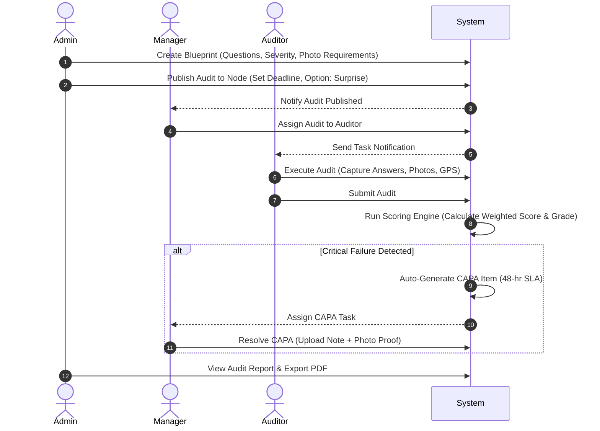

# Audiment – Master Product Documentation

> **Version:** 2.0.0  
> **Status:** Canonical Single Source of Truth  
> **Target Audience:** Product Owners, Engineers, Operations Leads, and Auditors  

---

## 1. Product Overview & Vision

### 1.1 Core Mission
**"You can't be everywhere."**

Audiment is an enterprise-grade, high-trust compliance and audit management platform engineered specifically for multi-location businesses (QSR chains, franchise networks, retail outlets, hospitality, and healthcare). 

Multi-outlet founders and operations heads cannot physically inspect every branch daily. Traditional audit workflows suffer from **pencil-whipping**—field staff completing checklists without visiting branches, uploading old photos via WhatsApp, or falsifying compliance. Audiment replaces unreliable manual checks with a trusted digital system that guarantees ground-truth operational accountability.

### 1.2 Tagline & Positioning
* **Tagline:** Audit smarter. Manage better.
* **Category:** Audit Management System for Multi-Location Businesses.
* **Tone:** Operational, practical, founder-native, punchy, and outcome-driven. Avoid abstract SaaS buzzwords.

---

## 2. Core Differentiators

| Feature | Description | Operational Impact |
| :--- | :--- | :--- |
| **Flash Verification (Flashmob)** | Unannounced, video-based presence audit combining a 20-second environmental sweep, circular selfie viewfinder, and immutable GPS locking. | Eliminates remote/fake audits completely. |
| **Mandatory Photo Evidence** | Per-question photo requirement toggle (`requiresPhoto`). Auditors cannot submit an audit without live photo evidence on flagged questions. | Prevents pencil-whipping and photo reuse. |
| **Automated CAPA Workflow** | Failing any `critical` severity question automatically generates a Corrective Action item assigned to the branch manager with a 48-hour SLA. | Turns audit failures into managed, trackable tasks. |
| **Surprise Audits** | Admin-scheduled audits hidden from branch managers until published, requiring same-day completion. | Prevents locations from "prepping" only when expecting inspectors. |
| **Mathematical Trend Detection** | Automated alert triggered when any location logs 3 consecutive failing or low-scoring audits. | Escalates systemic branch failure before regulatory or brand damage occurs. |

---

## 3. Technology Stack & Architecture

```
+-----------------------------------------------------------------------+
|                           NEXT.JS 16 APP ROUTER                       |
|  +-----------------------------------------------------------------+  |
|  |                       TypeScript + React 19                     |  |
|  +-----------------------------------------------------------------+  |
|  |           Tailwind CSS 4 + Shadcn UI + Framer Motion            |  |
|  +-----------------------------------------------------------------+  |
+-----------------------------------+-----------------------------------+
                                    |
            +-----------------------+-----------------------+
            |                                               |
+-----------v-----------+                       +-----------v-----------+
|   FIREBASE BACKEND    |                       |   MEDIA & REPORTING   |
| - Firestore Database  |                       | - Cloudinary (Photos) |
| - Firebase Auth       |                       | - HLS Video Stream    |
| - Security Rules      |                       | - jsPDF + html2canvas |
+-----------------------+                       +-----------------------+
```

* **Framework:** Next.js (App Router) with React 19 & TypeScript.
* **Styling & UI:** Tailwind CSS 4, Shadcn UI components, Framer Motion, and tw-animate.
* **Database:** Firebase Firestore (Real-time NoSQL document database).
* **Authentication:** Firebase Auth (Email/Password with RBAC claims).
* **Media Storage:** Cloudinary (Multipart image uploads, WebM/MP4 video storage, and HLS video streaming).
* **Data Visualization:** Recharts (Interactive compliance & trend charts).
* **PDF Export:** Custom jsPDF + html2canvas client-side engine with CSS stripping.
* **Hosting & Automation:** Vercel with Vercel Cron jobs (`GET /api/cron/check-missed-audits`).

---

## 4. User Roles & Access Control (RBAC)

The application enforces a multi-tenant model isolated by `organizationId`. Users can never access data outside their organization.

```
                  +-------------------------+
                  |       ADMIN (OWNER)     |
                  | Multi-Branch Org Scope  |
                  +------------+------------+
                               |
                               v
                  +-------------------------+
                  |         MANAGER         |
                  | Assigned Location Scope |
                  +------------+------------+
                               |
                               v
                  +-------------------------+
                  |         AUDITOR         |
                  | Assigned Audit Scope    |
                  +-------------------------+
```

### 4.1 Admin (Owner / VP of Operations)
* **Scope:** Full organization-wide control.
* **Key Capabilities:**
  * Build and edit master audit templates (Blueprints).
  * Manage locations (Nodes) and assign managers.
  * User Lifecycle: Add users, deactivate accounts, and trigger password reset emails.
  * Schedule & publish regular or surprise audits to locations with explicit deadlines.
  * View organization compliance health, cross-branch comparison matrices, and trend reports.
  * Review Flash Verification (Flashmob) video and selfie submissions.
  * Export comprehensive audit reports to high-fidelity PDF documents.

### 4.2 Manager (Branch / Regional Operations Manager)
* **Scope:** Location-specific operational control.
* **Key Capabilities:**
  * Receive published audits for assigned locations and assign them to specific field auditors.
  * Monitor active auditor status and upcoming audit deadlines via an interactive Calendar.
  * Manage the Corrective Action (CAPA) queue for assigned locations.
  * Resolve CAPA issues by submitting mandatory resolution notes and photographic evidence.
  * Track branch score trends over time.

### 4.3 Auditor (Field Inspector)
* **Scope:** Individual audit task execution.
* **Key Capabilities:**
  * Mobile-optimized interface for conducting step-by-step inspections.
  * Mandatory photo capture, inline previews, and text note attachments.
  * Progress auto-saving with ability to exit and resume mid-session.
  * Accidental exit guardrails (Abort Protection modal).
  * Geo-location capture locked upon audit submission.
  * Perform stealth Flashmob verification (if granted `flashmobAccess`).

---

## 5. Complete Feature Inventory by Module

### 5.1 Admin Dashboard (`/dashboard/admin`)
1. **Compliance Health Widget:** Real-time average compliance percentage across all organizational branches.
2. **Regional Performance Matrix:** Interactive bar and line charts comparing location performance.
3. **Active Audit Monitor:** Live status tracking (`published`, `assigned`, `in_progress`, `completed`, `missed`).
4. **Blueprint Builder:**
   * Full CRUD UI for template creation.
   * Question types: `yes_no` (Yes/No) and `rating_10` (1–10 scale).
   * Severity assignment: `low` (weight 1), `medium` (weight 2), `critical` (weight 5).
   * Toggle `requiresPhoto` per question.
   * Drag-and-drop reordering.
   * **FSSAI Compliance Preset:** 1-click loader that auto-populates standard food safety and hygiene audit blueprints.
5. **Node Manager:** Create and configure outlets with physical address, GPS coordinates (lat/lng), and manager assignments.
6. **Member Directory & Self-Service:**
   * Manage user accounts across Admin, Manager, and Auditor roles.
   * Admin-initiated password reset emails directly from user rows.
   * Instant active/deactivated state toggling.
7. **Surprise & Scheduled Audit Publisher:**
   * Select template, target location, and deadline.
   * Toggle `isSurprise` to hide scheduled audit from branch manager calendars.
   * Support for recurring schedule rules.
8. **Flashmob Review Studio:** Video playback player with HLS streaming, face-match selfie viewer, and GPS location map.

### 5.2 Manager Dashboard (`/dashboard/manager`)
1. **Operational Overview:** Metrics on active auditors, pending audits, and open CAPA tasks.
2. **Auditor Assignment Portal:** Delegate published audits to active auditors.
3. **Corrective Action (CAPA) Queue:**
   * SLA countdown timers (48-hour deadline per item).
   * Resolution modal requiring notes and photo proof upload.
4. **Location Performance Trends:** Historical line graphs showing score evolution.
5. **Manager Calendar:** Visual schedule of upcoming non-surprise audits and deadlines.

### 5.3 Auditor Interface (`/dashboard/auditor`)
1. **Assigned Tasks List:** Filterable view of assigned audits ordered by urgency.
2. **Step-by-Step Inspection Execution:**
   * Progress bar indicator.
   * Accessible toggle buttons for `yes_no` questions.
   * Rating selector (1–10) for numeric criteria.
   * Camera integration with multi-photo thumbnail preview and carousel.
   * Real-time validation enforcing photo upload when `requiresPhoto` is true.
   * **Mid-Audit State Persistence:** Automatic local/remote draft saving allowing seamless session resumption.
   * **Abort Protection:** Confirmation dialog preventing accidental navigation data loss.
3. **Flash Verification (Flashmob) Studio:**
   * 20-second live camera recording with animated REC indicator and timer countdown.
   * Video preview before submission.
   * Circular "Face Guide" overlay for selfie capture.
   * Automatic GPS coordinate locking.

---

## 6. Standard Audit Lifecycle & Workflows

### 6.1 End-to-End Audit Workflow



---

## 7. Mathematical Scoring & Grading Engine

> Centralized Implementation: `src/lib/scoring.ts`

### 7.1 Normalization
Each question score $N_i \in [0, 1]$ is calculated based on its type:

$$\text{Yes/No Question:} \quad N_i = \begin{cases} 1.0 & \text{if Answer = "Yes"} \\ 0.0 & \text{if Answer = "No"} \end{cases}$$

$$\text{Rating 1-10 Question:} \quad N_i = \frac{\text{Rating}}{10}$$

### 7.2 Severity Weighting
Fixed severity weights $W_i$ applied across all question types:

$$\text{Low} = 1, \quad \text{Medium} = 2, \quad \text{Critical} = 5$$

### 7.3 Final Weighted Percentage Score

$$\text{Final Percentage Score} = \left( \frac{\sum_{i=1}^{n} (N_i \times W_i)}{\sum_{i=1}^{n} W_i} \right) \times 100$$

### 7.4 Critical Failure Logic
Independent of the overall percentage score, a question is flagged as a **Critical Failure** ($C_i = \text{true}$) if:

$$C_i = \begin{cases} \text{true} & \text{if Severity = Critical AND Yes/No = "No"} \\ \text{true} & \text{if Severity = Critical AND Rating } < 6 \\ \text{false} & \text{otherwise} \end{cases}$$

### 7.5 Grade Determination Matrix

| Final Score | Critical Failure Present? | Derived Grade |
| :--- | :--- | :--- |
| Any Score | **YES ($C_i = \text{true}$)** | `critical_fail` |
| 90% – 100% | NO | `excellent` |
| 75% – 89% | NO | `good` |
| 60% – 74% | NO | `needs_improvement` |
| 0% – 59% | NO | `fail` |

> **Crucial Rule:** A `critical_fail` grade overrides any high percentage score (e.g., an audit scoring 92% with 1 critical fail receives a `critical_fail` grade).

---

## 8. Database Schema Reference (Firebase Firestore)

### `users` (Collection)
```typescript
interface UserDocument {
  uid: string;                 // Firebase Auth UID
  name: string;
  email: string;
  role: 'admin' | 'manager' | 'auditor';
  organizationId: string;
  assignedLocations?: string[];// Location IDs (for managers)
  managerId?: string;          // Supervisor ID (for auditors)
  flashmobAccess?: boolean;    // Flashmob permission flag
  isActive: boolean;
  createdAt: Timestamp;
}
```

### `organizations` (Collection)
```typescript
interface OrganizationDocument {
  id: string;
  name: string;
  ownerName: string;
  email: string;
  createdAt: Timestamp;
}
```

### `locations` (Collection)
```typescript
interface LocationDocument {
  id: string;
  organizationId: string;
  name: string;
  address: string;
  city: string;
  latitude: number;
  longitude: number;
  assignedManagerIds: string[];
  isActive: boolean;
  createdAt: Timestamp;
}
```

### `auditTemplates` (Collection)
```typescript
interface AuditTemplateDocument {
  id: string;
  organizationId: string;
  title: string;
  category: 'hygiene' | 'safety' | 'inventory' | 'custom';
  description: string;
  isActive: boolean;
  createdBy: string;
  createdAt: Timestamp;
  // Subcollection: questions/{questionId}
}

interface QuestionDocument {
  id: string;
  questionText: string;
  questionType: 'yes_no' | 'rating_10';
  maxScore: number;            // 1 for yes_no, 10 for rating
  severity: 'low' | 'medium' | 'critical';
  requiresPhoto: boolean;
  order: number;
}
```

### `audits` (Collection)
```typescript
interface AuditDocument {
  id: string;
  organizationId: string;
  templateId: string;
  templateTitle: string;
  locationId: string;
  locationName: string;
  publishedBy: string;
  assignedManagerId: string;
  assignedAuditorId?: string;
  status: 'published' | 'assigned' | 'in_progress' | 'completed' | 'missed';
  isSurprise: boolean;
  deadline: Timestamp;
  scheduledDate: Timestamp;
  completedAt?: Timestamp;
  totalScore?: number;
  maxPossibleScore?: number;
  scorePercentage?: number;
  grade?: 'excellent' | 'good' | 'needs_improvement' | 'fail' | 'critical_fail';
  hasCriticalFailure?: boolean;
  criticalFailureCount?: number;
  scoringVersion?: string;
  createdAt: Timestamp;
}
```

### `auditResponses` (Collection)
```typescript
interface AuditResponseDocument {
  id: string;
  auditId: string;
  questionId: string;
  questionText: string;
  questionType: 'yes_no' | 'rating_10';
  answer: 'Yes' | 'No' | number;
  score: number;
  severity: 'low' | 'medium' | 'critical';
  auditorId: string;
  locationId: string;
  latitude: number;
  longitude: number;
  photoUrls: string[];
  notes?: string;
  submittedAt: Timestamp;
}
```

### `correctiveActions` (Collection)
```typescript
interface CorrectiveActionDocument {
  id: string;
  auditId: string;
  questionId: string;
  questionText: string;
  locationId: string;
  locationName: string;
  organizationId: string;
  assignedManagerId: string;
  description: string;
  severity: 'critical';
  status: 'open' | 'in_progress' | 'resolved';
  deadline: Timestamp;           // 48 hours from creation
  resolvedAt?: Timestamp;
  resolutionNote?: string;
  resolutionPhotoUrls?: string[];
  lastDeadlineReminderSentAt?: Timestamp;
  createdAt: Timestamp;
}
```

### `flashmobAudits` (Collection)
```typescript
interface FlashmobAuditDocument {
  id: string;
  organizationId: string;
  locationId: string;
  locationName: string;
  auditorId: string;
  auditorName: string;
  videoUrl: string;
  selfieUrl: string;
  latitude: number;
  longitude: number;
  visibleTo: string[];           // Restricted viewer user IDs
  submittedAt: Timestamp;
}
```

### `notifications` (Collection)
```typescript
interface NotificationDocument {
  id: string;
  organizationId: string;
  recipientId: string;
  recipientRole: 'admin' | 'manager' | 'auditor';
  type: 'audit_assigned' | 'audit_missed' | 'low_score' | 'corrective_action' | 'trend_alert' | 'surprise_audit';
  title: string;
  message: string;
  relatedId?: string;            // auditId or correctiveActionId
  isRead: boolean;
  createdAt: Timestamp;
}
```

---

## 9. Background Jobs & Cron Escalations

### Missed Audits & CAPA Deadline Cron
* **Endpoint:** `GET /api/cron/check-missed-audits`
* **Schedule:** Hourly (`0 * * * *`) via Vercel Cron.
* **Authentication:** Bearer token headers (`Authorization: Bearer <CRON_SECRET>`).

#### Execution Logic:
1. **Missed Audit Transition:**
   * Scans `audits` where `status` is in `['published', 'assigned', 'in_progress']` and `deadline < now()`.
   * Updates `status` to `'missed'`.
   * Dispatches notifications to the assigned Manager and Organization Admins.
2. **CAPA Escalation Reminders:**
   * Scans `correctiveActions` where `status` is in `['open', 'in_progress']` and `deadline` falls within the next 6 hours.
   * Dispatches urgent reminder notification to the assigned Manager.
   * Updates `lastDeadlineReminderSentAt` timestamp to prevent duplicate notifications.

---

## 10. Copywriting, Tone & Brand Guidelines

### 10.1 Narrative Anchor
> **"You can't be everywhere."**

Every piece of copy must directly resolve the operational anxiety of scaling multi-outlet locations.

### 10.2 Banned Jargon List
Never use the following abstract SaaS jargon in Audiment UI or documentation:

| Banned Term | Approved Operational Alternative |
| :--- | :--- |
| *Operational clarity / visibility* | "Know what's actually happening at every branch." |
| *Streamline compliance* | "Run audits without faking or delay." |
| *Systemic bottlenecks* | "See which outlets keep failing—and why." |
| *Seamless / Empower / Leverage* | Use plain, direct verbs (build, inspect, track, resolve). |
| *Enterprise-grade control system* | "Audit management built for multi-outlet teams." |

---

## 11. Security & Data Integrity

1. **Multi-Tenant Isolation:** Enforced at the database driver level via Firestore Security Rules querying `request.auth.token.organizationId == resource.data.organizationId`.
2. **Immutable Submission Logs:** GPS coordinates (`latitude`, `longitude`) and timestamps (`submittedAt`) are captured client/server side during submission and cannot be overwritten.
3. **Scoring Versioning:** Every completed audit records `scoringVersion` (e.g., `v2-weighted-critical-threshold-6`) to guarantee historical data consistency across scoring model upgrades.
